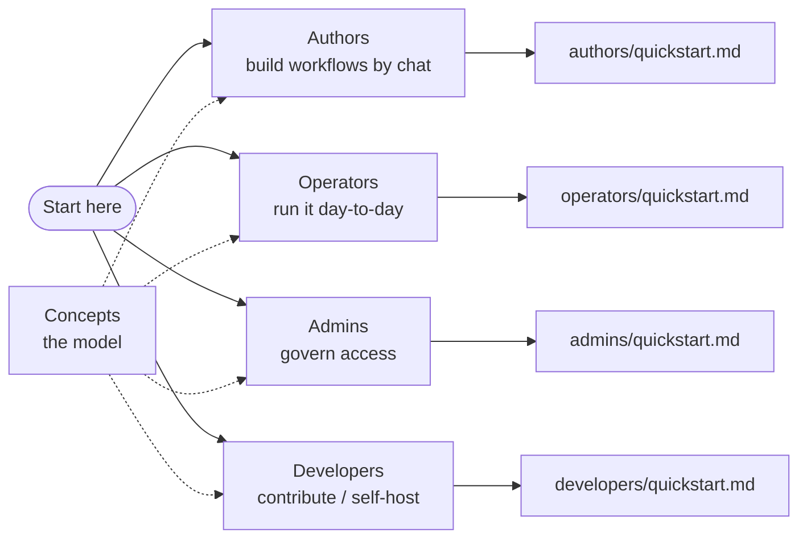
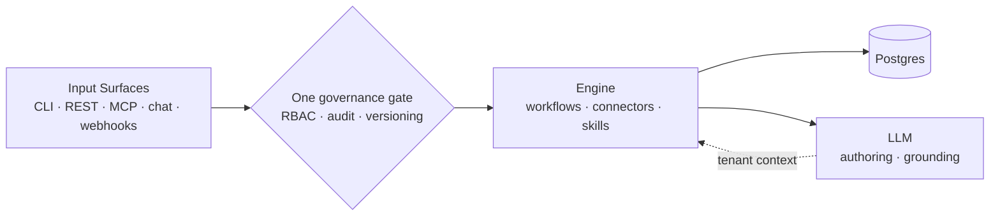

# sk Documentation

**Turn plain-language intent into governed, audited, versioned automation.** sk
collapses the time from "I need this integration" to a running workflow — and
every execution is permission-checked, recorded, and replayable, so the speed
never costs you control or compliance.

These docs are the single source of truth, organised by **audience**. Pick your
lane.

## Find your lane

## Section overviews

Each audience folder has a landing page that indexes its docs:

- [Concepts](concepts/README.md) — the domain model: surfaces, the governance gate, connectors, workflows, knowledge, and audit.
- [Operators](operators/README.md) — run sk day-to-day: credentials, scheduling, observability, self-healing, notifications.
- [Authors](authors/README.md) — build workflows by conversation: the REPL, the approval loop, recipes, skills, knowledge.
- [Developers](developers/README.md) — contribute and self-host: repo setup, input surfaces, the tool palette, the evidence process.
- [Admins](admins/README.md) — govern access: configuration, RBAC, credentials, and production hardening.

## The model in one picture

New here? Start with the [Architecture overview](concepts/overview.md).

## Pipe these docs into an LLM

Point any model at [llms.txt](llms.txt) for a flat, link-followed index of this
documentation set. To feed a single page in verbatim, append `?raw=1` (or open
the **Raw** view) on any `.md` file in this directory — that gives the model the
plain Markdown with no rendering chrome.

---

## Concepts — the model

| Doc | What it covers |
|---|---|
| [overview.md](concepts/overview.md) | The architecture at a glance: surfaces → one governance gate → engine → Postgres/LLM, and the tenant-context loop. |
| [glossary.md](concepts/glossary.md) | The authoritative glossary: every domain term defined exactly once — Tenant, Workflow, Skill, Connector, Execution, Audit Log, and more. |
| [connectors.md](concepts/connectors.md) | The integration fabric: Connectors, Drivers, Credentials, the vault, and the OAuth2 lifecycle. |
| [workflows.md](concepts/workflows.md) | The governed, version-bound execution engine: Workflow DAGs, Step types, Execution records, Schedules, and drift-assisted repair. |
| [knowledge-and-skills.md](concepts/knowledge-and-skills.md) | How organization-specific context compounds: Skills, Knowledge Sources, context assembly, Discovery. |
| [governance-and-audit.md](concepts/governance-and-audit.md) | Multi-tenancy, the immutable audit trail, the compliance posture, and conversational secret hygiene. |

---

## Authors — build workflows by conversation

| Doc | For |
|---|---|
| [quickstart.md](authors/quickstart.md) | You use sk through the CLI, chat, or an MCP client. Authenticated, first conversation open. 5 minutes. |
| [repl-tour.md](authors/repl-tour.md) | Author connectors and workflows by conversation in the `sk` REPL — the approve-to-commit loop, slash commands, headless `-p`. |
| [authoring-workflows.md](authors/authoring-workflows.md) | The AI authoring loop, the human approval gate, probe/preview, and stage-aware prompting. |
| [recipes.md](authors/recipes.md) | Recipe authoring deep-dive: schema, intent matching, and worked walkthroughs. |
| [custom-skills.md](authors/custom-skills.md) | Author, scope, and promote Skills that encode your conventions. |
| [knowledge-sources.md](authors/knowledge-sources.md) | Upload, tag, and refresh the documents the AI grounds its proposals in. |

---

## Operators — run it day-to-day

| Doc | For |
|---|---|
| [quickstart.md](operators/quickstart.md) | You run sk for your team. Engine up, admin key minted, first connector registered. 10 minutes. |
| [connectors-and-credentials.md](operators/connectors-and-credentials.md) | Attach and rotate credentials, test connectivity, invoke endpoints ad-hoc. |
| [scheduling-and-hooks.md](operators/scheduling-and-hooks.md) | Trigger workflows by schedule or webhook; wire Before-Request Hooks. |
| [observability.md](operators/observability.md) | Metrics, structured logs, the telemetry surface, runtime stats, and resource limits. |
| [self-healing.md](operators/self-healing.md) | How connector drift becomes an operator-reviewed Patch Candidate. |
| [notifications.md](operators/notifications.md) | Notification rules, channels (Slack / Teams / Google Chat / webhook), rate limits, circuit breaker. |

---

## Admins — govern access

| Doc | For |
|---|---|
| [quickstart.md](admins/quickstart.md) | Wire configuration, roles, and keys for a production tenant. 10 minutes. |
| [configuration.md](admins/configuration.md) | The `sk settings` model: the config file, resolution order, bootstrap env. |
| [settings-reference.md](admins/settings-reference.md) | Generated per-leaf reference: path, type, default, scope, sensitive, requiresRestart. |
| [rbac-and-roles.md](admins/rbac-and-roles.md) | Identity (OIDC/SSO, API keys, portal tokens), RBAC/ABAC, Before-Request Hooks. |
| [credentials-and-keys.md](admins/credentials-and-keys.md) | The credential vault, master-key rotation, and release signing. |
| [production-hardening.md](admins/production-hardening.md) | The readiness checklist and backup/recovery before you go live. |

---

## Developers — contribute & self-host

| Doc | For |
|---|---|
| [quickstart.md](developers/quickstart.md) | You contribute to sk. Repo cloned, tests green, engine in watch mode. 10 minutes. |
| [self-host.md](developers/self-host.md) | Zero-to-running from the Docker image, plus production topology, installation, and the operator config reference. |
| [input-surfaces.md](developers/input-surfaces.md) | Every way users and systems reach sk: CLI, REST, MCP, chat, webhooks, schedules. |
| [tool-palette.md](developers/tool-palette.md) | The unified tool palette and dispatcher: registry, naming, policy gates. |
| [evidence-process.md](developers/evidence-process.md) | The evidence-first development loop and two-tier test discipline. |

The deep-dive [conversational-flow-replay](internal/conversational-flow-replay.md)
and other working notes live under `internal/`.

---

## Who Should Read What

**Authors** — start at [authors/quickstart.md](authors/quickstart.md), then [authoring-workflows.md](authors/authoring-workflows.md) for what Conversations can do.

**Operators** — start with the [operator quickstart](operators/quickstart.md), then [observability.md](operators/observability.md) for monitoring and [self-healing.md](operators/self-healing.md) for drift.

**Admins** — start with the [admin quickstart](admins/quickstart.md), then [rbac-and-roles.md](admins/rbac-and-roles.md) and [credentials-and-keys.md](admins/credentials-and-keys.md).

**Developers** — start with [AGENTS.md](../AGENTS.md) for the subsystem map, then [developers/self-host.md](developers/self-host.md) and the [developer quickstart](developers/quickstart.md).

**Architects** — start with [concepts/overview.md](concepts/overview.md) and [glossary.md](concepts/glossary.md), then [governance-and-audit.md](concepts/governance-and-audit.md) for the security architecture.
