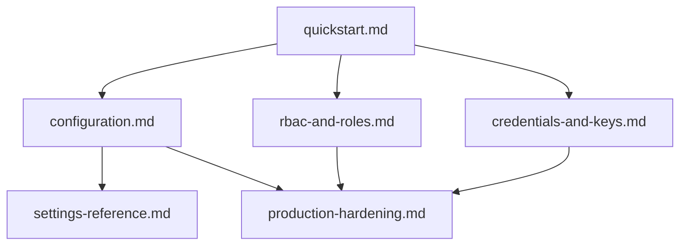

# Admins — govern access

Hand a team the keys without handing over the building. This section gets you to the point where people can move on their own — sign in with your existing identity provider, use credentials they never see, run what their role allows — and every one of those runs is scoped, checked, and written down.

Start at **quickstart.md** to wire configuration, roles, and keys in one pass. From there, **configuration.md** (with the generated **settings-reference.md**) governs the engine, **rbac-and-roles.md** governs who can do what, **credentials-and-keys.md** governs secrets, and **production-hardening.md** is the final checklist before you go live.

| Page | What it covers |
|---|---|
| [quickstart.md](quickstart.md) | Wire configuration, roles, and keys for a production tenant so every run is permission-checked and audited. |
| [configuration.md](configuration.md) | The `sk settings` model: one validated config or the engine refuses to boot — file, resolution order, bootstrap env. |
| [settings-reference.md](settings-reference.md) | Generated per-leaf reference: path, type, default, scope, sensitive, requiresRestart. |
| [rbac-and-roles.md](rbac-and-roles.md) | Identity (OIDC/SSO, API keys, portal tokens), RBAC/ABAC roles, and Before-Request Hooks. |
| [credentials-and-keys.md](credentials-and-keys.md) | The credential vault, master-key rotation, and release signing — secrets encrypted at rest and rotated on demand. |
| [production-hardening.md](production-hardening.md) | The readiness checklist plus backup and recovery to ship production-ready, audit-ready, and recoverable. |
