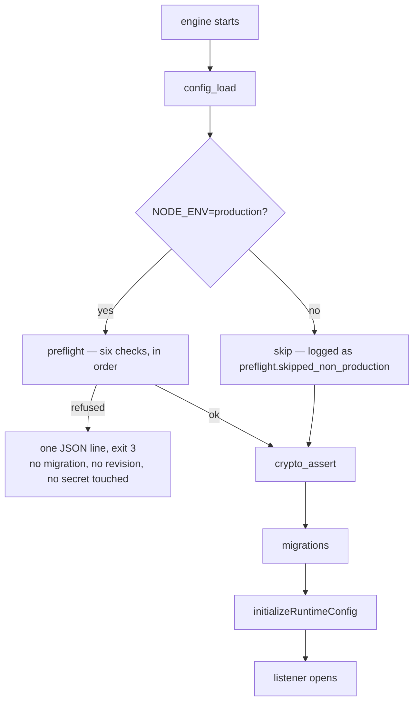

# Bootstrap Preflight

**Before a production engine migrates anything, it decides whether this release can run on the bootstrap it was given — and if it cannot, it exits 3 with one line and has changed nothing.** A rollback to the previous release is therefore always possible.

The contract itself is [BOOTSTRAP-PREFLIGHT.md](../BOOTSTRAP-PREFLIGHT.md), a text carried byte-identically by every product of the family. This page is SubKit's half: which code answers each numbered check, what each refusal means on this product, and the two things the contract asks about that SubKit answers differently from a sibling.

---

## What runs, and when



The phase is `preflight` in the boot log, wired in `apps/engine/src/index.ts` immediately after `config_load` and before `crypto_assert`. It is the last point at which the process has touched nothing.

A refusal prints exactly one line on stdout and nothing else:

```json
{"event":"preflight.refused","code":"object_store_missing","detail":"…"}
```

Run it on its own at any time:

```sh
engine --preflight        # 0 ok, 3 refused, 1 error
```

Outside production the automatic run is a no-op — local development and the test harness run without an object store and against an ephemeral database, and refusing them would only teach operators to set an escape hatch. `engine --preflight` still runs the full set wherever you invoke it, which is what makes it useful as a pre-deploy probe against a production bootstrap from a maintenance shell.

---

## The six checks, mapped

| # | Contract check | SubKit implementation | Refusal codes |
|---|---|---|---|
| 1 | `MASTER_KEY` present and exactly 64 hex | read straight from the process environment (`MASTER_KEY` is SubKit's only `BOOTSTRAP_ONLY_ENV_KEYS` entry, so this check needs no loaded config) | `master_key_missing`, `master_key_malformed` |
| 2 | `DATABASE_URL` reaches PostgreSQL; the schema is one this release can start from or migrate forward from | `SELECT 1`, then a read-only query over `subkit.__drizzle_migrations` compared against the migrations embedded in this binary | `database_url_missing`, `database_unreachable`, `schema_ahead` |
| 3 | The object store answers: endpoint is a URL, bucket exists, a probe object round-trips | the active revision's `storage.object_store` block **with its `secret://` credentials decrypted**, else the `OBJECT_STORAGE_*` revision-1 seed; `headBucket()` then one `.preflight/probe.<pid>` object written, read back and deleted | `object_store_missing`, `object_store_unreachable`, `secret_unreadable` |
| 4 | The current settings revision parses after retired keys are dropped | the active `runtime_config_revisions.document` against `ConfigSchema` | `settings_unparsable` |
| 5 | Every secret version the settings bind to decrypts under the running `MASTER_KEY` | every `secret://name/version` in the active document is read from `runtime_secret_versions` and decrypted with AAD `runtime-secret:<name>:<version>` | `secret_unreadable` |
| 6 | The identity provider is well-formed: https issuer, PKCE, no client secret | the parsed `auth.providers` OIDC entries | `identity_malformed` |

The checks stop at the first refusal. Once the release cannot run on this bootstrap, a later probe's failure is noise — and a probe that ran anyway would have touched something.

### Check 2 — why it does not use the drift detector

`detectDrift()` in `apps/engine/src/db/migrate.ts` answers the same question, but calls `ensureMigrationsTable` first, which creates the schema, installs `pgcrypto` and creates the journal table. That is a change, and the preflight's whole promise is that a refusal changed nothing. The preflight reads the journal directly and treats a missing table as a virgin database — a state this release migrates forward from, not one it refuses.

`schema_ahead` means the database carries tagged migrations this binary does not. That is a rollback that went one release too far, and starting would corrupt the newer schema.

### Check 3 — SubKit stores objects, always

Files, attachments and offloaded step results live in S3-compatible object storage. A production SubKit with no object store is not a degraded SubKit; it is one that will fail on the first upload, after it has migrated and written revision 1. The check therefore refuses before the migration rather than after.

`object_store_missing` means neither the active revision nor the `OBJECT_STORAGE_*` seed names a complete binding (endpoint, region, bucket, access key id, secret access key). `object_store_unreachable` means one was named and did not answer — a wrong endpoint, a bucket that does not exist, or credentials that cannot write.

**Which credentials it probes.** All three credential leaves of `storage.object_store` are `secret: true` in the config schema, so a stored revision holds `secret://name/version` there, never a usable value. The check decrypts them before probing. This matters twice over: probing with the literal reference string as an access key would fail for the wrong reason, and treating a reference as "not a complete binding" would fall through to `OBJECT_STORAGE_*` — which a stateless deployment that moved its settings into PostgreSQL no longer sets, refusing a perfectly healthy engine, or, worse, quietly probing stale environment credentials the engine does not use and passing. When one of those references does not decrypt, check 3 refuses with `secret_unreadable` rather than an object-store code: the cause an operator has to act on is the key, not the bucket.

### Check 4 — retired keys are reported, never refused

A key an older release persisted and this one no longer manages is dropped and logged:

```
settings.retired_keys_dropped  llm_provider, s3
```

It is never a reason to refuse. A release that refused to boot on its own history would make every rollback a data-repair job. The report names the retired *section*, not every key beneath it — naming `s3` is the fact an operator acts on; listing its three children would bury it.

`settings_unparsable` is the other case: a key the schema *does* manage carrying a value it rejects. That is a revision this release genuinely cannot run on.

### Check 5 — the deadlock this check creates, and the way out

A version written under an earlier `MASTER_KEY` refuses the boot with `secret_unreadable`. That is the correct refusal, and it is also a deadlock: the HTTP settings surface that would fix it needs a running engine. The operator commands below are the way back in — see [Recovering an unreadable version](#recovering-an-unreadable-version).

### Check 6 — SubKit's OIDC client type is structural

The contract asks the product to say `identity.client_type public` in a log line. SubKit emits it, and the property behind it is not a flag anyone can set: the `oidc` member of `auth.providers` in `apps/engine/src/config/schema.ts` is `.strict()` and **has no `client_secret` field at all**, so a parsed provider cannot carry one. `issuer_url` is refined to https outside localhost by the same schema. The preflight re-states both against the parsed value, so a schema that stopped enforcing them surfaces here rather than at the first login.

---

## T2 does not apply to SubKit — and here is the check

The contract's "never does" section names a specific family failure: *two releases derived the API-key pepper from `MASTER_KEY`, so introducing the key invalidated every API key.* Tranche A therefore asks each product to move that pepper into a stored secret.

**SubKit has no pepper to move.** An API key is stored as a plain, unsalted, unpeppered SHA-256 of the token — `sha256Hex` in `apps/engine/src/identity/api-key.ts`, one line, no key material — and the same helper backs portal tokens, invites, OAuth tokens and browser sessions. A repository-wide search for `pepper`, `hkdf` or `deriveKey` returns nothing. `MASTER_KEY` encrypts credential ciphertexts and runtime secret versions; it has never touched a token hash.

This is asserted, not merely stated: `preflight-checks.test.ts` computes the SHA-256 of a fixed token itself and requires `hashKey()` to equal it, and then changes `MASTER_KEY` and requires the hash not to move. Introducing a pepper of any kind breaks both tests, which is exactly the loud failure the family incident deserved.

What this does mean, for the record: a database-only read — a dump, a replica, a backup — yields token hashes that are verifiable offline without `MASTER_KEY`, in a way the encrypted credential columns are not. The tokens themselves carry ~192 bits of entropy (`randomBytes(24)`), so they are not guessable; the exposure is that a stolen dump is not additionally gated by the environment secret.

---

## Operator commands

All four run on the host, where the caller already holds `MASTER_KEY`, `DATABASE_URL` and a shell — a higher bar than any API key. None of them runs a migration, writes revision 1 or opens a listener.

```sh
engine --preflight
engine --vault-check <name>
engine --vault-set <name> --value-file <path> [--bind <path>,…] [--purpose "…"] [--if-unreadable]
engine --rewrap-master-key --from-file <path-to-previous-key>
```

Exit codes are the same for all four: **0** done or nothing to do, **1** failure, **2** usage error (message plus usage block on stderr), **3** refused — the preflight could not pass, or the checked version does not decrypt.

The secret value and the previous key are read **from a file only**. `--value`, `--secret-value`, `--previous-key` and `--master-key` are refused by name, because argv is world-readable and lands in shell history. Exactly one trailing newline is stripped, so `printf '%s\n' "$V" > file` and a raw write agree. No output line ever contains the value.

### `--vault-check`

One line, one fact:

```
<name>: readable (version 4)          exit 0
<name>: unreadable (version 3)        exit 3
<name>: unreadable (no version)       exit 3   every version is revoked
<name>: absent (no such secret)       exit 3
<name>: check failed — <message>      exit 1   the probe itself broke
```

### `--vault-set`

Writes the next **immutable** version. SubKit's versions are addressed by a stored revision as literal `secret://name/version` strings, so a new value is a new version, never an overwrite:

```
<name>: created at version 1
<name>: rotated to version 8
```

`--purpose` is recorded in the audit row (`secret.version_created`), not beside the ciphertext — `runtime_secret_versions` has no description column and this release adds no migration. It is where an operator asking "why does this version exist" will look anyway.

`--bind` takes **dotted settings paths**, not binding names, because in SubKit a binding *is* a settings path. Each named path is re-pointed at the new reference by saving a new global revision **and activating it**:

```
llm.providers.anthropic.api_key: pinned to settings.llm.providers.anthropic.api_key version 3
```

The activation is the load-bearing half, and it is why `--bind` requires the engine to be stopped. A saved revision only moves `desired_revision`; the preflight and every boot read `active_revision`, so a re-pin that stopped at "saved" would print `pinned to …` and leave the engine refusing on exactly the version it was already refusing on. The normal activation path cannot help here — it either needs a live replica to prepare and acknowledge, or defers to the next boot — so this writes the pointer directly, under the same precondition that makes it safe and that `--rewrap-master-key` already uses: nothing is serving. With a live replica lease it refuses and says so, because a replica holding the old snapshot must be told to prepare, not overtaken. Minting the version itself (`--vault-set` without `--bind`) is safe at any time.

Without `--bind` the command says so explicitly — `bindings keep their pinned version; re-run with --bind <binding> to re-pin them` — because a pinned revision does not follow a new version on its own. A binding that could not be re-pinned exits 1 even though the new version exists: the deploy this was meant to unblock will fail again on the version the revision still points at. Tenant overlays are out of scope for this flag; re-pin those through the settings API, where the tenant is named by someone who knows which one they mean.

`--if-unreadable` makes the command safe to run on every deploy. When the secret exists and its current version still decrypts, nothing happens and the value file is **not even read**:

```
<name>: current version is readable; nothing changed (version 1)
```

A name that does not exist yet is always created, flag or not.

### `--rewrap-master-key`

Re-encrypts every row in `runtime_secret_versions` under the running `MASTER_KEY`, reading each with the previous key from the file. Ciphertexts are rewritten **in place**, preserving each row's AAD — minting new versions would orphan every reference the active revision holds.

Three properties worth knowing before you run it:

- **It refuses while the process is serving.** Any healthy `runtime_config_replicas` lease (the same 30s window the activation coordinator uses) refuses the run and names the instances. Stop every replica first. The key file is not read while a lease is healthy.
- **It is one transaction, and re-runnable.** A version that already decrypts under the running key is skipped, so an interrupted sweep can simply be re-run. A version that decrypts under *neither* key aborts the whole sweep and changes nothing — that names a third key nobody supplied, which is a fact to report, not to work around.
- **Revoked versions are included.** A revoked version is retained history; leaving it under the old key would make it unreadable forever.

```
rewrap: 42 version(s) across 9 secret(s) re-encrypted under the running MASTER_KEY
```

One audit row is written per sweep: `secret.master_key_rewrapped`, actor type `system`, carrying the counts and the 8-hex fingerprints of both keys — never key material.

**Scope:** this rewraps runtime secret versions. Credential-vault ciphertexts (`credentials.ciphertext`, `oauth2_refresh_ciphertext`) are a different table and are **not** covered; those still require re-issuing each credential. See [credentials-and-keys.md](credentials-and-keys.md#rotating-master_key).

---

## Recovering an unreadable version

The engine refuses to boot with `secret_unreadable`, naming the secret and the settings path that binds it.

1. Confirm from the host: `engine --vault-check settings.llm.providers.anthropic.api_key`
2. If you still have the previous key, that is a rewrap — stop every replica, put the old key in a file readable only by the engine user, and run `engine --rewrap-master-key --from-file /run/secrets/previous`. Re-run `--preflight` and start.
3. If the previous key is gone, the value has to be supplied again:

   ```sh
   printf '%s' "$NEW_VALUE" > /run/secrets/new
   chmod 600 /run/secrets/new
   engine --vault-set settings.llm.providers.anthropic.api_key \
     --value-file /run/secrets/new \
     --bind llm.providers.anthropic.api_key \
     --purpose "master key rotation, incident 4711" \
     --if-unreadable
   shred -u /run/secrets/new
   ```

   `--if-unreadable` makes this line idempotent: run it on every deploy and it does nothing until the day it is needed. The engine must be stopped for the `--bind` half, which activates the revision it saves; without that the new version would exist but nothing would point at it.
4. `engine --preflight` — expect exit 0 — then start the engine.

A known limitation, stated plainly: `--vault-check` asks about the secret's current version, not about what a revision points at. A revision pinned to an older, unreadable version is left alone by the check and stays broken. The preflight's check 5 is the one that catches that case, because it reads the bindings rather than the names.
