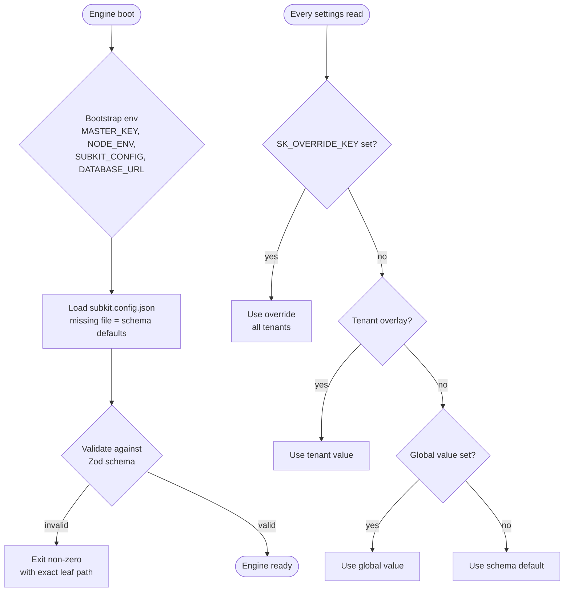

# Configuring the engine

**Outcome: one validated configuration, or the engine refuses to boot.**
There is no silent degraded mode. Every runtime setting lives in a single
JSON file, type-checked against a schema at startup — a misconfig fails fast
with the exact leaf path, so a broken deploy never reaches production traffic.

| You want | You run |
| --- | --- |
| Interactive form | `sk settings configure` |
| Scriptable access | `sk settings list / get / set` |
| Hand edit | `vim subkit.config.json`, then restart |

The per-leaf reference (type, default, scope, sensitivity, restart flag) is
auto-generated in
[`settings-reference.md`](./settings-reference.md). **This page covers the
model around it** — where the file lives, how a value resolves, what stays in
env, and how incident overrides work.

### How a value resolves



Precedence, highest to lowest: **`SK_OVERRIDE_<KEY>` env → tenant overlay →
global value → schema default.**

---

## Bootstrap env (the only env vars the engine reads at startup)

| Variable | Required | Purpose |
| --- | --- | --- |
| `MASTER_KEY` | yes | 64-char hex AES-256-GCM key. Used to encrypt connector credentials at rest. Generate once with `openssl rand -hex 32`. Must be injected from a secret manager — keep it out of the config file. |
| `NODE_ENV` | no | `development` (default in dev) / `test` / `production`. Controls the `requiresRestart` guard and other defaults. |
| `SUBKIT_CONFIG` | no | Override the config-file path. Defaults to `./subkit.config.json` in dev or `/etc/subkit/subkit.config.json` under `NODE_ENV=production`. |
| `DATABASE_URL` | fallback | Consulted only when `database.url` is absent from the config file. Once the operator runs `sk settings set database.url '"…"'` the file value wins; if both are set and they differ the engine emits a warn line at boot and the **config-file value wins**. |

Every other historical env var (`LLM_PROVIDER`, `ANTHROPIC_API_KEY`,
`OIDC_*`, `SLACK_*`, `LANGFUSE_*`, …) has moved to
`subkit.config.json`. Setting any of them at runtime emits a one-line
stderr warning at boot pointing at `sk settings configure`.

## The config file

`subkit.config.json` (or whatever `SUBKIT_CONFIG` points at). On a
fresh install the engine treats a missing file as "use schema
defaults" — the operator never has to hand-write the file.

- **Mode:** `0600`. Parent directory: `0700`. Both created
  automatically on first write.
- **Format:** JSON. Hand-edits are valid; the engine validates
  against the Zod schema at boot and exits non-zero with the
  precise leaf path when something is malformed.
- **Atomicity:** writes go through a same-directory temp file +
  `fsync(file)` + `fsync(parentDir)` + `rename`. A crashed write
  leaves the prior file intact.

### Sections

The schema groups leaves by section. Defaults live in the schema, so
the file only needs to carry overrides:

```jsonc
{
  "log":     { "level": "info", "format": "ndjson" },
  "server":  { "port": 3000, "public_base_url": "https://api.example.com" },
  "database":{ "url": "postgresql://..." },
  "llm":     { "provider": "anthropic",
               "api_key":  "…",                 // sensitive, masked everywhere
               "providers": { "anthropic": { "model": "claude-sonnet-4-6" } } },
  "auth":    { "oidc": { "issuer_url": "…" }, "session": { "secret": "auto-generated" } },
  "platform":      { "slack": { … }, "teams": { … }, "googlechat": { … } },
  "storage":       { "s3": { … }, "knowledge": { "backend": "local" } },
  "observability": { "langfuse": { "secret_key": "…" },
                     "otlp": { "endpoint": "…" },
                     "usage": { "enabled": false,
                                "hmac_secret": "…at least 32 chars…",
                                "retention_days": 90 } },
  "egress":        { "mode": "permissive", "provider_hosts_extra": [] },
  "mcp":     { "read_only": false },
  "errors":  { "ring_size": 100 },
  "spec":    { "allow_private_fetch": false },
  "queue":   { "concurrency": 8 },
  "tokens":  { "monthly_budget": 0 },

  "tenants": {
    "<tenant_id>": {
      // Only `scope: "tenant"` leaves are honored here. The schema
      // ships llm.* + queue.concurrency + tokens.monthly_budget as
      // tenant-overridable; everything else is global.
      "llm": { "api_key": "tenant-specific" }
    }
  }
}
```

`observability.usage` is the local, content-free product measurement surface. Set its
dedicated HMAC secret first, then enable it; changing either leaf is hot-applied. Raw events
stay in the engine Postgres for `retention_days` (31–365, default 90) and are exposed only as
tenant-scoped aggregates behind `stats:read`. This is separate from
`observability.analytics`, which optionally forwards a smaller HTTP event to an external
endpoint. Usage rows have no fields for prompts, messages, tool arguments/results, raw
paths/query strings, IP addresses, user agents, OAuth material, or plaintext dynamic IDs.

### Resolution order (every read)

`SK_OVERRIDE_<KEY>` env var → tenant overlay → global value → schema
default (see the boot/read flowchart above).

| Layer | Scope | Set by |
| --- | --- | --- |
| `SK_OVERRIDE_<KEY>` | All tenants (no per-tenant override env) | Incident-response env injection |
| Tenant overlay | One tenant, `scope: tenant` leaves only | `sk settings set … --tenant <id>` |
| Global value | All tenants | `sk settings set …` |
| Schema default | All tenants | Shipped in the schema |

## `sk settings configure` — interactive form

```bash
sk settings configure                      # open the form
sk settings configure --tab llm            # land on the llm section
sk settings configure --tenant <id>        # show only scope:tenant leaves
sk settings configure --non-interactive    # print JSON for piping / CI
```

The form is auto-detected as headless when stdin or stdout is not a
TTY, or when `--non-interactive` is passed; in that mode it prints
the `GET /v1/settings` response unchanged.

Keyboard model:

| Key | Action |
| --- | --- |
| `Tab` / `Shift-Tab` | Next / previous section |
| `↑` / `↓` | Move row cursor |
| `Enter` | Edit the selected leaf |
| `/` | Filter by path or description |
| `Esc` (in search) | Clear the query and exit search |
| `Esc` / `q` | Exit the form |
| `Ctrl-R` (in editor) | Reveal a masked secret |
| `Y` / `N` | Restart-required prompt: retry with `force=true` / cancel |

Every successful write emits a `settings.changed` audit row carrying
the actor's principal, the target tenant (if any), and a masked
diff. Raw secrets never appear in audit rows.

## Headless: `sk settings list / get / set`

```bash
sk settings list                                    # tree + diagnostics
sk settings get llm.api_key                          # one leaf
sk settings set llm.api_key '"sk-…"'                 # JSON value
sk settings set server.port 3001 --force             # bypass the
                                                     # requiresRestart guard
sk settings set llm.api_key '"…"' --tenant <id>      # tenant overlay
```

`set` accepts JSON for the value (`'"abc"'`, `42`, `true`, `null`).
`--force` is required in production for any leaf marked
`requiresRestart: true` — the engine writes the value but tells you
to restart for the change to take full effect.

`log.level` and `log.format` are explicitly **hot-reloaded** at the
moment of write — `requiresRestart: false`. The setting.applied log
line documenting the change is emitted *before* the live logger is
reconfigured, so an operator who flips `log.level=error` still sees
the entry that flipped the threshold.

## SK_OVERRIDE_<KEY> — incident escape hatch

To rotate an LLM key under pressure without going through the
config file:

```bash
SK_OVERRIDE_LLM_API_KEY=sk-new-key engine
```

- Active overrides surface in `/v1/diagnostics/setup` and as
  `settings_override_active{key}` on `/metrics`.
- The override value never appears in `GET /v1/settings`, audit
  rows, or any other operator-readable surface — only the leaf
  path is visible.
- The override applies to **all** tenants. There is no per-tenant
  override env var.
- A boot warn line lists active overrides so they can't accumulate
  silently across container restarts.

## `engine_settings` table

The `engine_settings` table is internal-only — only the bootstrap
probe reads/writes it for sentinel state. Two keys:

| key | shape | purpose |
| --- | --- | --- |
| `bootstrap.completed` | `boolean` | Sentinel flipped after the first-run setup wizard succeeds. Prevents `sk init` from re-arming on a populated engine. |
| `bootstrap.token` | `{ token_sha256, expires_at_ms }` | Hashed one-time token + 15-minute TTL printed in the boot banner. Consumed by `POST /v1/setup`; deleted on success. |

## Quality gates wired into `bun run verify`

- `check:settings-doc-drift` — regenerates
  `docs/admins/settings-reference.md` and fails if it differs.
- `check:config-example-drift` — regenerates
  `subkit.config.example.json` and fails if it differs.
- The route's wire shape is locked down by the
  `apps/engine/src/http/routes/__tests__/settings.integration.test.ts`
  testcontainers test (audit identity, three response envelopes,
  scope rules).
- The Ink form's bridge is locked down by the schema-walk test in
  `apps/sk/src/settings-ui/__tests__/schema-walk.test.ts` — a new
  Zod kind in the schema fails the test until a corresponding
  `FormFieldKind` lands.

## Operational guarantees

- **Fail-fast boot.** Missing or invalid required settings exit non-zero with
  a descriptive, leaf-pathed error. No silent degraded mode.
- **Secrets stay out of the file.** Database passwords and API keys belong in a
  secrets manager, env injection (`MASTER_KEY`), or the masked, audited
  `sk settings` path — never in committed config.
- **OpenAI-compatible endpoints.** To point the `openai` provider at a
  self-hosted or third-party endpoint (custom `base_url`), see
  [AI-Assisted Authoring → OpenAI-compatible endpoints](../authors/authoring-workflows.md#openai-compatible-endpoints).
- **Resource-limit tunables** (timeouts, token budgets, ingestion/knowledge byte
  caps, circuit breakers) are kept cohesive in
  [Observability & Resource Limits](../operators/observability.md#resource-limits-and-operational-safety).

## See also

- [`settings-reference.md`](./settings-reference.md) — auto-generated
  per-leaf reference (path, type, default, scope, sensitive,
  requiresRestart).
