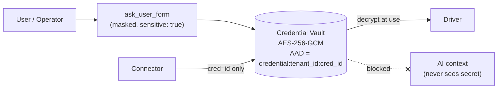

# Credentials & Keys

**Every integration secret is encrypted at rest, rotated on demand, and never
logged, returned in an API response, or shown to the AI.** That property is what
lets a regulated tenant put Stripe keys, OAuth refresh tokens, and database
passwords behind sk without auditing each one by hand.

This is the admin home for the three primitives that enforce it:

| Primitive | What it protects | Rotates by |
| --- | --- | --- |
| **Credential vault** | Every integration secret (API keys, OAuth2 tokens, connection strings) | Re-issue per credential |
| **`MASTER_KEY`** | The AEAD key that encrypts the vault at rest | Redeploy + re-onboard (no envelope) |
| **Release-signing key** | Self-updates of the `engine` and `sk` binaries | Transitional signed release |

```mermaid
flowchart LR
    subgraph Vault["Credential vault — secrets at rest"]
        direction TB
        In["ask_user_form<br/>(masked, sensitive)"] --> Enc["AES-256-GCM encrypt<br/>AAD = tenant_id:cred_id"]
        Enc --> Row[("credentials row<br/>ciphertext + oauth2_refresh_ciphertext")]
    end

    MK["MASTER_KEY<br/>(env-only, never on disk)"] -. keys .-> Enc
    Row -- decrypt at use --> Drv["Driver / Connector"]
    Vault -. blocked .-x AI["AI context"]

    subgraph OAuth["OAuth2 auto-refresh"]
        direction TB
        Drv --> Exp{"access token<br/>expired?"}
        Exp -- no --> Call["call upstream"]
        Exp -- yes --> Refresh["refresh w/ stored token"]
        Refresh --> Reenc["re-encrypt rotated tokens"]
        Reenc --> Row
        Refresh --> Call
    end

    subgraph Rotate["MASTER_KEY rotation lifecycle"]
        direction TB
        Leak["key leaked / cadence / incident"] --> Freeze["freeze writes"]
        Freeze --> Snap["DB snapshot"]
        Snap --> NewKey["new key via secret manager"]
        NewKey --> Rewrap["engine --rewrap-master-key<br/>(runtime_secret_versions only)"]
        Rewrap --> Invalidate["invalidate the rest<br/>(truncate / blank)"]
        Invalidate --> Boot["boot on new key"]
        Boot --> Reissue["re-issue every credential"]
    end

    MK -. rotation invalidates .-> Rotate
    Reissue -. repopulates .-> Vault
```



---

## Rotating MASTER_KEY

> **Read first:** rotating `MASTER_KEY` invalidates every payload encrypted
> under it, with **one exception**. The engine uses AES-256-GCM with no
> key-id envelope, so there is no "old key" it can fall back to at request
> time. This section describes what breaks, what to recover, and the
> operator-facing downtime window.
>
> **The exception — runtime secret versions.** Since 6.27.2 the rows in
> `runtime_secret_versions` (everything addressed as `secret://name/version`,
> which is every secret settings leaf) can be re-encrypted under the new key
> from the host, provided you still hold the previous one:
> `engine --rewrap-master-key --from-file <previous-key>`. It refuses while
> any replica is still serving, runs as one transaction, and preserves every
> version number so the active revision keeps resolving. See
> [bootstrap-preflight.md](bootstrap-preflight.md#--rewrap-master-key). The
> tables listed under **Blast radius** below are *not* covered by it — those
> still require the re-issue sequence on this page.

### When you must rotate

| Trigger | Rotate? |
| --- | --- |
| Key value leaked (committed to git, posted in chat, exfiltrated from backup) | **Yes** |
| Regulator / customer mandates a fixed cadence | **Yes** |
| Incident response demands it | **Yes** |
| Engine host compromised but key never on disk (injected at boot from a secret manager) | **No** — payloads at rest are useless without the key |

### Blast radius

`apps/engine/src/crypto/aes-gcm.ts` loads `env.MASTER_KEY` once at boot. Every
store below holds ciphertext keyed by that single key — rotation invalidates
every row in every one of them. `runtime_secret_versions` is deliberately
absent from this table: it is the one store `--rewrap-master-key` repairs in
place, and listing it here as lost would send an operator to re-enter settings
they can recover.

Each row is a Drizzle `pgTable` with at least one `bytea` column written through
`encryptSecret()` and read through `decryptSecret()`. The SQL name is the first
arg to `pgTable()`, verified against the schema file.

| SQL table | Encrypted column(s) | Schema definition | What's lost |
| --- | --- | --- | --- |
| `credentials` | `ciphertext` (NOT NULL), `oauth2_refresh_ciphertext` | `db/schema/connectors.ts:129` | Static secrets + OAuth access/refresh tokens for every connector instance. |
| `end_user_credentials` | `ciphertext` (NOT NULL) | `db/schema/connectors.ts:155` | Per-end-user OAuth secrets for portal flows. |
| `connector_template_credentials` | `ciphertext` (NOT NULL) | `db/schema/connector_template_credentials.ts` | Tenant-overridden template secrets. |
| `workflow_run_state` | `ciphertext` (NOT NULL) | `db/schema/workflow_run_state.ts` | Reverse-ETL watermarks and tenant-encrypted run state. |
| `webhooks_inbound` | `secret_ciphertext` (NOT NULL) | `db/schema/webhooks.ts:19` | Signing secrets for incoming webhooks (row also holds slug + verifier config). |
| `webhooks_outbound` | `secret_ciphertext` (NOT NULL), `rotating_secret_ciphertext` | `db/schema/webhooks.ts:75` | Signing secrets for outgoing webhooks (row also holds URL config). |
| `chat_workspaces` | `bot_ciphertext` (NOT NULL) | `db/schema/chat.ts:20` | Chat-platform bot tokens (row also holds workspace metadata). |
| `auth_provider_configs` | `config_ciphertext` (nullable) | `db/schema/identity.ts:208` | OIDC client secrets (issuer URL + client_id survive). |
| `tenant_llm_settings` | `llm_provider_credentials_ciphertext` (nullable) | `db/schema/llm.ts` | Tenant LLM provider API keys (model + provider config survive). |

Three invalidation classes drive the recovery SQL:

| Class | Tables | How to invalidate | Why |
| --- | --- | --- | --- |
| Pure secret | `credentials`, `end_user_credentials`, `connector_template_credentials`, `workflow_run_state` | `TRUNCATE … CASCADE` | Row identity *is* the secret. |
| Secret + config, NOT NULL | `webhooks_inbound`, `webhooks_outbound`, `chat_workspaces` | `TRUNCATE … CASCADE`, re-create via API | Secret column can't be blanked in place; config rides along. |
| Nullable secret | `auth_provider_configs`, `tenant_llm_settings` | `SET … = NULL` | Config (issuer URL, client_id, model) survives; operator re-enters the leaf. |

Tenant-isolation is preserved by AAD binding (`aadFor(tenant_id, …)`), so a
leaked key still requires per-row knowledge to forge — but **legitimate decrypt
also fails after rotation**. There is no key-rotation envelope today.

### Recovery sequence

1. **Freeze writes.** Stop the engine on every host serving the tenant pool
   you're rotating. New encrypts under the old key during the transition are
   lost.
   ```sh
   docker stop subkit
   ```

2. **Take a database snapshot.** The only path back if rotation goes wrong.
   ```sh
   ssh ${HOST} 'pg_dump -Fc subkit > /opt/subkit/backups/pre-rotate-$(date -u +%Y%m%dT%H%M%SZ).dump'
   ```

3. **Generate the new key + inject via your secret manager.**
   ```sh
   openssl rand -hex 32   # 64 hex chars; 32 bytes
   ```
   Update the secret store (Doppler / 1Password / DigitalOcean app-level env /
   `.env` for self-hosters) — never commit to git, never write to the config
   file. `MASTER_KEY` is the root process binding that stays outside the
   PostgreSQL runtime revisions (see [Configuration](configuration.md)).

4. **Invalidate every ciphertext keyed by the old `MASTER_KEY`.** Run as a
   single transaction so a partial failure doesn't leave half-rotated state.
   Verify each table name against your migration before running.
   ```sql
   BEGIN;

     -- Pure secret stores. The row identity is the secret; TRUNCATE drops
     -- the row entirely, then it gets re-issued in step 6.
     TRUNCATE
       credentials,
       end_user_credentials,
       connector_template_credentials,
       workflow_run_state
       CASCADE;

     -- Mixed secret-and-config rows: secret column is NOT NULL so it
     -- cannot be blanked in place. Drop the rows and re-create through
     -- the engine API in steps 6–7. CASCADE clears dependent
     -- subscriptions/deliveries/sessions rows.
     TRUNCATE
       webhooks_inbound,
       webhooks_outbound,
       chat_workspaces
       CASCADE;

     -- Nullable secret columns: blank in place; the row's config
     -- (issuer URL, client_id, model name, etc.) survives. Operators
     -- re-enter just the credential through the engine API.
     UPDATE auth_provider_configs SET config_ciphertext = NULL;
     UPDATE tenant_llm_settings   SET llm_provider_credentials_ciphertext = NULL;

   COMMIT;
   ```
   (If your migration names a column or table differently, correct it before
   running. The canonical column list is the Blast-radius table above.)

5. **Boot the engine on the new key.** Watch the boot log; the crypto layer
   asserts key length / hex shape at module load
   (`apps/engine/src/crypto/aes-gcm.ts:48-53`) and exits non-zero if the key is
   malformed.
   ```sh
   docker start subkit
   docker logs --since 1m subkit
   ```
   `/health` should return `status: "ok"` and `/ready` should return
   `checks.database: "pass"` within 30s.

6. **Re-issue every connector credential.** For each tenant × connector:
   - Regenerate static API keys at the upstream system (Stripe, GitHub, etc.)
     and re-add via `sk connectors credentials set`.
   - Re-run OAuth flows for OAuth-based connectors. The stored refresh tokens
     are gone — there is no silent re-auth path.

7. **Re-create every webhook subscription.** `webhooks_inbound` and
   `webhooks_outbound` were truncated, so the routing rows are also gone.
   - Inbound: re-create each subscription (slug + verifier + fresh secret) and
     update every upstream webhook configuration.
   - Outbound: re-create each subscription (URL + fresh signing secret) and
     update every consumer's verification config.

8. **Re-create every chat-platform workspace.** `chat_workspaces` was truncated
   — every Slack/Teams/Google Chat workspace must be re-installed and
   re-onboarded through the platform's add-app flow.

9. **Re-enter tenant LLM API keys.** Tenant LLM keys remain scalar
   `llm.api_key` settings. The active `auth.providers` model uses public PKCE
   clients and contains no identity-provider secret to rotate.

10. **Verify.** Hit `${ENGINE_URL}/health` and run the tenant-scoped
    integration smoke; expect zero `decrypt_failed` `CryptoError` entries in the
    structured log.

### Downtime window

| Phase | Steps | Window |
| --- | --- | --- |
| **Mandatory downtime** | 1 (freeze) → 5 (boot on new key) | ~5–15 min for a single host |
| **Re-onboarding** (engine running) | 6–9 | Runs in parallel; tenants see broken connectors, webhook signatures, chat integrations, OIDC sign-ins, and LLM calls until each is re-issued |

### Why there is no in-engine "rotate" command

The crypto layer is intentionally simple — one key, one algorithm, no key-id
envelope. Adding one is a real refactor: every encrypted column gains a
`key_version` field, the read path must dispatch on it, and the worker pool must
hold both keys during a window. Until that lands, rotation is a redeploy, not a
click.

If you need rotation without re-issuing every credential, that is the work to
commission — it is not a runbook task.

---

## The Credential Vault

### Credential identity for bounded execution

Direct connector credentials carry an `authority_revision`, initialized to 1
by migration without issuing any execution authority. A material replacement
(including changed credential identity, linked connection or permissions)
advances it. Saving identical material does not. This is separate from
`updated_at`, which also changes during routine token renewal.

OAuth refresh preserves this revision when the granted scope set and token type
are unchanged. Omitted scopes retain the previous grant; reordered or duplicate
scope tokens do not create a new permission. Scope names remain case-sensitive.
Expanded or reduced scopes and changed token types advance the revision. Token,
scope metadata, revision and audit are committed together or rolled back together.

The external MCP client's non-interactive handshake uses this refresh path only
for an existing direct OAuth credential. Initial authorization and interactive
credential replacement remain distinct browser flows; an automatic handshake
cannot establish a new credential or detach a connection-backed credential.
No additional operator configuration is required. The revision is a binding
input for execution authorities, not an approval by itself.

Connection-backed credentials also bind the outbound connection's own
`authority_revision`. A fresh interactive authorization advances that revision;
routine refresh keeps it unless the granted scopes change. Refresh updates
compare both the observed authority revision and token version, so a late
refresh cannot replace a newer login. Local secret versions, retirement of old
versions, connection identity changes and their audit records commit atomically.
An audit failure rolls those local changes back. It cannot roll back an OAuth
provider's already-issued token response; a consumed remote refresh token may
therefore require a fresh interactive authorization.

`ConnectorSystem.getAuthorityMetadata()` reads only stable credential and
connection identifiers, revisions and permissions. Availability is separate
from the stable binding. The read does not decrypt tokens, update usage or
refresh OAuth, even when tokens are near expiry. Actual use must still check
credential availability and perform the normal authenticated dispatch.

All integration secrets — API keys, OAuth2 access and refresh tokens, database
passwords, connection strings — are stored in the credential vault, encrypted
with AES-256-GCM.



**Guarantees**

| Property | How it holds |
| --- | --- |
| Never logged / returned / shown to AI | Connectors reference credentials by identifier; the vault resolves to the secret only at the moment of use. Outside that moment the raw value exists in neither memory nor any logged context. |
| OAuth2 refresh is automatic | The engine owns the full lifecycle — access-token expiry, refresh-token rotation, re-authorization. Connectors never see an expired token. |
| End-user overrides | A user can supply their own credential for a connector (e.g. personal GitHub vs the org integration) with no operator involvement — same vault, same encryption. |

The conversational secret-handling defences that keep a credential out of LLM
tool arguments and transcripts live in
[Governance & Audit → Secret Hygiene](../concepts/governance-and-audit.md#secret-hygiene-at-the-conversational-surface).

---

## Self-update + release signing

The engine and `sk` binaries verify a signed `SHA256SUMS` (Ed25519) on every
`engine --self-update` / `sk update` before they will replace the running
binary. The release workflow signs `SHA256SUMS` with the `RELEASE_SIGNING_KEY`
GitHub secret; the matching public key is committed to
`packages/cli-core/src/release-public-key.ts` and embedded in every binary at
build time.


*Atomic swap; failure rolls back automatically; every transition lands in the
audit log under the system tenant. Losing the private key bricks future updates
for any binary that hasn't yet picked up a key rotation — treat it like the
database master key.*

### Audit trail

Every binary swap writes a pair of rows to `audit_log` under
`tenant_id = 00000000-0000-0000-0000-000000000000` (system tenant) with
`actor_type = system`, `actor_id = null` — the change is process-level, with no
`system_accounts` row backing it. `metadata.request_source` distinguishes
`self-update` from `rollback`.

| Action | Emitted when | `result` |
|---|---|---|
| `engine.update.initiated` | Before download / before retained-binary swap | `success` |
| `engine.update.completed` | `engine --self-update` succeeded | `success` |
| `engine.update.rolled_back` | `engine --rollback` succeeded | `success` |
| `engine.update.failed` | The swap threw at any point after INITIATED | `error` |

`metadata` carries `from_version`, `to_version`, `channel`, `sha256` (64-char
hex of the verified binary, or empty before verification), and
`request_source ∈ {self-update, rollback}`.

Both flags also emit a structured log entry under `module: "self-update"` and
bump `engine_update_total{result, channel}` (Prometheus). The `result` label is
one of `success`, `failed`, `rollback` — kept in lockstep with the audit-action
vocabulary so an SRE joining the metric to `audit_log` doesn't have to remember
an off-by-one.

### Risk-signal edges (`risk_signal_edges`)

`risk_signal_edges` (`db/schema/audit.ts`, used by `operator/risk-signals.ts`)
is the shared, cross-replica edge-state store that backs risk-signal raising.
Risk signals describe host-global infrastructure (one Postgres pool, one set of
DLQs, one engine RSS), so a standing critical must be audited exactly once per
`false→true` edge across the whole deployment — not once per digest read, per
reading tenant, or per replica. The signal builder runs on every MCP connect,
resource read, REPL start, and status call, so auditing inline would otherwise
flood `audit_log`. The risk-signal surface itself is documented in
[Observability](../operators/observability.md).

The table is keyed by signal `kind` (host-global, no `tenant_id`). Each replica
claims an edge through a microsecond-safe `INSERT … ON CONFLICT … WHERE` CAS
(`operator/risk-signals.ts` around lines 234–251) so exactly one replica wins
the `false→true` transition and the others observe no edge — two replicas cannot
double-raise the same edge. The winning replica audits `RISK_SIGNAL_RAISED`
(under the system tenant, since the signal is host-scoped). Recovery clears the
row, so a recovered-then-recurring signal re-fires exactly once on its next
occurrence.

### Rollback

The updater retains the last 3 signed binaries under
`~/.engine/versions/<version>/` together with a sidecar `manifest.json`
recording the SHA256 captured at retention time. `rollbackTo` re-hashes the
retained binary against the manifest and refuses to swap on hash drift.

```bash
engine --rollback              # restore the most recent retained binary
engine --rollback --to=7.0.0   # restore a specific retained version
```

`sk update --rollback` is the same path. The rolled-back binary is itself
parked, so re-rollback works.

### Key rotation procedure

The Ed25519 release-signing key is rotated through a transitional release that
contains the *new* public key signed by the *old* key. Any operator who
self-updates to that transitional release picks up the new public key; from the
next release onward the old private key is retired.

```bash
# 1. Generate a fresh keypair. Writes the new public key into the repo;
#    prints the matching private key once to stdout.
bun run scripts/gen-release-key.ts

# 2. Paste the printed private key into the GitHub secret.
gh secret set RELEASE_SIGNING_KEY --repo MikeBild/subkit

# 3. Commit the public-key change.
git add packages/cli-core/src/release-public-key.ts
git commit -m "chore: rotate release signing key"

# 4. Cut the transitional release on the BRANCH containing the new
#    public key, signed with the OLD private key (so existing binaries
#    still accept it). The release workflow signs with whatever the
#    secret holds at run time, so rotate the secret only AFTER cutting
#    the transitional release.
git tag -a vX.Y.Z -m "transitional release — new public key"
git push origin vX.Y.Z

# 5. Once the transitional release is in the wild, flip the secret to
#    the new private key. Subsequent releases sign with the new key,
#    and only binaries that picked up the transitional release will
#    accept them.
```

Losing the private key bricks future updates for any binary that hasn't yet
picked up a key rotation. Treat it like the database master key — back it up,
rotate after operator handover.

## See also

- `apps/engine/src/crypto/aes-gcm.ts` — the encrypt/decrypt primitives.
- `apps/engine/src/env.ts` — how `MASTER_KEY` is loaded and validated.
- `.env.example:18-21` — the warning operators see at first install.
- [Configuration](configuration.md) — why this stays in env, not config.
