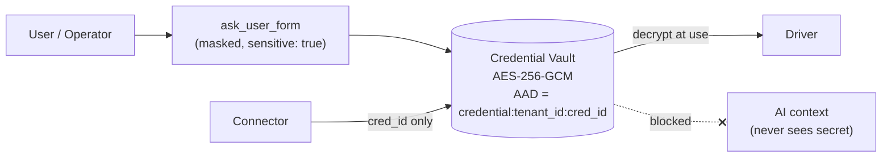
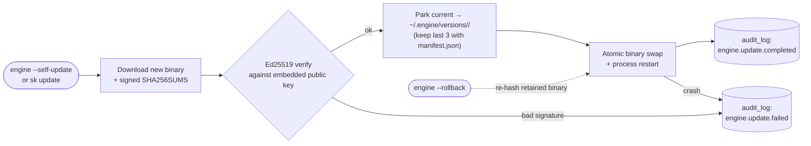

# Credentials & Keys

This document is the admin home for the secrets that protect a sk deployment:
the **credential vault** that holds every integration secret, the
**`MASTER_KEY`** that encrypts it at rest (and how to rotate it), and the
**release-signing key** that gates self-updates of the engine and `sk` binaries.

---

## Rotating MASTER_KEY

> **Read first:** rotating `MASTER_KEY` invalidates every payload encrypted
> under it. The engine uses AES-256-GCM with no key-id envelope — there is
> no "old key" the engine can fall back to. This section describes what
> breaks, what to recover, and the operator-facing downtime window.

### When you must rotate

- The key value leaked (committed to git, posted in a chat, exfiltrated
  from a backup).
- A regulator / customer requires it on a fixed cadence.
- An incident response demands it.

If only the *engine host* was compromised but the key is unknown to the
attacker (e.g. injected at boot from a secret manager, never on disk),
rotation is not required — credential payloads at rest are useless without
the key.

### Blast radius

`apps/engine/src/crypto/aes-gcm.ts` loads `env.MASTER_KEY` once at boot.
The following stores all hold ciphertext keyed by that single key —
rotation invalidates every row in every store below:

Each row below is a Drizzle pgTable with at least one bytea column written
through `encryptSecret()` and read through `decryptSecret()`. The SQL name
is the value passed as the first arg to `pgTable()` — verified against
the schema file as of writing.

| SQL table | Encrypted column(s) | Schema definition | What's lost |
| --- | --- | --- | --- |
| `credentials` | `ciphertext` (NOT NULL), `oauth2_refresh_ciphertext` | `db/schema/connectors.ts:129` | Static secrets + OAuth access/refresh tokens for every connector instance. |
| `end_user_credentials` | `ciphertext` (NOT NULL) | `db/schema/connectors.ts:155` | Per-end-user OAuth secrets for portal flows. |
| `connector_template_credentials` | `ciphertext` (NOT NULL) | `db/schema/connector_template_credentials.ts` | Tenant-overridden template secrets. |
| `workflow_run_state` | `ciphertext` (NOT NULL) | `db/schema/workflow_run_state.ts` | Reverse-ETL watermarks and tenant-encrypted run state. |
| `webhooks_inbound` | `secret_ciphertext` (NOT NULL) | `db/schema/webhooks.ts:19` | Signing secrets for incoming webhooks (row also holds slug + verifier config). |
| `webhooks_outbound` | `secret_ciphertext` (NOT NULL), `rotating_secret_ciphertext` | `db/schema/webhooks.ts:75` | Signing secrets for outgoing webhooks (row also holds URL config). |
| `chat_workspaces` | `bot_ciphertext` (NOT NULL) | `db/schema/chat.ts:20` | Chat-platform bot tokens (row also holds workspace metadata). |
| `auth_provider_configs` | `config_ciphertext` (nullable) | `db/schema/identity.ts:208` | OIDC client secrets (issuer URL + client_id survive). |
| `tenant_llm_settings` | `llm_provider_credentials_ciphertext` (nullable) | `db/schema/llm.ts` | Tenant LLM provider API keys (model + provider config survive). |

Tables in the bottom two rows hold *operational config* alongside the
encrypted secret. The middle three (`webhooks_inbound` / `webhooks_outbound`
/ `chat_workspaces`) have NOT NULL secret columns paired with config in
the same row — the secret cannot be blanked in place, so rotation forces
a re-create through the engine API.

Tenant-isolation invariant is preserved by AAD binding (`aadFor(tenant_id, …)`),
so a leaked key still requires per-row knowledge to forge — but **legitimate
decrypt also fails after rotation**. There is no key-rotation envelope today.

### Recovery sequence

1. **Freeze writes.** Stop the engine on every host serving the tenant
   pool you're rotating. New encrypts under the old key during the
   transition will be lost.
   ```sh
   docker stop subkit
   ```

2. **Take a database snapshot.** This is the only path back if rotation
   goes wrong.
   ```sh
   ssh ${HOST} 'pg_dump -Fc subkit > /opt/subkit/backups/pre-rotate-$(date -u +%Y%m%dT%H%M%SZ).dump'
   ```

3. **Generate the new key + inject via your secret manager.**
   ```sh
   openssl rand -hex 32   # produces 64 hex chars; 32 bytes
   ```
   Update the secret store (Doppler / 1Password / DigitalOcean app-level
   env / `.env` for self-hosters) — never commit to git, never write to
   the config file. `MASTER_KEY` is the one bootstrap env that stays
   outside `subkit.config.json` (see `docs/admins/configuration.md`).

4. **Invalidate every ciphertext keyed by the old MASTER_KEY.** The
   strategy depends on whether the secret column is the row's whole
   purpose or whether the row also holds operational config. Run as a
   single transaction so a partial failure doesn't leave half-rotated
   state. Verify each table name matches your migration before running.
   ```sql
   BEGIN;

     -- Pure secret stores. The row identity is the secret; TRUNCATE drops
     -- the row entirely, then it gets re-issued in step 6.
     TRUNCATE
       credentials,
       end_user_credentials,
       connector_template_credentials,
       workflow_run_state
       CASCADE;

     -- Mixed secret-and-config rows: secret column is NOT NULL so it
     -- cannot be blanked in place. Drop the rows and re-create through
     -- the engine API in steps 6–7. CASCADE clears dependent
     -- subscriptions/deliveries/sessions rows.
     TRUNCATE
       webhooks_inbound,
       webhooks_outbound,
       chat_workspaces
       CASCADE;

     -- Nullable secret columns: blank in place; the row's config
     -- (issuer URL, client_id, model name, etc.) survives. Operators
     -- re-enter just the credential through the engine API.
     UPDATE auth_provider_configs SET config_ciphertext = NULL;
     UPDATE tenant_llm_settings   SET llm_provider_credentials_ciphertext = NULL;

   COMMIT;
   ```
   (If your migration version names a column or table differently,
   correct it before running. The canonical column list is the schema
   grep at the top of this doc.)

5. **Boot the engine on the new key.** Watch the boot log; the crypto
   layer asserts key length / hex shape at module load
   (`apps/engine/src/crypto/aes-gcm.ts:48-53`) and exits non-zero if the
   key is malformed.
   ```sh
   docker start subkit
   docker logs --since 1m subkit
   ```
   `/v1/health` should return `db_connected: true` within 30s.

6. **Re-issue every connector credential.** For each tenant × connector:
   - Regenerate static API keys at the upstream system (Stripe, GitHub,
     etc.) and re-add via `sk connectors credentials set`.
   - Re-run OAuth flows for OAuth-based connectors. The stored refresh
     tokens are gone — there is no silent re-auth path.

7. **Re-create every webhook subscription.** `webhooks_inbound` and
   `webhooks_outbound` were truncated, so the routing rows are also gone.
   - Inbound: re-create each inbound subscription (slug + verifier +
     fresh secret) and update every upstream webhook configuration.
   - Outbound: re-create each outbound subscription (URL + fresh
     signing secret) and update every consumer's verification config.

8. **Re-create every chat-platform workspace.** `chat_workspaces`
   was truncated — every Slack/Teams/Google Chat workspace must be
   re-installed and re-onboarded through the platform's add-app flow.

9. **Re-enter OIDC client secrets and tenant LLM API keys.** These
   tables (`auth_provider_configs`, `tenant_llm_settings`) kept their
   non-secret config; operators just re-enter the redacted credential
   leaf. CLI: `sk settings set auth.oidc.client_secret '"…"'` and
   per-tenant `llm.api_key`.

10. **Verify.** Hit `${ENGINE_URL}/v1/health` and run the tenant-scoped
    integration smoke; expect zero `decrypt_failed` `CryptoError` entries
    in the structured log.

### Downtime window

Step 1 (freeze) → step 5 (boot on new key) is **mandatory downtime** —
typically 5–15 minutes for a single host. Steps 6–9 are
operator-driven re-onboarding and run in parallel with the engine
running normally; tenants will see broken connectors, webhook
signatures, chat-platform integrations, OIDC sign-ins, and tenant LLM
calls until each one is re-issued.

### Why there is no in-engine "rotate" command

The crypto layer is intentionally simple — one key, one algorithm, no
key-id envelope. Adding one is a real refactor (every encrypted column
gains a `key_version` field; the read path must dispatch on it; the
worker pool must hold both keys during a window). Until that lands,
rotation is a redeploy, not a click.

If you need rotation without re-issuing every credential, that is the
work to commission — it is not a runbook task.

---

## The Credential Vault

All integration secrets — API keys, OAuth2 access and refresh tokens, database passwords, connection strings — are stored in the credential vault, encrypted with AES-256-GCM.



*Secrets are never logged, never returned in API responses, never visible to the AI during conversations. Connectors reference credentials by identifier; the vault resolves the identifier to the actual secret at the moment of use. Outside that moment, the raw value does not exist in memory or in any logged context.*

OAuth2 token refresh is automatic. The engine manages the full OAuth2 lifecycle — access token expiry, refresh token rotation, re-authorization when needed. Connectors never deal with expired tokens; the vault handles it transparently.

End-user credential overrides are supported. Individual users can supply their own credentials for a connector without operator involvement — for example, a user connecting sk to their personal GitHub account rather than the organization's shared integration. Overrides are stored in the same vault with the same encryption guarantees.

The conversational secret-handling defences that keep a credential out of LLM tool arguments and transcripts live in [Governance & Audit → Secret Hygiene](../concepts/governance-and-audit.md#secret-hygiene-at-the-conversational-surface).

---

## Self-update + release signing

The engine and `sk` binaries verify a signed `SHA256SUMS` (Ed25519) on
every `engine --self-update` / `sk update` before they will replace the
running binary. The release workflow signs `SHA256SUMS` with the
`RELEASE_SIGNING_KEY` GitHub secret; the matching public key is
committed to `packages/cli-core/src/release-public-key.ts` and embedded
in every binary at build time.



*Atomic swap; failure rolls back automatically; every transition lands in the audit log under the system tenant. Losing the private key bricks future updates for any binary that hasn't yet picked up a key rotation — treat it like the database master key.*

### Audit trail

Every binary swap writes a pair of rows to `audit_log` under
`tenant_id = 00000000-0000-0000-0000-000000000000` (system tenant) with
`actor_type = system`, `actor_id = null` (the change is process-level —
there is no `system_accounts` row backing it). `metadata.request_source`
distinguishes `self-update` from `rollback`:

| Action | Emitted when | `result` |
|---|---|---|
| `engine.update.initiated` | Before download / before retained-binary swap | `success` |
| `engine.update.completed` | `engine --self-update` succeeded | `success` |
| `engine.update.rolled_back` | `engine --rollback` succeeded | `success` |
| `engine.update.failed` | The swap threw at any point after INITIATED | `error` |

`metadata` carries `from_version`, `to_version`, `channel`,
`sha256` (64-char hex of the verified binary, or empty before
verification), and `request_source ∈ {self-update, rollback}`.

Both flags also emit a structured log entry under
`module: "self-update"` and bump
`engine_update_total{result, channel}` (Prometheus). The `result` label
is one of `success`, `failed`, `rollback` — kept in lockstep with the
audit-action vocabulary so a SRE joining the metric to `audit_log`
doesn't have to remember an off-by-one.

### Risk-signal edges (`risk_signal_edges`)

`risk_signal_edges` (`db/schema/audit.ts`, used by `operator/risk-signals.ts`)
is the shared, cross-replica edge-state store that
backs risk-signal raising. Risk signals describe host-global infrastructure
(one Postgres pool, one set of DLQs, one engine RSS), so a standing
critical must be audited exactly once per `false→true` edge across the
whole deployment — not once per digest read, per reading tenant, or per
replica. The signal builder runs on every MCP connect, resource read, REPL
start, and status call, so auditing inline would otherwise flood `audit_log`.
The risk-signal surface itself is documented in
[Observability](../operators/observability.md).

The table is keyed by signal `kind` (host-global, no `tenant_id`). Each
replica claims an edge through a microsecond-safe `INSERT … ON CONFLICT …
WHERE` CAS (`operator/risk-signals.ts` around lines 234–251) so exactly one
replica wins the `false→true` transition and the others observe no edge —
two replicas cannot double-raise the same edge. The winning replica audits
`RISK_SIGNAL_RAISED` (under the system tenant, since the signal is
host-scoped). Recovery clears the row, so a recovered-then-recurring signal
re-fires exactly once on its next occurrence.

### Rollback

The updater retains the last 3 signed binaries under
`~/.engine/versions/<version>/` together with a sidecar `manifest.json`
recording the SHA256 captured at retention time. `rollbackTo` re-hashes
the retained binary against the manifest and refuses to swap on hash
drift.

```bash
engine --rollback              # restore the most recent retained binary
engine --rollback --to=7.0.0   # restore a specific retained version
```

`sk update --rollback` is the same path. The rolled-back binary is
itself parked, so re-rollback works.

### Key rotation procedure

The Ed25519 release-signing key is rotated through a transitional
release that contains the *new* public key signed by the *old* key.
Any operator who self-updates to that transitional release picks up
the new public key; from the next release onward the old private key
is retired.

```bash
# 1. Generate a fresh keypair. Writes the new public key into the repo;
#    prints the matching private key once to stdout.
bun run scripts/generate-release-key.ts

# 2. Paste the printed private key into the GitHub secret.
gh secret set RELEASE_SIGNING_KEY --repo MikeBild/subkit

# 3. Commit the public-key change.
git add packages/cli-core/src/release-public-key.ts
git commit -m "chore: rotate release signing key"

# 4. Cut the transitional release on the BRANCH containing the new
#    public key, signed with the OLD private key (so existing binaries
#    still accept it). The release workflow signs with whatever the
#    secret holds at run time, so rotate the secret only AFTER cutting
#    the transitional release.
git tag -a vX.Y.Z -m "transitional release — new public key"
git push origin vX.Y.Z

# 5. Once the transitional release is in the wild, flip the secret to
#    the new private key. Subsequent releases sign with the new key,
#    and only binaries that picked up the transitional release will
#    accept them.
```

Losing the private key bricks future updates for any binary that
hasn't yet picked up a key rotation. Treat it like the database master
key — back it up, rotate after operator handover.

## See also

- `apps/engine/src/crypto/aes-gcm.ts` — the encrypt/decrypt primitives.
- `apps/engine/src/env.ts` — how `MASTER_KEY` is loaded and validated.
- `.env.example:18-21` — the warning operators see at first install.
- `docs/admins/configuration.md` — why this stays in env, not config.
