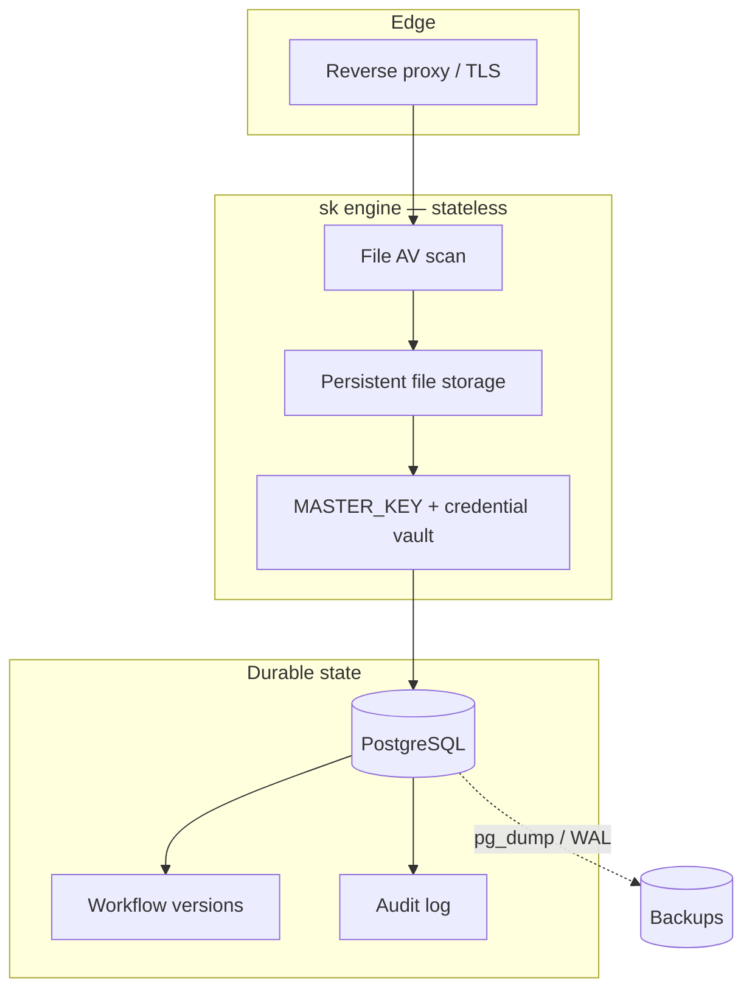
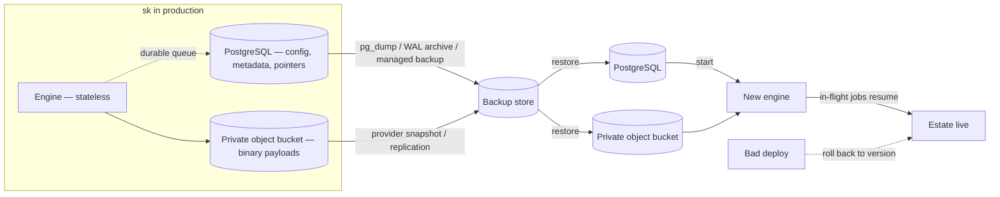

# Production hardening — known caveats & TODOs

Work through this page and you can go live knowing three things: every run is
permission-checked and recorded, someone can answer an auditor's questions from what was
written down, and you could rebuild the entire setup from a database backup alone.

This page lists the **deliberate defaults** the engine ships with. Each surfaces
as a loud `warn` line at boot — _not_ a bug. For every item: what it is, the
risk, how to close it, and the future TODO.

## Hardening layers at a glance



| Layer        | Production-ready when                       | Section                                                               |
| ------------ | ------------------------------------------- | --------------------------------------------------------------------- |
| File AV scan | a real scanner (clamd) answers under budget | [§1](#1-file-uploads-are-not-virus-scanned-scannernoop_in_production) |
| Object store | private, backed up, and restore-tested      | [§2](#2-use-a-private-backed-up-s3-compatible-bucket)                 |
| Secrets      | `MASTER_KEY` set + rotated                  | [credentials-and-keys.md](./credentials-and-keys.md)                  |
| Database     | external managed PostgreSQL                 | [self-host.md](../developers/self-host.md)                            |
| Recovery     | versioned workflows + PG backups            | [Backup and Recovery](#backup-and-recovery)                           |

### Grep the boot warnings

The engine emits these at boot so you can grep for them:

```sh
# from the engine container logs
docker logs subkit 2>&1 | grep -E '"action":"(scanner.noop_in_production|requires_restart_pending|ephemeral_dir_warning)"'
```

---

## 1. File uploads are NOT virus-scanned (`scanner.noop_in_production`)

### What it is

Every file uploaded into the engine (workflow attachments, inline uploads,
authenticated streamed uploads) passes through `getScanner().scan(stream, meta)` before the
file row flips to `status='ready'`. The **default scanner is a no-op**
(`NoopScanner`) — it returns `{ verdict: "clean", engine: "noop" }` for _every_
input without inspecting the bytes.

Boot log when `NODE_ENV=production`:

```
warn  files  scanner.noop_in_production
"FileScanner is NoopScanner in production. Every upload is reported as clean
 until a real scanner is wired. Replace getScanner() with a clamd-backed
 implementation before accepting tenant content."
```

### Risk

| Install shape                                      | Risk     | Why                                                                                                                                      |
| -------------------------------------------------- | -------- | ---------------------------------------------------------------------------------------------------------------------------------------- |
| Single trust boundary (you control every uploader) | **Low**  | No untrusted bytes enter the system.                                                                                                     |
| Untrusted / multi-tenant uploads                   | **Real** | A malicious file is accepted and stored unscanned; any later download/processing serves it as-is. Compliance/security hole (no AV gate). |

### Current behavior (by design)

- The upload pipeline calls the scanner **unconditionally** — wiring a real
  backend needs **no route changes**, only the resolver.
- Verdicts:

  | Verdict                        | File row             | Side effect                                             |
  | ------------------------------ | -------------------- | ------------------------------------------------------- |
  | `clean`                        | `ready`              | —                                                       |
  | `infected`                     | `failed`             | `FILE_SCAN_COMPLETED` audit event (verdict + signature) |
  | `timeout` (route wrapper only) | parked in `scanning` | reaped by the cleanup cron                              |

- Per-call ceiling: `SCANNER_TIMEOUT_SECONDS = 10` (in `files/scanner.ts`) — a
  real scanner must answer within this budget or the row is parked.

### How to close it (real fix — infra + a small code change)

1. **Provision ClamAV** on the host (or a sidecar):
   ```sh
   apt-get install -y clamav-daemon clamav-freshclam
   systemctl enable --now clamav-freshclam   # virus DB updates
   systemctl enable --now clamav-daemon       # clamd on /var/run/clamav/clamd.ctl or TCP 3310
   ```
2. **Implement a clamd-backed `FileScanner`** and return it from `getScanner()`
   in `apps/engine/src/files/scanner.ts`. The contract to satisfy:
   ```ts
   export interface FileScanner {
     scan(
       stream: AsyncIterable<Uint8Array>,
       meta: ScanMeta,
     ): Promise<ScanResult>;
   }
   // ScanResult = { verdict: "clean" | "infected" | "timeout"; engine: string; signature?: string }
   ```
   Stream the bytes to clamd (`INSTREAM`), map a clean result to
   `{ verdict: "clean", engine: "clamav/<dbver>" }` and a hit to
   `{ verdict: "infected", engine: "clamav/<dbver>", signature: <name> }`. Keep
   the scan under `SCANNER_TIMEOUT_SECONDS`.
3. **Verify:** restart, confirm the boot warning is **gone**, then upload an
   [EICAR test file](https://www.eicar.org/download-anti-malware-testfile/) and
   confirm the file row flips to `failed` with a `FILE_SCAN_COMPLETED` audit row.

### TODO (future)

- [ ] Add `storage.scanner.*` config (backend = `noop | clamav`, host/port/socket,
      timeout) so the scanner is operator-configurable instead of code-swapped.
- [ ] Ship a clamd-backed `FileScanner` and have `getScanner()` construct it from
      that config.
- [ ] Document the AV DB-update cadence (`freshclam`) in `deploy.md`.
- [ ] Gate uploads (refuse, not warn) when `NODE_ENV=production` AND the scanner
      is `noop` AND a future `storage.scanner.require=true` is set.

> **Interim mitigation** if you do not need uploads: there is currently no
> config flag to disable the files surface — open an issue if you want one, or
> restrict the `/v1/files*` routes at the reverse proxy (Caddy) layer.

---

## 2. Use a private, backed-up S3-compatible bucket

### What it is

All uploaded bytes and oversized execution results are stored in the canonical
`storage.object_store` binding. Seed it on a fresh database with the
`OBJECT_STORAGE_*` bootstrap variables, then rotate credentials through
immutable secret versions and a settings revision.

```json
{
  "endpoint": "https://objects.example.com",
  "region": "garage",
  "bucket": "private-subkit",
  "access_key_id": "secret://object-storage.access-key/1",
  "secret_access_key": "secret://object-storage.secret-key/1",
  "force_path_style": true
}
```

### Why this matters

- The engine has no durable local-storage mode or persistent `/data` volume.
- Startup performs `HeadBucket` and fails readiness if the private bucket or
  credentials are unavailable.
- Application SHA-256, rather than ETag, is the integrity authority.
- A single-node S3 service is still a single point of data loss. Back up or
  replicate the bucket independently of PostgreSQL.

### Action required

Keep the bucket:

- private and dedicated to this product,
- restricted to the minimum Head/Get/Put/Multipart/List/Delete operations,
- backed up with a restore procedure that is tested together with PostgreSQL.

## Quick production readiness checklist

| Item                  | Default                            | Production-ready?                                       | Where                                 |
| --------------------- | ---------------------------------- | ------------------------------------------------------- | ------------------------------------- |
| File AV scan          | `NoopScanner` (always clean)       | ❌ wire clamd before untrusted uploads                  | `files/scanner.ts`                    |
| Private object bucket | required; startup fails without it | ✅ bind S3 credentials, back up objects, verify restore | `storage/object-store.ts`             |
| `MASTER_KEY`          | required                           | ✅ set; rotate per `credentials-and-keys.md`            | `docs/admins/credentials-and-keys.md` |
| PostgreSQL            | external service is mandatory      | ✅ use a backed-up, supported PostgreSQL deployment     | `docs/developers/self-host.md`        |

See also: [`self-host.md`](../developers/self-host.md) · [`configuration.md`](./configuration.md) ·
[`settings-reference.md`](./settings-reference.md) · [`credentials-and-keys.md`](./credentials-and-keys.md).

---

## Backup and Recovery

**Outcome:** any clean host can rebuild the estate from a coordinated
PostgreSQL backup plus the matching object-store backup.



| Property           | Guarantee                                                                                                                                      |
| ------------------ | ---------------------------------------------------------------------------------------------------------------------------------------------- |
| State of record    | **PostgreSQL plus object storage** — database rows hold config and pointers; the bucket holds binary bodies.                                   |
| Backup method      | Standard PostgreSQL backup plus a provider snapshot, replication, or verified object export from the same recovery point.                      |
| Engine state       | **Stateless** — stop, replace, restart with no data loss.                                                                                      |
| In-flight jobs     | Durably queued in PostgreSQL; resume automatically on restart.                                                                                 |
| In-memory state    | None that must survive a restart.                                                                                                              |
| App-level rollback | Every workflow change creates a new **immutable version**; roll back to a known-good version in a single command. History is always available. |


## Scheduled workflows held for review

An active workflow and an enabled schedule do not grant execution authority.
When admission refuses a due occurrence, the schedule retains `admission_hold`
with a machine-readable reason and the time that hold was first observed.
The scheduler retries without advancing the occurrence watermark. Repeated
attempts do not create duplicate decisions; state changes have an audit entry.
The cockpit counts unpaused holds as blockers and shows critical operational
health even when there are no finished executions from which to calculate a
success ratio. “No runs (24 h)” is missing execution evidence, not a 100% score.

Open **Decisions → the held workflow → Execution authority**. For
`execution_authority_unavailable`, review the exact active version, production
or development environment, destinations, validity and finite run limit, then
issue an applicable human grant. The next due retry discovers it automatically.
For `execution_authority_required`, the current effects cannot be covered by
reusable authority: inspect a concrete preview or revise the workflow to use
supported, statically bound effects. Dynamic requests, unresolved subworkflow
calls and unsupported targets must not receive an invented migration grant.
Pause the schedule when it is intentionally not ready. A successful admission
clears the hold; paused and archived workflows are excluded from blocker counts.
The stored hold describes the last refused admission, not a fresh authority
preview; it clears when the scheduler next successfully admits the occurrence.

Automatic drift scans run independently on their hourly cadence. A successful
scan proves the scan completed; it does not approve workflow execution or prove
that scheduled business runs succeeded.
