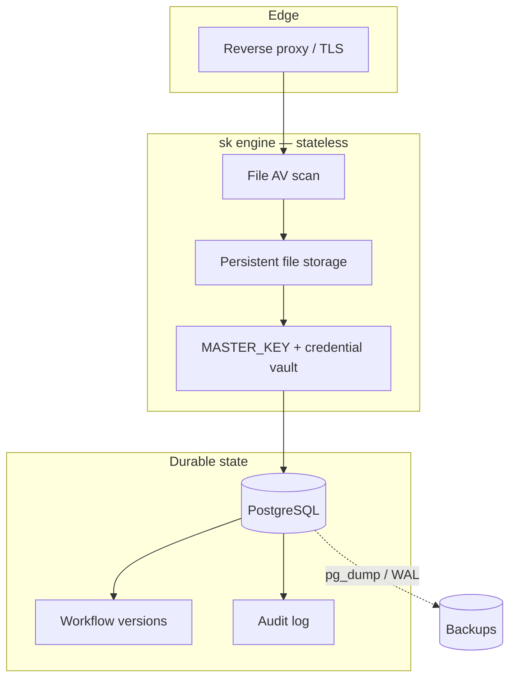
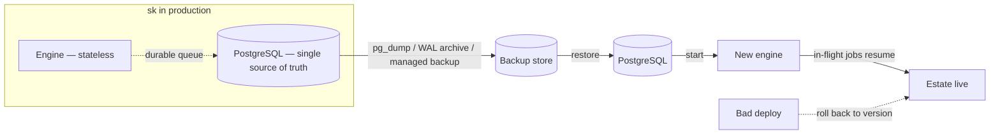

# Production hardening — known caveats & TODOs

**Outcome:** ship sk **production-ready, audit-ready, and recoverable.** Every
workflow run stays permission-checked, recorded, and replayable — and a clean
operator can rebuild the whole estate from a database backup alone.

This page lists the **deliberate defaults** the engine ships with. Each surfaces
as a loud `warn` line at boot — *not* a bug. For every item: what it is, the
risk, how to close it, and the future TODO.

## Hardening layers at a glance



| Layer | Production-ready when | Section |
|---|---|---|
| File AV scan | a real scanner (clamd) answers under budget | [§1](#1-file-uploads-are-not-virus-scanned-scannernoop_in_production) |
| File storage | points at a persistent, backed-up path | [§2](#2-storage-directory-is-set-via-a-config-override-overrideactive) |
| Secrets | `MASTER_KEY` set + rotated | [credentials-and-keys.md](./credentials-and-keys.md) |
| Database | external managed PostgreSQL | [self-host.md](../developers/self-host.md) |
| Recovery | versioned workflows + PG backups | [Backup and Recovery](#backup-and-recovery) |

### Grep the boot warnings

The engine emits these at boot so you can grep for them:

```sh
# from the engine container logs
docker logs subkit 2>&1 | grep -E '"action":"(scanner.noop_in_production|override.active|ephemeral_dir_warning)"'
```

---

## 1. File uploads are NOT virus-scanned (`scanner.noop_in_production`)

### What it is

Every file uploaded into the engine (workflow attachments, inline uploads,
presigned uploads) passes through `getScanner().scan(stream, meta)` before the
file row flips to `status='ready'`. The **default scanner is a no-op**
(`NoopScanner`) — it returns `{ verdict: "clean", engine: "noop" }` for *every*
input without inspecting the bytes.

Boot log when `NODE_ENV=production`:

```
warn  files  scanner.noop_in_production
"FileScanner is NoopScanner in production. Every upload is reported as clean
 until a real scanner is wired. Replace getScanner() with a clamd-backed
 implementation before accepting tenant content."
```

### Risk

| Install shape | Risk | Why |
|---|---|---|
| Single trust boundary (you control every uploader) | **Low** | No untrusted bytes enter the system. |
| Untrusted / multi-tenant uploads | **Real** | A malicious file is accepted and stored unscanned; any later download/processing serves it as-is. Compliance/security hole (no AV gate). |

### Current behavior (by design)

- The upload pipeline calls the scanner **unconditionally** — wiring a real
  backend needs **no route changes**, only the resolver.
- Verdicts:

  | Verdict | File row | Side effect |
  |---|---|---|
  | `clean` | `ready` | — |
  | `infected` | `failed` | `FILE_SCAN_COMPLETED` audit event (verdict + signature) |
  | `timeout` (route wrapper only) | parked in `scanning` | reaped by the cleanup cron |

- Per-call ceiling: `SCANNER_TIMEOUT_SECONDS = 10` (in `files/scanner.ts`) — a
  real scanner must answer within this budget or the row is parked.

### How to close it (real fix — infra + a small code change)

1. **Provision ClamAV** on the host (or a sidecar):
   ```sh
   apt-get install -y clamav-daemon clamav-freshclam
   systemctl enable --now clamav-freshclam   # virus DB updates
   systemctl enable --now clamav-daemon       # clamd on /var/run/clamav/clamd.ctl or TCP 3310
   ```
2. **Implement a clamd-backed `FileScanner`** and return it from `getScanner()`
   in `apps/engine/src/files/scanner.ts`. The contract to satisfy:
   ```ts
   export interface FileScanner {
     scan(stream: AsyncIterable<Uint8Array>, meta: ScanMeta): Promise<ScanResult>;
   }
   // ScanResult = { verdict: "clean" | "infected" | "timeout"; engine: string; signature?: string }
   ```
   Stream the bytes to clamd (`INSTREAM`), map a clean result to
   `{ verdict: "clean", engine: "clamav/<dbver>" }` and a hit to
   `{ verdict: "infected", engine: "clamav/<dbver>", signature: <name> }`. Keep
   the scan under `SCANNER_TIMEOUT_SECONDS`.
3. **Verify:** restart, confirm the boot warning is **gone**, then upload an
   [EICAR test file](https://www.eicar.org/download-anti-malware-testfile/) and
   confirm the file row flips to `failed` with a `FILE_SCAN_COMPLETED` audit row.

### TODO (future)

- [ ] Add `storage.scanner.*` config (backend = `noop | clamav`, host/port/socket,
      timeout) so the scanner is operator-configurable instead of code-swapped.
- [ ] Ship a clamd-backed `FileScanner` and have `getScanner()` construct it from
      that config.
- [ ] Document the AV DB-update cadence (`freshclam`) in `deploy.md`.
- [ ] Gate uploads (refuse, not warn) when `NODE_ENV=production` AND the scanner
      is `noop` AND a future `storage.scanner.require=true` is set.

> **Interim mitigation** if you do not need uploads: there is currently no
> config flag to disable the files surface — open an issue if you want one, or
> restrict the `/v1/files*` routes at the reverse proxy (Caddy) layer.

---

## 2. Storage directory is set via a config override (`override.active`)

### What it is

The engine resolves config from `subkit.config.json` plus **`SK_OVERRIDE_*`
environment overlays** (prefix `SK_OVERRIDE_`, see `config/loader.ts`). In
production, point file storage at a persistent path (e.g. the all-in-one
image's `/data` volume):

```
SK_OVERRIDE_STORAGE_FILES_DIR=/data/files
```

overrides `storage.files.dir`. Boot log:

```
warn  config  override.active   override_keys=["storage.files.dir"]
"SK_OVERRIDE_* active"
```

### Why this is correct (not a problem)

- `storage.files.dir` is **where uploaded files are written on disk**.
- If left **empty** with the `local` backend, `LocalDiskObjectStore` falls back
  to `os.tmpdir()/sk-files` and the engine emits a *different*, more serious
  warning — `ephemeral_dir_warning` — because **tmpdir is wiped on reboot and
  every customer file is lost**.
- Setting it to a **persistent path** (`/var/lib/subkit/files`) is exactly what
  you want: files survive reboots and redeploys. The `override.active` line is
  **pure transparency** — it tells an operator "this value didn't come from the
  default config."

### Action required

**None.** This is the intended production configuration. Keep the directory:

- on persistent storage (not tmpfs),
- backed up if uploads matter,
- owned/writable by the engine's system user.

### TODO (future, optional)

- [ ] Move `storage.files.dir` (and other stable prod values) from a
      `SK_OVERRIDE_*` env into the committed `subkit.config.json` so the
      `override.active` line stops appearing for settled config and overrides are
      reserved for secrets / per-host values.

---

## Quick production readiness checklist

| Item | Default | Production-ready? | Where |
|---|---|---|---|
| File AV scan | `NoopScanner` (always clean) | ❌ wire clamd before untrusted uploads | `files/scanner.ts` |
| `storage.files.dir` | empty → ephemeral tmpdir | ✅ set to a persistent path (done via `SK_OVERRIDE_*`) | `config/loader.ts`, `index.ts` |
| `MASTER_KEY` | required | ✅ set; rotate per `credentials-and-keys.md` | `docs/admins/credentials-and-keys.md` |
| PostgreSQL | bundled in the all-in-one image | ✅ for scale, point at an external managed Postgres | `docs/developers/self-host.md` |

See also: [`self-host.md`](../developers/self-host.md) · [`configuration.md`](./configuration.md) ·
[`settings-reference.md`](./settings-reference.md) · [`credentials-and-keys.md`](./credentials-and-keys.md).

---

## Backup and Recovery

**Outcome:** any clean host can rebuild the entire estate from one backup —
workflows, connectors, credentials, executions, audit log, skills, and knowledge
sources all live in PostgreSQL.



| Property | Guarantee |
|---|---|
| State of record | **PostgreSQL** — back it up and you have backed up sk. |
| Backup method | Standard `pg_dump`, WAL archiving, or managed cloud-database backup. |
| Engine state | **Stateless** — stop, replace, restart with no data loss. |
| In-flight jobs | Durably queued in PostgreSQL; resume automatically on restart. |
| In-memory state | None that must survive a restart. |
| App-level rollback | Every workflow change creates a new **immutable version**; roll back to a known-good version in a single command. History is always available. |
