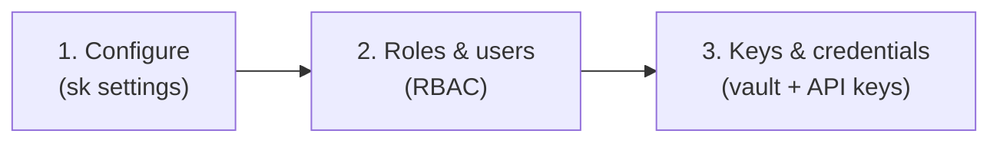

# Admin Quickstart

In about ten minutes your team can work on their own — signing in with the identity provider
you already have, using credentials they never see, doing only what their role allows. Every
one of those runs is scoped, checked, and written down, which is the part you will be asked
about later. Three steps on an already-running engine: **configuration**, **roles**, **keys**.

> **Audience:** The admin standing up governance for a team.
> **Time:** ~10 minutes.
> **Prerequisite:** A running engine — see [Self-host](../developers/self-host.md) or the [Operator quickstart](../operators/quickstart.md).



---

## 1. Configure

Runtime configuration lives in a single JSON file managed through `sk settings` — never in scattered `.env` files. Set your LLM provider, database, and any platform integrations, then confirm:

```bash
sk settings configure          # interactive form
sk settings list               # every leaf + resolved value
sk settings get llm.provider
```

The full model — where the file lives, how values resolve, what stays in bootstrap env — is in [Configuration](./configuration.md), and the generated per-leaf table is [settings-reference.md](./settings-reference.md).

## 2. Roles & users

sk ships four built-in roles: **admin**, **member**, **end-user**, and **service account**. Provision teammates and assign roles; create custom roles and resource grants for finer control.

```bash
sk users create --email teammate@example.com --role member
sk users invite <USER_ID>      # single-use invite; the teammate mints their own key
sk roles list
```

The RBAC/ABAC model, identity providers (OIDC/SSO), and Before-Request Hooks are in [RBAC & Roles](./rbac-and-roles.md). The structural guarantees around it — multi-tenant isolation and the audit trail — are in [Governance & Audit](../concepts/governance-and-audit.md).

## 3. Keys & credentials

API keys are the standard programmatic credential — long-lived, revocable, scoped, hashed at rest, shown once. Connector secrets live in the encrypted Credential Vault.

```bash
sk apikeys create --name ci --role service
sk connectors credentials set <CONNECTOR_ID> --mode bearer --token sk_live_…
```

Set your own `MASTER_KEY` in production and learn the rotation procedure before you need it: [Credentials & Keys](./credentials-and-keys.md). Before accepting untrusted uploads or going live, walk [Production hardening](./production-hardening.md).

---

## Further reading

- [Configuration](./configuration.md) · [RBAC & Roles](./rbac-and-roles.md) · [Credentials & Keys](./credentials-and-keys.md) · [Production hardening](./production-hardening.md)
- [Governance & Audit](../concepts/governance-and-audit.md) — the model behind the controls you just wired.
