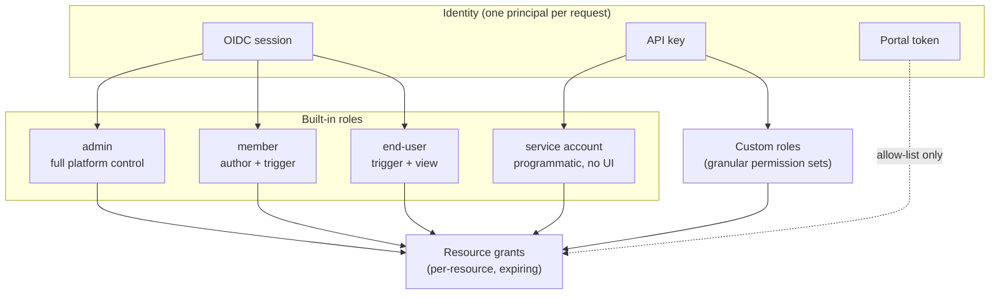
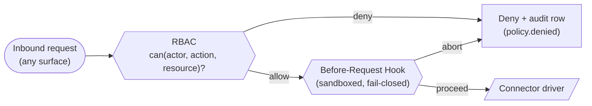

# RBAC & Roles

> **Audience:** Security engineers, compliance reviewers, operators wiring access

**Least-privilege by default, every decision auditable.** No caller reaches a connector or a workflow without passing an explicit permission check, and every allow or deny lands in the append-only audit trail. This page covers the access surface: the pluggable identity chain, the built-in and custom roles, resource grants, and the dynamic policy layer added by Before-Request Hooks.

The structural properties around it — multi-tenant isolation, the audit trail and what its guarantee covers — live in [Governance & Audit](../concepts/governance-and-audit.md).

## At a glance

| Layer | Question it answers | Fails to |
|---|---|---|
| Identity | Who is calling? | Reject (401) |
| Role | What class of action may they take? | Deny + audit |
| Grant | Which specific resources, until when? | Deny + audit |
| Before-Request Hook | Is this request allowed *right now*? | Deny + audit (fail-closed) |
| Driver | Execute against the connector | — |

---

## Identity and Authentication

sk authenticates callers through a pluggable chain. Organisations pick the methods that fit their posture; each request resolves to exactly one principal.

| Method | Lifetime | Scope | Use it for |
|---|---|---|---|
| **OIDC** | Session | Tenant account from token claims | Enterprise SSO (Azure AD, Okta, Google Workspace, any OIDC provider) |
| **API Key** | Long-lived, revocable | Tenant + permission set | Programmatic and CI access |
| **Portal Token** | Short-lived, auto-expiring | Single workflow/conversation | Customer-facing, controlled end-user flows |

**OIDC** provisions tenant accounts from the identity token's claims, so provisioning and deprovisioning stay with the organisation's IdP — users sign in with the credential they already use everywhere.

**API Keys** are hashed before storage; the raw key is shown exactly once at creation and can never be retrieved afterward. Lose one and you mint a replacement and revoke the old. Overlap-window rotation lets a new key go live before the old expires, so access is never interrupted.

**Portal Tokens** carry only the permissions their flow requires — nothing more — and expire automatically. They are the right credential when an end user must touch a specific workflow without becoming a full tenant member.

---

## Role-Based and Attribute-Based Access Control

Every API route, MCP call, and workflow trigger is permission-checked **before** any resource is read or any action is taken. There is no path through the platform that bypasses authorization.

### Persona and permission hierarchy

| Role | Can do | Cannot do |
|---|---|---|
| **admin** | Full platform control: roles, keys, connector promotion, workflows | — |
| **member** | Author and trigger workflows | Manage tenant identity/keys or promote DEV connectors to PROD |
| **end-user** | Trigger and view workflows | Modify any definition |
| **service account** | Programmatic access | Reach any interactive surface |

Beyond the built-ins, operators define **custom roles** for finer control, attach **resource grants** scoped to a single resource with an expiry, and group users for assignment.

`connector:promote` is intentionally admin-only in the built-in roles. It moves encrypted production access and therefore does not ride on the broader member-level `connector:write` permission. A custom role may receive it explicitly; every allow or deny is audited before promotion state changes.

### Before-Request Hooks

A Before-Request Hook is a sandboxed script that runs immediately before a connector request executes, adding a dynamic policy layer on top of static RBAC. It receives the full request context — caller identity, target connector, operation type, request parameters — and enforces rules that roles cannot express.

| Property | Behaviour |
|---|---|
| Sandbox | Isolated QuickJS-WASM, strict CPU budget |
| Access | No network, no file system, no database |
| Error / timeout | **Fails closed** — request denied |
| Auditing | Every execution recorded in the audit log |

Typical hooks: block writes during a maintenance window, require extra approval for specific production connectors, enforce data-residency constraints, or log requests matching a pattern. The operator how-to for authoring and wiring a hook is in [Scheduling & Hooks](../operators/scheduling-and-hooks.md).

### Policy evaluation order

Evaluation is sequential and short-circuits on the first denial.

1. **RBAC first.** No permission for the action → denied before the hook is ever consulted.
2. **Hook second.** RBAC passed → the Before-Request Hook runs. If it aborts, the request is denied with the hook's reason.
3. **Driver last.** Only when both pass does the request reach the connector.

### `stats:read` is operator-tier

`stats:read` exposes process-scoped operational signals — grant it only to operator/admin principals on a shared deployment.

The operator health digest (`GET /v1/operator/health-digest`, the `subkit://operator/health-digest` MCP resource, and the on-connect MCP `instructions` summary) is gated on `stats:read`. Its **failing-runs** and **pending-patch** sections are tenant-scoped, but its predictive-maintenance **risk signals** (Postgres-pool saturation, dead-letter-queue growth, transient-DB-retry rate, connector-health mix, LLM-fallback fraction, RSS high-water) read *engine-wide* gauges — the pool, the DLQs, and the host RSS are shared infrastructure, not per-tenant. A principal with `stats:read` on a multi-tenant deployment can therefore infer host-level load that other tenants contribute to.

This is intentional: `stats:read` is the operator-tier permission, and "your runs are fine but the host is about to OOM" is exactly the warning the per-tenant lagging signals cannot give in time.

| Guard | Behaviour |
|---|---|
| Portal-token-class principals | **Structurally barred** from `stats:read` regardless of role. The RBAC evaluator short-circuits every identity path (resource grant, group, role) for a `portal_token` provider and admits only the workflow/conversation allow-list (`apps/engine/src/rbac/evaluator.ts:256-306`). A portal token can never resolve `stats:read`, even if a tenant admin mints a custom role carrying it. |
| Audit attribution | Risk values are written to the audit trail under the **system** tenant (`operator.risk_signal_raised` / `operator.risk_signal_cleared`), not the reading tenant's — so the SIEM trail attributes a host condition once rather than per reader. |

---

## Further reading

- [Governance & Audit](../concepts/governance-and-audit.md) — multi-tenancy, the append-only audit trail, what its guarantee covers, and conversational secret hygiene.
- [Credentials & Keys](./credentials-and-keys.md) — the credential vault, master-key rotation, and release signing.
- [Scheduling & Hooks](../operators/scheduling-and-hooks.md) — the operator how-to for Before-Request Hooks.
- [glossary — governance terms](../concepts/glossary.md#group-5-governance) — Audit Log, RBAC, Before-Request Hook, Self-Healing, Patch Candidate.
