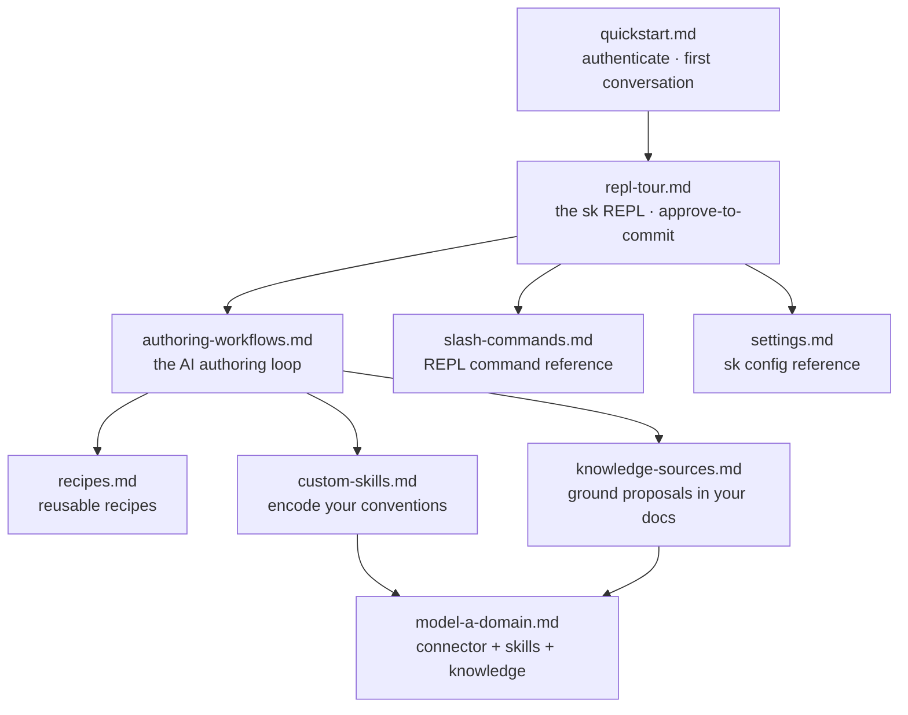

# Authors

Build and run workflows by chatting with `sk` — describe the outcome in plain
language, approve what the AI proposes, and ship a governed, versioned workflow.

| Doc | What it covers |
|---|---|
| [quickstart.md](quickstart.md) | Get authenticated and open your first authoring conversation in about 5 minutes. |
| [repl-tour.md](repl-tour.md) | Author connectors and workflows by conversation in the `sk` REPL — the approve-to-commit loop, slash commands, headless `-p`. |
| [authoring-workflows.md](authoring-workflows.md) | The AI authoring loop, the human approval gate, probe/preview, and stage-aware prompting. |
| [recipes.md](recipes.md) | Recipe authoring deep-dive: schema, intent matching, and worked walkthroughs. |
| [custom-skills.md](custom-skills.md) | Author, scope, and promote Skills that encode your conventions. |
| [knowledge-sources.md](knowledge-sources.md) | Upload, tag, and refresh the documents the AI grounds its proposals in. |
| [model-a-domain.md](model-a-domain.md) | Teach sk a whole field of work — the connector + skills + knowledge-source trio, worked end to end. |
| [slash-commands.md](slash-commands.md) | Generated reference of the `sk` REPL slash commands. |
| [settings.md](settings.md) | Generated reference of every `sk` configuration key. |
