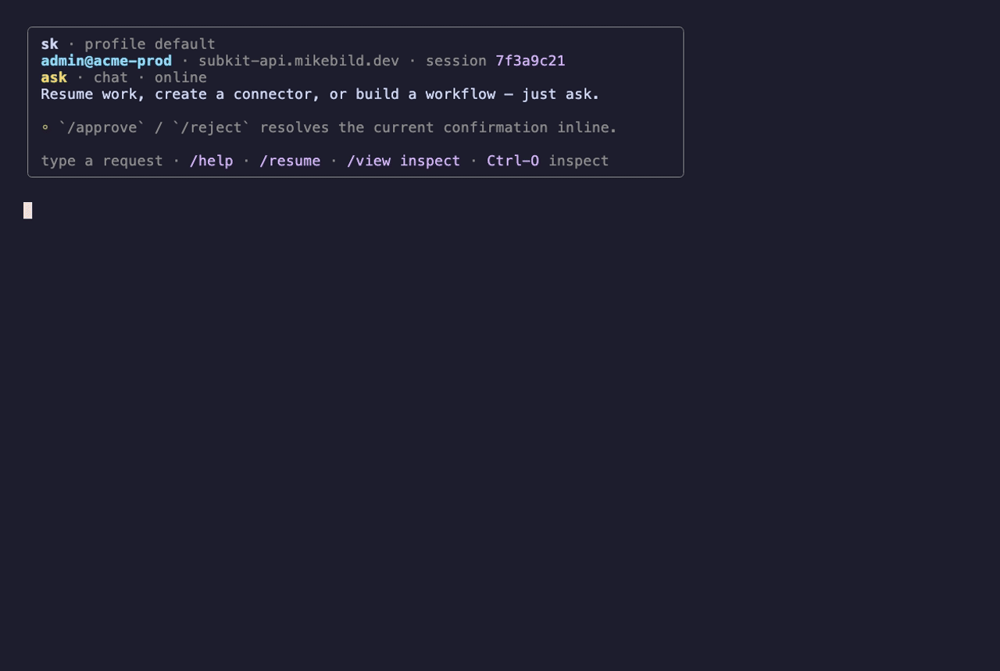
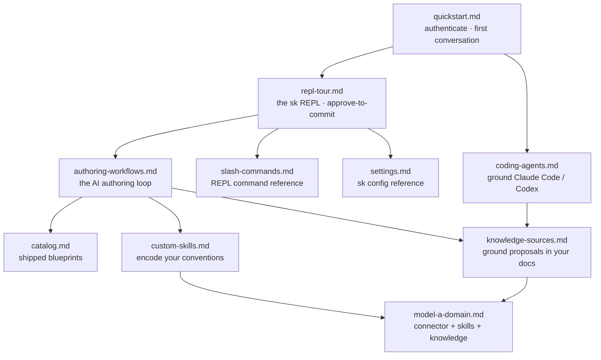
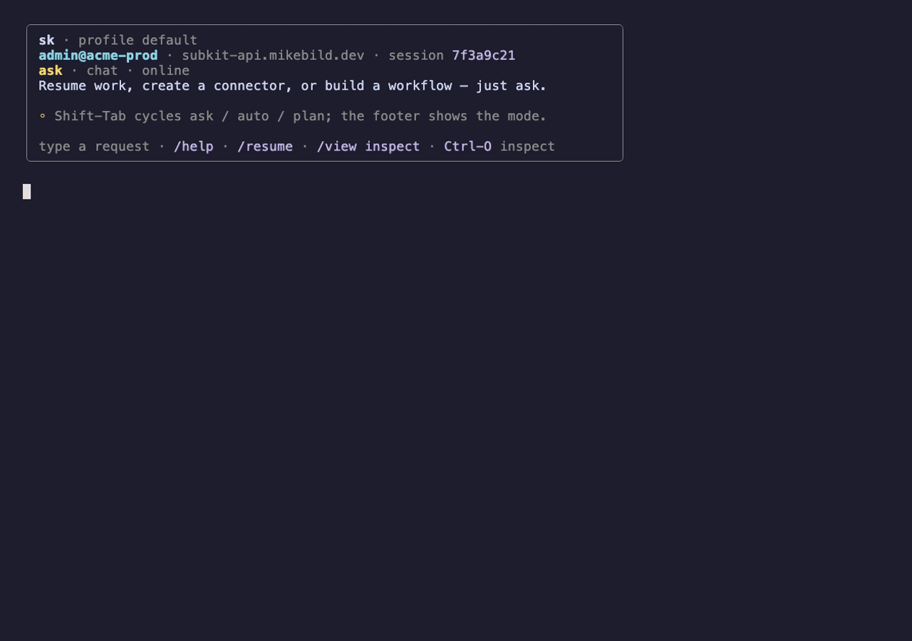

# Authors

Get from one sentence to a process that runs every week without you. You describe the
outcome, sk builds it and shows you what it built, you approve it — and from then on it
runs, permission-checked and recorded, whether you are at your desk or not.

Everything the REPL can do is one `/` away — drafts, connectors, context, settings:

Ordered by the job in front of you, not by mechanism:

| You want to | Doc |
|---|---|
| **Get connected** and open your first conversation (5 minutes) | [quickstart.md](quickstart.md) |
| **See what's worth building** — real cases, each traceable to a shipped blueprint or a workflow we run ourselves | [Use cases](../use-cases.md) · [Catalog](../catalog.md) |
| **Build a process** — the AI authoring loop, the approval gate, probe/preview | [authoring-workflows.md](authoring-workflows.md) |
| **Use what you built** — call a workflow from your app, a webhook, an AI client, a schedule or a terminal | [calling-workflows.md](calling-workflows.md) |
| **Pick the right door** for a change — editing a definition vs. running one, seven worked examples | [choosing-your-surface.md](choosing-your-surface.md) |
| **Ask your company's knowledge** and trust the answer — sourced, quote-checked, honestly refused | [asking-your-knowledge.md](asking-your-knowledge.md) |
| **Teach sk a whole field of work** — connector + skills + knowledge, worked end to end | [model-a-domain.md](model-a-domain.md) |
| **Encode your conventions** as Skills the AI follows | [custom-skills.md](custom-skills.md) |
| **Feed it your documents** — upload, tag, refresh | [knowledge-sources.md](knowledge-sources.md) |
| **Ground your coding agent** — Claude Code / Codex briefed on your domain, with a review loop | [coding-agents.md](coding-agents.md) |
| **Drive the `sk` REPL** — the approve-to-commit loop, headless `-p` | [repl-tour.md](repl-tour.md) |
| **Look something up** — slash commands, configuration keys | [slash-commands.md](slash-commands.md) · [settings.md](settings.md) |
| **Connect another system** from the Cockpit without pasting a key, and approve a prepared change to this installation | [connections.md](connections.md) |
