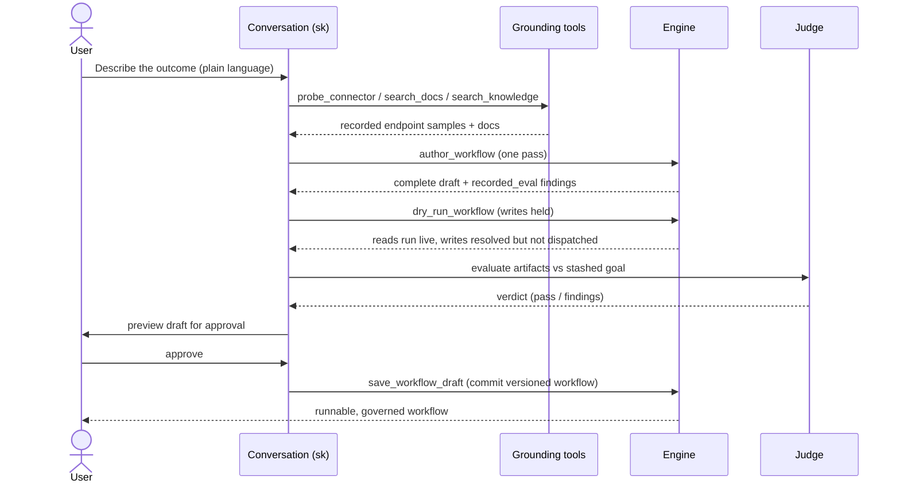
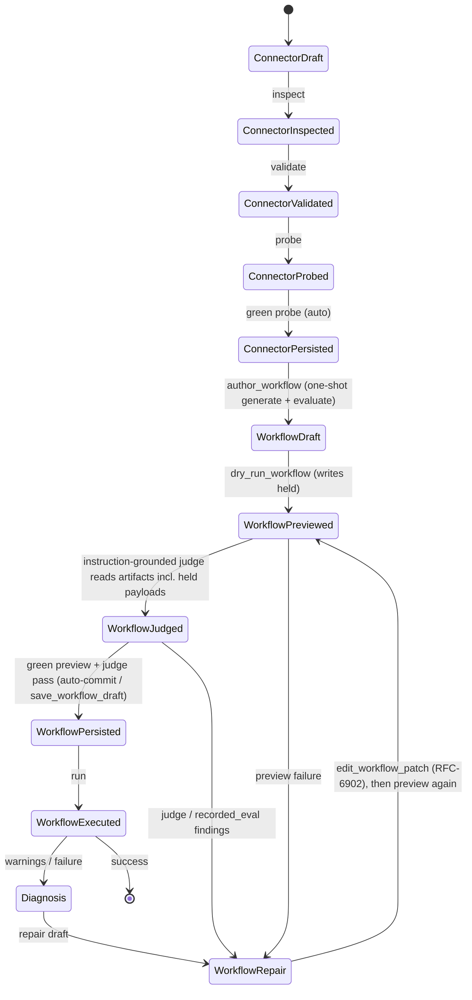
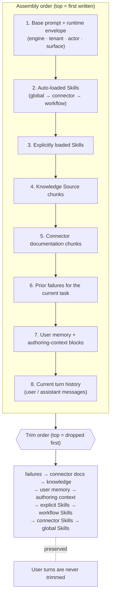

# AI-Assisted Authoring

**Describe the outcome. Get a governed, audited, versioned workflow in minutes — not a build project that runs for weeks.**

Traditional workflow tools put construction on the builder: know the connector, learn the config syntax, draw it on a blank canvas. You ship what developers can build, not what the business needs. sk inverts that — the author states intent in plain language, the AI does the structural work, and a human signs off before anything runs.

| Business outcome | How sk delivers it |
|---|---|
| **Time** — first workflow in minutes | One `author_workflow` pass generates the complete definition, grounded in real endpoint evidence |
| **Compliance** — audit-ready by construction | Nothing reaches the engine without an explicit human approval; every step is reviewable |
| **Risk** — no raw secrets in the loop | Credentials are referenced by name through the Credential Vault, never seen during authoring |
| **Determinism** — production is AI-free | Once committed, the engine runs the workflow with zero AI involvement |


> **Reading time:** ~18 min · **Audience:** engineers integrating with sk's authoring, operators curating Skills & Knowledge

---

## The Conversation Model

A Conversation is the primary authoring interface. The user describes a goal; the AI replies with a structured proposal — a Draft workflow that can be inspected, modified, and approved — never free-form code or autonomous decisions.

| Property | Behaviour |
|---|---|
| **Persistent** | Survives reloads, reconnects, multi-day sessions |
| **Resumable** | Start Monday, return Wednesday, pick up exactly where you left off — context, draft state, pending questions recalled |
| **Structured** | The AI operates over a fixed palette of authoring actions; its reasoning is a visible sequence of explicit moves, not opaque text |

The primary entry is `author_workflow` — one call that takes the user's goal verbatim, grounds generation in recorded endpoint samples and ingested docs, emits the complete evaluated draft, and returns structured `recorded_eval` findings. Around it sit grounding actions (probe a connector, search docs), the hold-writes preview, and repair actions that each apply one specific finding.

Operators and scripted clients that already know the target definition use the same model through the direct workflow and execution surface — skipping the conversational loop and working directly with definitions plus `POST /v1/executions` for preview and execution.

### One turn, end to end



---

## The Authoring State Machine

The engine maintains an explicit state machine per conversation and uses it to decide which actions are visible, which moves are blocked, and what the next valid move is. The model does not infer progress from transcript history.



**Verification is persistence.** Probe persists the connector inline; a green, judged dry-run commits the workflow inline. There is no separate "save" step on the happy path. Dry-runs hold writes — read steps execute live, write steps are fully resolved (URL, headers, materialized body) but never dispatched, and the held request is recorded as the artifact the judge evaluates. Any draft mutation invalidates downstream checkpoints automatically.

**The authoring triad.** Workflow authoring is four verbs, in order: `author_workflow` (generate the complete grounded draft), `dry_run_workflow` (test it with writes held), `edit_workflow_patch` (revise it with an RFC-6902 JSON-Patch), and `save_workflow_draft` (commit the version). Generation is ONE `author_workflow` call, not a micro-iterated step-by-step build.

**Stage gate.** `edit_workflow_patch` is the repair-stage verb. While the draft is in its initial stage — no recorded preview, no recorded-eval/judge findings — it refuses with `authoring_stage_violation` and names the exact next valid actions (`author_workflow`, `dry_run_workflow`, `save_workflow_draft`), none of which is ever gated. The moment a preview or findings exist, it unlocks unconditionally — that is when a patch edit has real artifacts to reason against.

The state is persisted in the conversation draft summary:

| Field | Meaning |
|---|---|
| `mode` | `connector`, `workflow`, `execution`, or `diagnosis` |
| `stage` | concrete state, e.g. `connector_probed`, `workflow_previewed` |
| `lifecycle_state` | active target is `draft_only` or `persisted` |
| `blocked_by` | exact missing checkpoints/fields blocking the next durable action |
| `next_required_action` | next state-advancing action to take or have the user approve |
| `checkpoints[]` | freshness for `inspect`, `validate`, `probe`, `preview`, `persist`, `execute`, `diagnose` |

The current stage, active target, and checkpoint freshness are part of the runtime contract, not prompt advice. The same grounding rule applies to explanatory follow-ups: when a user asks why something was named or configured a certain way, the assistant answers from recorded state, audit history, ingested docs, or a fresh grounding call — or says plainly that the reason is not recorded. It does not speculate.

When an answer is grounded in a knowledge source or connector documentation, `sk` shows a dim `Sources: …` footer beneath it — the source names the answer was built on, so a reader can verify the claim rather than trust the prose. The footer appears only when the turn actually cited a source that resolves for the tenant (the same refs written to the audit log); a source-less answer shows nothing. It carries no new interaction — it is a display of the grounding that already happened.

### New draft versus saved workflow

A conversation can stay bound to a saved workflow after rename, commit, and execution so follow-up runs and repairs stay grounded. That binding is intentional but not sticky against explicit new-workflow intent.

When the user says they want to create a new workflow after inspecting or running an existing one, the engine clears the saved-workflow binding before the next authoring move. The next `author_workflow` call targets a fresh draft, not an in-place update. Updating a saved workflow remains an explicit path: keep the bound target and commit back into it.

---

## The Human-in-the-Loop Approval Gate

The most important architectural decision in sk: **nothing reaches the execution engine without an explicit human approval.**

When the AI finishes a Draft, it pauses the authoring loop and presents it for review. The operator sees every step, connector reference, parameter, and branching condition — and can push back, ask for changes, iterate. On approval, the Draft is committed as a new versioned Workflow; the Conversation transitions to active and the workflow is ready to run.

This is the governance model, not a UX convenience. It is the structural answer to "How do we know the AI did the right thing?" — because a human checked and signed off before anything ran.

The gate sits on top of hard quality gates:

| Gate | Rule |
|---|---|
| Connector save | Blocked until `inspect`, `validate`, `probe` checkpoints are fresh |
| Workflow commit | Blocked until `inspect`, `validate`, `preview` checkpoints are fresh |
| Workflow run | Always targets a persisted version, never an ambiguous draft |
| Connector persistence | A green `probe_connector_draft` calls `saveConnectorAtomic` inline (audit reason `auto_persist_on_green_probe`), returns `auto_saved: true` |
| Workflow persistence | A green, judged `dry_run_workflow` calls `commitWorkflowAtomic` inline (audit reason `auto_persist_on_green_dry_run`), returns `auto_committed: true` |
| Force overrides | `force_save: true` (after a failed probe) and `force_commit: true` (after a failed dry-run) go through the explicit `ask_user_confirm` carrier so the deviation is auditable |

Approval is the final human sign-off after the state machine has already established that the draft is internally coherent — not a substitute for missing technical checks.

---

## Probe Before Save, Preview Before Commit

The clean authoring experience treats intermediate verification as first-class product steps, not optional debugging.

**Connectors:**

| Step | Action |
|---|---|
| 1 | Start or update the connector draft |
| 2 | Inspect the current draft |
| 3 | Validate required fields and config shape |
| 4 | Collect static credentials through the masked `sk` form or MCP single-use URL elicitation; never through chat text |
| 5 | Probe the real upstream boundary — a green probe persists inline; envelope carries `auto_saved: true` |

**Workflows:**

| Step | Action |
|---|---|
| 1 | **Ground** — `list_connectors`, `probe_connector` for any never-called connector (records the real response shape), `search_docs` / `search_knowledge` when the endpoint surface is unclear |
| 2 | **`author_workflow`** (one call) — generates the COMPLETE definition (steps, transforms, input/output schema, trigger), evaluates it against recorded evidence with bounded auto-repair, stashes it as the draft; read the `recorded_eval` findings |
| 3 | **`dry_run_workflow`** — hold-writes preview: reads run live; writes resolved (URL, headers, materialized body) but never dispatched, recorded as held request artifacts |
| 4 | **Judge** — instruction-grounded judge evaluates the artifacts (held payloads included) against the stashed goal; green preview + judge pass auto-commits (`auto_committed: true`) |
| 5 | **Repair on findings** — apply specific findings via `edit_workflow_patch` (an RFC-6902 JSON-Patch over the draft; accept all, decline all, or accept a partial subset of its operations), iterate a transform with `dry_run_transform`, then preview again |
| 6 | **Run** the persisted workflow |

No separate "save"/"commit" on the happy path — the verification step is the persistence step. Executing write steps for real during a preview is the rare exception, behind explicit user confirmation (`execute_writes: true`); externally visible destinations (recipient addresses, channels, webhook URLs) must always come from the user, never fabricated placeholders.

The engine tracks checkpoints as fresh or stale. Any draft mutation invalidates later checkpoints — editing after a successful preview makes the preview stale, so the workflow must be previewed again before commit. The assistant does not "think" a connector is ready; it reads that from checkpoint state. The draft summary carries the concrete next suggested tool, so prompt assembly, confirmations, and surface-specific evaluations all reason from the same contract.

### CLI parity

The `sk` CLI mirrors the conversational gates, so operators get the same guarantees from a script or pipeline:

| Conversation tool | sk CLI subcommand |
|---|---|
| `validate_draft` | `sk workflows validate <file.json>` |
| `dry_run_workflow` / `dry_run_step` | `sk workflows preview <file.json>` (alias: `dry-run`) |
| `save_workflow_draft` | `sk workflows create <file.json>` |
| `validate_connector_draft` (shape check) | — (use the conversational loop for structural checks) |
| `probe_connector_draft` / `test` | `sk connectors probe <id>` (alias of `test`) |
| `inspect_connector_draft` | `sk connectors inspect <id>` (alias of `get`) |

`sk workflows create` runs `validate` + `preview` as a pre-flight by default. `sk connectors create` runs a driver probe after the create returns. Both accept `--skip-checks` as an explicit escape hatch — it surfaces a stderr warning and is reserved for callers that already validated elsewhere. The same `inspect → validate → preview/probe → commit/save` state machine gates the persisted write on both surfaces.

### Warnings feed the next turn

When a dry-run (`dry_run_workflow`, `dry_run_step`) produces structured warnings — unresolved identifiers, rate-limit signals, pagination edges — they attach to the draft's `latest_preview` and feed automatically into the next turn's `prior_failures` block. The assistant sees them as structured context without the user quoting them back. `sk workflows run` mirrors this by printing a `WARN step=<key> code=<code> msg=<text>` line per warning on stderr while keeping the JSON payload on stdout unchanged.

### Submit/abort retry loop

Every structured LLM flow — `generate`, `extract`, `repair`, `discover` — goes through the same tool loop in `AiSdkModel.generateObject`. The model must call `submit` (return the final structured object) or `abort` (give up with a reason). Unknown tool calls trigger another iteration with the result appended so the model can self-correct. The loop is hard-capped at `MAX_TOOL_LOOP_ATTEMPTS = 8`; callers can tighten it per-flow via `maxAttempts`.

### Prompt caching

Stable context (skills, ingested docs, knowledge chunks) is marked with an Anthropic ephemeral `cache_control: { type: "ephemeral", ttl: "1h" }` breakpoint. Volatile context (user memory, prior failures, the current turn's messages) refreshes every call. The `llm.cache.hit_rate` metric (`llm_cache_hit_tokens_total` / `llm_prompt_tokens_total`) tracks reuse of stable blocks within the 1-hour window; the mock provider simulates the same accounting so tests can assert on cache behaviour.

### Tools for context

The assembler pre-loads Skills + docs + Knowledge chunks before every turn. On-demand retrieval uses four conversation tools, in precedence order:

| Order | Tool | Use |
|---|---|---|
| 1 | `search_knowledge` | semantic search over tenant Knowledge Sources |
| 2 | `search_docs` | ranked search over a connector's ingested docs (OpenAPI/GraphQL/HTML/Markdown); hits carry a `match_type` (endpoint / auth / schema / text). Use when `search_knowledge` is empty and the answer is connector-specific |
| 3 | `fetch_connector_docs` | full doc overview for a connector |
| 4 | `fetch_connector_self_description` | live-fetch the connector's *own* published docs — its `llms.txt` / `llms-full.txt`, OpenAPI spec, or GraphQL introspection (`kind: "llms" \| "openapi" \| "graphql" \| "all"`). Use to pull deeper detail the inline endpoint signatures don't carry |
| 5 | `web_search` | Anthropic-native server-side web search (billed per search; Claude models only). On by default; advisory escalation in `policies/web-search-escalation.ts`; gated per tenant by `llm.web_search` (toggle via /settings) |

When a connector is in scope, the assembler doesn't inline its full doc corpus — that would blow the token budget. Instead it surfaces a one-line pointer (*"this connector publishes its own docs — fetch on demand with `fetch_connector_self_description`"*) alongside compact endpoint signatures pulled from the discovery index. sk fetches the connector's own published docs lazily, only when the model needs more than the signatures, so the workflow is grounded in the target's real documentation without paying for prose it never reads. The remembered links are described in [Connectors → Connector Self-Description](../concepts/connectors.md#connector-self-description).

### Self-healing retry

When drift is detected, the repair flow proposes a patch, classifies it, and dry-runs it against the most recent `execution_fixtures` row. If either gate rejects, the loop re-prompts the LLM with the structured rejection folded into `prior_failures`, up to `MAX_REPAIR_ATTEMPTS = 2` total. The final patch candidate carries a `metadata.rejection_chain` array recording every prior rejection, so reviewers see what was tried. Rate-limit-class drift (HTTP 429 / 503 with a template `rate_limits` hint) produces a distinct `kind: "rate_limited"` candidate — same retry loop, but the patch only adjusts backoff metadata.

---

## Playground Mode — Scratch Authoring That Never Persists

Sometimes you want to explore — try a connector shape, sketch a workflow, see what a dry-run returns — without leaving anything behind. Playground mode is an ephemeral authoring space: the full triad works exactly as it does normally (author, dry-run, edit, even the judge), but nothing is ever written to the tenant. No draft is persisted, no connector is saved, no workflow is committed. When the conversation ends, the scratch work is gone.

It is a durable per-conversation flag — set it once when you start, and every turn in that conversation stays ephemeral. There is nothing to remember to clean up afterward.

| Surface | How to start a playground conversation |
|---|---|
| MCP client | Set `_meta.sk_playground` on the conversation-start call |
| HTTP API | Pass a `playground` field in the conversation-start body |

Use it for a throwaway exploration, a live demo, or a "what would this even look like?" question where committing anything would be noise. When you want the real thing, start an ordinary conversation and the same steps persist as usual.

---

## Partial-Accept Of Edits

When you ask for a change to a draft, `edit_workflow_patch` expresses it as an RFC-6902 JSON-Patch — a precise, ordered list of operations against the workflow definition (add this header, replace that URL, remove this step). Before any operation is applied, the patch is presented for confirmation, and you have three responses, not two:

| Response | Effect |
|---|---|
| **Accept all** | Every operation in the patch is applied. |
| **Decline all** | The draft is untouched; nothing changes. |
| **Accept a partial subset** | You choose which operations to apply; the rest are dropped. |

Partial-accept matters when a single edit bundles a change you want with one you don't — take the corrected pagination cursor, leave the header rename you didn't ask for. The accepted subset is applied atomically and, as with any draft mutation, invalidates downstream checkpoints so the draft is previewed again before it can commit. Nothing is silently applied: every operation you see is either accepted by you or dropped.

---

## Payload-First: A Sample Payload Drives The Input Contract

Authoring is easier when you can hand the AI a concrete example of the data the workflow will receive. That is `input_schema_sample` — a sample TEST payload that grounds the resolved input contract and seeds the first dry-run.

The input contract resolves by a fixed precedence:

| Priority | Source | When it applies |
|---|---|---|
| 1 | **Declared** | An explicit `input_schema` on the workflow always wins |
| 2 | **Sample** | With no declared schema, the shape is inferred from `input_schema_sample` |
| 3 | **Synthesized** | With neither, the engine synthesizes a minimal contract from how the steps reference their inputs |

The sample is scaffolding, not content. **The test payload is never persisted into the workflow definition.** It drives dry-runs and shapes the contract during authoring, then is discarded — what gets committed is the resolved `input_schema`, never the example values you tested with. A committed workflow stays free of throwaway test data while you still author against realistic inputs.

---

## Testing A Draft With `includeStepResults`

A dry-run tells you whether the draft is green. When you need to know *why* a step behaved the way it did, pass `includeStepResults` on `dry_run_workflow` (or on `run_workflow` for a committed workflow). The response then carries the raw per-step inputs and outputs — exactly what each step received and exactly what it produced.

This is the self-diagnosis lever. Instead of guessing which step mangled a field, read the actual value that flowed into it and the value it emitted:

- A transform returns something unexpected → read its input scope and its return value side by side.
- A downstream step can't resolve a scope path → see the real shape the upstream step actually produced.
- You are calibrating a new draft against an `input_schema_sample` → confirm each step consumes the sample the way you intended.

It is opt-in because the per-step payloads are verbose — omit it for a quick green/red check, include it the moment you are actually debugging.

---

## Diagnosis Is Part of Authoring

Execution is not the end of the loop. When a persisted workflow runs and produces warnings or a suspicious result, the conversation enters diagnosis mode instead of generic retry.

Diagnosis keeps the latest execution and its causal context attached to the draft summary:

| Field | Captures |
|---|---|
| `latest_execution` | exact persisted workflow id and version that ran |
| `diagnosis_available` | the latest run should be inspected before editing |
| `latest_diagnosis` | structured reason, warning sources, step-level summaries from the diagnosis pass |

This matters most for expression-heavy workflows. A run can technically succeed while carrying warnings such as unresolved identifiers in scope paths. The static verifier checks the step-id segment of a reference: a reference to a non-existent step — writing `$scope.wrong_step.data` when no `wrong_step` exists — is blocked before commit. It does not catch field-path mistakes on an existing step: writing `$scope.step.field` instead of `$scope.step.data.field` passes the static check and surfaces only as a runtime unresolved-identifier warning. For those, the right recovery is not "run it again" but "diagnose, repair the draft, preview again, commit again, then run again." Diagnosis is a first-class authoring phase, not an operator-only debugging escape hatch.

---

## Stage-Aware Prompting And Tool Narrowing

The loop constrains both prompt guidance and the visible authoring surface by mode and stage:

| Mode | Prompt focus | Visible surface |
|---|---|---|
| connector | Stay inside connector work until the connector is persisted | Connector actions |
| workflow | Inspection, validation, preview, commit | Workflow actions; commit only when checkpoints permit |
| execution / diagnosis | The latest persisted run and its repair path | Run + diagnosis actions |

Premature actions — connector save, workflow commit, diagnosis — only become visible when the relevant stage and checkpoint state permit them, rather than always-visible with runtime rejection. Prompt guidance, action visibility, and runtime gates all read from the same state model, which is why the flow stays consistent across turns.

---

## Multi-AI Provider

sk is not tied to a single AI model. It supports Claude (Anthropic), OpenAI GPT models, and Google Gemini. Providers are interchangeable — swapping models requires no changes to connectors, workflows, or skills.

| Property | Behaviour |
|---|---|
| Routing | Best available provider by operator config and task type |
| Budgets | Token budgets enforced per tenant and per Conversation; operators set a monthly ceiling, consumption surfaces in the audit log |
| Runtime | The provider is an authoring-layer detail; a committed workflow runs with no AI involvement, regardless of which model authored it |

### OpenAI-compatible endpoints

The `openai` provider also drives any **OpenAI-compatible** endpoint — a self-hosted open-weight model, an internal gateway, or a third-party API speaking the OpenAI wire format. Point the slot at the endpoint:

```
llm.provider                  = openai
llm.providers.openai.base_url = https://llm.internal.example/v1   # your endpoint
llm.providers.openai.api_key  = <key>                             # sent as a Bearer token
llm.providers.openai.model    = <model-id>
llm.summarize_provider        = openai                            # optional
llm.summarize_model           = <fast-model-id>                   # optional
```

Two behaviours switch on automatically whenever `base_url` is non-empty, because a custom host typically implements only a subset of the OpenAI surface:

- **Transport.** Requests use `POST <base_url>/chat/completions` (Chat Completions), not the OpenAI Responses API.
- **Attachments.** The Files API upload path and audio/video inputs are disabled; files fall back to inline content or extracted text. Inline images and small documents still work.

Leaving `base_url` empty keeps the slot on real OpenAI with full Responses API and Files API behaviour. Structured-output authoring works on any tool-calling endpoint — it runs through a provider-agnostic tool loop rather than OpenAI-specific JSON-schema response formats.

> **Known limitation.** The attachment downgrade is a conservative default: it assumes an arbitrary custom endpoint serves text and inline images only. Some OpenAI-compatible servers (e.g. vLLM, SGLang) do serve vision/audio and a real Files API — there is currently no per-endpoint opt-back-in, so those richer capabilities aren't used on a custom `base_url`. A per-endpoint capability override is a tracked follow-up.

---

## Skills: Curated Context

The AI is only as useful as its context. Without organization-specific context it proposes generic workflows — not one that follows your GDPR handling policy, uses your Salesforce field mappings, or respects your API versioning conventions.

A Skill is a curated, reusable piece of context loaded into the AI's window during a Conversation and other AI-assisted flows (discovery, diagnosis, bounded repair). Skills encode best practices, integration patterns, security policies, and domain knowledge specific to your organization. When the AI proposes a workflow involving your Stripe connector, the Stripe Skill loads automatically — and the proposals reflect your conventions, not just generic Stripe API knowledge.

| Aspect | Rule |
|---|---|
| Ownership | Operators create and manage Skills |
| Scope | Global (all Conversations), per-Connector (loaded when referenced), or per-Workflow |
| Promotion | Not auto-generated, not auto-promoted; the platform surfaces Skill Candidates from execution history, a human promotes |

The platform learns from what works; humans decide what becomes canonical guidance.

---

## Knowledge Sources: Enterprise Documents

Skills are concise and curated. For document-scale context — runbooks, API specifications, compliance frameworks, architecture diagrams — sk provides Knowledge Sources.

A Knowledge Source is a persistent document store. Operators upload PDFs, runbooks, API specs, compliance documents, and diagrams; the platform chunks and indexes them for semantic search. During a Conversation, discovery pass, or diagnosis/repair loop, the AI searches them to ground its proposals. A workflow that correctly follows your GDPR compliance runbook is possible because the runbook is a searchable Knowledge Source.

When a document is uploaded interactively — from chat, an attached file, or `sk knowledge-sources create` — the AI auto-analyzes it to generate a short description and topical tags, making each source self-describing: the AI can list sources and decide which covers a topic before searching, and a search can be narrowed to a tag. The description is generated only when none was supplied; tags are a deduped set that re-analysis replaces wholesale. Auto-analysis is best-effort — if it fails (e.g. the model budget is exhausted) the upload still succeeds without enrichment. Re-run it anytime (`sk knowledge-sources analyze <id>`, or the `analyze_knowledge_source` tool in chat). Bulk paths — crawled pages, scheduled refreshes — stay mechanical and are not auto-analyzed.

Knowledge Sources have configurable refresh strategies — manual, scheduled, or webhook-triggered — and can be scoped to a tenant (global) or to specific workflows.

| | Skills | Knowledge Sources |
|---|---|---|
| Nature | Dense, operator-authored guidance | Broader organizational artifacts |
| Treatment | Specific instructions the AI should follow | Searched for context, not prescriptive rules |

Committed workflow execution does not query Skills or Knowledge Sources. Those systems improve authoring and repair quality; the runtime path stays deterministic once a workflow is committed.

## Context Assembly And Trimming

For each AI-assisted turn, the engine assembles prompt context in a fixed order. Order matters twice — it shapes how the model sees context (top is most foundational) and how the trimmer drops it under pressure (top survives longest, bottom goes first):



This order is part of the contract. Operator-curated connector and workflow guidance survives longer than incidental historical context under tight budgets — so the AI's deep grounding in a tenant's own conventions is the *last* thing dropped, not the first.

Conversation replay is bounded: tool results are truncated before re-feeding into later turns, explicit compaction markers suppress older replay, and oversized histories collapse into a deterministic summary plus the recent tail. The model keeps the current task context without dragging every historical tool payload back through the window.

---

## The Connector Catalog

When a user names an external boundary — "pull from our Salesforce instance" or "post to Slack" — the AI needs connector-specific knowledge. Generic HTTP knowledge is not enough.

| Source | What it gives the AI |
|---|---|
| Connector Templates | A catalog covering common enterprise services — driver type, auth config, doc references, setup guidance. The AI understands the target API, not just the idea of it |
| Documentation Ingestion | OpenAPI specs, GraphQL schemas, and HTML docs are indexed and become context for that connector — specific endpoints, parameters, error codes |
| Credential Vault | Users never handle raw secrets; the AI proposes "use your Stripe connector" without seeing the key. Credentials are referenced by name, never by value |

Cloudflare and Firebase/Firestore are catalog templates (`cloudflare` and `firebase`). When no
catalog template exists, `import_connector_from_spec` can start from OpenAPI JSON/YAML or Google
REST Discovery JSON, inline or at a URL. URL imports are streamed up to 50 MiB and use server,
service-root, and security metadata to seed the draft. Cloudflare's official OpenAPI document
auto-matches the Cloudflare template; Firestore's official Discovery document auto-matches
Firebase revision 2. Credentials are collected only after import through the masked or managed
OAuth flow and must never appear in the public spec fetch or conversation transcript.

---

## Discovery: From Files to Proposals

Discovery accelerates onboarding new systems. Rather than manually configuring every connector and skill, it starts from documentation that already exists.

An operator uploads files — API specs, data dictionaries, architecture diagrams, runbooks — and sk analyzes them into structured proposals. Each Discovery Artifact is a proposed Connector, Skill, or Knowledge Source, with a confidence score and links to the specific evidence in the uploaded files. The operator reviews each proposal and decides what to approve.

Nothing is automatically configured — the proposals are starting points, not decisions. Discovery is built for the scenarios enterprises actually hit: a new vendor relationship, an acquired company's systems, a newly discovered internal API. The goal is documentation into a working starting point in minutes rather than weeks, while keeping every configuration decision in human hands.

---

## How Authoring Improves Over Time

sk's authoring layer is not static — it improves as the platform accumulates execution history and operator feedback.

| Mechanism | Trigger | Output | Decision |
|---|---|---|---|
| **Skill Candidates** | Connectors / step sequences used together frequently and succeeding | A proposed Skill with confidence scores and links to supporting executions | Operator promotes or rejects |
| **Self-healing drift detection** | A connector's behavior diverges from what the workflow expects (endpoints move, fields shift, new error codes) | A Patch Candidate — the smallest safe change the AI can propose | Operator reviews before anything is applied |

The pattern is identical: the platform surfaces improvement proposals, humans make the decisions. The platform gets smarter over time, but only with human approval at each step.

---

## The sk-Stdlib In The Sandbox

Operator-authored JavaScript — transform steps with `language: "javascript"`, before-request hooks — runs inside a QuickJS-WASM sandbox with zero host globals. To keep that code concise, uniform, and reviewable, every context ships a curated `sk` global: a frozen, versioned, deterministic standard library.

The surface is intentionally small — the patterns that showed up repeatedly in real tenant code: HTTP-method classification, null-safe property access, allow/deny builders, common array reshapers, type guards.

| Instead of | Authors write |
|---|---|
| Maintaining a POST/PUT/PATCH/DELETE list by hand | `sk.http.isMutating(method)` |
| Hand-coding `{ allow: false, reason }` | `sk.deny("reason")` |
| Chained null checks | `sk.get(input, "request.method", "")` |

Nothing in the stdlib touches the host — no `Date.now`, no `Math.random`, no I/O — so dry-runs stay reproducible and self-healing stays deterministic. The stdlib is versioned with semantic versioning: additive changes are minor bumps; signature or semantic changes are major bumps paired with a migration proposal. When the engine's stdlib version drifts past the major recorded on a persisted workflow, self-healing surfaces a Patch Candidate so operators can review the migration before anything runs.

The conversational layer is aware of the stdlib and proposes `sk.*` forms by default. Operators can still write raw comparisons in edge cases, but the stdlib form is the norm — it shortens review and keeps policy uniform across tenants.

---

## Further reading

- [Connectors & integration](../concepts/connectors.md) — how Connectors, Drivers, and Credentials form the integration fabric authoring draws on.
- [Workflow execution](../concepts/workflows.md) — how approved workflows run deterministically, what governance looks like at execution time, and how self-healing keeps them healthy.
- [glossary — authoring terms](../concepts/glossary.md#group-2-authoring) — Conversation, Draft, Skill, Skill Candidate, Knowledge Source, Discovery.
</content>
</invoke>
