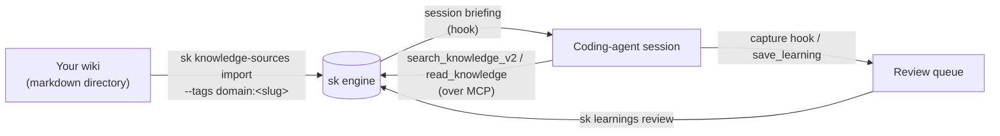

# Use sk from a coding agent (Claude Code, Codex, …)

> **Audience:** You use Claude Code, Codex, Cursor, Claude Desktop, claude.ai,
> or ChatGPT, and want it grounded in your team's knowledge instead of guessing.

Every new session starts already knowing your domain's rules, looks your
runbooks up instead of inventing them, and remembers what you taught it last
time — once you have reviewed and approved that lesson.

This page is the whole path: install → connect your client → import your
knowledge → ask a grounded question. About 10 minutes.



## What your client can do

Two channels do different jobs. **MCP** lets a session search and read your
knowledge; the **briefing hook** tells it your rules and what knowledge exists
before it starts. Not every client supports both:

| Client | MCP (lookup) | Briefing hook | Writes workflow definitions | Setup |
|---|---|---|---|---|
| **Claude Code** | yes | yes | yes — via the `sk` CLI | [below](#claude-code) |
| **Codex** | yes | yes (feature-gated) | yes — via the `sk` CLI | [below](#codex) |
| **Cursor**, **Claude Desktop** | yes | no | yes, if it can run `sk` | [below](#cursor-claude-desktop-and-other-mcp-clients) |
| **claude.ai**, **ChatGPT** | yes (OAuth) | no | **no** — MCP carries no definition writes | [below](#claudeai-and-chatgpt-oauth) |

A client without hooks still gets every tool — it just is not *told* about your
domain up front, so ask it to search, or put the instruction in the client's own
rules file (`CLAUDE.md`, `AGENTS.md`, Cursor rules …).

The last column is the one that surprises people. MCP is a lookup and run
surface: it carries reads and `run_workflow`, not definition writes. A client
that can run `sk` in a shell edits definitions directly and byte-exactly; a
browser client has to route every edit through an authoring conversation
instead. Pick accordingly — see [Choosing your surface](choosing-your-surface.md).

## Before you start

You need the `sk` CLI installed and logged in:

```bash
curl -fsSL <engine-url>/install | bash      # the CLI is served by your engine
sk login --engine-url <engine-url> --api-key <wf_live_…>
sk status                                   # engine + key confirmed
```

Your operator gives you the engine URL and the API key. If you run the engine
yourself, start at the [self-host guide](../developers/self-host.md).

## 1. Declare the domain in your repo

A **domain** is a business area you curate knowledge for — `blog-de`,
`payments`, `platform`. It is nothing but the tag `domain:<slug>` on Skills and
Knowledge Sources; there is no table and no config object to create.

```bash
cd <your-repo>
sk agent init --domains <domain-slug>
```

This writes `.sk/agent.json` (commit it — it is how a session in this repo knows
which domains to pull), wires the Claude Code hooks, and prints the Codex
snippets plus the MCP command for both. Re-running it never duplicates anything.

Worth running even on a client without hooks: `.sk/agent.json` is what
`sk agent briefing` reads, so you can always fetch the briefing by hand.

## 2. Connect your client

The registration commands below need the API key in your shell. It is the same
key you logged in with; if you no longer have it at hand:

```bash
export SK_API_KEY="$(jq -r '.profiles.default.api_key' ~/.sk/config.json)"
```

### Claude Code

```bash
claude mcp add --transport http --scope user sk <engine-url>/mcp \
  --header "Authorization: Bearer ${SK_API_KEY}"
```

Your shell expands `${SK_API_KEY}` as you run the line, so the key is stored in
Claude Code's own config — the export is only needed once, at registration time.
Confirm with `claude mcp list`; `sk` should show as connected.

`sk agent init` already wired the hooks in `~/.claude/settings.json`:
`SessionStart` (matcher `startup|resume|compact`, so it survives context
compaction) injects the briefing, and `SessionEnd` posts the transcript for
learning capture.

> **Already connected?** If your Claude account carries the sk connector, your
> sessions can already call `search_knowledge_v2`, `read_knowledge`,
> `find_skill`, and `save_learning`. Do not add a second registration for the
> same engine — it duplicates the whole tool catalog.

### Codex

```bash
codex mcp add sk --url <engine-url>/mcp --bearer-token-env-var SK_API_KEY
```

Codex reads `SK_API_KEY` at call time, not just at registration — so export it
in your shell profile, not just the current shell.

Hooks are feature-gated. `sk agent init` prints, but cannot apply, two manual
steps:

1. Enable them in `~/.codex/config.toml`:
   ```toml
   [features]
   hooks = true
   ```
2. Add the printed `~/.codex/hooks.json`. Codex has no `SessionEnd` event, so
   capture runs on the `Stop` hook — which fires per turn. That is cheap: the
   engine dedups repeated captures by learning fingerprint.

Hooks additionally need a one-time trust confirmation via `/hooks` in the Codex
TUI.

### Cursor, Claude Desktop, and other MCP clients

Add the engine as a streamable-HTTP MCP server in the client's config:

```json
{
  "mcpServers": {
    "sk": {
      "url": "https://<engine-host>/mcp",
      "transport": "streamable-http",
      "headers": { "Authorization": "Bearer wf_live_…" }
    }
  }
}
```

These clients have no session hook, so nothing injects the briefing. Paste the
grounding rule into the client's own rules file so sessions know to look up:

```text
For facts about <domain-slug>, call search_knowledge_v2 with
tags: ["domain:<domain-slug>"] instead of guessing. If it returns
nothing, say so.
```

### claude.ai and ChatGPT (OAuth)

These clients cannot hold a static key. The engine is a full OAuth 2.1
authorization server for `/mcp`, so they authenticate interactively instead:
point the connector at `https://<engine-host>/mcp` and the client discovers
OAuth via `/.well-known/oauth-protected-resource`, registers itself, and opens
the sk login + consent flow. No header, no key. The ChatGPT connector steps and
the full flow: [input surfaces](../developers/input-surfaces.md).

> **`sk mcp` is a different thing.** It is a stdio proxy exposing
> `sk_conversation_*` tools for driving conversations from an IDE plugin. It
> does **not** carry the knowledge tools, so it is not the path for this page.

## 3. Import your knowledge — tagged with the domain

This is the step that connects the two halves. Knowledge only reaches a session
if it carries that session's `domain:` tag.

```bash
sk knowledge-sources import ./team-wiki --tags "domain:<domain-slug>"
```

`import` takes a whole markdown directory — an Obsidian vault, an
agent-maintained wiki, an [OKF](https://okf.md/) bundle, a Notion export — and
makes one searchable source with a passage per file. Re-running it is a no-op
when nothing changed, so a nightly CI job keeps sk in sync with a git wiki
without churn. Details and the frontmatter rules:
[Knowledge Sources](./knowledge-sources.md).

For a single file, `sk knowledge-sources create --file ./runbook.md --tags
"domain:<domain-slug>"` does the same job.

> **The tag is not optional.** An import without `--tags "domain:<slug>"`
> succeeds and is searchable — but the briefing never indexes it and sessions
> in that domain will not know it exists.

## 4. Verify before you trust it

```bash
sk agent briefing        # what a fresh session will be told
```

You should see your source under **Knowledge index** and a grounding rule
naming your domain:

```text
# sk session briefing — domains: payments

Grounding rule: for facts of these domains, look up instead of guessing —
call `search_knowledge_v2` with `tags: ["domain:payments"]`.
If the search returns nothing, say so; do not invent domain internals.

## Knowledge index (search, don't preload)
- **Team Wiki** (`team-wiki`)
```

Full documents are never preloaded — the session gets an index and fetches
details on demand, which is what keeps the context small.

Now start your agent in the repo and ask something only your wiki knows. It
searches instead of guessing, and cites the source it used.

## 5. Teach it once, keep it

When you correct the agent, that correction can outlive the session:

- **Automatic** — the capture hook posts the transcript; the engine distills
  only durable rules a human actually taught. A routine session correctly
  produces nothing. (Claude Code and Codex only — it is the hook that posts it.)
- **Explicit** — say "remember this" and the agent calls `save_learning`. This
  works on every MCP client, hooks or not.

Both create *proposals*, never live knowledge. You decide:

```bash
sk learnings list        # what is waiting
sk learnings review      # approve / edit / reject
```

An approved learning becomes an active skill carrying the domain tag — the very
next briefing in that domain includes it. You can also approve without leaving
the session: ask the agent to approve the candidate and confirm your client's
native dialog.

Optionally materialise the domain's skills as `SKILL.md` files, so the
conventions work even with no engine connection. Both Claude Code and Codex
hot-reload them:

```bash
sk skills sync
```

## Troubleshooting

| Symptom | Cause |
|---|---|
| `sk agent briefing` says "no domains" | The directory (or a parent) has no `.sk/agent.json` — run `sk agent init`, or pass `--domains`. |
| Briefing shows no knowledge index | The source is missing the `domain:<slug>` tag. Check `sk knowledge-sources list`; fix with `sk knowledge-sources patch <id> --tags "domain:<slug>,…"` (tags are replaced wholesale). |
| The session ignores your knowledge | The hook fires but MCP is not registered — the agent knows what exists but cannot fetch it. Check `claude mcp list` / `codex mcp list`. |
| No briefing at all, but tools work | Expected on a client without hooks (Cursor, Claude Desktop, claude.ai, ChatGPT) — put the grounding rule in the client's rules file. |
| The briefing misses a skill | Only **active** skills with the domain tag are included. Check `sk skills list`. |
| Codex: hooks never fire | `[features] hooks = true` missing in `~/.codex/config.toml`, or the one-time `/hooks` trust confirmation is pending. |
| Nothing happens at all | Hooks never break a session: on any error they print nothing and exit 0. The swallowed error is in `~/.sk/debug.log` (`agent.briefing_hook_failed`, `agent.capture_hook_failed`). |

## Related

- [Coding-agent integration](../developers/coding-agent-integration.md) — the
  loop's mechanics: briefing assembly, capture, dedup, review.
- [Knowledge Sources](./knowledge-sources.md) — import, tags, refresh, and
  reading knowledge back.
- [Input surfaces](../developers/input-surfaces.md) — MCP transport, OAuth 2.1,
  and every other door into the engine.
- [Knowledge & Skills](../concepts/knowledge-and-skills.md) — the concepts and
  why the loop compounds.
- [Model a Domain](./model-a-domain.md) — connector + skills + knowledge for a
  whole domain.
