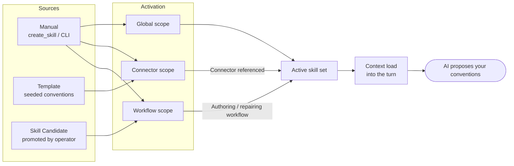
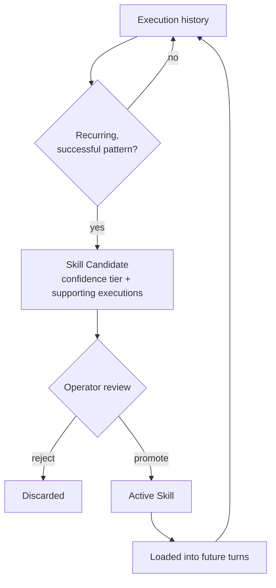

# Custom Skills

> **Audience:** Authors and operators encoding organization-specific guidance for
> the AI.

**Outcome:** sk encodes your conventions once, then applies them on every
Conversation, discovery, and repair — so authored workflows ship faster, pass
review sooner, and stay policy-uniform across tenants. With approval, it gets
smarter over time.

A Skill is a curated, reusable piece of context loaded into the AI's context
window during a Conversation and other AI-assisted authoring flows (discovery,
diagnosis, bounded repair). Skills encode best practices, integration patterns,
security policies, and the domain knowledge that makes the AI propose *your*
conventions, not generic ones. For how Skills sit alongside Knowledge Sources and
how the engine assembles them into each turn, see
[Knowledge & Skills](../concepts/knowledge-and-skills.md).

## How a Skill reaches the AI

Three sources feed Skills; activation rules decide which load; the engine then
assembles the active set into the turn.



| Source | Origin | Becomes active when |
|---|---|---|
| **Manual** | `create_skill` / `update_skill` in chat, or `sk skills create` | Its scope matches the turn |
| **Template** | Seeded conventions shipped with the platform | Its scope matches the turn |
| **Candidate** | Detected from execution history, **promoted by an operator** | Its scope matches the turn |

---

## Authoring and scoping a Skill

Operators create and manage Skills. They can be scoped:

| Scope | Loads when |
|---|---|
| **globally** | Available in all Conversations |
| **per-Connector** | That Connector is referenced (the Stripe Skill loads when the AI touches your Stripe connector) |
| **per-Workflow** | Authoring or repairing that workflow |

In chat you can author a Skill conversationally (`create_skill` / `update_skill`),
or manage them from the CLI:

```bash
sk skills list
sk skills create --file ./stripe-skill.json
```

The `--file` argument is a SkillDef JSON, not markdown. The SkillDef body carries
the `scope`, `connector_id`, and `title` — there are no separate `--title` or
`--scope` flags.

A Skill is dense, prescriptive guidance the AI should follow — keep each one tight and single-purpose. Broader, document-scale context belongs in a [Knowledge Source](./knowledge-sources.md) instead.

| Use a Skill when | Use a [Knowledge Source](./knowledge-sources.md) when |
|---|---|
| Guidance is prescriptive — "always do X" | Context is reference material to draw from |
| It fits in a tight, single-purpose page | It is document-scale |
| You want it followed, not just consulted | You want it available for lookup |

## Skill Candidates: learning from what works

Skills are not auto-generated and not auto-promoted. The platform detects recurring patterns from execution history — Connectors or step sequences that are used together frequently and tend to succeed — and surfaces them as **Skill Candidates** for operator review. Each candidate carries a confidence tier (low / medium / high) and links to the executions that support it.



A candidate becomes an active Skill only through explicit operator promotion:

```bash
sk skill-candidates list
sk skill-candidates approve <id>
```

sk learns from what works, but humans decide what becomes canonical guidance.

## The sk-Stdlib the AI proposes

JavaScript that authors write — transform steps with `language: "javascript"`, before-request hooks — runs inside a QuickJS-WASM sandbox with zero host globals. Every sandbox context ships a frozen, versioned, deterministic `sk` standard library (HTTP-method classification, null-safe access, allow/deny builders, array reshapers, type guards). The conversational authoring layer is aware of the stdlib and proposes `sk.*` forms by default — `sk.http.isMutating(method)`, `sk.deny("reason")`, `sk.get(input, "request.method", "")` — which shortens code review and keeps policy uniform across tenants. Nothing in the stdlib touches the host, so dry-runs and self-healing stay reproducible.

---

## Further reading

- [Knowledge & Skills](../concepts/knowledge-and-skills.md) — the conceptual model, context-assembly order, and the compounding loop.
- [Model a Domain](./model-a-domain.md) — a Skill and a Knowledge Source configured side by side for one domain, worked end to end.
- [Knowledge Sources](./knowledge-sources.md) — the broad-context counterpart.
- [AI-assisted authoring](./authoring-workflows.md) — how Conversations load and use Skills.
