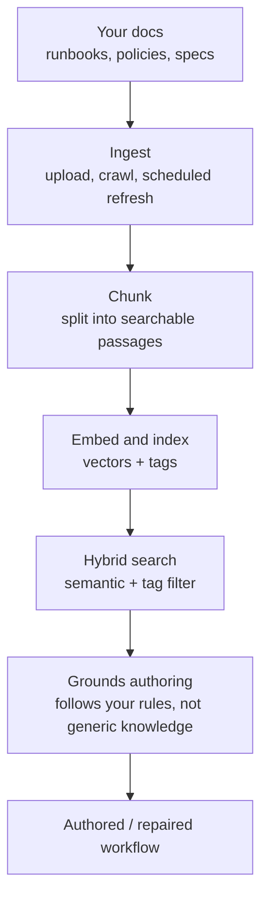

# Knowledge Sources

> **Audience:** Authors and operators grounding the AI in their own documents.

**Outcome:** workflows follow *your* runbooks and compliance docs, not generic
knowledge. A workflow that correctly honors your GDPR retention rule exists
because the runbook is a Knowledge Source the AI searched while authoring — so
compliance ships by construction, not by review after the fact.

A Knowledge Source is a persistent, indexed document store the AI can search
while authoring, discovering, or repairing workflows. For the conceptual model —
and how Knowledge Sources differ from Skills — see
[Knowledge & Skills](../concepts/knowledge-and-skills.md).

## How grounding works



| Stage | What happens |
|---|---|
| Ingest | Upload, crawl, or scheduled refresh pulls the document in. |
| Chunk | The text is split into searchable passages. |
| Embed + index | Passages become vectors; tags and descriptions are attached. |
| Hybrid search | Queries rank by semantic relevance, narrowed by tag. |
| Ground | Matched passages enter the authoring context so the workflow follows your rules. |

---

## Adding a source

In the REPL, say *"add this file as a knowledge source tagged weather, runbook"*.
The scriptable form:

```bash
sk knowledge-sources create --file ./runbook.md \
  --title "Weather Runbook" --tags "weather,runbook,open-meteo"
sk knowledge-sources list
sk knowledge-sources search "open-meteo"   # semantic search; ranks by relevance
```

| Flag | Behavior |
|---|---|
| `--tags` | Authoritative — no AI auto-tagging when you supply them. |
| `--description` | Authoritative when supplied. |
| (omit both) | The engine generates tags and a description. |

## Auto-analysis and self-description

When a document is uploaded interactively — from chat, an attached file, or
`sk knowledge-sources create` — the AI auto-analyzes its content to generate a
short description and a set of topical tags. This makes each source
self-describing: the AI can list sources and decide which one covers a topic
before searching, and a search can be narrowed to sources carrying a given tag.

| Rule | Detail |
|---|---|
| Description | Generated only when none was supplied. |
| Tags | Topical tags are a deduped set that re-analysis replaces wholesale; **namespaced tags** (a whitespace-free prefix, a colon, and content directly after it — e.g. `domain:blog-de`; prose colons like `note: x` don't count) are structural routing keys that always survive re-analysis, and re-analysis never adds new ones. The `<ns>:` shape is reserved for routing, so don't use it for plain topical tags. To re-home a source (drop or change a `domain:*` tag), edit the tags explicitly (`sk knowledge-sources update` / PATCH) — explicit edits replace the tag set wholesale. |
| Embeddings | Freshly ingested or updated chunks are embedded right away (source-scoped, off the request path); semantic ranking works within seconds of an update, no manual step needed. |
| Failure mode | Best-effort — if it fails (e.g. model budget exhausted) the upload still succeeds, just without enrichment. |
| Re-run | `sk knowledge-sources analyze <id>`, or the `analyze_knowledge_source` tool in chat. |
| Bulk paths | Crawled pages and scheduled refreshes stay mechanical — not auto-analyzed. |

## Refresh strategies and scope

Knowledge Sources have configurable refresh strategies, so the AI always works
from current documentation. When a runbook is updated, the source refreshes and
the next workflow follows the new rule.

| Axis | Options |
|---|---|
| Refresh | Manual or scheduled. |
| Scope | Tenant-wide (available globally) or pinned to specific workflows. |

## Budgets

Per-source and per-tenant byte caps, per-message file counts, and ingestion
concurrency are operator-tunable. Defaults are conservative; raise them on
hardware that warrants larger corpora. The full tunable table lives in
[Observability & Resource Limits → Documentation & Knowledge Tunables](../operators/observability.md#documentation--knowledge-tunables).

---

## Further reading

- [Knowledge & Skills](../concepts/knowledge-and-skills.md) — the conceptual model and context-assembly order.
- [Model a Domain](./model-a-domain.md) — a Knowledge Source and a Skill configured side by side for one domain, worked end to end.
- [Custom Skills](./custom-skills.md) — the dense, prescriptive counterpart to Knowledge Sources.
- [AI-assisted authoring](./authoring-workflows.md) — how Conversations draw on Knowledge Sources.
