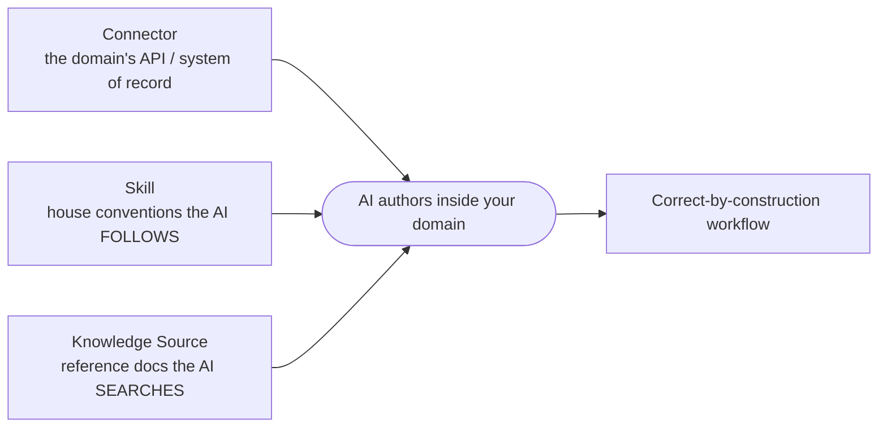

# Model a Domain

> **Audience:** Authors and operators teaching sk about a whole field of work —
> a policy, a process, a specialized domain — not just a single workflow.

Teach sk a whole field of work once, and every workflow in it arrives right the
first time. The AI proposes against your conventions and looks the specifics up
in your own documents, so review stops being the place where the draft gets
fixed.

A single workflow answers one question. A **domain** — your expense policy, your
contract-review process, a compliance framework — is the shared context that
makes *every* workflow in it correct. You model a domain by standing up three
primitives around it: a **Connector**, one or more **Skills**, and one or more
**Knowledge Sources**. This guide shows the trio working together.

For the conceptual model behind the two context primitives, see
[Knowledge & Skills](../concepts/knowledge-and-skills.md). For the quick "which
one do I reach for?" answer, jump to the [FAQ](../concepts/faq.md).

---

## The trio



| Primitive | Its job in the domain | Prescribes or informs |
|---|---|---|
| **Connector** | Authenticate the domain's system once; ground requests against its real, discovered surface | — |
| **Skill** | Encode the rules the AI must obey — required validations, error handling, approval gates, tone | **Prescribes** |
| **Knowledge Source** | Hold the domain's reference material — policy PDFs, runbooks, glossaries, rate tables | **Informs** |

The mnemonic that keeps them straight: **Skills prescribe; Knowledge Sources
inform.** The decision table for borderline cases lives in
[Custom Skills](./custom-skills.md#authoring-and-scoping-a-skill) — reuse it
rather than guessing.

---

## Worked example: an expense-approval domain

Say your finance team wants sk to help build expense-handling automations that
always honor company policy. Model the domain once:

**1. Connector — the system of record.** Register the connector for wherever
expenses live (your accounting API, an HR system). This is the normal
connector-creation flow; the AI grounds every request against the connector's
discovered endpoints.

**2. Skill — the conventions the AI must follow.** Author a tight,
single-purpose Skill scoped to that connector (or global if it spans several).
It prescribes the rules, for example:

> Expenses over €1,000 require a second approver. Never auto-approve travel
> without an attached receipt. Reject line items with no cost-center code.

Author it in a Conversation, or from the CLI:

```bash
sk skills create --file ./expense-policy-skill.json   # a SkillDef JSON
sk skills list
```

Because it is prescriptive, the AI *follows* it — proposals that violate the
policy never get authored in the first place.

**3. Knowledge Source — the reference material.** Upload the actual policy so
the AI can cite specifics (thresholds, eligible categories, per-diem rates):

```bash
sk knowledge-sources create --file ./expense-policy-2026.pdf \
  --tags "expense,policy,finance"
sk knowledge-sources search "per-diem cap for international travel"
```

Or, in a Conversation, attach the document and say *"add this as a knowledge
source tagged expense, policy"* — sk creates it and (unless you supply them)
auto-generates a description and tags.

**The combined effect.** When someone now asks sk to build an
expense-reimbursement workflow, the AI proposes steps that respect the
two-approver rule (from the **Skill**) and fills in the correct per-diem figure
(from the **Knowledge Source**), grounded against your accounting API (the
**Connector**). The evidence a compliance review needs is produced as you work, not reconstructed afterwards.

---

## Chunk for retrieval: many focused sources beat one blob

Knowledge Sources are searched at the **chunk** level — the AI receives only the
passages that match the current question. Granularity is therefore a quality
lever. Split a domain's reference material into focused documents rather than one
giant file:

| Instead of | Prefer |
|---|---|
| `everything-about-expenses.pdf` (50 KB) | `per-diem-rates.md`, `approval-thresholds.md`, `eligible-categories.md` |

Sharper matches, less wasted context budget, and each source is independently
refreshable. See [Knowledge Sources](./knowledge-sources.md) for ingest,
tagging, and refresh strategies, and
[Knowledge & Skills → context assembly](../concepts/knowledge-and-skills.md#context-assembly-and-trimming)
for how the retrieved chunks are ordered and trimmed under budget.

---

## The pattern is domain-agnostic

Expense policy is just an instance. The identical trio models any field:

| Domain | Connector | Skill | Knowledge Sources |
|---|---|---|---|
| Contract review | Your CLM / doc store | Clause-review conventions | Standard-clause library, redline policy |
| Tax filing | Tax authority API | Filing-rule conventions | Rate tables, deduction glossary |
| Music theory | (optional) score API | `music-theory-authoring` conventions | `harmonic-functions.md`, `chord-voicings.md`, glossary |

Whatever the field, the shape is the same: a Connector to ground requests,
Skills to prescribe how the work is done, Knowledge Sources to inform the
specifics.

---

## Further reading

- [Knowledge & Skills](../concepts/knowledge-and-skills.md) — the conceptual model and context-assembly order.
- [Custom Skills](./custom-skills.md) — how to author, scope, and promote Skills.
- [Knowledge Sources](./knowledge-sources.md) — how to upload, tag, and refresh documents.
- [FAQ](../concepts/faq.md) — quick answers on workflows, skills, and knowledge sources.
