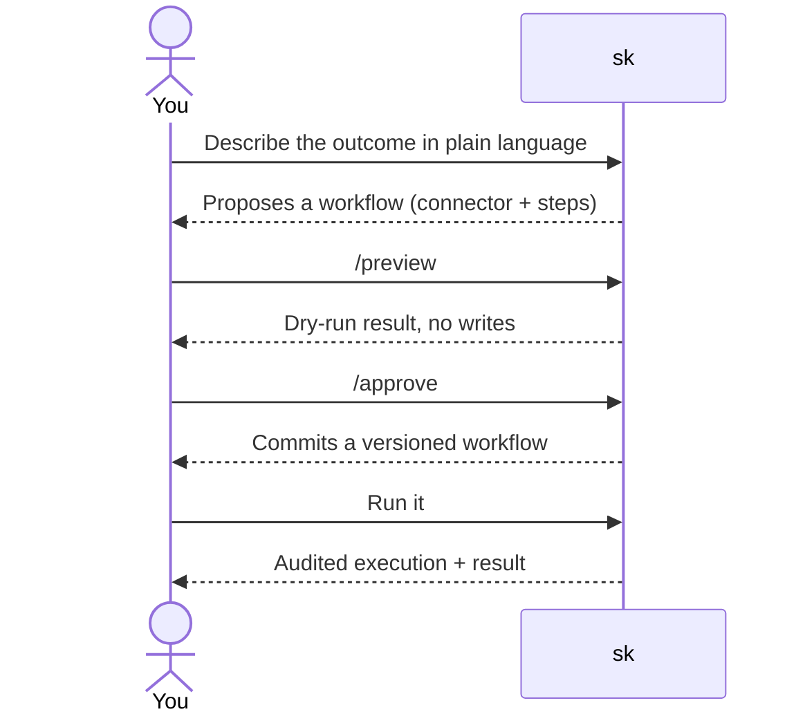

# Quickstart — Authors

In about five minutes you will have described a piece of work in ordinary sentences and
watched it run — no code written, nothing touched in a real system until you said so. You
describe the outcome; sk builds the connection, drafts the process, and holds every write
back until you approve it.


## Your first conversation



Every step is permission-checked and recorded. Nothing writes to a real system until you approve.

## The first thing to try

Once connected (pick a path below), type a sentence, not a command. Two that work
immediately:

> *"Show me the top five repos of the vercel org by stars."*

Every fresh tenant already carries this as a seeded, credential-free demo workflow — so
your very first run succeeds before any system is connected. Then point at a system your
operator has connected:

> *"Every morning at 7, mail me our open Jira tickets grouped by assignee."*

sk proposes the workflow, `/preview` shows you the dry run with every write held back,
`/approve` commits it. More worth building, with what each case needs:
[Use cases](../use-cases.md).

## Connect

Your operator has given you **one** of the following. Pick the matching path.

- **Engine URL + API key** — you operate a tenant directly → Path A.
- **Portal-token link** — you are a scoped end-user → Path B.
- **Slack / Teams / Google Chat** where the sk bot is installed → Path C.
- **An MCP client** (Claude Desktop, Cursor, …) → Path D.
- **Claude Code or Codex** → [Use sk from a coding agent](./coding-agents.md) — the
  coding-agent loop needs a briefing hook and domain-tagged knowledge on top of
  the MCP registration, so it has its own page.

> **Want to run your own engine first?** [Self-host quickstart](../developers/self-host.md) takes you from the Docker image to a first connector and workflow.

## Path A — CLI with API key

```bash
curl -fsSL <URL>/install | bash          # the CLI is served by your engine
sk login --engine-url <URL> --api-key <wf_live_…>
sk                         # opens the TUI, picks up your session
```

## Path B — CLI with portal token

Portal tokens are time-limited and pre-scoped. Click the link your operator sent; it provisions a session for `sk` automatically.

```bash
sk login --portal-token <token>      # token is time-limited and pre-scoped; reusable until it expires or is revoked
sk
```

## Path C — Chat (Slack / Teams / Google Chat)

Nothing to install. In the workspace your operator set up:

- **Slack.** `@sk run <workflow>` or just `@sk …` to start a conversation.
- **Teams.** Same pattern — `@sk …` in a channel or DM.
- **Google Chat.** Invite the bot to a space; mention it.

See [input surfaces](../developers/input-surfaces.md) for how each chat adapter works.

## Path D — MCP client (Claude Desktop, Cursor, etc.)

Add the engine as a streamable-HTTP MCP server:

```json
{
  "mcpServers": {
    "sk": {
      "url": "https://<engine-host>/mcp",
      "transport": "streamable-http",
      "headers": { "Authorization": "Bearer <key>" }
    }
  }
}
```

Your client discovers workflows, prompts, and resources automatically. See [input surfaces](../developers/input-surfaces.md) for MCP details.

**Claude Code / Codex** register from the shell rather than a JSON file, and
want the briefing hook and domain-tagged knowledge as well — that whole path is
[Use sk from a coding agent](./coding-agents.md).

## Troubleshooting

Any failed request prints `{code}: {message} [trace=…]`. Send the `trace_id` to your operator — they correlate it with `sk diagnostics errors --trace-id <trace_id>`.

## Next steps

- [input surfaces](../developers/input-surfaces.md) — every surface: CLI, REST, MCP, chat, webhooks, schedules.
- [authoring workflows](./authoring-workflows.md) — what Conversations can do: proposing workflows, Skills, Knowledge Sources, Discovery, and the approval gate.
- [REPL tour](./repl-tour.md) — the authoring state machine and slash commands end to end.
