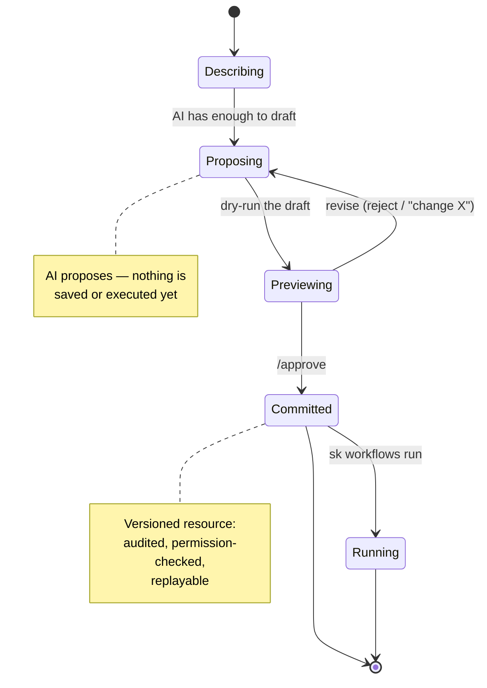

# Using the `sk` REPL — authoring by conversation

**Go from idea to a governed, versioned workflow in minutes** — no JSON, no
glue code. Describe the outcome in plain language; the AI proposes a connector
or workflow, previews a real result, and only commits when you approve. Every
saved artifact is permission-checked, audited, and replayable.


This guide assumes you are already authenticated (see
[zero-to-running](../developers/self-host.md), Steps 1–2). Everything below also works
inside the container as `docker exec -it subkit sk …`.

---

## The authoring state machine

One conversation, one gate. The AI iterates on a draft as long as you want;
**approval is the only path to a saved, runnable workflow.**



---

## Start a conversation

```bash
sk                      # opens the interactive REPL
sk "current weather in Berlin"   # opens the REPL with a first message
sk -c                   # continue your most recent conversation
sk -r <conversation-id> # resume a specific one
```

You type in natural language. The AI replies, and — when it has enough — it
**proposes** a connector or workflow as a structured draft. Nothing is saved or
executed until you approve.

---

## The authoring loop (what actually happens)

```
You    ▸ get the current temperature in Berlin
AI     ▸ I'll use the open-meteo connector (keyless). Here's the workflow I propose:
         1. request  GET /v1/forecast?latitude=52.52&longitude=13.41&current=temperature_2m
         2. transform extract { city, time, temperature_c }
         (shows the draft + a dry-run preview result: 21.4 °C)
         Approve to save this as a workflow?
You    ▸ /approve
AI     ▸ Saved workflow "berlin-current-temperature" (v1). Run it with: sk workflows run berlin-current-temperature
```

Key properties:

- **AI proposes, you approve.** The AI never commits a workflow or runs it in
  production on its own — approval is the governance gate.
- **Preview before save.** The proposal includes a dry-run so you see a real
  result before committing.
- **Iterate in place.** Reject or just say what to change (“also return
  windspeed”, “use Munich instead”) and the AI revises the draft.

---

## Slash commands

Type `/` for the live menu. The shipped commands:

| Command | What it does |
|---|---|
| `/approve` | Approve the AI's current proposal (commit the draft). |
| `/reject` | Reject the proposal (optionally with a reason); the AI revises. |
| `/preview` | Dry-run the current workflow draft now (`/preview show` for the last result). |
| `/probe` | Test the current connector draft now (`/probe show` for the last result). |
| `/draft` · `/connector` · `/workflow` | Inspect the current authoring state. |
| `/templates` | Browse connector templates suggested for the draft. |
| `/onboard` | Guided wizard: pick a template, enter credentials, probe, save. |
| `/versions` · `/restore <n>` | List committed workflow versions / roll back to one. |
| `/skills` · `/knowledge` | List reusable Skills / knowledge sources in scope. |
| `/clear` (`/new`) · `/compact` · `/resume` | New conversation · shrink history · reattach. |
| `/setup` · `/status` · `/cost` · `/usage` | Readiness · session+persona · budget · token usage. |
| `/config` | Open the searchable Config tab (every engine setting). |
| `/settings` (`/preferences`) | Open the 5-tab settings palette (Status / Config / Usage / Skills / Knowledge). |
| `/model` · `/tenant` · `/login` · `/logout` | Switch model · switch/list tenants · auth. |
| `/attach` · `/upload` · `/files` | Attach a file to the message · upload · list files. |
| `/yolo` | Lift the destructive-action confirm gate for a few turns (typed `yes`). |
| `/help` · `/exit` (`/quit`) | Cheat sheet · leave the REPL. |

## Mentions & attachments

- `@file:<id>` — attach a previously uploaded file to the message.
- `@skill:<name>` — pull a specific Skill into context.
- Attach files when launching headless: `sk -p "build a connector from this" --attach ./openapi.json`.

---

## Example conversations to try

```
create a connector for the open-meteo forecast API (https://api.open-meteo.com), no auth
```
```
make a workflow that returns tomorrow's high and low for a city I pass as input
```
```
add a knowledge article from ./runbook.md tagged ops,weather
```
```
run berlin-current-temperature and show me the result
```

After `/approve`, the artifact is a normal, versioned resource — manage it with
the non-conversational commands (`sk workflows …`, `sk connectors …`,
`sk executions …`) or from your own machine over the API.

---

## Headless = the same loop, scripted

For CI or one-liners, `-p` runs one prompt non-interactively through the **same**
authoring engine (no TTY, no slash commands — the AI completes autonomously up to
`--max-turns`):

```bash
sk -p "create a workflow that returns the current temperature in Berlin using the open-meteo connector" \
   --output text --max-turns 40
sk -p "list my workflows" --output json
```

`--output {text|json|stream-json}` controls the shape; non-zero exit codes signal
failure so scripts can branch reliably.
