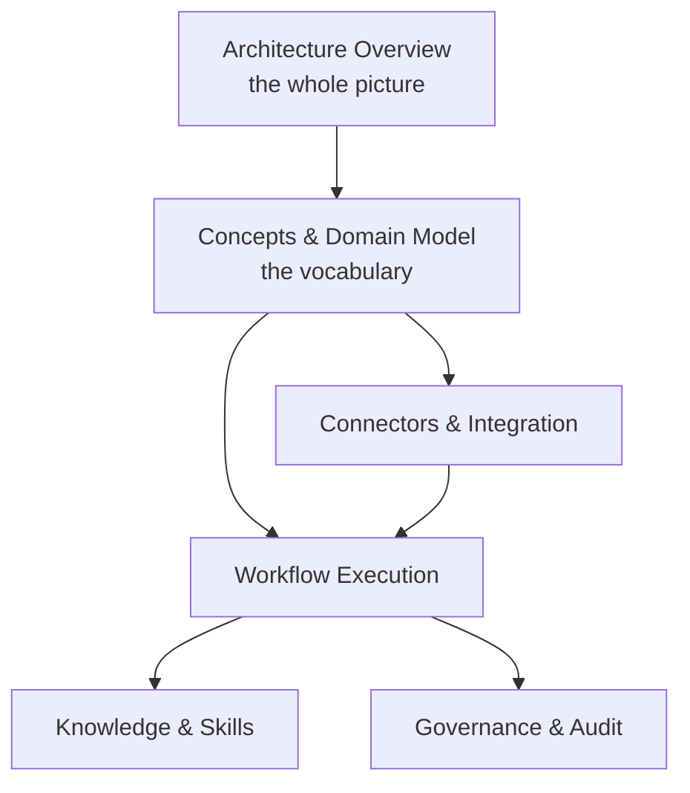

# Concepts

Read this section and you can predict what sk will do before you run it — and say why, in the same words as everyone else on your team. Six pages cover the whole model: how a system gets connected, how a process runs, where the AI helps and where it stops, and what gets written down along the way.

Start with the **Overview** for the big picture, then the **Glossary** to lock the vocabulary. From there, **Connectors** feed **Workflows**, **Knowledge & Skills** shape how the AI authors them, and **Governance & Audit** wraps every run.

| Page | What it covers |
|---|---|
| [Architecture Overview](overview.md) | The first mental model of sk — the major pieces and how they connect. |
| [Concepts & Domain Model](glossary.md) | One vocabulary, defined once: Workflow, Connector, Credential, Audit Log, and the rest. |
| [Connectors & Integration](connectors.md) | Drivers, Connector Templates, and Credentials — authenticate a system once, reuse it everywhere. |
| [Workflow Execution](workflows.md) | The lifecycle, execution model, eight Step kinds, triggers, versioning, scheduling, and self-healing. |
| [Knowledge & Skills](knowledge-and-skills.md) | How Knowledge Sources and Skills shape the AI that authors workflows. |
| [FAQ](faq.md) | Fast answers on workflows, skills, and knowledge sources — each pointing to the page that covers it in full. |
| [Governance & Audit](governance-and-audit.md) | Permission checks, immutable records, and the audit trail behind every run. |
| [Reversibility & Trust Domains](reversibility-and-trust-domains.md) | How much autonomy a piece of work should get — and why authoring and execution are different jobs. |
