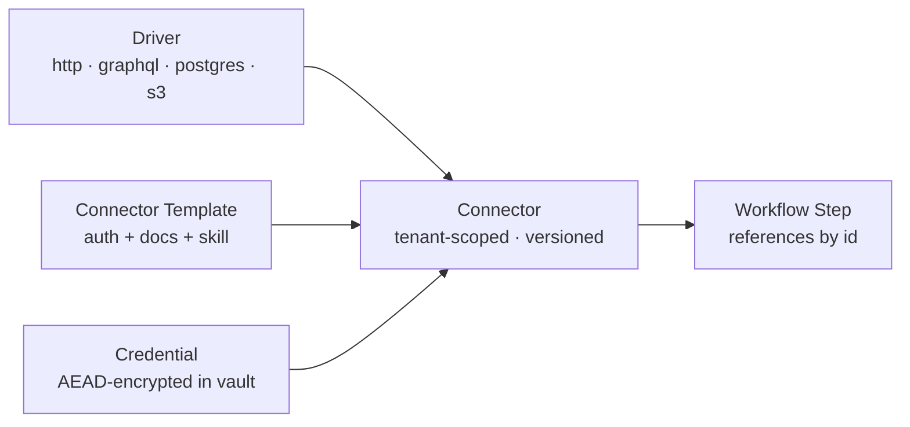
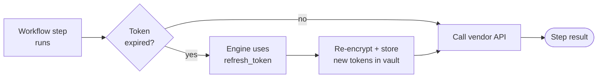
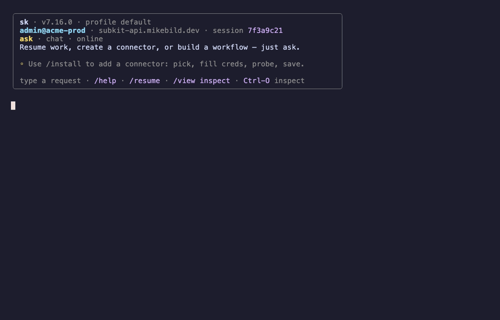
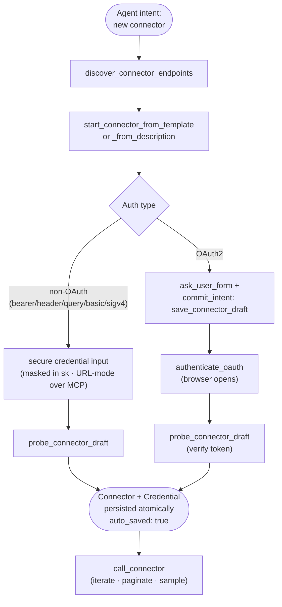

# Connectors & Integration

> **Audience:** Engineers wiring sk to external systems, operators curating the catalogue

**Outcome:** authenticate external systems—including built-in Cloudflare and Firebase/Firestore—once, reuse them across every workflow, and never let a secret touch a workflow definition, an AI prompt, or a log. Connectors collapse weeks of bespoke integration glue into a one-time, governed setup — typed, authenticated, monitored, and audited.

A Connector combines three independently-evolving layers: a **Driver** (protocol), a **Connector Template** (target-specific config + context), and a **Credential** (vault-managed secret).



Each layer evolves independently. A Workflow Step references the Connector by id — the raw credential never enters the workflow definition, the AI context, or any log.

---

## What a Connector Is

A Connector is a configured, authenticated connection to an external integration boundary. It is not a generic HTTP client, and it is not an ad hoc integration configured per-workflow. A Connector is a first-class platform resource: typed, validated, monitored, and reusable across any number of workflows.

The design separates three concerns that are often conflated. The Driver handles the protocol — how requests are formed, sent, and parsed. The Connector Template provides connector-specific configuration and context — what this particular integration target looks like and how to work with it. The Credential provides secure authentication — the secrets needed to connect. Each layer has a distinct responsibility, and each can evolve independently.

This separation has practical consequences. Multiple Connectors can share the same Template — for example, a production Stripe account and a staging Stripe account can each be a separate Connector built from the same Stripe Template, with different Credentials and different Environment tags. The platform can route workflows to the appropriate account based on execution mode without any workflow-level logic.

---

## The Four Drivers

Drivers are the protocol layer. Every Connector in sk uses one of four built-in drivers: `http`, `graphql`, `postgres`, and `s3`. These are the protocols the execution engine dispatches end-to-end at runtime.

The **HTTP driver** handles REST APIs. It manages request construction, response parsing, pagination patterns, and error normalization. When a Step calls an HTTP Connector, the driver handles the protocol details so the workflow step only needs to describe what to call and what to do with the result.

The **GraphQL driver** handles GraphQL APIs. It manages query and mutation construction, variable binding, and schema awareness. Workflows that target GraphQL APIs benefit from the driver's understanding of the schema structure — the AI can propose specific queries rather than generic HTTP calls.

The **PostgreSQL driver** handles direct database connections. It manages query execution, parameterized inputs, and result set handling. This driver enables workflows that read from or write to relational databases directly, without requiring an intermediate API layer.

The **S3 driver** handles object storage. It manages bucket operations, presigned URL generation, and streaming transfers. This covers not just AWS S3 but any S3-compatible object store.

Every Connector in sk uses one of these four drivers. Custom drivers are not part of it.

### GraphQL vs REST: when to pick which

Several major APIs — GitHub, Linear, Monday, Shopify — offer both REST and GraphQL endpoints. The built-in template catalogue ships both where appropriate (for example `github` and `github-graphql`). Choose by what the workflow actually does:

- **Deep read traversals** (repository → issues → comments → labels): prefer GraphQL. One query replaces many REST roundtrips; the cost-based rate limit is more forgiving than REST's per-request budget.
- **Write operations** (create an issue, merge a PR, commit a file): prefer REST. GraphQL mutations at these providers are incomplete — organisation-admin mutations often don't exist.
- **Simple CRUD on one resource**: REST is usually shorter to author and debug.

The two connectors can coexist in a tenant — one `github` connector for writes, one `github-graphql` connector for reads — sharing the same credential (a PAT with `repo + read:org` works on both endpoints).

---

## The Connector Template Catalog

Templates are what make the AI's proposals accurate. Without templates, the AI cannot propose the correct authentication pattern, suggest the right endpoints, or explain the connector target's specific behaviors and limitations.

sk ships 57 Connector Templates covering the most common enterprise services: Stripe, Salesforce, HubSpot, GitHub, Jira, Slack, Notion, Cloudflare, Firebase/Firestore, Google services, AWS services, databases, and more.

A Template is more than a configuration skeleton. It includes: the appropriate driver, the authentication configuration for that service (OAuth2 scopes, API key placement, basic auth conventions), links to documentation that the platform will index, setup guidance the AI presents when a user configures the Connector, and example Skill content the AI can draw on when proposing integrations.

Templates are the reason the AI can propose accurate integrations rather than generic API calls. The curated knowledge about each connector target is baked into the template, not assembled from general training data at authoring time.

---

## Authentication and Credential Management

Supported patterns, the ones enterprise systems actually use:

- **API key** — header, query, or custom scheme.
- **OAuth2** — authorisation code and client credentials flows.
- **Basic auth** — username + password.
- **AWS SigV4** — signed requests for AWS-compatible surfaces.

**OAuth2 is managed end-to-end by the engine.** An operator configures the Connector once; the platform detects expiry, refreshes, and rotates tokens with no workflow involvement.





All secrets live in the Credential Vault: encrypted at rest, never logged, never exposed outside the engine. Workflows and Steps reference Credentials by name, not value — sk can propose, configure, and audit integrations without a secret ever surfacing in a workflow definition, a log, or a conversation transcript.

**End-User Credentials** extend this for multi-user scenarios. A user supplies their own credentials for a Connector, and the platform acts as that user when executing on their behalf — proper delegation, not credential sharing.

---

## Schema Versions and Drift

External APIs change. Fields are renamed, endpoints move, new error codes appear, response shapes evolve. A Connector that worked last month may not work the same way today.

sk tracks schema versions per Connector endpoint, Workflow, and Step. Successful responses accumulate observed fields into a contract, so request-dependent or optional fields can appear and disappear without being misclassified as removals. Incompatible type changes remain proactive drift signals; an actual missing path or failed validation is still detected reactively from the affected execution.

Drift is detected from actual execution results, not from periodic polling. The signal comes from real workflow runs encountering real changes in the connected boundary. When drift is detected, it becomes the trigger for the self-healing process described in the execution document.

---

## Health and Validation

Every Connector can be tested independently of any workflow. The engine validates the connection, authenticates with the configured Credentials, and reports the result along with connection latency. Connector tests and workflow request steps share the same underlying request execution path, so a successful connector test reflects the same transport behavior a workflow will use.

Connector validation is available on demand and during authoring. Operators do not need to wait for a full workflow failure before checking whether a Connector is reachable, authenticated, and returning the expected shape.

A draft connector that does not yet have a credential cannot be probed. The probe path returns a structured `credential_required` envelope rather than silently sending an unauthenticated request. `sk` collects the value in its masked terminal form. MCP clients use a single-use URL elicitation for an unsaved static-credential draft; the submission stages the credential in engine memory, resumes the same conversation, and the next green probe persists the connector and encrypted credential atomically. The draft never has to be saved unauthenticated just to obtain a connector id.

Templates may attach bounded, non-secret headers to their health endpoint. The header schema rejects authentication, cookie, transport, and CR/LF-bearing values; a saved credential remains the only source of authentication. This is used for vendor-required protocol headers such as Notion's `Notion-Version`, so a connector probe exercises the same valid request shape as runtime traffic.

---

## Audited DEV to PROD Promotion

An admin can promote a persisted DEV connector without reading or re-entering its credential. The operation is one transaction: connector state, credential state, promotion idempotency record, and immutable audit entries either all commit or all roll back. It requires the dedicated `connector:promote` permission and an `Idempotency-Key`; only the SHA-256 digest of that key is persisted.

Two strategies make retention explicit:

| Strategy | Connector identity | Credential handling | DEV after success |
|---|---|---|---|
| `copy` | Creates a new PROD connector id | Decrypts and re-encrypts supported static credentials under a new credential id and AAD; token-mint caches are cleared | Retained |
| `move` | Keeps the connector id | Keeps credential ids, ciphertext, OAuth refresh state, and end-user bindings; only the environment changes | Removed |

`copy` deliberately rejects OAuth/OAuth-client state and connectors with end-user credential bindings: duplicating either would create ambiguous refresh ownership or silently lose user bindings. Use `move` for those connectors. A conflicting active PROD connector with the same tenant-scoped slug is also rejected. Copy carries the pinned template snapshot, connector configuration, self-description links, circuit/health state, and static credential; ingested document rows and observed schema history stay attached to the DEV connector.

Every successful operation writes `connector.environment_promoted` and one `credential.environment_promoted` event per affected credential. Audit metadata contains ids, environments, strategy, request source, and the idempotency-key digest—never plaintext or ciphertext.

The conversational action is `promote_connector`. The equivalent CLI command is:

```bash
sk connectors promote <dev-connector-id> --to prod --strategy copy
sk connectors promote <dev-connector-id> --to prod --strategy move --yes
```

The REST form is `POST /v1/connectors/{id}/promote` with a required `Idempotency-Key` header and body `{ "target_environment": "prod", "strategy": "copy" | "move" }`. A new copy returns 201; a move or idempotent replay returns 200.

---

## OpenAPI Connector Import

`import_connector_from_spec` creates a connector draft from inline OpenAPI JSON/YAML, Google
REST Discovery JSON, or an HTTP(S) spec URL. The equivalent REST surface is
`POST /v1/connector-templates/import` with `source: "openapi"` or
`source: "google_discovery"`. URL-fetched specification bodies are streamed with a 50 MiB
(52,428,800 byte) hard limit: a declared oversized body is rejected before reading, while an
unknown-length stream is cancelled on the first byte over budget.

The importer reads top-level `servers` and `components.securitySchemes`. Absolute servers are
preferred over the spec-host origin, relative servers resolve against the spec URL, and server
variables use their declared defaults. Supported authentication hints are Bearer, OAuth2,
header/query API keys, and Basic; Bearer wins when the document declares several alternatives.
Google Discovery imports recursively read nested resources and methods, build the service base
URL from `baseUrl` or `rootUrl` + `servicePath`, resolve request/response schema references, and
derive OAuth2 or query-key authentication hints. The public import response shape is unchanged.

Cloudflare now ships as the built-in `cloudflare` template. Create it directly, then add a newly
created least-privilege API token through the credential command's masked/secret input path:

```bash
sk connectors create --template cloudflare --name cloudflare-dev
sk credentials set <CONNECTOR_ID> --mode bearer --token '<NEW_SCOPED_TOKEN>'
sk connectors test <CONNECTOR_ID>
```

The template uses `https://api.cloudflare.com/client/v4`, Bearer authentication, the official
[Cloudflare OpenAPI schema](https://github.com/cloudflare/api-schemas), and three read-only
starter recipes: token verification, zone listing, and DNS-record listing. A token that has
appeared in chat, source code, shell history, or logs must be revoked and replaced before use.
The Global API Key is intentionally not the default.

The same official schema can still be imported explicitly when testing or customizing a draft:

```json
{
  "source": "openapi",
  "content": "https://raw.githubusercontent.com/cloudflare/api-schemas/main/openapi.json",
  "name": "Cloudflare",
  "environment": "dev"
}
```

The resulting draft auto-matches the same built-in template. Never put a token in the spec URL,
public spec-fetch headers, a chat message, connector config, or workflow.

Firebase/Firestore ships as template revision 2 and ingests the official Firestore v1 Google
Discovery document. Configure a Google OAuth client, create the connector, and authorize it:

```bash
sk connector-templates set-oauth --slug firebase \
  --client-id '<GOOGLE_OAUTH_CLIENT_ID>' \
  --client-secret '<GOOGLE_OAUTH_CLIENT_SECRET>'
sk connectors create --template firebase --name firebase-dev
sk auth --connector-id <CONNECTOR_ID>
```

The built-in OAuth scopes are `cloud-platform` and `datastore`. For end-user requests governed
by Firestore Security Rules, a short-lived Firebase Authentication ID token may instead be stored
as a Bearer credential. A service-account JSON key is not an OAuth client secret and must not be
pasted into the OAuth fields.

This 50 MiB allowance is specific to connector-spec import. Live API Discovery below remains
bounded to 16 MiB and returns a curated, cached endpoint index rather than a connector draft.

---

## Live API Discovery

Connectors that ship with an `ingestion_url` (the OpenAPI or Swagger spec) can be inspected without authoring a single workflow step. The conversational tool `discover_connector_endpoints` and the matching HTTP route fetch and parse the spec server-side, returning a curated index of endpoints with auth schemes, parameters, and pagination hints.

A chain of fallback strategies runs in order — postgres introspection, OpenAPI direct fetch, GraphQL introspection, Swagger UI scrape, llms.txt, HTML/well-known-paths scrape, and a last-resort Playwright crawl. The first strategy that produces a valid spec wins. Each attempt is logged so operators can see where a discovery succeeded or failed.

Discovery results cache for 24 hours per tenant in `knowledge_sources` of kind `connector_endpoint_index`. Pass `force_refresh: true` to bypass the cache. Refreshes write an audit row of kind `knowledge_source.refreshed` with `reason: "discovery_cache_refresh"`.

The conversational agent is expected to call `discover_connector_endpoints` BEFORE proposing endpoints to a workflow. Endpoint guesses against an unfamiliar API are an anti-pattern.

CI scripts and SDK callers can drive the same pipeline directly via `POST /v1/connectors/discover`. The route requires the `connector:read` permission and accepts one of `template_id`, `ingestion_url`, or `base_url` plus an optional `force_refresh: true`.

```bash
curl -X POST "$SK_BASE_URL/v1/connectors/discover" \
  -H "Authorization: Bearer $SK_API_KEY" \
  -H "Content-Type: application/json" \
  -d '{ "template_id": "stripe" }'
```

The response is `{ source: "cache" | "fresh", cache_key, result: DiscoveryResult }`. Failed discoveries (every strategy bailed) surface as HTTP 503 with `code: "discovery_unavailable"`; bad input (no template_id / base_url / ingestion_url, or an unknown template id) is HTTP 400.

---

## Connector Self-Description

Outcome: the AI grounds a workflow in a connector's *own* published docs instead of guessing from general training data — and it does so without burning the token budget on prose nobody asked for.

Many target systems publish their own machine-readable docs: an `llms.txt` index, a full `llms-full.txt` corpus, an OpenAPI spec, or a GraphQL introspection endpoint. Each Connector remembers where those live in lightweight `self_description.links[]` metadata. Four link kinds are tracked:

| `kind` | What it points at |
|---|---|
| `llms_txt` | The connector target's [llms-txt](https://llmstxt.org) index — a curated map of its docs. |
| `llms_full` | The full single-fetch prose corpus (e.g. `llms-full.txt`). |
| `openapi` | The OpenAPI / Swagger spec. |
| `graphql` | The GraphQL introspection endpoint. |

**Links only — never bodies.** Each entry records the URL, a `source` (`discovery`, `self_healing`, or `manual`), and a `discovered_at` timestamp. The full document bodies are *not* copied into a new store; the connector keeps only the pointer. (The discovery cache, described above, is a separate store that holds richer parsed content; self-description deliberately stays a thin set of links so it never bloats.)

**How links are captured.** A link is recorded whenever discovery runs against a connector — the `discover_connector_endpoints` call forwards the `connector_id`, so a successful spec fetch leaves a remembered pointer behind. A bounded self-healing scheduler pass then broadens and refreshes the set, probing every published surface so the links stay current as the target's docs move.

**How links ground authoring.** When a connector is in scope during workflow authoring, the context-assembler surfaces a single pointer line — *"This connector publishes its own docs — fetch on demand with `fetch_connector_self_description`: …"* — covering the connector's llms / OpenAPI / GraphQL links. Compact endpoint signatures (operation names plus arguments) come inline from the discovery index for OpenAPI and GraphQL connectors. The full prose corpus is **not** eagerly inlined; the authoring LLM fetches it lazily, only when it needs deeper detail, which keeps the prompt budget bounded.

The fetch itself is the conversational / MCP tool `fetch_connector_self_description` — `{ connector_id?, kind?: "llms" | "openapi" | "graphql" | "all" }`. It live-fetches the remembered link transiently (egress-guarded and size-capped) and persists nothing. It is an MCP tool, not an HTTP route, so it does not appear in the engine OpenAPI spec.

---

## Ad-hoc Invocation

Once a connector is persisted, the agent can invoke any endpoint against it for sampling, pagination validation, or response-shape inspection. The conversational tool `call_connector` accepts `{ connector_id, method, path, query?, headers?, body?, timeout_ms? }` and returns the response status, headers, body, latency, and a truncation flag.

`call_connector` is RBAC-checked (`connector:read`), audited (`connector.invoked`), and always confirm-before-execution per the conversational tool policies. Response bodies above ~8 KB are truncated in the tool result with `truncated: true` and `body_byte_count` so the prompt budget stays bounded; the full response is available via the egress telemetry.

Driver coverage: HTTP and GraphQL. For Postgres and S3 connectors, `call_connector` returns a structured `driver_not_supported_for_call_connector` envelope and points at `author_workflow` as the path to author a single-step workflow that invokes the driver.

The same surface is reachable as `POST /v1/connectors/{id}/call` for CI scripts and SDK callers. The route applies the saved credential, emits a `connector.invoked` audit row, and returns `{ status, headers, body, latency_ms, body_byte_count, truncated, health, metadata }`.

```bash
curl -X POST "$SK_BASE_URL/v1/connectors/$CONNECTOR_ID/call" \
  -H "Authorization: Bearer $SK_API_KEY" \
  -H "Content-Type: application/json" \
  -d '{ "method": "GET", "path": "/v2/droplets", "query": { "per_page": 10 } }'
```

Errors are typed: 403 on policy denial, 404 when the connector id is unknown, 422 when the connector exists but is unprocessable (no credential, unsupported driver, GraphQL body shape mismatch). Unsupported drivers carry `details.error_code: "driver_not_supported_for_call_connector"` so SDK callers can disambiguate without parsing the message.

---

## Conversational Creation Contract

Connector creation through the conversational surface follows a single, observable contract. Two persistence paths, one for non-OAuth credentials and one for OAuth2:



*Both paths end at the same atomic persistence: a green probe (non-OAuth) or a successful OAuth callback (OAuth2) commits the connector and the encrypted credential in one transaction. The diagnostic tools `save_connector_draft` remain available for force-saves and credential rotation.*

**Non-OAuth (bearer / header / query / basic / aws_sigv4):**

1. The agent calls `discover_connector_endpoints` to ground its endpoint choices in real spec data.
2. The agent calls `start_connector_from_template` (or `start_connector_from_description`) to create a draft.
3. The agent requests the credential. `sk` renders a masked terminal form. Over MCP, where protocol form elicitation must not carry secrets, the engine converts the request into a single-use URL-mode elicitation tied to the unsaved draft. In either case the value lands only in the draft credential cache; no connector row or `commit_intent` is needed.
4. The agent calls `probe_connector_draft`. A green probe (`ok: true`) persists the connector + credential atomically inside the same tool call — DB row, encrypted credential, audit entry — and the response envelope carries `auto_saved: true` plus the saved connector shape. The agent does NOT need to call `save_connector_draft` afterward.
5. The agent calls `call_connector` to iterate / paginate / sample.

**OAuth2:**

1–2. As above.
3. `ask_user_form` collects `client_id` + `client_secret` and carries `commit_intent: { kind: "save_connector_draft", payload, description }`. The harness persists the connector + OAuth config on form submit (`authenticate_oauth` needs a persisted connector_id).
4. `authenticate_oauth` opens the authorization URL; tokens land via the OAuth callback.
5. `probe_connector_draft` verifies the access token works.

The diagnostic tools `save_connector_draft` and `save_workflow_draft` remain available for credential rotation, recovery from a partial write, or a force-save after a failed probe (`force_save: true`). They are idempotent — a re-issue against an already-persisted connector returns `{ ok: true, data: { already_persisted: true } }` without a double-write. Audit rows distinguish the three persistence paths via `reason`:

| Reason | Surface | Trigger |
|---|---|---|
| `auto_persist_on_green_probe` | `probe_connector_draft` (inline) | A successful probe |
| `auto_persist_on_confirmation` | harness auto-persist | An `ask_user_form` carrying `commit_intent` (OAuth2 happy path, plus delete/revoke confirmations) |
| `manual_re_issue` | `save_connector_draft` / `save_workflow_draft` (direct) | Operator-driven re-save, force-save, credential rotation |

Credentials only flow through a sanctioned secret-input surface: the masked `sk` form or the single-use MCP URL flow. The `update_connector_draft` tool rejects any credential-shaped key in `config` with a structured `credential_must_use_form` envelope. Drivers no longer accept inline credentials from `connector.config` at probe time. There is no chat-text or connector-config shortcut.

---

## Vendor-drift Sweep

Connector templates pin vendor base URLs (`base_url`), probe endpoints, and OAuth issuers. Vendors retire or rename these surfaces over time. The Layer-3 vendor-drift sweep proves the surfaces are still live and stamps `verified_at` per template so operators can spot stale entries before a workflow fails on them.

The catalogue ships three layers of validation:

- **Layer 1 — structural lint.** `apps/engine/src/connectors/templates.test.ts` runs at every PR: every template must parse `ConnectorTemplateSchema`, slugs are globally unique, recipes pass `WorkflowDefSchema`, etc. No network.
- **Layer 2 — cross-reference invariants.** Same test file: every `default_skill` resolves to a known entry in `template-skills.json`, recipe placeholders are bound, no credential-shaped literals leak into recipe workflows. No network.
- **Layer 3 — vendor-drift sweep.** A network sweep HEADs every `base_url`, calls every declared `probe_endpoint`, and fetches `<oauth.issuer_url>/.well-known/openid-configuration` for OAuth templates, stamping `verified_at` per template. It **never runs in CI** — gated by `RUN_TEMPLATE_AUDIT=1` so a careless pipeline can't hammer vendors. The sweep lives in `scripts/template-vendor-sweep.ts` and runs on an operator-chosen cadence against `templates.json`.
- **Layer 4 — conversation journey.** `conversation-native-elicitation.integration.test.ts` drives a real Streamable HTTP MCP client from an unsaved bearer draft through URL elicitation, single-use credential submission, conversation resume, authenticated probe, connector save, and encrypted credential persistence. This composed state-machine test is mandatory because isolated tests of form delivery, probing, and saving cannot detect lifecycle deadlocks between those components.

### Running the sweep

From the repo root (gated by `RUN_TEMPLATE_AUDIT=1`):

```bash
# Full sweep — concurrency=3, 1s/host backoff. Takes a few minutes.
RUN_TEMPLATE_AUDIT=1 bun run scripts/template-vendor-sweep.ts

# Smoke-test a single template; or --update-templates to stamp
# verified_at on every template that came back OK or auth_required.
RUN_TEMPLATE_AUDIT=1 bun run scripts/template-vendor-sweep.ts --only=stripe
RUN_TEMPLATE_AUDIT=1 bun run scripts/template-vendor-sweep.ts --update-templates
```

The sweep classifies every template as one of:

- `ok` — base URL + probe + OAuth discovery all responded with the expected status.
- `auth_required` — vendor answered with 401/403 (the URL is real; we just don't send credentials).
- `drift` — vendor returned 404 / 410 / persistent 5xx. Triage required.
- `error` — network-level failure (DNS, TLS, timeout). May be transient.
- `skipped` — `base_url` is null or carries placeholder segments (`{tenant}`, `{cloudId}`).

Per-vendor backoff escalates exponentially on 429/5xx (cap 30s, 4 attempts). Output is sorted by slug so re-runs produce a byte-stable report when nothing changed.

### What `verified_at` means

`verified_at` is a wall-clock ISO8601 timestamp of the last successful sweep. `null` means the template has never been swept (newly authored, or the script has not been run since the field landed).

The Layer-1 test emits a `console.warn` (it does **not** fail the suite) when a template's `verified_at` is `null` or older than 90 days. Sample output:

```
[connector-templates] vendor-drift sweep stale on 44/56 templates.
Run the Layer-3 vendor-drift sweep (RUN_TEMPLATE_AUDIT=1 bun scripts/template-vendor-sweep.ts) to refresh verified_at.
  - airtable (verified_at=null, never swept)
  - hubspot (verified_at=null, never swept)
  …
```

The deliberate non-fail-on-stale design lets the catalogue ship even when the sweep hasn't run recently — running the sweep is an operator decision (vendor surfaces don't drift on a PR's schedule), and a stale stamp should never block an unrelated change.

---

## Further reading

- [Recipe authoring contract](../authors/recipes.md) — schema, conventions, multi-connector binding, quality gate, promotion checklist for pre-built workflows shipped on every connector template.
- [Workflow execution](./workflows.md) — how workflows that use Connectors actually run: the execution model, step kinds, triggers, versioning, and self-healing.
- [glossary — integration terms](./glossary.md#group-3-integration) — Connector, Connector Template, Driver, Credential.
