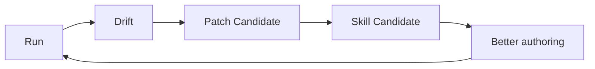

# Concepts & Domain Model

One vocabulary, defined once. When every team means the same thing by _Workflow_, _Credential_, or _Audit Log_, reviews move faster, handoffs stop leaking, and compliance gaps close before they reach an auditor.

This is the authoritative glossary for sk: each term is defined exactly once, and every other doc uses the meaning given here — not an approximation.

| Group                                              | Covers                         | Key terms                                               |
| -------------------------------------------------- | ------------------------------ | ------------------------------------------------------- |
| [0 — Naming & Acronyms](#group-0-naming--acronyms) | Shared names and expansions    | Contextual learning loop, AEAD, DAG, MCP, RBAC          |
| [1 — Platform Core](#group-1-platform-core)        | Isolation and identity         | Tenant, User, API Key, Portal Token                     |
| [2 — Authoring](#group-2-authoring)                | How workflows get built        | Conversation, Draft, Skill, Knowledge Source, Discovery |
| [3 — Integration](#group-3-integration)            | Reaching external integrations | Connector, Template, Driver, Credential                 |
| [4 — Execution](#group-4-execution)                | What runs, and what it records | Workflow, Step, Execution, Schedule                     |
| [5 — Governance](#group-5-governance)              | Control and proof              | Audit Log, RBAC, Before-Request Hook, Self-Healing      |
| [6 — Surfaces](#group-6-surfaces)                  | How callers reach sk           | sk CLI, MCP Server, Chat Adapter, Notifications         |

Read top to bottom for a full mental model, or jump to a group.

---

## Group 0: Naming & Acronyms

A few names in the codebase differ from the phrasing used in the prose docs, and several acronyms recur across every group. Both are collected here so every reader shares the same vocabulary.

**Contextual learning loop** — the mechanism by which a tenant's authoring context improves over time: every run can surface drift, a drift can produce an operator-reviewed Patch Candidate, a recurring pattern can produce an operator-promoted Skill Candidate, and both feed back into the next authoring run. See [workflows.md](./workflows.md) and the self-healing subsystem.

**Drift-assisted repair suggestion** — the prose phrasing for the codebase's _self-healing_ subsystem (also called _operator-reviewed remediation_ in governance contexts). Same concept, different audience.

> **Naming note.** The prose docs say "drift-assisted repair"; the codebase keeps stable technical identifiers (`apps/engine/src/self-healing/`, `rbac/`, `credentials/`, etc.). These names must not be renamed for vocabulary alignment — they are referenced by modules, logs, and tests.

### Acronyms

Collected so every reader has the same expansion at hand.

| Acronym   | Expansion                                     | One-line definition                                                                                                           |
| --------- | --------------------------------------------- | ----------------------------------------------------------------------------------------------------------------------------- |
| AEAD      | Authenticated Encryption with Associated Data | Encryption that also detects tampering of the ciphertext and the metadata it is bound to.                                     |
| BPMN      | Business Process Model and Notation           | Classical visual workflow language; cited as a contrast to AI-assisted authoring.                                             |
| DAG       | Directed Acyclic Graph                        | The shape of a Workflow: steps flow forward, never loop back to themselves.                                                   |
| DCR       | Dynamic Client Registration                   | OAuth 2.1 mechanism that lets a new external client self-register with the server (RFC 7591).                                 |
| DLP       | Data Loss Prevention                          | Policy layer that recognises sensitive fields (PII, secrets) and blocks them at the boundary.                                 |
| MCP       | Model Context Protocol                        | The standard by which AI clients (IDE assistants, coding agents, chat clients) connect to external integrations (Connectors). |
| OAuth 2.1 | —                                             | The current consolidated OAuth standard (PKCE-by-default, refresh-token rotation, no implicit grant).                         |
| OIDC      | OpenID Connect                                | Identity layer on top of OAuth 2.x; how sk verifies who a user is.                                                            |
| PII       | Personally Identifiable Information           | Data that identifies a natural person; subject to GDPR / SOC2 controls.                                                       |
| PKCE      | Proof Key for Code Exchange                   | OAuth extension that protects the authorization-code flow on public clients.                                                  |
| RAG       | Retrieval-Augmented Generation                | LLM pattern: ground generation in retrieved tenant-specific context (Lewis et al. 2020).                                      |
| RBAC      | Role-Based Access Control                     | Permission model that grants actions through roles rather than per-user grants.                                               |
| ReAct     | Reasoning + Acting                            | Agent pattern that interleaves model reasoning and tool calls (Yao et al. 2023).                                              |
| RLS       | Row-Level Security                            | PostgreSQL feature that enforces tenant boundaries at the database, not the application.                                      |
| RTO/RPO   | Recovery Time / Point Objective               | Disaster-recovery targets: how fast you recover, and how much data you may lose.                                              |
| SAML      | Security Assertion Markup Language            | Enterprise SSO standard, alternative to OIDC.                                                                                 |
| SCIM      | System for Cross-domain Identity Management   | Standard for automated user provisioning and deprovisioning.                                                                  |
| SSO       | Single Sign-On                                | One login session unlocks multiple applications.                                                                              |

---

## Group 1: Platform Core

**Tenant** — the top-level isolation unit in sk. All resources — workflows, connectors, credentials, users, skills, conversations, and knowledge sources — belong to exactly one Tenant. Multi-tenancy is structural, not configurable; no shared state crosses tenant boundaries, and every platform operation is scoped to the tenant of the authenticated principal.

**User** — a human principal within a Tenant. A User has a role (admin, member, or end-user) that governs which resources they can see and which actions they are permitted to take. Users authenticate through an Auth Provider (OIDC or API Key) and their identity is linked to their chat-platform accounts when chat integrations are enabled.

**API Key** — a bearer token scoped to a Tenant and a set of permissions. Used for programmatic access, service-to-service integration, and CLI authentication. API Keys carry explicit scopes and can be constrained to specific workflows or connectors. They support overlap-window rotation so access is never interrupted during a key change. In the Cockpit they live under **Credentials → Keys for scripts** (**Zugangsdaten → Schlüssel für Skripte**): your own script, a cron job or CI calls sk — a nightly export, for example.

**Credentials page (Zugangsdaten)** — the one Cockpit page that answers "who may access sk, and what does sk access on your behalf?", in three tabs. **Apps with access to SubKit** (**Apps mit Zugriff auf SubKit**): Claude, ChatGPT or another program somebody granted access to this installation over OAuth; adding one starts in the app itself, the page shows who may and withdraws the access. **Keys for scripts** (**Schlüssel für Skripte**): the API Keys above. **Access on your behalf** (**Zugriff in deinem Namen**): systems sk may use on a person's behalf — a workflow reading from another product, say — connected once by signing in there, with no key typed; each row there is a connection (**Verbindung**). The MCP tools, CLI commands and API routes keep their names (`list_api_keys`, `/v1/identity/api-keys`, `/v1/oauth/clients`, `/v1/connections`).

**Portal Token** — a short-lived, scoped credential issued to an end user for single-purpose access. Portal Tokens allow external users to interact with specific workflows without becoming full Tenant members. They are a tighter variant of an API Key, with a shorter default lifetime and a narrower permission surface.

---

## Group 2: Authoring

**Conversation** — the primary authoring session in sk. A User and the AI exchange messages; the AI uses structured authoring actions internally to propose, validate, and assemble a workflow. Conversations are persistent and resumable — a session can be paused and continued without losing context. The Conversation is where Drafts are created, refined, and committed.

**Draft** — a workflow under construction within a Conversation. A Draft exists only in the context of the Conversation until it is committed. Committing a Draft creates a versioned, immutable Workflow. A Draft _is_ executable — that is what a dry run does — but only with writes held back, so a Draft run has no side effects outside sk; the unheld path runs committed Workflows.

**Skill** — a reusable, curated piece of context loaded into the AI during Conversations and other AI-assisted authoring flows such as discovery, diagnosis, and bounded repair. Skills encode best practices, integration patterns, domain-specific knowledge, and known failure modes. They are authored or promoted by operators with explicit human approval. Skills are never auto-generated or auto-promoted from execution history, and committed deterministic workflow execution does not load them. See [Model a Domain](../authors/model-a-domain.md) for a Skill and a Knowledge Source configured together for one domain.

**Skill Candidate** — a pattern detected from execution history that might improve AI context quality. The platform proposes Skill Candidates automatically when it detects recurring patterns in successful or failed executions. A Skill Candidate becomes a Skill only through explicit operator approval — the platform never promotes one automatically.

**Knowledge Source** — a persistent document store attached to a Tenant or Workflow. Operators upload documents (PDFs, runbooks, compliance policies, architecture diagrams) which are chunked and indexed for semantic search. On interactive upload the AI auto-analyzes the content to generate a short **description** and a set of topical **tags**, so each source is self-describing and routable — the AI can decide which source covers a topic before searching, and searches can be narrowed by tag. The AI searches Knowledge Sources during Conversations, discovery, and repair-oriented authoring flows to ground its proposals in tenant-specific context. Committed workflow execution does not query Knowledge Sources directly.

**Discovery** — a one-shot analysis where the AI examines uploaded files (API specifications, runbooks, architecture diagrams, OpenAPI docs) and proposes Connectors, Skills, and Knowledge Sources inferred from their content. The result is a set of proposals — called Discovery Artifacts — that operators can approve or reject individually. Discovery does not configure anything automatically.

---

## Group 3: Integration

**Connector** — a configured connection to an external integration boundary. A Connector is built from a template, a driver, and credentials. It represents a specific integration instance — for example, a Stripe production account or a GitHub organisation. Connectors are tenant-scoped and versioned.

**Connector Template** — a pre-built blueprint for a well-known service. Templates include the driver type, authentication configuration, documentation ingestion setup, and guided setup instructions. sk ships 57 Connector Templates covering services across payments, CRM, DevOps, data, communication, and cloud infrastructure. Templates are the starting point for creating a Connector; they are not Connectors themselves.

**Driver** — the protocol layer that executes Connector requests. sk has five built-in drivers: HTTP, GraphQL, PostgreSQL, S3, and MCP. Each driver handles request construction, response parsing, pagination, and error normalisation for its protocol. The driver set itself is closed — you cannot register a sixth protocol at runtime — but the **MCP driver is the extension point**: point a Connector at any Model Context Protocol server and every tool, resource, and prompt that server publishes becomes reachable from workflows and chat, with no new driver to write and no engine change. Unlike the other four, the MCP driver holds a live session between calls rather than opening one per request.

**Credential** — an encrypted secret stored in the platform's credential vault. Credentials include API keys, OAuth2 tokens, connection strings, and similar sensitive values. Connectors reference Credentials by identifier; the raw secret value is never exposed outside the vault. All Credentials are encrypted at rest. OAuth2 Credentials refresh automatically.

---

## Group 4: Execution

**Workflow** — a versioned, directed acyclic graph (DAG) of Steps with a deterministic control flow: which Steps run, in what order, on what condition is fixed at approval time and never re-decided at runtime. Step _results_ can still vary — a Step calls the outside world. Workflows are authored through Conversations, approved by a human, and then committed as immutable versions. Each version is a complete snapshot of the workflow at the time of approval. Workflows are tenant-scoped and support a lifecycle of draft, active, and archived.

**Step** — a single unit of work within a Workflow DAG. Step types are: request (call a Connector), transform (reshape data), branch (conditional routing), loop (iterate over a collection), parallel (run Steps concurrently), wait (introduce a delay), wait_for_event (pause until an inbound signal), and call (invoke another Workflow). Each Step declares retry policy, timeout, error handling behaviour, and optional field masking for sensitive data.

**Execution** — a single run of a Workflow. An Execution carries its own state, step-by-step results, logs, and final status. sk never modifies an Execution record after it completes. Each Execution records its request source (API, CLI, scheduler, webhook, MCP, or chat) and its environment (dev or prod). Executions are queryable and searchable after the fact.

**Execution Fixture** — a recorded snapshot of a past Workflow execution, capturing the request and response at each Step. Fixtures serve as the dry-run corpus for Self-Healing proposals: before a Patch Candidate is presented to an operator for approval, it is validated against relevant Fixtures to confirm the repair does not break known-good behaviour.

**Schedule** — a cron expression or event trigger attached to a Workflow. The scheduler fires the Workflow at the configured time or in response to an inbound event. Schedules are reconciled at engine boot and on configuration changes. Scheduled fires are recorded in the Audit Log with source `scheduler`.

---

## Group 5: Governance

**Attention list** — the one list of what needs a person now: waiting questions, held schedules, failing scheduled workflows with their proposed repairs, connectors and connections that need a sign-in, prepared secret versions, skill proposals, and a critical budget or risk signal. One entry per subject, each checked against the reader's permissions. It is the heart of the Cockpit's start page (**Overview** / **Übersicht**), below the operations bar of six figures (runs, success rate, healthy connectors, repairs applied — each linking to the list of the same window — plus the cost of the window and the calendar month's budget), and it is `GET /v1/attention`, the MCP tool `get_attention`, and the headline of the health digest. When nothing is open and every source answered, the start page says so with one status line under the operations bar; the Cockpit has no separate decisions or system page.

**Audit Log** — the append-only record of every state change in the platform. Every entry carries: what changed, who initiated it, from which surface (API, CLI, MCP, chat, scheduler, webhook), and when. sk exposes no path that modifies or deletes an audit entry — no route, no tool, no job, and `audit:read` is the only audit permission — so nothing reaching the platform through its own surfaces can rewrite history. That is an application-layer guarantee: it does not extend to a party with direct database access, and entries are not hash-chained, so it provides no tamper _evidence_ against one. It is the authoritative record for compliance, debugging, and incident review.

**RBAC** — role-based access control enforced at every platform boundary. Every API route, MCP call, webhook trigger, and execution path checks the caller's role and permissions before proceeding. sk ships five built-in roles: the three user-facing roles (admin, member, enduser) plus the metrics_scraper and portal_token_user system roles. Custom roles and resource-level grants are supported for more granular control. RBAC decisions are recorded in the Audit Log.

**Before-Request Hook** — a sandboxed script that runs before a Connector request executes. Hooks can inspect or modify the outbound request, enforce policy (such as blocking writes during maintenance windows), or abort execution entirely. Hooks run in an isolated sandbox with a strict CPU budget and no access to the host environment. Hook execution is audited. Any error or timeout fails closed and denies the request.

**Self-Healing** — the platform's drift detection and bounded repair system. When a Connector's schema or behaviour changes in a way that causes Step failures, the engine detects the drift, compares the new response against the last known Schema Version, proposes a repair using the AI within a narrow repair loop, and dry-runs the proposed repair against recorded Execution Fixtures. The result is a Patch Candidate presented to an operator for approval. Self-Healing never applies a repair automatically without operator approval.

**Patch Candidate** — a proposed repair generated by the Self-Healing process. Each Patch Candidate carries the proposed change, a classification of safe or unsafe based on the scope and risk of the repair, the Execution Fixtures it was validated against, and a full audit trail. Patch Candidates require explicit operator approval before they are applied to a live Workflow.

---

## Group 6: Surfaces

**sk CLI** — the unified command-line surface and primary human-facing interface for the platform. Built on Ink plus citty commands, it provides a terminal UI that opens a Conversation for end users describing workflow goals, and top-level admin commands for operators managing the platform (`sk connectors`, `sk workflows`, `sk executions`, `sk audit`, and related groups). The sk CLI supports four authentication modes: API Key, OIDC, Portal Token, and headless (stdin pipe for scripted usage). Persona-aware: the surface adapts based on the authenticated user's role.

**MCP Server** — the Model Context Protocol server embedded in the sk engine. It exposes Workflows as callable `wf_<slug>` entries inside the MCP callable surface, Connectors as structured resources, and Skills as curated prompts that can be injected into an AI's context. Any MCP-compatible client — IDE assistants, coding agents, and chat clients alike — can connect to the MCP Server and interact with the platform. All MCP calls are governed by the same RBAC and Audit Log as direct API calls.

**Chat Adapter** — the integration layer for enterprise chat platforms (Slack, Microsoft Teams, Google Chat). Each adapter normalises platform-specific events — mentions, slash commands, interaction callbacks — into sk's Conversation model, and renders responses back as native platform messages. Approval flows surface as interactive cards with approve and reject buttons. Identity linking connects a chat user's platform identity to their Tenant account.

**Notification Rule** — a tenant-scoped row that selects which engine events fan out to which channel. Carries an event-type pattern, an optional workflow pattern, a severity, an optional `request_source_filter`, and the target `(workspace_id, channel_id)` tuple. Backed by the dispatcher in `apps/engine/src/notifications/service.ts` with a leaky-bucket rate limiter and a three-state circuit breaker. See [docs/operators/notifications.md](../operators/notifications.md).

**Notification Delivery** — the per-attempt outcome of dispatching a Notification Rule against an event. Possible statuses: `sent`, `rate_limited`, `breaker_open`, `failed`, `skipped`. Each row is the audit-grade record of what was (or was not) delivered, mirrored in the audit log via `chat.message.sent`, `chat.message.denied`, or `webhook.outbound.failed`.

**Service Metadata** — the identity envelope every engine code path carries: `{ trace_id, tenant_id, actor_id, actor_email, request_source }`. Constructed at every entry point (HTTP middleware, MCP server, scheduler, CLI bin, conversation tool-chain recursion) and threaded through every log line, audit row, and telemetry event. Defined in `apps/engine/src/observability/service-metadata.ts`. The trace_id is what an operator follows across surfaces during incident triage.

**Result Storage URI** — the pointer in `executions.result_storage_uri` (and per-step rows) that resolves a spilled payload back to its full content. Inline payloads up to `STEP_RESULT_DB_BYTES` (10 KB) live in the row; larger payloads spill to the configured S3-compatible private bucket as an immutable `s3://<bucket>/<key>` object with application SHA-256 metadata. A 512-byte text preview always lands inline. `fixture://<uuid>` is a read-only legacy recovery format, never a destination for new writes.

**LLM Judge** — an opt-in scoring layer invoked by the eval runner only when (a) `SUBKIT_EVAL_LLM_JUDGE=1` is set AND (b) the deterministic validator returns `pass=false` with `function_passed=true` (structurally fine, semantically dubious). The judge emits a `passes`/`partial`/`failed` verdict that enriches the report; it never overrides the deterministic gate.

---

## What to Read Next

- [docs/developers/input-surfaces.md](../developers/input-surfaces.md) — How users and systems reach sk: the CLI, REST API, MCP server, chat platforms, webhooks, and scheduled triggers.
