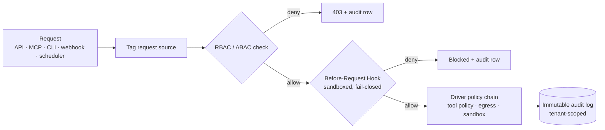
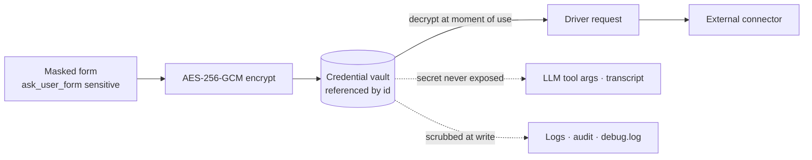

# Governance & Audit

> **Audience:** Security engineers, compliance reviewers, architects

**Pass the audit on the first pass.** Every interaction in sk is authorised before it runs, recorded in an immutable trail, and stripped of secrets — so "who did what, when, and from where?" is always one query away. Security is the default behaviour by architecture, not by configuration: multi-tenant isolation, a comprehensive audit log, a compliance posture that holds by construction, and secret-hygiene defences at the conversational surface.

Two adjacent concerns have their own admin homes:

- **Access control (RBAC/ABAC), identity, and Before-Request Hooks.** Every API route, MCP call, and workflow trigger is permission-checked before any resource is touched; a sandboxed, fail-closed Before-Request Hook can add dynamic policy on top of static roles. Full model: [RBAC & Roles](../admins/rbac-and-roles.md).
- **The credential vault.** All integration secrets are stored encrypted with AES-256-GCM, referenced by identifier, decrypted only at the moment of use, and never exposed to the AI or to logs. Full model and rotation: [Credentials & Keys](../admins/credentials-and-keys.md).

---

## How every request is governed

A request from any surface passes the same chain before it touches a resource: it is tagged with its source, checked against RBAC/ABAC, run through any tenant Before-Request Hook, then handed to the driver policy chain — and every decision lands in the tenant-scoped audit log.

Secrets never travel through that chain in the clear. A credential is collected through a masked form, encrypted, and stored by reference; the driver decrypts it only at the moment of use, while the LLM and every log surface see a redacted placeholder instead of the value.

---

## Multi-Tenancy as a First-Class Concern

sk is multi-tenant from the ground up. Every resource in the platform — workflows, connectors, credentials, users, skills, conversations, audit log entries — belongs to exactly one Tenant. This is not a deployment mode or a configuration setting. It is the data model.

Tenant isolation is enforced at every layer. Database queries always filter by tenant identity. API responses never include cross-tenant data. The audit log is tenant-scoped. A single engine instance can serve multiple organizations with complete isolation between them.

This design means there is no "global" namespace to accidentally share, no configuration flag to toggle isolation on or off, and no way for one tenant's data to appear in another tenant's context. Isolation is structural.

---

## The Audit Trail

Every state change in sk produces an immutable audit log entry. This is not selective logging — it is comprehensive.

The audit log captures: workflow creation, modification, approval, and deletion; connector operations; credential creation, rotation, and revocation; user provisioning and role changes; execution triggers and final results; approval events; skill promotions; patch candidate reviews; and more — over 100 distinct action types across all platform surfaces.

Each entry captures the full context of the event: what action was taken, who took it (user or service account identity), from which surface (API, CLI, MCP, chat, webhook, or scheduler), what changed (a structured diff where applicable), and precisely when. The metadata field on every entry is scrubbed for token-shaped values before persistence — bearer tokens, JWTs, AWS access keys, and any value under a key matching a sensitive name (`password`, `token`, `secret`, `credential`, `*_token`, `authorization`) become `***REDACTED:<kind>***` at write time, regardless of how they reached the audit recorder.

The audit log cannot be modified or deleted. It is the compliance and forensics record for the platform. It is designed to answer the question every audit or incident review requires: "Who did what, when, and from where?"

Audit emissions go through typed recorders under `apps/engine/src/audit/recorders/` — one helper per resource family (connector, workflow, credential, knowledge source, policy). Each recorder requires a non-null `reason` for state-changing rows. Reasons are part of the contract: `auto_persist_on_confirmation` distinguishes harness auto-persist writes from `manual_re_issue` (explicit `save_connector_draft` calls), `force_save_override` / `force_save_override` mark force-flag overrides of failed probes or previews, `credential_must_use_form` records rejected credential attempts at the draft layer, and `confirm_before_execution` records every tool-policy decision that paused for an operator confirmation.

New audit kinds for the conversational surface include `tool_policy.confirmation_required` (every confirmation gate the policy resolver fires), `connector.draft.credential_rejected` (rejections by the `update_connector_draft` contract), `connector.invoked` (each `call_connector` round-trip), `connector.saved_override` (a save persisted with `force_save: true` despite a failed probe), and `knowledge_source.refreshed` (each discovery cache refresh). The conversational context pipeline also emits `conversation.skill_loaded` — a tenant-scoped row written when a Skill is loaded into a conversation working set under the recency-gated `load_skill` path, with reason `skill_loaded` on first load and `skill_re_promoted` when an already-known Skill is re-promoted (see `apps/engine/src/audit/types.ts` `CONVERSATION_SKILL_LOADED` and `apps/engine/src/audit/recorders/conversation.ts`). It records a state-mutating write: `load_skill` updates the persisted `conversations.loaded_skills` palette — tenant-visible state that survives session resumption — so, like every other tenant-state mutation, it goes through the audit chokepoint. Per-turn recency demotions are derived and intentionally not audited.

Operators can query the audit log by actor, action type, resource, time range, and request source. The `sk audit-log tail` command provides a real-time stream for operational monitoring. The API exposes the same query surface programmatically.

**Asymmetric coverage on `data.exported` from `POST /v1/extract`.** Binary-format extracts (PDF / DOCX / XLSX / XLS / PPTX) emit an `action = "data.exported"` audit row for both success and parse-failure paths — these formats can carry whole tenant documents (CVs, contracts, financial spreadsheets), so the egress trail is explicit. Text-format extracts (JSON / CSV / YAML / XML / plaintext) deliberately skip the audit row because they are shape-only (the caller is sending data the engine already knows about for schema inference). Operators monitoring `data.exported` for *all* extract calls should be aware of this gradient. The 413 body-cap denial path is audited for every format. See [Observability & Resource Limits](../operators/observability.md#resource-limits-and-operational-safety) for the full operator-controlled metadata surface (`audit_log.metadata.filename`, `audit_log.metadata.error`).

---

## The Compliance Posture

The following properties hold by construction — they are not optional configurations.

**Encryption at rest.** All credentials are encrypted with AES-256-GCM before being written to the database. The encryption key is managed at the engine configuration layer.

**Encryption in transit.** All engine endpoints are served over TLS. The engine does not serve unencrypted HTTP in production configurations.

**API key storage.** Keys are stored as hashes. The comparison during authentication is always against the hash, never against a stored plaintext value. There is no way to recover a key after issuance.

**Webhook signatures.** All inbound webhooks use the Standard Webhooks signature scheme (HMAC-SHA256). The engine verifies signatures before processing any webhook payload. Requests with missing or invalid signatures are rejected.

**Sandboxing.** Untrusted code — transforms, Before-Request Hooks, and self-healing patch scripts — runs in an isolated QuickJS-WASM sandbox with a strict CPU budget. Sandbox code cannot access the network, the file system, or the database. The sandbox is not a trust boundary that can be configured away; it is where all runtime code execution occurs.

**Egress governance.** Connector requests go through the engine. Clients never call external connector boundaries directly. All egress is logged in the audit log with request source, caller identity, and outcome.

**Request source tracking.** Every platform interaction — API call, MCP invocation, webhook delivery, chat message, CLI command, scheduled trigger — is tagged with its source. "Who initiated this?" is always answerable from the audit log.

---

## Secret Hygiene at the Conversational Surface

The conversational surface introduces additional pressure on secret handling: an LLM may attempt to type a credential into a tool argument, an operator may paste a token into the chat input, or a debug log may capture a verbose elicitation payload. sk applies multiple defences so any one of these doesn't propagate into a persistent surface.

The `update_connector_draft` tool rejects any credential-shaped field in `config` with a structured `credential_must_use_form` envelope. The agent is steered, by both the tool contract and the seed skill content, toward the masked-form path: `ask_user_form(type: password, sensitive: true)` collects the value, the harness auto-persists the connector and credential atomically, and the LLM never sees the secret in any tool argument or transcript.

The HTTP / GraphQL / S3 drivers no longer honour inline credentials from `connector.config`. Probing a draft without a saved credential row returns a structured `credential_required` envelope, which the conversational layer turns into the next ask-form turn. The previous shortcut that lifted `config.token` into the Authorization header has been removed — it made the wrong thing look like progress.

Engine logs, audit metadata, conversation event payloads, and the `~/.sk/debug.log` file pass through a centralized scrubber before write. The scrubber matches known token shapes — DigitalOcean, GitHub, GitLab, Slack, Anthropic, Bearer-prefixed bearer tokens, JWTs, AWS access keys — and any value whose key name matches the sensitive-name pattern. Matches become `***REDACTED:<kind>***` at the file-write boundary.

The sk CLI composer detects token-shaped paste in the chat input. When matched, the input is replaced with a one-keystroke confirmation prompt; on confirmation the CLI sends a redirect message that asks the agent to re-prompt through the masked form, instead of forwarding the literal paste to the engine. The detector catches the same regex catalog as the engine scrubber.

Tool policies (`apps/engine/src/conversations/tools/tool-policies.ts`) decide execution mode dynamically per call. Inputs containing token-shaped values or sensitive key names force the policy resolver to `confirm_before_execution`, which inserts an `ask_user_confirm` gate before the tool runs. Every such pause writes a `tool_policy.confirmation_required` audit row with the tool name and the matched sensitive shape — operators can review every policy-gated decision in the audit trail.

The `authenticate_oauth` flow surfaces an authorization URL that the sk CLI auto-launches in the operator's browser. That URL is tenant-controlled input: it is derived from the connector's `oauth.issuer_url` config, which a tenant admin can write. The proportionate control is a scheme clamp — `BrowserUrlSchema` accepts only `http`/`https`, closing `file:`, `javascript:`, and `data:` URLs — so the worst a tenant admin can do is cause the CLI to open an arbitrary http(s) page for an operator who has paused on that connector. This is acceptable because connector-config writes are already an audited, RBAC-gated action: the admin who could set a hostile `issuer_url` is the same admin already trusted to configure the connector's real endpoints, and every such write lands in the audit trail.

---

## Further reading

- [RBAC & Roles](../admins/rbac-and-roles.md) — identity, authentication, RBAC/ABAC, and Before-Request Hooks.
- [Credentials & Keys](../admins/credentials-and-keys.md) — the credential vault, master-key rotation, and release signing.
- [glossary — governance terms](./glossary.md#group-5-governance) — Audit Log, RBAC, Before-Request Hook, Self-Healing, Patch Candidate.
