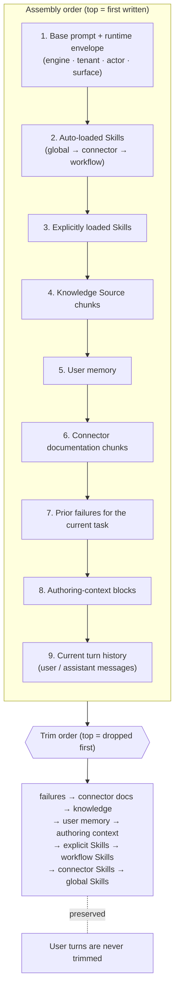
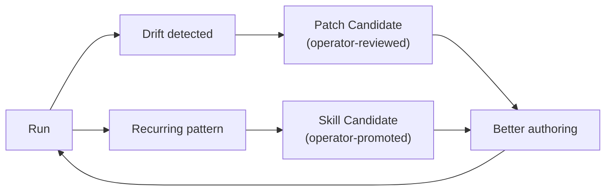

# Knowledge & Skills

> **Audience:** Architects and authors who want the model behind the AI's
> organization-specific context.

**Outcome:** authoring grounded in your own conventions — not generic API
docs — so workflows ship faster, with fewer rework cycles and fewer
compliance surprises. The AI proposes against your patterns because your
patterns are in its context.

Two primitives carry that context:

| Primitive | What it is | Role |
|---|---|---|
| **Skills** | Dense, operator-authored guidance | Prescriptive rules the AI follows |
| **Knowledge Sources** | Broad organizational documents | Searchable grounding, not rules |

This page covers how the engine assembles them into each authoring turn, how
**Discovery** turns files into proposals, and how the loop compounds. Author
how-tos live in [Custom Skills](../authors/custom-skills.md) and
[Knowledge Sources](../authors/knowledge-sources.md).

---

## Skills: curated context

A Skill is reusable context loaded into the AI during a Conversation and other
AI-assisted flows — discovery, diagnosis, bounded repair. Skills encode your
best practices, integration patterns, security policies, and domain knowledge.
Reference your Stripe connector and the Stripe Skill loads automatically, so
proposals reflect your conventions, not generic API knowledge.

Operators own Skills. Scope each one:

- **Global** — every Conversation.
- **Per-connector** — loaded when that connector is referenced.
- **Per-workflow** — loaded for that workflow.

Skills are never auto-generated or auto-promoted. The engine detects recurring
patterns and surfaces them as Skill Candidates; a candidate becomes an active
Skill only by explicit operator promotion. The engine learns what works; humans
decide what becomes canonical.

---

## Knowledge Sources: enterprise documents

A Knowledge Source is a persistent document store for document-scale context —
runbooks, API specs, compliance frameworks, architecture diagrams. Operators
upload the files; the engine chunks and indexes them for semantic search.
During a Conversation, discovery pass, or repair loop, the AI searches them to
ground its proposals.

Skills prescribe; Knowledge Sources inform. The AI follows Skills as
instructions and searches Knowledge Sources for relevant context without
treating them as rules.

**Committed workflow execution queries neither.** Skills and Knowledge Sources
improve authoring and repair quality; once a workflow is committed, the runtime
path stays deterministic.

---

## Context assembly and trimming

Each authoring turn assembles prompt context in a fixed order. Order matters
twice: it shapes how the model reads context (top is most foundational) and how
the trimmer drops it under budget pressure (top survives longest, bottom goes
first).

This order is contract, not implementation detail. Under tight budgets,
operator-curated connector and workflow guidance outlives incidental history —
so a tenant's own conventions are the *last* thing dropped, never the first.

Replay stays bounded: tool results are truncated before re-entering later
turns, compaction markers suppress older replay, and oversized histories
collapse into a deterministic summary plus the recent tail.

---

## Discovery: from files to proposals

Discovery cuts onboarding time for a new integration: instead of hand-configuring
every connector and Skill, it starts from documentation that already exists.

An operator uploads files — API specs, data dictionaries, architecture
diagrams, runbooks — and sk produces structured proposals. Each Discovery
Artifact is a proposed connector, Skill, or Knowledge Source, with a confidence
score and links to the supporting evidence.

Nothing is configured automatically. Proposals are starting points; the
operator approves what to keep.

---

## How the loop compounds

Skill Candidates surface production patterns: when connectors or step sequences
recur together and tend to succeed, the engine proposes a new Skill with
confidence scores and links to the supporting executions. Self-healing drift
detection keeps workflows healthy as connected systems change, proposing the
smallest safe fix as a Patch Candidate.

Same shape both times: the engine surfaces proposals, humans decide. The engine
gets smarter over time — but only with human approval at each step.

---

## Further reading

- [Model a Domain](../authors/model-a-domain.md) — the connector + skills + knowledge trio, worked end to end.
- [FAQ](./faq.md) — fast answers on how these pieces differ and where to create each.
- [Custom Skills](../authors/custom-skills.md) — how to author, scope, and promote Skills.
- [Knowledge Sources](../authors/knowledge-sources.md) — how to upload, tag, and refresh documents.
- [Self-healing](../operators/self-healing.md) — the operational side of the repair loop.
- [glossary — authoring terms](./glossary.md#group-2-authoring) — Conversation, Draft, Skill, Skill Candidate, Knowledge Source, Discovery.
