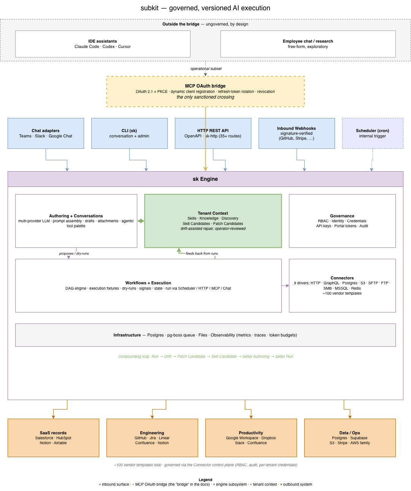
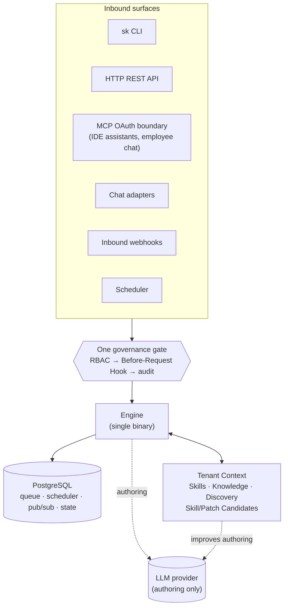
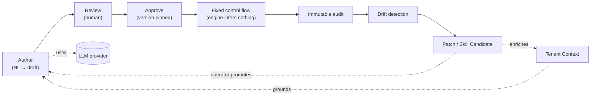

# Architecture Overview

> **Audience:** Anyone forming a first mental model of sk — architects, operators, authors, contributors.

**Ship audited automation in hours, not sprints — and keep every run governed,
versioned, and auditable.** A team describes the outcome in plain language; sk turns it into a
governed, versioned workflow; an operator approves it; the engine runs it against the
connectors (the SaaS and apps your team already uses) along a control flow that is fixed
at approval time.

One contract holds throughout: **AI assists with *authoring*; the *control flow* of an
approved workflow is fixed and never re-decided at runtime.** Multi-tenancy, RBAC,
encrypted credentials, and an append-only audit trail apply to every entry point.

---

## At a glance

*External clients (IDE assistants, employee chat) reach governed workflows only through SubKit's product-local **MCP OAuth boundary**; other surfaces (Chat adapters, CLI, HTTP REST API, Inbound Webhooks, Scheduler) enter directly. The engine groups into six clusters; the green **Tenant Context** cluster is the compounding loop. Source: [`./overview.drawio`](./overview.drawio).*

Every entry point flows through the same governed pipeline. Execution is policy-
and version-bound, auditable, and operator-reviewed for drift-assisted repair.

---

## The governance loop

Authoring and execution are separate trust domains. The model proposes; a human
approves; the engine runs the frozen artefact. Each run can feed the next
authoring — but only through operator promotion, never silently.

---

## The three things to internalise

1. **Authoring vs. execution are different trust domains.** The LLM proposes; a human approves; the engine runs the approved artefact deterministically. Committed execution never queries Skills, Knowledge, or the model. See [Authoring workflows](../authors/authoring-workflows.md) and [Workflows](./workflows.md).
2. **One dependency.** The engine compiles to a single binary; PostgreSQL is the only stateful dependency. The job queue, cron scheduler, and pub/sub bus all live in Postgres. See [Self-host](../developers/self-host.md).
3. **The compounding loop.** Run → Drift → Patch Candidate → Skill Candidate → better authoring → better run. Every run can improve the tenant's authoring context — but only through operator promotion. See [Knowledge & Skills](./knowledge-and-skills.md) and [Self-healing](../operators/self-healing.md).

---

## Where to go next

- [Glossary](./glossary.md) — every domain term defined exactly once.
- [Connectors & integration](./connectors.md) — Drivers, Templates, Credentials, the vault, OAuth2.
- [Workflows](./workflows.md) — the execution model, step kinds, triggers, versioning, self-healing.
- [Knowledge & Skills](./knowledge-and-skills.md) — how the authoring context compounds.
- [Governance & Audit](./governance-and-audit.md) — multi-tenancy, RBAC, audit, secret hygiene.
- [`AGENTS.md`](../../AGENTS.md) — the canonical repo-wide contributor contract.
