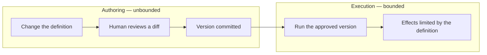

# Reversibility & Trust Domains

> **Reading time:** ~8 min
> **Audience:** Architects, operators, and authors deciding how much autonomy a piece of automation should get

**Give each piece of work the level of control it actually needs — no ceremony where mistakes are cheap, no blind spots where they are not.** Most automation decisions are made on one question: *is this useful?* That question picks what to automate. It cannot tell you how much freedom the automation should have, or whether a person belongs in front of it. This page adds the two questions that can, and shows where sk fits — and where it deliberately does not.

---

## The question that decides

Before automating anything, ask:

> **What does the worst plausible failure cost, and how long does it take to undo?**

Usefulness picks *what* to automate. Reversibility picks *how much autonomy it gets and which gate it passes.*

The same technology deserves different treatment depending on the answer. A typo in a draft is corrected and forgotten. A sent message is gone. A payment is a phone call and an apology. Automation checklists that ask only about upside green-light all three identically — which is why the one that later hurts is usually the one that passed review most easily.

## Two axes, four quadrants

Reversibility alone is not enough. The second axis is how much judgment the work needs **at the moment it runs**: can the decision be written down as rules, or does someone have to weigh things up?

| | **Formalizable** — rules decide | **Soft judgment** — a call must be made |
|---|---|---|
| **Reversible** | Automate plainly. A gate costs more than it saves. | A briefed, freely iterating agent genuinely fits here. |
| **Irreversible** | **sk's zone.** Versioned artefact, gate, audit trail. | **Danger zone.** |

The danger zone is the honest part of this table: **there is no good answer inside it.** Soft judgment in front of an irreversible effect means an unreviewable decision with a permanent consequence, and no amount of additional guardrail changes that — a guardrail cannot review a decision nobody can inspect.

The correct move is not to secure the quadrant. It is **to leave it**:

- **Pull the judgment forward**, into authoring, where a person reviews an artefact without time pressure.
- **Formalize what remains**, so execution follows rules rather than making calls.
- Where that split genuinely cannot be made, the effect itself needs a person on it — every time, not by exception.

This also names a trade sk makes openly: it exchanges runtime flexibility for authoring effort. For irreversible work that is the right trade — the effort buys a reviewable artefact and a rollback target. For reversible, variance-driven work it is the wrong one, and reaching for a fixed graph there is overkill rather than rigour. Knowing which quadrant you are in is what keeps you from paying either price unnecessarily.

## Authoring and execution are different trust domains

Running an approved workflow is bounded work: the definition already says what may happen, and execution stays inside it. *Changing* that definition is unbounded work: it decides what may happen from then on, for every future run.

Same actor, same intelligence, categorically different blast radius.

Systems that collapse these into one surface end up governing neither: the authoring change slips through the gate built for execution, and the execution gate is too heavy for what it now guards. sk keeps them apart — which is also why the surface you choose to *author* on matters. See [Choosing your surface](../authors/choosing-your-surface.md).

## The readable-artefact test

For any change, one test decides whether review is even possible:

> **Can someone read what will change, before it changes?**

If yes, review is possible and rollback has a target. If no, the only remaining control is trust in the intent — and intent does not survive a paraphrase. Something restated by another party, human or model, is no longer the thing you approved.

This is why a workflow in sk is a **numbered, versioned document** rather than a configured personality. A behaviour change you cannot read is a change with no way back: nothing to compare, no version to name, no target to restore. A document has all three. It is the difference between "the automation behaves differently now" and "this version changed these four lines, and the previous one is a single command away."

The practical consequences run through the whole product: [Workflow Execution](workflows.md) for version binding and replay, [Governance & Audit](governance-and-audit.md) for the trail that records who approved which version.

## A guardrail is a boundary, not a request

"Never do X" written into a prompt is a request. The model may honour it, and usually will — but compliance is the mechanism, and compliance is not a boundary.

These are boundaries:

- a permission check that refuses before the resource is touched
- an execution sandbox with no host globals to reach for
- an approval bound to the exact payload it approves

The distinction has a sharp edge worth stating plainly: **a value the model can place in its own tool call is not an approval.** It is a field with a reassuring name. The same holds for identity — a name and a role description are not an identity subject. What makes attribution possible is identity carried *per action*, on the row, at the moment the action happens.

## Where determinism does and does not reach

sk fixes the **control flow** of an approved workflow. It does not promise that every step returns the same value.

There is no step kind that calls a model: the step kinds are `request`, `transform`, `call`, `wait`, `wait_for_event`, `branch`, `parallel`, and `loop`. A workflow that wants a model's judgment reaches it the way it reaches any other API — a `request` step against a provider. That step is version-bound, recorded, and replayable like every other, and its token cost is accounted for; what it is not is deterministic in its result.

Saying this plainly matters, because the honest boundary is narrower than "deterministic execution" suggests. The guarantee is that the *path* through the workflow is fixed at approval time and never re-decided at runtime — not that every value along it is reproducible. A reader who assumes the stronger version discovers the gap at the worst moment.

It is also why sk prefers a deterministic classifier, or a replay against a recorded real response, over asking a second model for a verdict. Two models built the same way share failure modes: they agree confidently, and agreement between them is not evidence. Where a verdict has to hold, the check should not itself be a judgment call.

## Further reading

- [Choosing your surface](../authors/choosing-your-surface.md) — the practical consequence: which door for which job
- [Workflow Execution](workflows.md) — versioning, replay, and what a fixed control flow buys
- [Governance & Audit](governance-and-audit.md) — the permission chain and the audit trail
- [RBAC & Roles](../admins/rbac-and-roles.md) — how boundaries are actually enforced
