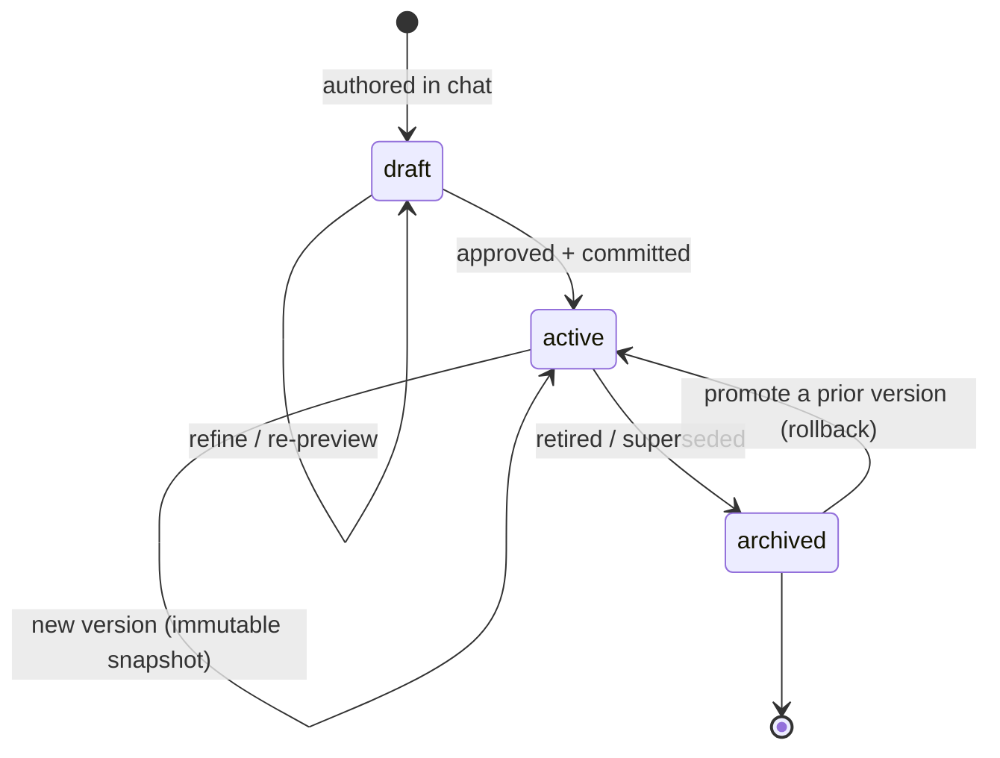
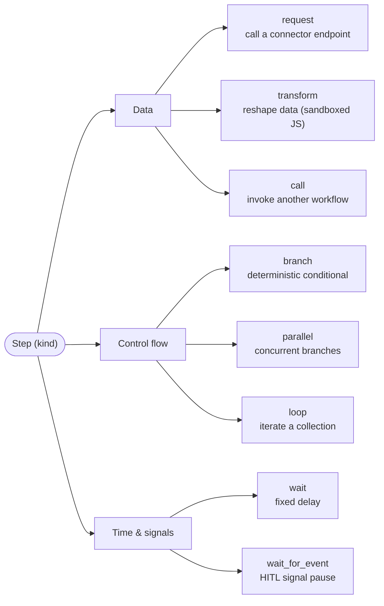
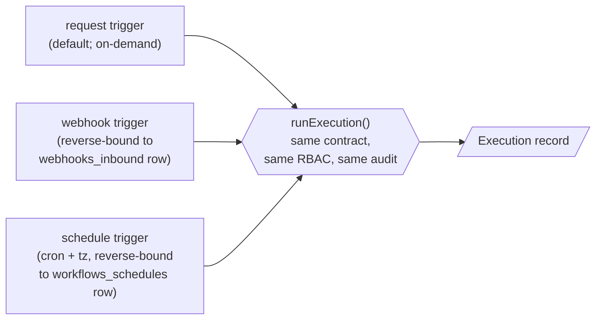
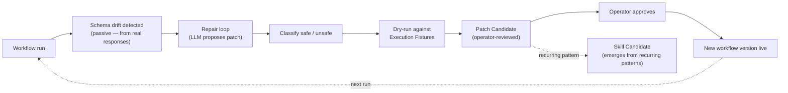

# Workflow Execution

> **Audience:** Engineers integrating the runtime, operators monitoring executions

Once you approve a workflow, it takes the same path every time — no model reconsiders it on the next run. That is what makes it safe to leave month-end reporting, invoice checks, or back-office routine running unattended: each run is permission-checked, recorded, tied to a version, and replayable when someone asks what happened. AI writes the workflow; the engine runs it.

This page covers the workflow lifecycle, the execution model, the eight Step kinds, triggers, versioning and rollback, scheduling, self-healing, and the observability surface operators rely on.

---

## Workflow Lifecycle

A workflow moves through three states. Chat authors a **draft**; approval commits it to **active**; retiring or superseding it moves it to **archived**. Promoting a prior version back to active is the rollback path — no redeploy, instant, audited.

Authoring itself follows a fixed shape: sk builds a grounded draft from the described outcome, tests that draft against real connectors, refines it with targeted patch edits, and only then commits it. Each stage is a discrete, governed step — the draft is never mutated blindly, and the commit is the single gated transition from draft to active. See [AI-assisted authoring](../authors/authoring-workflows.md) for the full loop.

**Playground mode.** Authoring can run in an ephemeral scratch mode that never persists. A playground conversation builds and tests drafts exactly like a normal session, but nothing it produces is written to the tenant's workflow store — the draft evaporates when the conversation ends. This is the safe space to explore a shape, probe a connector, or demonstrate the authoring loop without leaving any committed artifact behind. Playground is a durable, per-conversation flag: it is set when the conversation is opened (an AI client signals it over MCP; an HTTP caller passes it on the start request) and holds for the life of that conversation.

_Draft → active → archived. Every transition lands in the Audit Log with the actor, the version, and the timestamp._

### Durable drafts are not active versions

The draft API persists preparation without activating a workflow. A workflow has
separate `draft_version_id` and `current_version_id` pointers. Saving a draft writes
an additional version and advances only the draft pointer; the active definition,
schedule, webhook and tool catalog stay unchanged. A new draft has no active
version and creates no live trigger. Existing workflows acquire no draft or
execution authority through migration.

Updates bind `expected_draft_version_id` to the version the author read (`null`
when no draft exists). A concurrent edit returns a conflict instead of silently
overwriting another draft. Identical definitions reuse the existing draft version;
changed definitions retain earlier versions. Draft responses include a canonical
SHA-256 definition digest, not an execution grant. Every actual save has a
transactional audit record carrying actor, request source and both pointers.

Use the dedicated draft endpoints for this behavior. Existing definition-commit
endpoints are activation-capable and are not equivalent to saving an inert draft.

### The authoring critic

Static validation catches what a schema can prove: unknown step kinds, malformed placeholders, a scope reference that can't resolve. It cannot catch a draft that is _structurally valid but semantically wrong_ — a workflow that parses cleanly yet quietly drifts from what the author actually asked for (the wrong endpoint, an inverted condition, a dropped field).

The authoring critic closes that gap. It is an LLM gate that runs **after** static validation in the authoring pipeline and reads the draft against the stated intent, flagging semantic drift a parser can't see. When it finds a problem, the finding is fed back into the same bounded-repair loop the engine uses everywhere else, so the fix is proposed and re-validated rather than silently applied.

The critic is **off by default** and enabled through the `llm.critic.*` settings (see the settings reference). It is deliberately **fail-open**: if the critic model is unavailable or errors, authoring proceeds on the static result rather than blocking — the critic sharpens quality when present but is never a hard dependency on the path to a committed workflow.

---

## The Execution Model

The **control flow** of an Execution is deterministic. A Workflow is a DAG of Steps; the execution engine walks that DAG in order, following branching and parallel directives exactly as defined. The engine does not re-interpret, adapt, or infer at runtime: it never calls a model to decide what runs next, and committed execution never queries Skills or Knowledge Sources.

What a Step _returns_ is a different matter — a `request` Step calls the outside world, and the outside world is not deterministic. That includes a Step an author points at a model provider: sk supports this deliberately (see [Calling a model from a Step](#calling-a-model-from-a-step)), and such a Workflow does not produce identical output on every run. The guarantee is that no model decides what the Workflow _does_.

There is a single runtime entry point for manual execution: `POST /v1/executions`. Persisted workflows, inline draft definitions, and single-step previews all flow through this same route and the same execution engine. Inline runs complete synchronously by default. Queued background execution is explicit and reserved for persisted workflows, scheduler fires, webhook fan-out, and other detached cases.

All execution surfaces normalize workflow input through the same boundary before dispatch. Conversation `run_workflow`, MCP callable entries, REST workflow-run routes, webhook-bound executions, queue resumes, and scheduler-triggered runs all end up at the same execution contract with the same effective input payload. Surface adapters may differ in how they collect input, but they do not get to define different runtime semantics.

Provider failures on the authoring side do not leak through as generic internal errors anymore. Usage-limit and rate-limit failures are surfaced as typed provider-limited responses, context-window failures are surfaced as context-too-large responses, and temporary provider outages are surfaced as typed provider-unavailable responses. The execution engine remains deterministic; these envelopes only describe authoring-time model failures.

This is a deliberate architectural decision, not a limitation. AI is for authoring — exploring, proposing, and revising. Once a Workflow is approved and committed, the enterprise needs to know which steps will run, in which order, against which systems. The moment the _engine_ infers that, the audit trail becomes "the AI decided" rather than "the workflow ran as specified."

An Execution is a permanent record. It captures the specific Workflow version that ran, who or what triggered it, the inputs and outputs of every Step, timing at every boundary, and the final status. sk never modifies it after it completes. If something goes wrong, the complete record of what happened is preserved exactly as it occurred.

## Calling a model from a Step

A `request` Step may target a model provider like any other HTTP endpoint, and sk supports this on purpose: it ships a connector template and recipes for it. This is how a Workflow does work that needs judgement — classifying, extracting, summarising — inside an otherwise fixed control flow.

Two things follow, and both are the point rather than a caveat:

- **The run is no longer reproducible.** The same input can yield different output. The control flow is still fixed; the content is not. A Workflow that must produce byte-identical results should not contain such a Step.
- **The spend is bounded, not unbounded.** Declare `max_llm_tokens_per_run` on the Workflow. The engine recognises calls to known provider hosts, meters prompt + completion tokens across the run, and refuses to dispatch a call whose pre-call estimate would exceed the cap — before the provider is charged. Without a cap the tokens are still counted and land on the execution's audit record; they are simply not bounded. The recipe linter marks such Workflows `budgeted-llm` and requires the cap.

---

## Step Kinds

A Workflow is composed of Steps. sk ships eight Step kinds, grouped by what they do. There is no `tool` kind (no docker-based sandbox runner) — this is a data-workflow engine, not a container runtime.

| `kind`           | What it carries                                                                                                                                                                                                                                                                                      |
| ---------------- | ---------------------------------------------------------------------------------------------------------------------------------------------------------------------------------------------------------------------------------------------------------------------------------------------------- |
| `request`        | Calls a system through a connector — HTTP, GraphQL, SQL, S3, or a remote MCP server. One step kind, five drivers, so retry, backoff, and the audit envelope behave identically whichever system is on the other end.                                                                                 |
| `transform`      | Reshapes data between steps in a sandboxed JavaScript expression — no network access, bounded time and memory.                                                                                                                                                                                       |
| `branch`         | Deterministic conditional routing — the engine evaluates the condition and dispatches the matching branch, no inference, no fallthrough.                                                                                                                                                             |
| `loop`           | Iterates a collection, running its body once per item. Expensive or side-effecting loops can set `fail_fast: true` to stop after the first non-tolerated body failure; the default collects every iteration result.                                                                                  |
| `parallel`       | Fans out independent step sequences concurrently and merges their results.                                                                                                                                                                                                                           |
| `wait`           | A deliberate delay (up to 24 h) — polling, rate-limit pacing, human-paced flows.                                                                                                                                                                                                                     |
| `wait_for_event` | Pauses the run for an external signal — the human-in-the-loop gate. The run resumes when the signal arrives, or takes an explicit timeout path the author defines. The shipped `merge-pr-after-approval` recipe is the canonical example: open a PR, wait up to 24 h for approval, merge or abandon. |
| `call`           | Invokes another saved workflow — sub-processes compose into pipelines.                                                                                                                                                                                                                               |

Two contracts sit on top and matter to everyone, not just contributors:

**Every request is classified read or write.** The driver classifies at dispatch time (a GET is a read, a mutation is a write; an external MCP tool call is a write until someone inside the tenant says otherwise), and the author can override either way.

**Previews hold writes.** A dry run executes read steps live but fully resolves and _holds_ every write — URL, headers, the materialized body are recorded, nothing is dispatched. You see exactly what would have been sent before anything is sent; executing writes during a preview takes an explicit confirmation.

The exact field contract of every step kind — schemas, sandbox limits, timeout interplay — is the [step-kinds field reference](../developers/step-kinds-reference.md).

---

## Triggers

_Three trigger kinds, one execution core. The trigger lands in the immutable Execution and Audit Log alongside the actor identity envelope, so an operator can answer "who/what triggered this and from where" without joining tables._

`WorkflowDef.trigger` is a discriminated union over `kind`. Omitting the block is equivalent to `{ kind: "request" }`, so every workflow authored before this field existed keeps its behaviour. Setting `webhook` or `schedule` reverse-binds an inbound binding or cron schedule keyed on `(tenant_id, workflow_id)` at save time and removes the binding on delete or version rotate. The schema source of truth is [`apps/engine/src/workflows/types.ts`](../../apps/engine/src/workflows/types.ts) (`RequestTriggerSchema`, `WebhookTriggerSchema`, `ScheduleTriggerSchema`).

The trigger is recorded in every Execution and every Audit Log entry alongside the actor identity envelope.

| `kind`     | Fields                                                                                                                                                                                                                                            | Behaviour                                                                                                                                                                                                                                                                                                                                                                                                                                                                                                                                                                                                             |
| ---------- | ------------------------------------------------------------------------------------------------------------------------------------------------------------------------------------------------------------------------------------------------- | --------------------------------------------------------------------------------------------------------------------------------------------------------------------------------------------------------------------------------------------------------------------------------------------------------------------------------------------------------------------------------------------------------------------------------------------------------------------------------------------------------------------------------------------------------------------------------------------------------------------- |
| `request`  | (none)                                                                                                                                                                                                                                            | Default. Run is initiated on demand by a caller — chat `run_workflow`, MCP, the CLI, or `POST /v1/executions`. Inline runs complete on the request path; `async: true` is honoured only for `source=saved`.                                                                                                                                                                                                                                                                                                                                                                                                           |
| `webhook`  | `source` (string slug per integration — a provider label stored in `native_verifier_config.source`, **not** the ingress URL path), `events[]` (provider event names; empty means "any"), `verify` (`stripe-signature` \| `github-hmac` \| `none`) | Reverse-bound to a `webhooks_inbound` row. Inbound posts are signature-verified before any processing begins; replay-id deduplication suppresses retried deliveries. Executor lives in `apps/engine/src/webhooks/inbound/service.ts`.                                                                                                                                                                                                                                                                                                                                                                                 |
| `schedule` | `cron` (5-field `m h dom mon dow` or `every:N` shorthand), `tz` (IANA, default `UTC`); optional `execution_mode` (`dev` \| `prod`, default `prod`), `business_days_only`, `skip_dates[]` (ISO `YYYY-MM-DD`)                                       | Reverse-bound to a `workflows_schedules` row. The scheduler reconciler validates the cron expression at bind time, persists the connector environment, and uses `tz` so firings land at the operator's local wall-clock time. Unattended runs target production connectors by default; dev schedules are explicit. `business_days_only` skips weekends; `skip_dates` declares holidays / freezes explicitly (no holiday calendar is inferred). Catch-up semantics: a missed firing fires on the next reconciler pass rather than being silently skipped. Executor lives in `apps/engine/src/scheduler/reconciler.ts`. |

All three variants land at the same `runExecution()` core through the same execution contract; only the way the run is initiated differs.

**Schedule resource upserts.** `POST /v1/schedules` is an upsert on `(tenant_id, workflow_id)`. A new row returns 201 with `upsert_status: "created"` and audits `schedule.created`; replacing the existing workflow schedule returns 200 with `upsert_status: "updated"` and audits `schedule.updated`. The persisted JSON `input`—including arrays, scalars, and `null`—is returned by create/update responses and by `GET /v1/schedules`, so the catalog shows the exact payload that unattended runs receive.

**Webhook trigger, exactly.** Two facts trip up authors; both are grounded in `apps/engine/src/webhooks/inbound/service.ts`:

- **`verify` is not the stored verifier.** `stripe-signature` → stored `verifier = "stripe"`; `github-hmac` → `"github"`; `none` → `"standard"` with `native_verifier_config.skip = true`. The stored `verifier` column is always one of `standard` / `github` / `stripe` — never `none`. A row whose `verifier` is set to `none` (or anything unrecognized) is denied at ingress with `unknown_verifier` / 401.
- **The public ingress is `POST /v1/hooks/{slug}`, and `{slug}` is the derived `wf-<workflow-slug>`, not the trigger's `source`.** The default (`standard`) verifier requires the Standard Webhooks headers `webhook-id`, `webhook-timestamp`, `webhook-signature`; the event type is read from the `webhook-type` header and must match one of `events[]` (non-empty) or the delivery is denied with `event_not_subscribed` / 401.

**Reverse-bind is a mirror, not an add.** Saving a workflow _with_ a `webhook` trigger upserts the inbound hook; saving it _without_ one (an edit that drops the `trigger` block, or switches it to `request` / `schedule`) **deletes** the hook and its stored signing secret. Re-adding the trigger recreates the row with a fresh placeholder secret that must be re-provisioned. See [Scheduling & Hooks](../operators/scheduling-and-hooks.md#verify--stored-verifier-mapping-read-this-before-touching-the-crud-api) for the full mapping table, ingress request contract, and end-to-end wiring recipe.

---

## Finding a Workflow in a Large Catalog

A catalog grows into the dozens quickly, and a flat list stops being useful long before it stops being correct. sk therefore presents workflows in **categories** — themed blocks the operator can scan instead of a single undifferentiated list.

A category is **derived, never maintained**. There is no folder to create, no tag to apply, no field to keep current: sk reads the naming your team already uses. Workflows that share a leading slug segment form a block, so `notion-search-pages`, `notion-append-markdown`, and `notion-page-to-markdown` present together as **notion**. A prefix only becomes a block once at least three workflows share it — otherwise every one-off would become a heading of its own, which reads worse than no grouping at all. Everything without a qualifying family collects under **other**.

Because the category comes from the whole catalog rather than from a stored attribute, the blocks _emerge_ as the catalog grows: the third sibling of a would-be family promotes all three out of **other** into a block of their own. Nothing is migrated and nothing is edited.

Two filters follow from this, and they are the same on every surface — CLI, HTTP API, MCP, and chat:

- **by category** — show one block instead of the whole catalog.
- **by connector** — show every workflow that touches a given external system. This answers the operational question directly: _before I rotate these credentials, what depends on them?_ It counts both ways a step can bind a connector, so a workflow referencing it only through a `${connector.<slug>.base_url}` URL is not missed.

Each listed workflow reports its `category` and the `connectors` it uses, so the same answer is available to an operator reading a terminal, a dashboard rendering the API, and an agent calling the tools.

**Moving a workflow between blocks** means renaming its slug — the governed metadata update, which is audited and does not create a new version. Note that the slug is also the workflow's MCP tool name (`wf_<slug>`), so connected clients re-discover it after a rename.

**New workflows land in the right block by construction.** When sk authors a workflow it is shown the families that already exist and asked to reuse one where it fits — so a new Notion reader is named into the `notion` block at the moment of creation, when no tool name exists yet and nothing has to be renamed. The display name stays clean and human; only the slug carries the family. The catalog keeps itself organised as it grows rather than needing a periodic tidy-up.

---

## Versioning

Every change to a Workflow creates a new version. A version is a complete snapshot of the workflow's DAG — not a diff, not a patch, but the full definition as it stood at the moment of change. Versions are immutable once created.

At any given time, exactly one version is designated "active." The active version is what runs when the workflow is triggered. Operators can inspect any prior version and promote it to active in a single action.

This is the rollback story for sk. When a change introduces failures, the response is to promote the previous known-good version to active. No code changes are required, no deployment is needed, and the rollback is immediate. The audit log records the promotion decision — who made it, when, and from which version.

---

## Scheduling and Event Architecture

The scheduler uses a durable job queue so that scheduled runs survive engine restarts. A schedule is a commitment: if the engine was unavailable when a run was due, it will fire when availability is restored. The same queue also backs explicitly asynchronous workflow runs, while synchronous API-initiated runs stay inline on the request path.

Execution state changes — a run starting, a step completing, a run finishing — are published as events through a pub/sub system. Subscribers receive these events in real time: the sk CLI can tail a live execution, chat adapters can show progress in a thread, SSE consumers drive external observers, and outbound webhook Subscriptions can notify external connector boundaries.

The platform uses an outbox pattern to ensure that events are never silently lost. Events are written to the database as part of the same transaction as the state change that produced them. Delivery is attempted after the transaction commits, and any undelivered event is retried. The outbox provides a durable event log that survives restarts and partial failures.

Pub/sub channels are **global, not per-tenant**. The `connector.oauth` channel — over which an out-of-band OAuth callback announces `callback_succeeded` / `callback_failed` — carries events for every tenant. A consumer that subscribes to it (e.g. `waitForOAuthCredential` in [`apps/engine/src/credentials/oauth2/wait.ts`](../../apps/engine/src/credentials/oauth2/wait.ts)) is therefore responsible for tenant isolation itself: it MUST drop any event whose `tenant_id` does not match the wait's own `tenant_id` in-handler, before acting on it. There is no channel-level scoping to fall back on.

---

## Self-Healing

Connected boundaries change. The APIs a workflow depends on today may behave differently in six months. Schema fields are renamed, endpoints are moved, error codes change, pagination patterns evolve. Workflows that are not maintained will eventually fail.

sk's self-healing subsystem is designed to catch these failures early and propose repairs before they cause sustained disruption.

_No autonomous repair in production. The loop runs through a human gate. The compounding effect — each run improving the next — comes from operator-reviewed drift repair feeding back into authoring._

The engine monitors active Connectors for schema drift from real execution results. Successful response evidence is accumulated per endpoint, Workflow, and Step; optional field absence is compatible, while incompatible type changes are proactive drift. Missing paths, validation failures, and endpoint removals remain reactive signals from the affected run. Detection is passive: no vendor polling, just observation of what actually executes plus the scheduled comparison of recorded evidence.

When drift is detected, the self-healing loop analyzes the failure, consults the Connector's latest documentation, and proposes the smallest change that would make the Step work again. The proposal is validated by dry-running it against recorded Execution Fixtures — samples of past successful inputs and outputs. This validation step distinguishes a plausible repair from one that would introduce new failures.

The result is a Patch Candidate: a proposed change with a classification of safe or unsafe based on the nature of the repair. Safe Patch Candidates can be applied by an operator with a single approval action. Unsafe ones require manual review of the proposed change.

No Patch Candidate is ever applied automatically. Self-healing is a proposal system, not an autonomous repair system. The platform surfaces the problem and its proposed solution; the human decides whether to apply it.

---

## Synchronous and Queued Execution

`POST /v1/executions` is synchronous by default. The caller receives the full `RunResult` — output, step summaries, connector resolutions, warnings — in the HTTP response body. Draft runs and single-step previews always execute inline regardless of the `async` flag, because they have no persisted workflow context for a queue worker to rehydrate.

Warnings are a first-class runtime state, not a hidden side channel. A run can report
`status: "succeeded"` while still carrying structured `warnings[]`; CLI and MCP clients are
expected to surface that distinction so operators can diagnose partial or suspicious results.

The authoring surfaces are expected to catch the obvious cases before runtime. In particular,
the static verifier rejects the common scope-envelope mistake of writing `$scope.step.field`
instead of `$scope.step.data.field`. Runtime warnings still matter for dynamic cases, but the
baseline contract is to fail fast on structural scope misuse.

Queued (`async: true`) execution is available **only** for `source=saved` runs. In that case the engine inserts the execution row synchronously, enqueues the job on `pg-boss`, and returns `202 Accepted` with `{ execution_id, status: "queued" }`. A worker picks the job up and runs it through the same `runExecution()` core. Scheduler fires, webhook fan-out, and any other detached trigger also land on the queue — but every inline caller gets the run on the request path.

### Following a run live

`GET /v1/executions/:id/stream` is an SSE tail over the execution's outbox events, gated by the resource-scoped `execution:read` permission (following your own run does not require the tenant-wide `audit:read` that `GET /v1/events/stream` carries). The stream replays the run's full event history — `execution.queued` → `execution.started` → per-step `execution.step.started` / `execution.step.finished` frames (with `step_key`, `step_index`, `kind`, `status`, `duration_ms`, and `error_code` on failure) → the terminal `execution.<status>` frame — then tails live and closes right after the terminal frame. `Last-Event-ID` resumes after a dropped connection. `sk workflows run <id> --follow` and `sk executions tail <id>` consume this stream.

Step frames are written transactionally with the `execution_steps` rows, so a follower never observes a step that isn't persisted.

---

## Per-step Request Meta

Every Step in the `RunResult` carries a `request_meta` object with driver-specific fields. For HTTP and GraphQL Request Steps:

- `url` — the final URL actually hit (after path composition and static query merge).
- `method` / `operation` / `operation_name` — HTTP verb or GraphQL operation kind and name.
- `status` — HTTP status code (or HTTP status of the GraphQL endpoint).
- `bytes_in` — response body size in bytes.
- `retry_count` — retries consumed before success or failure (also surfaced at top level).
- `connector` — a sub-object with `connector_id`, `connector_slug`, `driver`, `requested_environment`, `resolved_environment`, `auth_method`, and `base_url`.

`auth_method` is observable at request time, not configured: it distinguishes `oauth2_static` (cached token still fresh) from `oauth2_refreshed` (a stale token was rotated inline before the request went out). Debugging a mysteriously failing credential becomes a lookup in the run result rather than a server-side hunt.

An MCP Request Step carries `driver: "mcp"`, the wire `operation` (`tools/call`, `resources/read`, `prompts/get`), `bytes_in`, the same `connector` sub-object, and `tool_name` when the operation was a tool call. It deliberately carries **no `status`**: a JSON-RPC result has no HTTP status, and inventing one would make the trail claim something the call never produced.

The `RunResult` also rolls the per-step connector info up into `connector_resolutions[]` — one entry per unique connector touched during the run. Operators see at a glance which workflow step landed on which connector, against which environment, with which auth method.

---

## Determinism, Timeouts and Limits

Numeric budgets — step timeouts, recursion limits, payload thresholds,
LLM tool-result truncation, repair attempts — live in
[`apps/engine/src/execution/timeouts.ts`](../../apps/engine/src/execution/timeouts.ts)
so operators have one place to look and reviewers have one place to
gate. The current values:

| Constant                        | Default | What bites first                                             |
| ------------------------------- | ------- | ------------------------------------------------------------ |
| `WORKFLOW_TIMEOUT_DEFAULT_MS`   | 6 h     | Workflow status flips to `timed_out`; in-flight steps abort. |
| `STEP_TIMEOUT_DEFAULT_MS`       | 1 h     | Per-step safety net when the step does not declare its own.  |
| `TRANSFORM_TIMEOUT_DEFAULT_MS`  | 60 s    | QuickJS wall-clock and abort signal.                         |
| `MAX_CALL_DEPTH`                | 5       | `call` step refuses to recurse further.                      |
| `MAX_CALL_RETRIES`              | 5       | Transient `request` retries. pg-boss handles backoff.        |
| `MAX_PAGINATION_REQUESTS`       | 1 000   | Safeguard against missing termination conditions.            |
| `MAX_REPAIR_ATTEMPTS`           | 2       | Self-healing LLM revision budget per drift signal.           |
| `STEP_RESULT_DB_BYTES`          | 10 KB   | Payload spillover threshold (see below).                     |
| `STEP_RESULT_PREVIEW_BYTES`     | 512     | Inline operator-facing preview when spilled.                 |
| `LLM_TOOL_RESULT_SUCCESS_BYTES` | 80 KB   | Tool-result truncation budget for successful results.        |
| `LLM_TOOL_RESULT_ERROR_BYTES`   | 50 KB   | Same for error results.                                      |
| `SANDBOX_MEMORY_LIMIT_BYTES`    | 128 MB  | QuickJS heap cap.                                            |
| `SANDBOX_WALL_MS_DEFAULT`       | 30 s    | Default sandbox wall-clock.                                  |

These constants are not env-overridable except where explicitly noted.
The intent is that an operator should be able to read this table once
and know what the engine will and will not do.

### Execution cancellation

Cancellation has a durable control-plane path in addition to the local
`AbortController` fast path. `POST /v1/executions/:id/cancel` first writes
`executions.abort_requested_at` and the matching audit/outbox records in one
transaction. The worker that owns the run polls only its locally registered
execution ids, grouped by tenant, and aborts the in-flight request when it sees
the flag. This remains effective when the cancel request reaches another
replica or the notification stream is interrupted. The worker also refuses the
queued-to-running transition when the flag already exists.

`queue.abort_poll_interval_ms` controls the observation interval. It defaults
to 500 ms, is globally scoped, and is read again after every monitor cycle, so
settings hot-reload changes the next delay without an engine restart. The
durable cross-replica path and queued-start race are exercised in
`apps/engine/src/execution/tests/abort.test.ts` and
`apps/engine/src/execution/execution-state.test.ts`.

### Result Persistence

Step results are written inline when serialized payload size is
≤ `STEP_RESULT_DB_BYTES`. Larger payloads always spill to the configured
S3-compatible object store, and the original row records an immutable
`s3://<bucket>/<key>` pointer plus application SHA-256 metadata. A 512-byte text
preview always lands inline so an operator can see at a glance what the payload
looked like without resolving it. Historical `fixture://` rows remain readable
for recovery, but new writes never use PostgreSQL as a blob fallback.

The `GET /v1/executions/:id` route hydrates from the storage URI when
present; consumers never read the URI directly.

Inside a run, a loop that spills large body payloads keeps its
`iterationResults` array bounded by substituting an `OffloadRef` — a
small in-memory placeholder pointing at the already-spilled
`storage_uri` — in place of each full payload. This is the loop-memory
(OOM) guard: N iterations cost N references, not N resident envelopes.
An `OffloadRef` is an execution-internal, in-memory-only type. It MUST
be fully resolved back to plain JSON before the value crosses any
external surface — the persisted execution result, the REST response,
the MCP `wf_*` tools, or `get_raw_result`. Readers never see the
discriminant; a persisted result that still contains one is a contract
violation. Preview surfaces (loop/parallel step summaries) are exempt
from re-hydration but still carry no discriminant: each `OffloadRef`
collapses to a plain scalar string marker, never a structured object.

### Self-Healing Mode

`RunOptions.self_healing.enabled` lets a caller opt out of the
post-execution drift-detection hook. Default behaviour preserves the
existing path (the tenant policy decides whether to record the
outcome). The eval runner uses the toggle to compare a fixture's
`one_shot` outcome against its `self_healing` outcome — a regression
in either is a gate failure.

## Observability

The execution layer is designed to be fully transparent to operators.

Each Execution emits structured events at every Step boundary. Operators can tail execution logs in real time from the CLI or via SSE streams. Log entries are structured — machine-readable and queryable — not free-form text. Every record carries the same identity envelope (`tenant_id`, `trace_id`, `request_source`, `actor_id`) so an operator can correlate a slow request, an audit row, and a failing step by a single id — see [`apps/engine/src/observability/service-metadata.ts`](../../apps/engine/src/observability/service-metadata.ts).

Prometheus metrics cover the dimensions operators need to monitor platform health: execution duration, Step latency, error rates, retry counts, and queue depth, all scoped per tenant. These metrics are the basis for dashboards, alerts, and capacity planning. Connection pools export their own counters (`pg_pool_*`) so operators can spot saturation before it shows up as step failures. The LLM context-assembly path additionally emits `llm_context_assembled_total{flow,request_source}`, `llm_context_dropped_sections_total{flow,section}`, and a histogram `llm_context_total_tokens` so trimmer pressure surfaces alongside model cost.

The Audit Log records every execution trigger, every Step completion, every error, and every approval decision — with full context for forensic investigation. The trail is append-only: sk exposes no path that modifies or deletes an entry, and it persists independently of execution records. See the [Audit Log](./governance-and-audit.md#the-audit-trail) for what that guarantee does and does not cover.

---

## Further reading

- [Security & governance](../admins/rbac-and-roles.md) — RBAC, API keys, Before-Request Hooks, Audit Log guarantees, and the policy model that governs every surface in sk.
- [glossary — execution terms](./glossary.md#group-4-execution) — Workflow, Step, Execution, Execution Fixture, Schedule.
