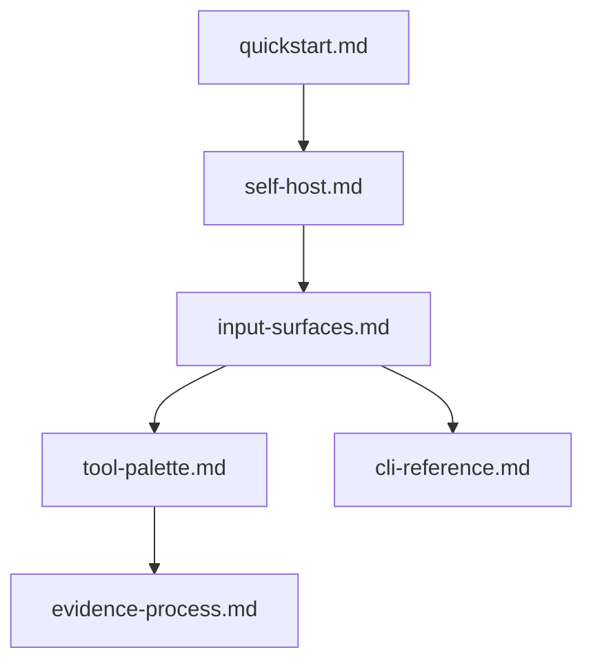

# Developers

**Integrate, extend, and self-host sk — without forking security per surface.** Everything here gets you from a clone to a running engine, a green quality gate, and a workflow reachable from the CLI, REST, MCP, or your own infra.

Start with **quickstart** for a green gate locally, then **self-host** to stand up your own engine. **input-surfaces** maps the doors in (CLI, REST, MCP), with **cli-reference** and **tool-palette** as the per-surface detail. **evidence-process** is the bar for changing LLM-driven paths.

| Page | What it covers | Link |
| --- | --- | --- |
| Quickstart — Developer | Clone to a passing test suite and a live engine in ~10 minutes. | [quickstart.md](quickstart.md) |
| Quickstart — Zero to Running | Self-host the engine in your own infra with PostgreSQL, no SaaS lock-in. | [self-host.md](self-host.md) |
| Input Surfaces | The doors into the engine — CLI, REST, MCP, webhooks — over one RBAC and Audit model. | [input-surfaces.md](input-surfaces.md) |
| sk CLI reference | Non-interactive `sk` commands for scripting and CI. | [cli-reference.md](cli-reference.md) |
| Tool palette and dispatch | Every LLM action as a named, governed, audited tool. | [tool-palette.md](tool-palette.md) |
| Evidence process | Verifying a behavioral / LLM-path change with proof, not guesses. | [evidence-process.md](evidence-process.md) |
