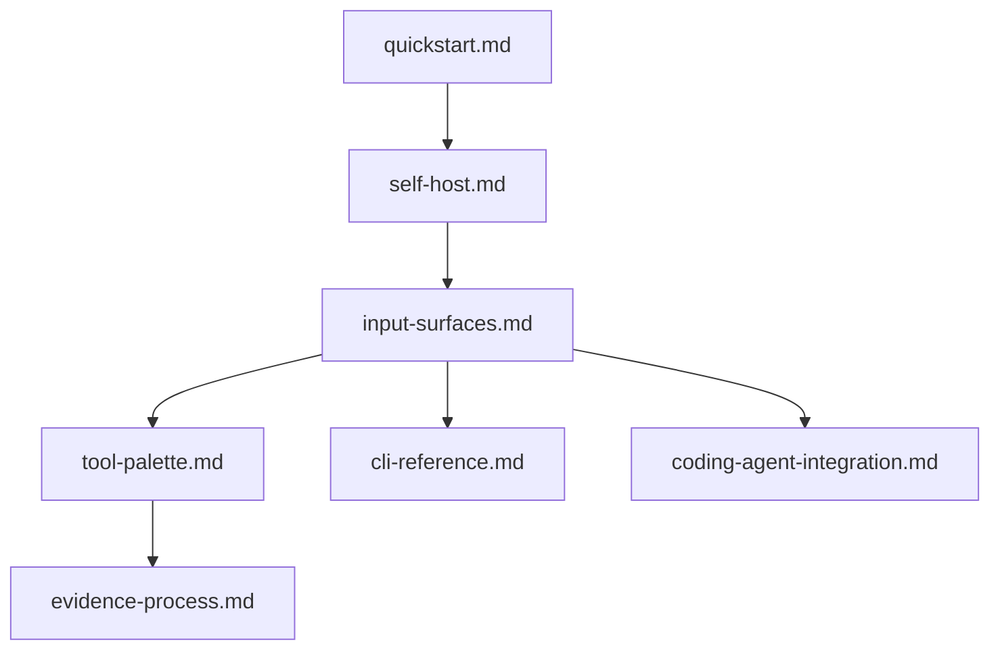

# Developers

Run sk on your own infrastructure and change it safely. Everything here takes you from a clone to a green test suite, a live engine on your own hardware, and a workflow you can reach from the CLI, a REST call, an MCP client, or your own code — all of them landing on the same permission and audit model, so you never secure a surface twice.

Start with **quickstart** for a green gate locally, then **self-host** to stand up your own engine. **input-surfaces** maps the doors in (CLI, REST, MCP), with **cli-reference** and **tool-palette** as the per-surface detail. **coding-agent-integration** turns sk into the knowledge source for Claude Code and Codex sessions. **evidence-process** is the bar for changing LLM-driven paths.

> Just want your own Claude Code grounded in your team's knowledge? You are not
> in the contributor lane — go to
> [Use sk from a coding agent](../authors/coding-agents.md).

| Page | What it covers | Link |
| --- | --- | --- |
| Quickstart — Developer | Clone to a passing test suite and a live engine in ~10 minutes. | [quickstart.md](quickstart.md) |
| Self-Host sk — Zero to Running | Self-host the engine in your own infra with PostgreSQL, no SaaS lock-in. | [self-host.md](self-host.md) |
| Input Surfaces | The doors into the engine — CLI, REST, MCP, webhooks — over one RBAC and Audit model. | [input-surfaces.md](input-surfaces.md) |
| sk CLI reference | Non-interactive `sk` commands for scripting and CI. | [cli-reference.md](cli-reference.md) |
| Tool palette and dispatch | Every LLM action as a named, governed, audited tool. | [tool-palette.md](tool-palette.md) |
| Coding-agent integration | sk as the knowledge/skill source for Claude Code and Codex — briefing, capture, review, skills sync. | [coding-agent-integration.md](coding-agent-integration.md) |
| Evidence process | Verifying a behavioral / LLM-path change with proof, not guesses. | [evidence-process.md](evidence-process.md) |
