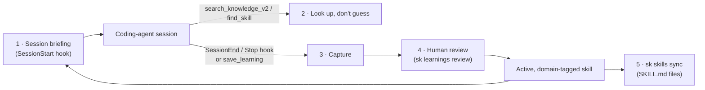

# Coding-Agent Integration (Claude Code & Codex)

> **Just want it working?** [Use sk from a coding agent](../authors/coding-agents.md)
> is the step-by-step path (install → connect → import your knowledge → ask a
> grounded question). This page is the mechanics underneath it.

sk can act as the central knowledge and skill source for your coding agents.
Every new Claude Code or Codex session starts grounded in your business
domains, and what a session teaches flows back — reviewed by a human — so the
next session already knows it.

The loop, end to end:



Nothing becomes live knowledge without step 4 — capture always produces
*proposals*, and a human decides.

## Concepts in one minute

- **Domain** — a business area you curate knowledge for (for example
  `blog-de`). Technically it is just the tag `domain:<slug>` on Skills and
  Knowledge Sources; there is no extra table or configuration object.
- **Briefing** — a budgeted markdown block the engine assembles per domain:
  the domain's active skills (your conventions), an index of its knowledge
  sources, and the grounding rule ("look up with `search_knowledge_v2`,
  and say so when nothing is found"). Full documents are never preloaded —
  sessions fetch details on demand, which keeps the context small.
- **Learning** — a durable rule a human taught, corrected, or confirmed in a
  session. Learnings arrive as `session_learning` skill candidates in a
  review queue; approving one creates an active, domain-tagged skill.

## Setup (once per repo, ~2 minutes)

Prerequisite: the `sk` CLI is installed and logged in (`sk status` shows your
engine and an API key).

```bash
cd <your-repo>
sk agent init --domains <domain-slug>[,<more-domains>]
```

This does three things:

1. Writes `.sk/agent.json` into the repo — the repo's domain declaration:

   ```json
   { "domains": ["blog-de"] }
   ```

   Commit this file; it is how a session in this repo knows which domains to
   pull. An optional `"budget_tokens": <n>` caps the briefing size.

2. Wires the Claude Code hooks in `~/.claude/settings.json` (idempotent —
   re-running never duplicates):
   - `SessionStart` (matcher `startup|resume|compact`) runs
     `sk agent briefing --hook` and injects the briefing into the fresh
     session. The `compact` matcher re-injects it after context compaction.
   - `SessionEnd` runs `sk agent capture --hook`, which posts the session
     transcript for learning distillation.

3. Prints the Codex snippets (hooks are feature-gated there) and the MCP
   registration commands for both agents.

Verify with `sk agent briefing` inside the repo — you should see the
briefing markdown. In a directory without `.sk/agent.json` the hook stays
silent by design: repos without declared domains are none of the engine's
business.

### Codex specifics

Codex needs two one-time steps that `sk agent init` prints but cannot do for
you:

- Enable hooks in `~/.codex/config.toml` (`[features] hooks = true`) and add
  the printed `~/.codex/hooks.json` (Codex has no `SessionEnd` event, so
  capture runs on the `Stop` hook — the engine dedups repeated captures by
  learning fingerprint, so per-turn capture is cheap).
- Register the MCP server:
  `codex mcp add sk --url <engine-url>/mcp --bearer-token-env-var SK_API_KEY`.
  Export `SK_API_KEY` in your shell profile. Hooks additionally require a
  one-time trust confirmation via `/hooks` inside the Codex TUI.

### Claude Code MCP registration

If your Claude account already carries the sk connector (it shows up in
`claude mcp list` as connected), sessions can call `search_knowledge_v2`,
`find_skill`, and `save_learning` already — do not add a second registration
for the same engine, it would duplicate the whole tool catalog. Otherwise:

```bash
claude mcp add --transport http --scope user sk <engine-url>/mcp \
  --header "Authorization: Bearer ${SK_API_KEY}"
```

## The capture loop in practice

During a session, two paths feed the review queue:

- **Automatic** — when the session ends, the hook posts the transcript to
  `POST /v1/agent/sessions`. The engine distills ONLY durable rules a human
  explicitly taught or corrected; a routine session correctly produces
  nothing. Distillation runs asynchronously; results appear in the queue a
  few seconds later.
- **Explicit** — the agent calls the `save_learning` MCP tool the moment you
  say "merke dir das" / "remember this". It creates the same kind of
  proposal, never live knowledge, so it needs no confirmation dialog.

Re-teaching the same rule later updates the existing proposal (evidence
accrues) instead of duplicating it; a rejected learning is never proposed
again.

## Review and curation

```bash
sk learnings list             # what is waiting
sk learnings review           # interactive: approve / edit / reject / skip
```

You can also approve without leaving the coding session: tell the agent to
approve the candidate and confirm your client's native dialog — that click is
the explicit operator approval (requires `skill:write`).

Approving promotes the learning to an **active skill carrying the domain
tags** — the very next session briefing in that domain includes it. Rejecting
retires the learning's fingerprint for good. Editing before approve lets you
tighten title and body; the review is the human gate, so approved learnings
go straight to active.

## Offline skills: `sk skills sync`

```bash
cd <your-repo>
sk skills sync
```

Materializes the domains' active skills as Agent-Skills-standard `SKILL.md`
directories into `.claude/skills/` and `.agents/skills/` of the repo. Both
agents hot-reload these, so the conventions work even without a live engine
connection; the briefing remains the freshness channel. Sync is safe by
construction: it only creates, updates, or prunes directories carrying its
managed marker — hand-authored skills are never touched. Re-run after
approving learnings to refresh the files.

## Troubleshooting

- Hooks never break a session: on any error `sk agent briefing --hook` and
  `sk agent capture --hook` print nothing and exit 0. The swallowed error is
  recorded in `~/.sk/debug.log` (`agent.briefing_hook_failed`,
  `agent.capture_hook_failed`).
- `sk agent briefing` says "no domains" — the directory (or any parent) has
  no `.sk/agent.json`; run `sk agent init` or pass `--domains`.
- The briefing misses a skill — only **active** skills with the domain tag
  are included; check `sk skills list` and the tag `domain:<slug>`.
- Capture produced no candidates — expected for routine sessions; the
  distiller extracts only human-taught rules. Check `sk learnings list` a
  minute after session end (analysis is queued).

## Related

- [Use sk from a coding agent](../authors/coding-agents.md) — the end-to-end setup
  path this page's mechanics sit under.
- [Knowledge Sources](../authors/knowledge-sources.md) — how to get the
  knowledge this briefing indexes IN: `sk knowledge-sources import ./wiki
  --tags "domain:<slug>"`, tagging, and refresh.
- [Knowledge & Skills concepts](../concepts/knowledge-and-skills.md) — how
  the compounding loop fits the wider platform.
- [Model a Domain](../authors/model-a-domain.md) — building the
  connector + skills + knowledge trio for a new domain.
- [CLI reference](./cli-reference.md) — all `sk agent`, `sk learnings`, and
  `sk skills` flags.
