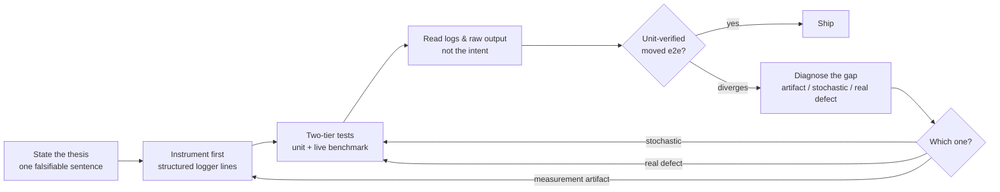

# Evidence process — verifying a behavioral / LLM-path change

**Outcome:** changes to LLM-driven paths ship proven, not guessed. Every claim
that a metric moved is backed by a test or benchmark run — so reviewers spend
their time on the diagnosis, not on re-verifying the author's intuition.

This is the discipline behind the format-aware-judge work, where it caught a
confident wrong self-diagnosis mid-flight (see [Worked example](#worked-example-format-aware-judge)).

> **Rule:** evidence MUST be confirmed by real tests. Never state that a metric
> moved unless a test or the benchmark shows it. Separate "logic verified by a
> unit test" from "end-to-end outcome verified by the benchmark", and report
> both states honestly.

## The loop



| Step | What you do | Why |
|---|---|---|
| 1. State the thesis | One falsifiable sentence, e.g. *"the grounding rule makes single-shot `author_workflow` emit a markdown table as the final output"*. | Vague theses can't be refuted. |
| 2. Instrument first | Add structured `logger` lines at every decision point *before* you trust the change — a greppable `action` name plus the deciding fields. They stay in the code so the failure class is findable later. | The log is the ground truth you read in step 4. |
| 3. Two-tier tests | Deterministic unit tests for the *logic*; live benchmark for the *end-to-end metric*. Both real. | Unit = the load-bearing "verified"; benchmark = the honest outcome. |
| 4. Read logs &amp; raw output | Grep the engine log for your instrumented actions; inspect the *actual* tool output, not what the code "should" produce. | The raw output is ground truth for "is the final output really a markdown table?". |
| 5. A/B a thesis | Run the same scenario on two git states and compare — no env feature-flag. | Variants are two git states, not a runtime toggle. |
| 6. Distinguish verified vs not | Treat a unit-verified-vs-e2e divergence as a *finding*, not noise. | Honesty about what is and isn't proven. |
| 7. Diagnose before fixing | Name the cause of the gap before touching code. | Stops speculative code added to chase a number. |

### Instrumentation — example actions

These greppable actions are the instrumentation left behind by the
format-aware-judge path:

| Action | Fields |
|---|---|
| `authoring_pipeline.output_format_grounded` | `{ named_format }` |
| `preview_judge.format_check` | `{ named_format, matched, failed_checks }` |
| `preview_judge.format_mismatch` | emitted on a `passes→partial` downgrade |
| `oauth2.refresh_skipped_needs_reauth` | the F1 short-circuit |

### The two tiers

| Tier | Tests | Verifies | Where |
|---|---|---|---|
| Deterministic unit (no LLM) | Mock the LLM seam (`getMockProvider().generateOverrides.<flow>`), feed hand-built inputs, assert the decision. | The *logic* — the load-bearing "verified". | `apps/engine/src/conversations/tests/preview-judge.test.ts`, `output-format.test.ts` |
| Live benchmark (real LLM) | Boot the engine on the working tree, drive a real authoring conversation, score the targets, analyze the log. | The *end-to-end metric*. | `benchmarks/authoring/` |

### What to read (step 4)

| Artifact | Contents |
|---|---|
| `benchmarks/authoring/out/new.engine.log` | The structured log — grep your instrumented actions here. |
| `benchmarks/authoring/out/new.report.results.json` | The **raw per-scenario tool outputs** — the model's actual `dry_run_workflow` result. Ground truth for the final output. |

### A/B a thesis (step 5)

Run the same scenario on two code states and compare. The variants are two git
states — never an env feature-flag.

**Committed path** (works in any clone) — the eval driver takes a `--baseline`:

```
bun run eval:live --engine-url <A> --api-key <k> --scenario <slug> --out a.json
bun run eval:live --engine-url <B> --api-key <k> --scenario <slug> --out b.json --baseline a.json
```

It prints per-metric OLD-vs-NEW changes (regressions flagged).

**Local convenience wrapper** (`benchmarks/authoring/`, gitignored review
scaffolding — reconstruct from its README) boots two throwaway engines + DBs
around the above:

```
BENCH_OLD_REF=HEAD BENCH_SCENARIOS=weather-ranking-table ./run.sh delta
```

OLD runs in an isolated git **worktree** (`BENCH_OLD_REF`, default `HEAD^`), NEW
on the working tree. NEVER `git stash` to switch states on a shared checkout —
the wrapper uses a worktree for exactly this reason.

### Diagnosing a divergence (step 7)

When unit-verified logic doesn't move the e2e number, name the cause — don't
bolt on speculative code to chase a number (benchmarks are review scaffolding;
permanent regressions go in unit tests).

| Cause | Signal | Fix |
|---|---|---|
| Measurement artifact | The test and the code read different corpora/fields. | Fix the *benchmark*, not the product. |
| Stochastic generation | The LLM is probabilistic; one run is weak evidence. | Run several trials. |
| Real defect the test didn't cover | The metric is correctly red. | Widen the test. |

## Worked example (format-aware judge)

The first conclusion was: *"the benchmark's `content_pass=false` is a measurement
artifact — the judge logged `format_check matched:true`, so generation IS
producing markdown."* The evidence loop refuted it.

| Step | Finding |
|---|---|
| Dump raw results (`run.sh` step 4) | The actual `dry_run_workflow` output was **6.5 KB, zero pipes, zero separator row** — the final output the caller receives genuinely is NOT a markdown table. |
| Re-read the verdict | So `content_pass=false` was *correct*. |
| Locate the real defect | Generation rendered markdown in an intermediate step (which the judge's `step_artifacts` view saw → `matched:true`), but a later `output_transform` discarded it. The final output isn't markdown, and the judge — evaluating step artifacts — was blind to the final-output transform. |

The log + raw-output inspection turned a confident wrong answer into the right
diagnosis. That is the entire point of the process.

## Files

**Committed (available in any clone):**

| File | Role |
|---|---|
| `apps/engine/eval/live-authoring.ts` | The eval driver (`bun run eval:live`); writes the scored report + the sibling `*.results.json` raw dump, and A/B-compares with `--baseline`. |
| `apps/engine/eval/live-report.ts` | `LIVE_SCENARIOS` + scoring + content checks. |

**Local-only (gitignored review scaffolding — reconstruct from the README, do
not expect it in a fresh clone):**

| File | Role |
|---|---|
| `benchmarks/authoring/run.sh` | `bench` (current tree) \| `delta` (A/B vs ref); boots throwaway engine(s) + DB around `eval:live`. |
| `benchmarks/authoring/analyze-log.mjs` | Log verdict (CLEAN / REVIEW / ISSUES). |
