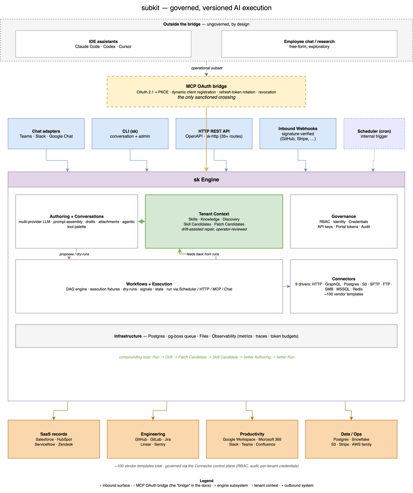
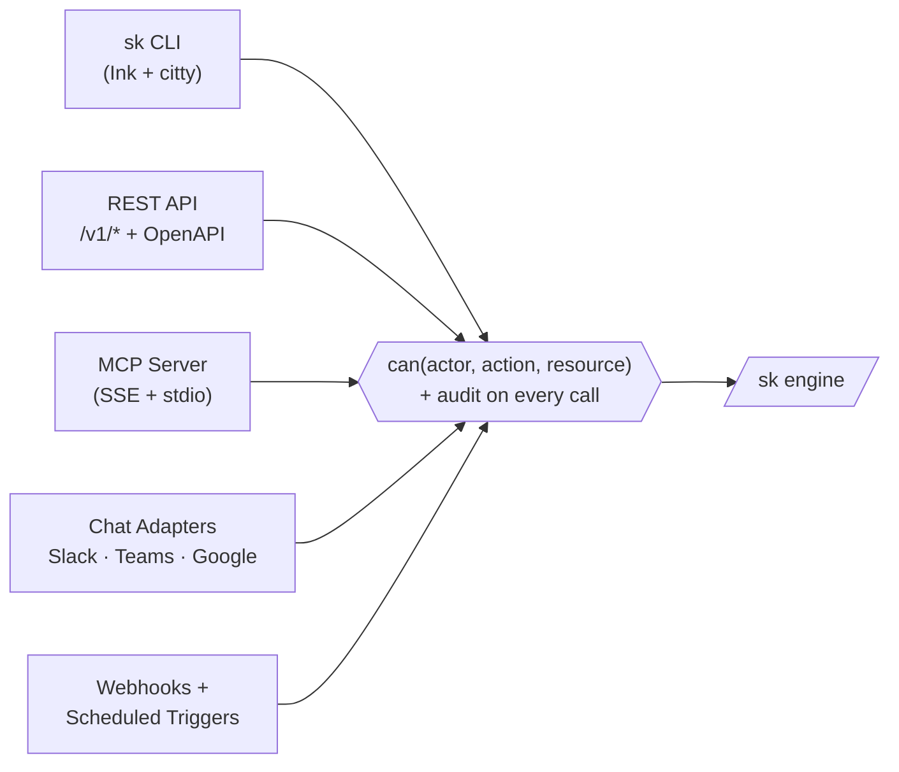

# Input Surfaces

> **Reading time:** ~12 min
> **Audience:** Engineers integrating with sk, operators configuring surfaces

Automation that only works from one place does not fit how enterprise teams actually operate. A developer may prefer a terminal. An analyst may live in Slack. A CI pipeline needs a machine-readable API. An AI coding assistant should be able to call a workflow directly.

sk is designed around this reality. It has multiple entry points — the sk CLI, the REST API, the MCP server, chat platform integrations, webhooks, and scheduled triggers — and all of them lead to the same governed authoring and execution pipeline. The security model, the RBAC checks, and the Audit Log apply identically regardless of where a request originates.



*System-wide context for this document. The rest of it zooms in on each inbound surface; the diagram below sharpens the "one governance gate" principle. Source: [`overview.drawio`](../concepts/overview.drawio).*



*Many doors. One platform. The gate is the same callable; the audit row is the same shape; the identity envelope (`tenant_id`, `actor_id`, `request_source`, `trace_id`) is populated at every entry.*

---

## The sk CLI (Conversations + Admin Commands)

The sk CLI is the primary human-facing authoring tool and the canonical operator CLI. It is a terminal interface built on Ink that opens a Conversation when launched, and it also exposes top-level admin command groups such as `sk connectors`, `sk workflows`, `sk executions`, and `sk audit`.

**Who uses it.** End users describe workflow goals in natural language and work through the AI-assisted authoring loop. Operators use the same binary to manage Connectors, review Skill Candidates and Patch Candidates, query the Audit Log, inspect executions, and administer the platform — the surface adapts based on the authenticated user's role. There is no separate operator-only CLI surface in the current codebase.

**Authentication.** The sk CLI supports four modes: API Key (for developers and CI), OIDC (for SSO-enabled organizations), Portal Token (for scoped external-user flows), and headless mode where input is piped from stdin for scripted or automated usage. All modes resolve to the same identity and RBAC model.

**In-conversation actions.** Users interact with the ongoing Conversation through slash commands: `/approve` to commit a Draft, `/reject` to discard a proposal, `/list` to enumerate available Connectors or Skills, `/run` to trigger an execution, `/draft` to inspect the current draft snapshot, `/context` to inspect the current authoring state, and others. These commands give users explicit control over the AI authoring loop without leaving the terminal.

**Slash-command reference.** The full set of conversational and admin slashes (registered in `apps/sk/src/slash.ts`):

- *Authoring*: `/connector`, `/connectors`, `/workflow`, `/workflows`, `/templates`, `/versions`, `/approve`, `/approvals`, `/reject`, `/draft`, `/context`, `/run`, `/list`, `/restore`, `/policy`, `/yolo` (force-skip checkpoint gates), `/patch-candidates`, `/discovery`, `/actions`, `/queue`, `/history`, `/view`, `/export`, `/attach`, `/paste`, `/upload`, `/files`, `/rename` (rename the session), `/fork` (fork the session into a new conversation).
- *Session*: `/help`, `/clear`, `/compact`, `/resume`, `/exit`, `/init`, `/setup`, `/onboard`, `/profile`, `/model`, `/status`, `/cost`, `/verbose`, `/debug`, `/bug`, `/feedback`, `/logs`, `/config`, `/config-form`, `/settings` (5-tab settings palette), `/usage` (token usage per flow), `/copy` (copy last assistant message), `/aliases`, `/env`, `/exec`.
- *Identity & access*: `/login`, `/logout`, `/auth`, `/apikeys`, `/audit`, `/admin`, `/tenant`, `/users`, `/system-accounts`, `/permissions`, `/session` (mint a portal token + QR for a workflow).
- *AI context*: `/skills`, `/knowledge`, `/mcp`, `/mcp-servers`, `/mention`, `/memory`, `/notifications`, `/executions`.
- *Vendor install helpers*: `/install-slack`, `/install-teams`, `/install-github`, `/install-google-workspace`, `/install-salesforce`, `/install-jira`, `/install-hubspot`.

Each command's full surface lives next to its handler; this list is the canonical index.

**State visibility.** The CLI does not infer progress from transcript text alone. It renders the engine's authoring summary directly: current mode, stage, active target, checkpoint freshness, blockers, next required action, latest execution, and latest diagnosis. This is what makes resume, repair, and handoff predictable across long-running sessions.

**Guided progression.** The guided CLI flow follows the same state machine as the engine. Connector save is gated by fresh inspect/validate/probe checkpoints. Workflow commit is gated by fresh inspect/validate/preview checkpoints. Execution runs always target the persisted workflow version currently tracked in the conversation state. The normal guided flow does not expose conversational force bypasses for these transitions.

**Resource references.** Within a Conversation, users can mention platform resources directly using `@connector` and `@skill` syntax. This lets the AI ground its proposals in the specific Connectors and Skills the tenant has configured, rather than making generic assumptions.

**Headless mode.** When stdin is not a TTY, the sk CLI operates without interactive prompts. This enables scripted workflows, CI pipeline integration, and automated testing scenarios where a human is not present at the terminal.

**Outbound network from CLI startup.** The welcome banner can pull a one-line "what's new" headline from a remote JSON endpoint on REPL start, but the **default posture is opt-in**. With `SK_WHATS_NEW_URL` unset, no network call fires and the resolver renders the bundled `CHANGELOG.md` head. Operators who want the upstream feed set `SK_WHATS_NEW_URL=<url>` (recommended: `https://updates.subkit.dev/whats-new.json`); the fetch is async, 3-second timeout, 24-hour on-disk cache at `~/.sk/whats-new-cache.json`, identifies itself with a `User-Agent: sk-cli/<version>` header, and the JSON payload is Zod-validated (`{ headline: string }`, strict — unknown keys reject) before any string reaches the banner. The request carries no auth and no tenant identifier. The opt-out sentinels (`""`, `"disabled"`, `"off"`, `"0"`) remain compatible with operators who inherited a populated default and want to disable explicitly. All headline strings (cache, remote, CHANGELOG) pass through `sanitizeHeadline` which strips ANSI escapes and control bytes and truncates to 80 chars before render. After three consecutive remote-fetch failures (including Zod parse failures) the resolver opens a 7-day circuit breaker: subsequent REPL boots skip the network call entirely until the breaker re-arms or a future success resets it.

---

## The REST API (OpenAPI)

The REST API is the full programmatic interface to sk. Every capability available through any other surface is available through the API. It is the canonical interface that all other surfaces — including the CLI and MCP server — ultimately use.

**Coverage.** The API exposes CRUD endpoints for all platform resources: Workflows, Connectors, Executions, Credentials, Skills, Skill Candidates, Knowledge Sources, Conversations, Schedules, Webhooks, Audit Log entries, and more. Every operation that changes state goes through the API layer, which means RBAC and the Audit Log apply uniformly.

**Direct workflow and execution surface.** The API exposes workflow CRUD plus a single runtime entry point at `POST /v1/executions`. Persisted workflows, inline draft definitions, and single-step previews all run through that same execution contract. Inline runs complete synchronously by default; queued background execution is explicit.

**Schema-first design.** All request and response shapes are defined as Zod schemas. The OpenAPI 3.1 specification is generated from those schemas — it is never hand-written. This means the spec is always accurate, and client code generated from it is always consistent with the actual implementation.

**Conversation state surfaces.** Conversation responses expose the authoring state machine directly, including `authoring_mode`, `authoring_stage`, active target metadata, checkpoint statuses, stale checkpoints, `next_required_action`, persisted resources, and latest execution or diagnosis references. API clients do not have to reconstruct progress from free-form assistant messages.

**Consistency.** Pagination, filtering, and sorting follow the same conventions across all list endpoints. Operators and developers can learn the pattern once and apply it everywhere.

**Discoverability.** The OpenAPI spec is served at `/openapi.json`. An interactive Scalar UI for exploring and testing the API is available at `/docs`. Both are available to any authenticated client.

---

## MCP Integration

The Model Context Protocol (MCP) server is embedded in the sk engine and exposes the platform's capabilities to AI coding tools. Where the REST API is designed for direct programmatic use, the MCP server is designed for AI agents and AI-assisted development tools that need to reason about and invoke platform capabilities as part of their own workflows.

**Supported clients.** Any MCP-compatible client can connect: IDE assistants, coding agents, chat clients, and custom MCP clients built for specific workflows. The connection is a single configuration line pointing at the engine's MCP endpoint.

**Three capability types.** The MCP server exposes sk's capabilities in three forms that match the MCP standard:

- **Callable entries** expose Workflows as `wf.<slug>` functions. A workflow named `payment-sync` becomes a callable workflow entry that an MCP client can invoke directly. The client sees the workflow's input schema, can call it, and receives the result.
- **Resources** expose Connectors as structured data access. A Stripe Connector might surface as a `stripe://customers` resource that an MCP client can read to understand available data shapes.
- **Prompts** expose Skills as curated context. When an MCP client requests a prompt, sk injects the relevant Skill content — best practices, integration patterns, known failure modes — directly into the AI's context.

**Transport.** The MCP server supports Streamable HTTP transport, which is the current MCP standard. Stdio transport is also supported via `sk mcp` for tools that expect a subprocess interface.

> **Behavior change (MCP elicitation).** Every `POST /mcp` response over the Streamable HTTP transport is now framed as an SSE stream (`text/event-stream`) rather than a single buffered JSON envelope — `enableJsonResponse` is `false`. This is required for MCP elicitation: a tool whose handler issues a server→client `elicitation/create` request mid-call (connector forms, OAuth authorization prompts) can only deliver that nested request and receive the reply while the originating POST holds an open stream. **MCP clients must accept `text/event-stream`-framed responses** — every spec-compliant Streamable HTTP client does (verified against current MCP clients across browser, IDE, and CLI surfaces). Note that `enableJsonResponse: false` also changes the `Content-Type` of the `initialize` response itself to `text/event-stream` — operators debugging an older client should expect that framing from the very first round-trip and not chase phantom 4xx errors caused by a client that hard-codes a `application/json` expectation. The stdio transport is unaffected.

> **Behavior change (MCP async Tasks — conversation tools).** The conversation cluster (`conversation_start`, `conversation_append`, `conversation_respond_elicitation`) no longer runs the authoring turn inside the `tools/call` handler. A real turn takes 68–160 s — well past the ~60 s MCP client timeout — so the handler now (1) inserts/validates the conversation row + persists the user message, (2) inserts an `mcp_tasks` index row and enqueues a `conversation.run-turn` background job, (3) returns immediately. The model loop runs in a pg-boss worker. Clients consume the result one of two ways:
>
> - **Tasks-capable clients** (SEP-1686) that send a task-augmented `tools/call` receive a `CreateTaskResult` and poll `tasks/get` / `tasks/result`; `tasks/cancel` aborts the running turn. The server advertises `capabilities.tasks = {list, cancel, requests:{tools:{call:{}}}}`.
> - **Non-Tasks clients** receive a fast plain `CallToolResult` — `{conversation_id, mcp_task_id, status:"working", poll_with:"conversation_get", poll_arg:{conversation_id}}` — and poll the new read-only `conversation_get({conversation_id})` tool until it reports `completed`, `failed`, or `input_required`.
>
> **Elicitation in a backgrounded turn.** A backgrounded turn has no live MCP session, so it cannot use the in-process `ElicitationBridge` (`elicitForm` / `elicitOob` need the open `tools/call` SSE stream). It always uses the DB-pause path: an `ask_user_*` / `authenticate_oauth` inserts a pending `conversation_elicitations` row, sets the conversation to `awaiting_input`, and the turn ends. The task then derives `input_required`; the client reads the pending form via `conversation_get` (or `tasks/get`) and resolves it with `conversation_respond_elicitation`, which enqueues the next turn. The `ElicitationBridge` is retained for any synchronous (non-conversation) tool that still runs inside its `tools/call`.

**Governance.** All MCP calls are subject to the same RBAC checks and Audit Log entries as direct API calls. There is no privileged back channel through MCP; identity and permissions are enforced identically regardless of which surface initiated the request.

**Destructive-action flow.** `tenant.*` writes (e.g. `tenant.delete_workflow`, `tenant.revoke_api_key`) follow the same `confirm_before_execution` policy as in-conversation authoring actions. The first call returns a structured pending envelope — `{pending: true, confirm_required: true, target: {...}, resume: "..." , tool_call_id: "..."}` — and an `approval.requested` audit row. The client relays the target to the operator, obtains consent, and re-issues the same call with `_meta.sk_confirm: true` (or `__policy_confirmed: true` inside the arguments). The second call emits `approval.approved` and executes the callable entry. This is two MCP round-trips and one human confirmation — no authoring conversation required for routine CRUD.

**Callable hints.** Every listed callable entry carries `_meta.subkit = {category, confirm_required, destructive}` so clients can render destructive warnings and skip self-authored pre-confirms. Clients that honour `confirm_required` from the listing avoid the two-elicitation trap.

**Workflow inputs.** Each `wf.<slug>` callable entry advertises an `inputSchema`. When the workflow declares `input_schema` on its DAG, that is passed through verbatim. When it doesn't, sk synthesises one by scanning the DAG for `${input.X}` placeholders in request steps and `input.input.X` references in JavaScript transforms, yielding `{type:"object", properties:{X:{type:"string"}}, additionalProperties: true}`.

**Non-fatal warnings.** When a workflow run hits a soft signal — for example a `loop.over` JSONata expression that resolved to a non-array because it referenced a step id not in scope — the MCP response wraps the output as `{output, warnings: [{code:"loop_over_unresolved", identifier, step_key, message}]}`. The run still reports `status: "succeeded"` but the client can surface the diagnostic so operators know why a payload looks partial.

**Read-only deployments.** For MCP deployments that expose only read callables (no write surface at all), set `SK_MCP_READ_ONLY=1`. Writes are visible by default and rely on the policy gate for safety.

**Resource update notifications.** When a client subscribes to a resource URI (`workflow://<id>`, `connector://<id>`, `knowledge://<id>`, `skill-candidate://<id>`), the engine emits `notifications/resources/updated` on every committed state change in that resource. The notification follows the MCP spec exactly: it carries only the URI — no event-type discriminator, no payload diff, no actor. Clients that need to distinguish a delete from a rename must re-fetch via `readResource`, or for workflows specifically observe the lifecycle audit row directly through `/v1/audit-log`. Delivery is at-most-once — a transient `sendResourceUpdated` failure is logged and dropped — so clients on critical paths should also poll. Subscriptions are subject to the same RBAC check as `readResource`: a portal token or custom role lacking `workflow:read` on the underlying resource receives no notifications, even if it knew the URI to subscribe.

### MCP OAuth 2.1 (ChatGPT / Claude.ai / Cursor)

The sk engine is a full OAuth 2.1 authorization server and resource server for `/mcp`. This lets OAuth-only clients — including the ChatGPT custom connector, Claude.ai, and Cursor — authenticate without a static API key.

**Prerequisites.** Set `server.public_base_url` to the engine's public `https://` URL in `subkit.config.json` (or via `sk settings set server.public_base_url '"https://your-engine.example.com"'`). The MCP OAuth feature is enabled by default (`auth.mcp_oauth.enabled = true`).

**Discovery endpoints.**

| Endpoint | Spec | Purpose |
|---|---|---|
| `GET /.well-known/oauth-protected-resource` | RFC 9728 | Points clients to the authorization server. |
| `GET /.well-known/oauth-authorization-server` | RFC 8414 | Authorization server metadata (endpoints, scopes, PKCE). |

**OAuth flow.**

```mermaid
sequenceDiagram
    participant C as MCP Client
    participant E as sk engine
    participant U as User browser

    C->>E: GET /.well-known/oauth-protected-resource
    E-->>C: { authorization_server }
    C->>E: GET /.well-known/oauth-authorization-server
    E-->>C: endpoints, scopes, PKCE required
    C->>E: POST /v1/oauth/register (DCR, RFC 7591)
    E-->>C: { client_id, client_secret? }
    C->>U: 302 to /v1/oauth/authorize?code_challenge=...
    U->>E: OIDC login + consent
    E-->>U: 302 to redirect_uri?code=...&state=...
    U-->>C: deliver code
    C->>E: POST /v1/oauth/token (code + verifier)
    E-->>C: { access_token: wf_mcp_*, refresh_token: wf_mcr_* }
    C->>E: POST /mcp (Authorization: Bearer wf_mcp_*)
    E-->>C: SSE stream
    Note over C,E: Refresh rotates the chain; replay revokes it.
```

1. Client fetches `/.well-known/oauth-protected-resource` to discover the authorization server.
2. Client fetches `/.well-known/oauth-authorization-server` to get all endpoints.
3. Client registers itself at `POST /v1/oauth/register` (dynamic client registration, RFC 7591). Returns `client_id` (and `client_secret` for confidential clients).
4. Client redirects the user to `GET /v1/oauth/authorize?client_id=...&redirect_uri=...&response_type=code&code_challenge=...&code_challenge_method=S256&scope=mcp:read&state=...`. PKCE S256 is mandatory; `plain` is rejected.
5. If not logged in, the engine redirects to `/v1/identity/login/start` (OIDC). After login the user returns to the authorize page.
6. The consent page shows the client name, tenant, and requested scopes. The user approves or denies.
7. On approval, the engine issues an authorization code and redirects to the client's `redirect_uri?code=...&state=...`.
8. Client exchanges the code at `POST /v1/oauth/token` (form-encoded, `grant_type=authorization_code`). Response: `{ access_token: "wf_mcp_...", refresh_token: "wf_mcr_...", token_type: "bearer", expires_in: 3600 }`.
9. Client uses `Authorization: Bearer wf_mcp_...` on subsequent `POST /mcp` calls.
10. Client refreshes at `POST /v1/oauth/token` (`grant_type=refresh_token`). Refresh tokens rotate on every use; replaying a rotated token revokes the whole chain.
11. Client revokes at `POST /v1/oauth/revoke`.

**Scopes.**

| Scope | MCP mode | What the token unlocks |
|---|---|---|
| `mcp:read` | product | Callable workflow entries and the `authenticate` tool only. |
| `mcp:authoring` | authoring | Adds `conversation.*` authoring tools. |
| `mcp:admin` | admin | Adds full `tenant.*` admin tools (subject to RBAC). |

The scope granted at consent is the intersection of what the client requested and what the consenting user's role permits. A token can never carry a scope its owner lacks.

**Connecting ChatGPT custom connector.**

1. In ChatGPT → Settings → Connectors → New connector, set the server URL to your engine's MCP endpoint (`https://your-engine.example.com/mcp`).
2. ChatGPT auto-discovers OAuth via `/.well-known/oauth-protected-resource`.
3. ChatGPT performs dynamic client registration and opens the sk login + consent flow.
4. After approval, ChatGPT stores the OAuth tokens and uses them on all future calls.

**Connecting Claude.ai.**

1. In Claude.ai → Settings → Integrations → Add integration, enter `https://your-engine.example.com/mcp`.
2. Claude.ai discovers OAuth metadata and performs DCR automatically.
3. Complete the login + consent flow in the browser.

**Connecting Cursor.**

Add to `.cursor/mcp.json`:
```json
{
  "mcpServers": {
    "sk": {
      "url": "https://your-engine.example.com/mcp",
      "transport": "http"
    }
  }
}
```
Cursor discovers OAuth from the `WWW-Authenticate` header on the first unauthenticated request and opens the browser-based consent flow.

**Security notes.** Authorization codes are single-use with a 60-second TTL. `redirect_uri` is matched exactly against the registered URIs — no prefix or wildcard matching. Refresh tokens rotate on every use and replay of a rotated token revokes the full chain. Only SHA-256 hashes of tokens are persisted; the plaintext values are never stored. `mcp_oauth_clients` intentionally has no `tenant_id` because DCR (RFC 7591) registers the client before any tenant context exists; the tenant binds at consent time on the authorization-code row and on every token. This is a deliberate, documented exception to the "every row carries tenant_id" rule.

---

## Chat Systems (Slack, Teams, Google Chat)

Enterprise teams spend much of their day in chat. The sk chat integrations bring the Conversation authoring loop into the surfaces teams already use, so workflow authoring does not require context switching.

**How it works.** Each chat platform has a dedicated adapter that normalises incoming messages — mentions, slash commands, interaction callbacks — into sk's Conversation model. The same AI authoring loop that runs in the sk CLI runs inside a Chat Session. Responses are rendered as native platform messages. A conversation started in Slack and continued the next day picks up exactly where it left off.

**Approval flow.** When a Draft or Patch Candidate requires approval, the platform surfaces an interactive card in the relevant chat thread. Operators see an approve button and a reject button as native chat UI elements — no separate workflow call required. The approval decision is recorded in the Audit Log with the chat platform as the request source.

**Identity linking.** A chat user's platform identity (their Slack user ID, Teams user principal, or Google Chat identity) is linked to their sk Tenant account through a user-initiated flow. Once linked, messages from that user carry their full sk identity, including role and permissions.

**Notification routing.** Execution results, alerts, and approval requests can be routed to specific channels or users through Notification Rules. Operators configure which events go where, at what severity level, and with what quiet-hour constraints. Chat systems are the primary notification channel in sk — email notifications are not supported.

---

## Webhooks and Scheduled Triggers

Not every workflow starts with a human. Scheduled triggers and inbound webhooks let sk respond to time and to connector-boundary events without requiring a person to initiate anything.

**Inbound webhooks.** Each inbound webhook endpoint has a unique URL and is bound to a specific Workflow. When an external connector boundary — a payment processor, a CI service, a monitoring service — sends a request to that endpoint, sk verifies the signature using the Standard Webhooks specification, deduplicates replays, and triggers the bound Workflow. The trigger is recorded in the Audit Log with source `webhook`.

**Outbound webhooks.** sk can also push events outward. Operators configure Subscriptions that match internal platform events and fan them out to external connector boundaries as signed webhook deliveries. Delivery retries follow a well-defined cadence, failed deliveries go to a dead-letter queue, and repeated failures trip a per-subscriber circuit breaker to prevent cascading problems.

**Scheduled triggers.** Cron expressions can be attached to any Workflow. The sk scheduler fires the Workflow at the configured time with catch-up semantics — if the engine was offline when a scheduled run was due, it fires the missed run when it comes back online (subject to a configurable window). Scheduled fires are recorded in the Audit Log with source `scheduler`.

**Triggering without a human.** Whether triggered by a webhook or a schedule, the resulting Execution is governed by exactly the same rules as a manually triggered one: RBAC applies to the trigger, the Workflow runs deterministically as committed, and the full Execution record is written to the immutable log.

---

## Further reading

- [AI-assisted authoring](../authors/authoring-workflows.md) — how Conversations work, how the AI assembles Workflows, and how the approval gate turns a Draft into a committed, executable Workflow.
- [glossary](../concepts/glossary.md#group-6-surfaces) — definitions for sk CLI, MCP Server, Chat Adapter, Notification Rule, Service Metadata.
