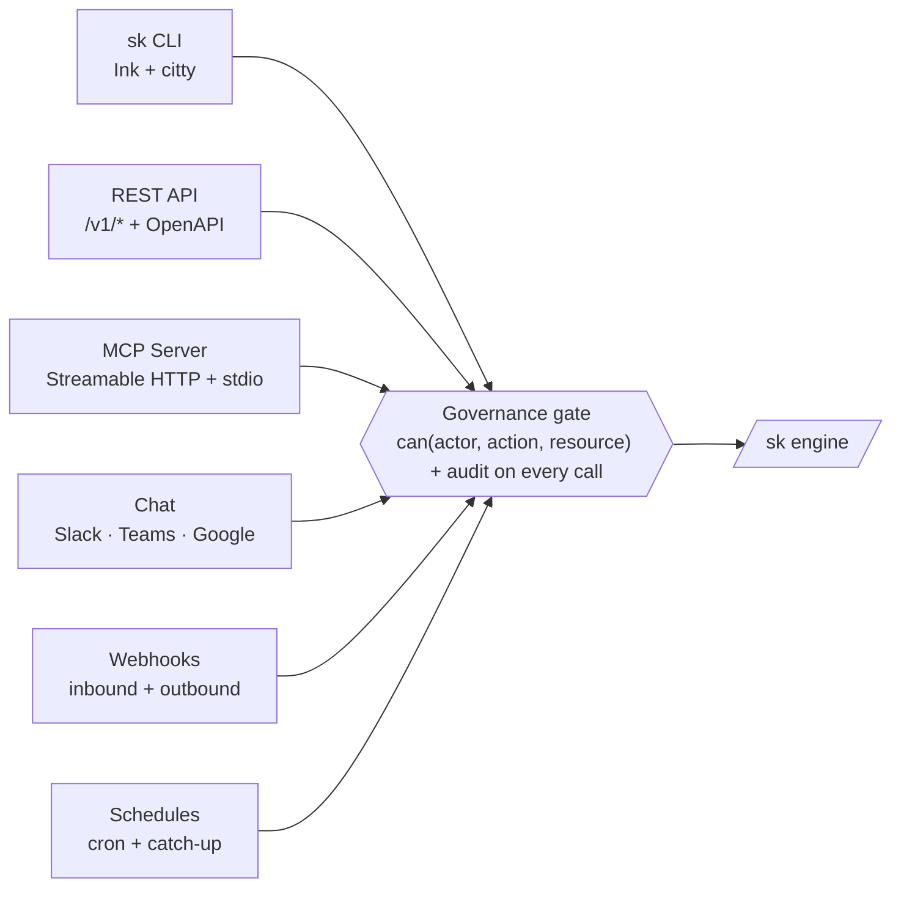

# Input Surfaces

> **Reading time:** ~12 min
> **Audience:** Engineers integrating with sk, operators configuring surfaces

**Meet your team where they already work—with one governed engine and one common MCP auth contract.** A developer lives in a terminal. An analyst lives in Slack. A CI pipeline needs a machine-readable API. An AI coding assistant wants to call a workflow directly. sk gives each of them a native door, and every door opens onto the *same* governed engine: one RBAC model, one Audit Log, one identity envelope (`tenant_id`, `actor_id`, `request_source`, `trace_id`). Adopting sk never forces a tooling migration, and security never forks per surface.

## Surfaces at a glance

| Surface | Reach it via | Best for | Auth |
|---|---|---|---|
| **sk CLI** | `sk` in a terminal | Human authoring + operator admin | API key · OIDC · portal token · headless |
| **REST API** | `/v1/*` + OpenAPI | Programmatic + CI | API key |
| **MCP server** (coding agent) | stdio or Streamable HTTP, alongside the `sk` CLI | Lookup **and** authoring — the CLI supplies the definition writes MCP does not carry | OAuth 2.1 or API key |
| **MCP server** (browser client) | Streamable HTTP | Running workflows, reading results, first drafts — **not** definition edits | OAuth 2.1 |
| **Chat** | Slack · Teams · Google Chat | Read-only Q&A + gated workflow runs | Linked platform identity |
| **Webhooks** | Signed inbound URLs | Connector-boundary events | Standard Webhooks signature |
| **Schedules** | Cron triggers | Time-based runs | RBAC on the trigger |

## One gate, many doors

Every inbound surface funnels through a single governance gate before it ever reaches the engine. The gate is the same callable, the audit row is the same shape, and the identity envelope is populated at every entry.

One decision, rendered per surface. `policyDecide()` is the only place that decides whether a write needs a human confirmation, and no surface re-derives that answer. How the confirmation is *presented* does differ: chat raises an elicitation the engine owns end to end, while an MCP client renders its own `destructiveHint` dialog — which is why every MCP-reachable write tool must advertise that annotation. A client that ignores the annotation gets no prompt; the decision was still made, but the door it was rendered on is not one sk controls.



For system-wide context — where external AI clients cross sk's MCP OAuth boundary and other surfaces enter directly — see the architecture overview:


*Source: [`overview.drawio`](../concepts/overview.drawio).*

---

## The sk CLI (Conversations + Admin Commands)

The sk CLI is the primary human-facing authoring tool and the canonical operator CLI — one Ink-based binary that opens a Conversation on launch and also exposes admin command groups such as `sk connectors`, `sk workflows`, `sk executions`, and `sk audit`. The surface adapts to the authenticated user's role; there is no separate operator-only CLI.

**Who uses it.**

| Role | What they do |
|---|---|
| End users | Describe workflow goals in natural language, work the AI-assisted authoring loop. |
| Operators | Manage Connectors, review Skill Candidates and Patch Candidates, query the Audit Log, inspect executions, administer the platform. |

**Authentication.** Four modes, all resolving to the same identity and RBAC model:

| Mode | For |
|---|---|
| API Key | Developers and CI |
| OIDC | SSO-enabled organizations |
| Portal Token | Scoped external-user flows |
| Headless (stdin) | Scripted / automated usage with no TTY |

**In-conversation actions.** Users drive the AI authoring loop with slash commands — `/approve` to commit a Draft, `/reject` to discard a proposal, `/draft` to inspect the current draft snapshot, `/context` to inspect the current authoring state, and others — without leaving the terminal. Connector onboarding runs through `/install`, an alias of `/onboard`.

**Direct draft actions (no model turn).** A narrow set of deterministic, draft-scoped conversation tools is also invocable directly over HTTP — `POST /v1/conversations/{id}/preview` (dry-run the draft or one step, writes held), `POST /v1/conversations/{id}/probe` (probe the connector draft), `POST /v1/conversations/{id}/draft/patch` (apply an RFC 6902 patch through the same validation gates as the model-driven editor), and the draft-snapshot list/restore pair. These run the exact tool implementations the model dispatches and persist the same `conversation_tool_calls` rows, so the next model turn sees what the operator ran; the CLI's `/preview`, `/probe`, `/edit`, and `/snapshots` are thin wrappers over them. Tenant writes (saving drafts, running live workflows) are deliberately NOT direct-invocable — they stay behind the conversation loop's confirm gates.

**Slash-command reference.** The canonical, always-current list of every conversational and admin slash command — names, aliases, and one-line descriptions — is the generated reference at [`slash-commands.md`](../authors/slash-commands.md). It is regenerated from the registry in `apps/sk/src/slash.ts`, so it never drifts from what the CLI actually accepts.

**State visibility.** The CLI does not infer progress from transcript text. It renders the engine's authoring summary directly — current mode, stage, active target, checkpoint freshness, blockers, next required action, latest execution, latest diagnosis — which is what makes resume, repair, and handoff predictable across long-running sessions.

**Guided progression.** The guided CLI flow follows the same state machine as the engine:

| Transition | Gated by |
|---|---|
| Connector save | Fresh inspect / validate / probe checkpoints |
| Workflow commit | Fresh inspect / validate / preview checkpoints |
| Execution run | The persisted workflow version tracked in the conversation state |

The normal guided flow does not expose conversational force bypasses for these transitions.

**Resource references.** Inside a Conversation, users mention platform resources directly with `@connector` and `@skill` syntax, grounding AI proposals in the specific Connectors and Skills the tenant has configured.

**Connector promotion.** Admins can ask the conversation to promote a connector, or call `sk connectors promote <id> --to prod --strategy copy|move`. Both reach the same tenant-scoped promotion service and require `connector:promote`. The CLI generates and prints an idempotency key when one is omitted; `move` also requires an interactive confirmation unless `--yes` is supplied.

**Headless mode.** When stdin is not a TTY, the sk CLI runs without interactive prompts — enabling scripted workflows, CI pipeline integration, and automated testing where no human is at the terminal.

**Outbound network from CLI startup.** The welcome banner can pull a one-line "what's new" headline from a remote JSON endpoint on REPL start, but the **default posture is opt-in**. With `SK_WHATS_NEW_URL` unset, no network call fires and the resolver renders the bundled `CHANGELOG.md` head. Operators who want the upstream feed set `SK_WHATS_NEW_URL=<url>` (recommended: `https://updates.subkit.dev/whats-new.json`); the fetch is async, 3-second timeout, 24-hour on-disk cache at `~/.sk/whats-new-cache.json`, identifies itself with a `User-Agent: sk-cli/<version>` header, and the JSON payload is Zod-validated (`{ headline: string }`, strict — unknown keys reject) before any string reaches the banner. The request carries no auth and no tenant identifier. The opt-out sentinels (`""`, `"disabled"`, `"off"`, `"0"`) remain compatible with operators who inherited a populated default and want to disable explicitly. All headline strings (cache, remote, CHANGELOG) pass through `sanitizeHeadline` which strips ANSI escapes and control bytes and truncates to 80 chars before render. After three consecutive remote-fetch failures (including Zod parse failures) the resolver opens a 7-day circuit breaker: subsequent REPL boots skip the network call entirely until the breaker re-arms or a future success resets it.

---

## The REST API (OpenAPI)

The REST API is the full programmatic interface to sk and the canonical interface that every other surface — including the CLI and MCP server — ultimately uses. Every capability available through any other surface is available here.

| Concern | Behavior |
|---|---|
| **Coverage** | CRUD for all resources: Workflows, Connectors, Executions, Credentials, Skills, Skill Candidates, Knowledge Sources, Conversations, Schedules, Webhooks, Audit Log entries, and more. Every state change flows through the API layer, so RBAC and the Audit Log apply to all of them. (The *confirmation prompt* for a write is rendered per surface — see [One gate, many doors](#one-gate-many-doors).) |
| **Runtime entry** | One execution entry point at `POST /v1/executions`. Persisted workflows, inline draft definitions, and single-step previews all run through that same contract. Inline runs complete synchronously by default; queued background execution is explicit. |
| **Schema-first** | Request/response shapes are Zod schemas; the OpenAPI 3.1 spec is generated from them, never hand-written — so the spec is always accurate and generated clients always match the implementation. |
| **Conversation state** | Conversation responses expose the authoring state machine directly — `authoring_mode`, `authoring_stage`, active target metadata, checkpoint statuses, stale checkpoints, `next_required_action`, persisted resources, latest execution / diagnosis references. Clients never reconstruct progress from free-form text. |
| **Consistency** | Pagination, filtering, and sorting follow the same conventions across all list endpoints. Learn the pattern once, apply it everywhere. |
| **Promotion** | `POST /v1/connectors/{id}/promote` promotes DEV to PROD with explicit `copy` or `move` semantics, a required `Idempotency-Key`, admin-only RBAC, and connector/credential audit ids in the response. |
| **Discoverability** | OpenAPI spec served at `/openapi.json`; interactive Scalar UI at `/docs`. Both available to any authenticated client. |
| **LLM grounding** | The engine publishes its own docs in the [llms-txt](https://llmstxt.org) format, unauthenticated, as `text/markdown`: `GET /llms.txt` (a robots.txt-style index) and `GET /llms-full.txt` (the full docs in one fetch). Point an MCP client or model at these to ground it on auth, error-code semantics, and conventions in prose the bare schema can't express. |

---

## MCP Integration

The Model Context Protocol (MCP) server is embedded in the sk engine and exposes the platform's capabilities to AI coding tools. Where the REST API targets direct programmatic use, the MCP server targets AI agents and AI-assisted development tools that reason about and invoke platform capabilities inside their own workflows.

**Supported clients.** Any MCP-compatible client — IDE assistants, coding agents, chat clients, custom MCP clients — connects with a single configuration line pointing at the engine's MCP endpoint.

**Three capability types** that match the MCP standard:

| MCP type | sk resource | What the client gets |
|---|---|---|
| **Callable entries** | Workflows as `wf.<slug>` functions | A workflow `payment-sync` becomes a callable entry: the client sees its input schema, calls it, receives the result. |
| **Resources** | Connectors as structured data access | A Stripe Connector surfaces as e.g. `stripe://customers` for the client to read available data shapes. |
| **Prompts** | Skills as curated context | On prompt request, sk injects the relevant Skill — best practices, integration patterns, known failure modes — into the AI's context. |

**Transport.** Streamable HTTP (the current MCP standard). Stdio is also supported via `sk mcp` for tools that expect a subprocess interface.

> **Behavior change (MCP elicitation).** Every `POST /mcp` response over the Streamable HTTP transport is now framed as an SSE stream (`text/event-stream`) rather than a single buffered JSON envelope — `enableJsonResponse` is `false`. This is required for MCP elicitation: a tool whose handler issues a server→client `elicitation/create` request mid-call (connector forms, OAuth authorization prompts) can only deliver that nested request and receive the reply while the originating POST holds an open stream. **MCP clients must accept `text/event-stream`-framed responses** — every spec-compliant Streamable HTTP client does (verified against current MCP clients across browser, IDE, and CLI surfaces). Note that `enableJsonResponse: false` also changes the `Content-Type` of the `initialize` response itself to `text/event-stream` — operators debugging an older client should expect that framing from the very first round-trip and not chase phantom 4xx errors caused by a client that hard-codes a `application/json` expectation. The stdio transport is unaffected.

> **Behavior change (MCP async Tasks — conversation tools).** The conversation cluster (`conversation_start`, `conversation_append`, `conversation_respond_elicitation`) no longer runs the authoring turn inside the `tools/call` handler. A real turn takes 68–160 s — well past the ~60 s MCP client timeout — so the handler now (1) inserts/validates the conversation row + persists the user message, (2) inserts an `mcp_tasks` index row and enqueues a `conversation.run-turn` background job, (3) returns immediately. The model loop runs in a pg-boss worker. Clients consume the result one of two ways:
>
> - **Tasks-capable clients** (SEP-1686) that send a task-augmented `tools/call` receive a `CreateTaskResult` and poll `tasks/get` / `tasks/result`; `tasks/cancel` aborts the running turn. The server advertises `capabilities.tasks = {list, cancel, requests:{tools:{call:{}}}}`.
> - **Non-Tasks clients** receive a fast plain `CallToolResult` — `{conversation_id, mcp_task_id, status:"working", poll_with:"conversation_get", poll_arg:{conversation_id}}` — and poll the new read-only `conversation_get({conversation_id})` tool until it reports `completed`, `failed`, or `input_required`.
>
> **Progress heartbeat.** While the turn is `working`, `conversation_get` also returns a worker-stamped heartbeat so a polling client can render live progress instead of a bare spinner: `{phase, elapsed_ms, last_action, step}` — the stage the turn is in, the wall-clock elapsed, the most recent action the worker took, and the workflow step currently being authored or tested. The heartbeat is advisory; the authoritative terminal signal remains the completion status.

The complete MCP conversation cluster is `conversation_start`, `conversation_append`, `conversation_get`, `conversation_respond_elicitation`, and `conversation_commit` — the session orchestration an AI client uses to open, drive, resolve elicitations on, and commit an authoring conversation. See [Tool palette → MCP session and confirmation tools](./tool-palette.md#mcp-session-and-confirmation-tools) for each tool's role.
>
> **Persisted-to-native MCP elicitation.** Background workers have no live MCP
> session, so an `ask_user_*`, conversation approval, or browser authorization
> first persists a pending `conversation_elicitations` row and ends the turn.
> The next `conversation_get` or `tasks/get` on a client advertising
> `elicitation` atomically leases that row and emits a real server→client
> `elicitation/create`: form mode for primitive questions/approvals and URL mode
> for OAuth or credential setup. Delivery is **non-blocking**: the poll holds
> the call open only for a ~1 s delivery grace (so the request reaches the
> client inside an active call — clients auto-cancel "unsolicited"
> elicitations) and then returns `input_required` immediately. Agentic clients
> (Claude Code) render the form only after their own agent turn completes —
> a poll that blocked on the answer could therefore never be answered in time.
> The round-trip itself stays pending for up to five minutes; a form answer is
> stamped as `human/in_band_elicitation`, staged by a detached continuation,
> and resumes the same conversation with no poll in flight. A `cancel`
> arriving faster than a human could render the form is treated as an
> undelivered form (the client auto-cancelled), not a decision — the row
> stays pending and a later poll re-prompts. URL
> acceptance only acknowledges navigation; the credential/OAuth callback marks
> the persisted row complete and emits `notifications/elicitation/complete`
> before the next poll resumes it. Tasks clients retain the same task id. A
> DB lease slightly longer than the round-trip timeout prevents duplicate
> dialogs across concurrent polls and expires after a disconnect so another
> replica can retry. A transport break never destroys the row: the pending
> elicitation survives (demoted to the portal DB-pause on live-bridge
> surfaces) and the in-flight draft with it. Ordinary questions still have the explicit
> `conversation_respond_elicitation` fallback on clients without elicitation;
> approval-bearing rows remain human-only and cannot be answered by a model.

Static credentials are intentionally not transported in MCP form-elicitation
payloads. For a new unsaved bearer/basic/header/query/AWS-SigV4 connector, the
worker mints a single-use URL capability bound to the conversation draft. The
credential submission remains process-local until an authenticated green probe
atomically writes the connector and encrypted credential. This avoids the
invalid lifecycle “save to obtain an id, but probe before save”. The native `sk`
surface continues to use its masked in-terminal form.

**Governance.** All MCP calls are subject to the same RBAC checks and Audit Log entries as direct API calls. There is no privileged back channel; identity and permissions are enforced identically regardless of which surface initiated the request.

**Destructive-action flow.** Tenant writes (e.g. `delete_workflow`, `revoke_api_key`) follow the same `confirm_before_execution` policy as in-conversation authoring actions. One rule governs every write tool on every client: **an approval is granted by a human, never by the model.**

*Standalone tool calls.* The first call returns a `needs_confirm` envelope — `{status: "needs_confirm", tool, pending_output, tool_call_id, approval_url}` — and an `approval.requested` audit row that persists the encrypted arguments and the `would_write` preview. The approval is minted UNGRANTED. A person opens `approval_url`, sees exactly what will be written, and grants or declines (`approval.granted` / `approval.declined`). Only then does `confirm_tool_call({tool, confirm_id})` succeed: the engine claims that single-use approval under a CAS, replays the arguments it already holds, emits `approval.approved`, and executes. Before the human decides, the same call answers `approval_not_granted`.

`confirm_tool_call` is therefore a **trigger**, not a gate — it performs a call a human already approved and can approve nothing itself. It is offered to every client, with no capability-based refusal, because there is nothing left for one to protect.

*Conversation clients that advertise form elicitation.* A policy gate reached
inside `conversation_*` is persisted by the worker and delivered by the next
poll as `elicitation/create(mode: form)`. Only the active MCP session can supply
the answer; it is recorded with human in-band provenance before the held call is
claimed. Standalone tool calls still use the approval portal because they have
no conversation/task pause to reattach to.

There is no argument on any tool, and no `_meta` flag a model-driven client can set, that clears a confirmation gate. `_meta.sk_confirm` is the same trigger `confirm_tool_call` is, and fails the same way on an ungranted approval.

**Callable hints.** Every listed callable entry carries `_meta.subkit = {category, confirm_required, destructive}` so clients can render destructive warnings and skip self-authored pre-confirms. Clients that honour `confirm_required` from the listing avoid the two-elicitation trap.

**Connector docs on demand.** `tools/list` includes `fetch_connector_self_description` — an MCP tool (not an HTTP route, so it is absent from the OpenAPI spec) that live-fetches a connector's *own* published docs (its `llms.txt` / `llms-full.txt`, OpenAPI spec, or GraphQL introspection) from the links the connector remembers. The fetch is transient, egress-guarded, and persists nothing. See [Connectors → Connector Self-Description](../concepts/connectors.md#connector-self-description).

**Workflow inputs.** Each `wf.<slug>` callable entry advertises an `inputSchema`. When the workflow declares `input_schema` on its DAG, that is passed through verbatim. When it doesn't, sk synthesises one by scanning the DAG for `${input.X}` placeholders in request steps and `input.input.X` references in JavaScript transforms, yielding `{type:"object", properties:{X:{type:"string"}}, additionalProperties: true}`.

**Non-fatal warnings.** When a workflow run hits a soft signal — for example a `loop.over` JSONata expression that resolved to a non-array because it referenced a step id not in scope — the MCP response wraps the output as `{output, warnings: [{code:"loop_over_unresolved", identifier, step_key, message}]}`. The run still reports `status: "succeeded"` but the client can surface the diagnostic so operators know why a payload looks partial.

**Step-level self-diagnosis.** `dry_run_workflow` and `run_workflow` accept an optional `includeStepResults` flag. When set, the response carries the raw per-step inputs and outputs alongside the normal summary, so a client that hit an unexpected result can inspect exactly what each step received and emitted — and feed that into a patch edit — without a second round-trip. It is off by default because the raw payloads can be large.

**Read-only deployments.** For MCP deployments that expose only read callables (no write surface at all), set `SK_MCP_READ_ONLY=1`. Writes are visible by default and rely on the policy gate for safety.

**Resource update notifications.** When a client subscribes to a resource URI (`workflow://<id>`, `connector://<id>`, `knowledge://<id>`, `skill-candidate://<id>`), the engine emits `notifications/resources/updated` on every committed state change in that resource. The notification follows the MCP spec exactly: it carries only the URI — no event-type discriminator, no payload diff, no actor. Clients that need to distinguish a delete from a rename must re-fetch via `readResource`, or for workflows specifically observe the lifecycle audit row directly through `/v1/audit-log`. Delivery is at-most-once — a transient `sendResourceUpdated` failure is logged and dropped — so clients on critical paths should also poll. Subscriptions are subject to the same RBAC check as `readResource`: a portal token or custom role lacking `workflow:read` on the underlying resource receives no notifications, even if it knew the URI to subscribe.

### The other direction: sk as an MCP client

Everything above describes sk as an MCP **server**. sk is also an MCP **client**,
and that half is not a separate subsystem — a remote MCP server is a Connector
whose driver is `mcp`.

**No separate registry.** There is no MCP-server table, no MCP-server routes, and
no MCP-server CLI namespace. You create, list, patch, enable, disable, and delete
a remote server through `/v1/connectors` and `sk connectors`, exactly like an HTTP
or Postgres integration. Its secret lives in the same credential vault, and it
appears in the same catalog, grouped under the `mcp` driver.

```bash
sk connectors create --file server.json     # driver "mcp", base_url = the endpoint
sk credentials set <CONNECTOR_ID> --mode bearer --token '<TOKEN>'
sk connectors mcp-inspect <CONNECTOR_ID>    # one handshake: what does it actually serve?
sk connectors disable <CONNECTOR_ID>        # operator off switch, any driver
```

**Two driver-specific operations**, because no other driver has an equivalent:
`POST /v1/connectors/{id}/mcp/inspect` forces a single handshake and reports the
remote's negotiated capabilities, instructions, and tool manifest; and
`POST /v1/connectors/{id}/mcp/authorize` starts the interactive OAuth 2.1
round-trip for a server that publishes its authorization server through
protected-resource metadata instead of declaring one in config. The generic
connector OAuth flow cannot serve that case — it reads a declared issuer out of
config, and an MCP server does not have one.

**What the remote surface becomes.** Every tool the connected server publishes
joins the conversation palette as `mcp_<connector-slug>__<tool>`; resources and
prompts get four engine-minted read adapters where the server declares those
capabilities. Each entry passes the same RBAC check, the same confirm gate, and
the same audit trail as an in-repo tool — see
[Tool palette → Remote MCP entries](./tool-palette.md#remote-mcp-entries-sk-as-an-mcp-client).
From a workflow, the same server is reached as a `request` step carrying an `mcp`
block.

**A remote's claims about itself do not move a gate.** `readOnlyHint` and
`destructiveHint` reach the model's description and the audit row and nothing
else: a `tools/call` is a write regardless. Only a tenant-side author can
reclassify one.

**Session, not request.** Unlike every other driver, the MCP client pool keeps a
live handshaken session per server with its own backoff and manifest cache. A
disable evicts it immediately rather than letting it serve past the switch.

### MCP OAuth 2.1 (ChatGPT / Claude.ai / Cursor)

The sk engine is a full OAuth 2.1 authorization server and resource server for `/mcp`. This lets OAuth-only clients — including the ChatGPT custom connector, Claude.ai, and Cursor — authenticate without a static API key.

Every issued MCP access token is RFC 8707-bound to this deployment's canonical
`/mcp` resource. When `server.public_base_url` is configured, a token with a
missing or different resource audience is rejected; there is no audience-less
compatibility path.

**Prerequisites.** Set `server.public_base_url` to the engine's public `https://` URL in `subkit.config.json` (or via `sk settings set server.public_base_url '"https://your-engine.example.com"'`). The MCP OAuth feature is enabled by default (`auth.mcp_oauth.enabled = true`). Configure authentication exclusively through `auth.providers`. It accepts one `api_key` plus multiple named direct `oidc` adapters. Each OIDC client, secret, callback and tenant mapping belongs to this sk deployment. Provider ids and labels are deployment-owned values, never engine modes.

The visible state machine is the common `mcp-auth-v2` contract. Authorize
redirects to `/v1/identity/login/start?login_state=<opaque>`; the chooser
always renders **Continue with SSO** before **Continue with API key** and does
not expose the configured provider label. The consent, account-switch and
logout screens use the same layout and security headers as WikiKit and
ContentKit while retaining sk branding and RBAC.

```json
{
  "auth": {
    "providers": [
        {
          "protocol": "api_key",
          "id": "api-key",
          "label": "SubKit API key"
        },
        {
          "protocol": "oidc",
          "id": "workforce-oidc",
          "label": "Workforce OIDC",
          "issuer_url": "https://identity.example.com",
          "client_id": "<client-id>",
          "client_secret": "<secret>"
        }
      ]
  }
}
```

Register `${server.public_base_url}/v1/identity/login/callback` as every OIDC
adapter's redirect URI. Every adapter uses only the generic `login/start`,
`login/callback`, and `logout` routes.

The CLI discovers the same list through `GET /v1/identity/providers`. An OIDC
device-flow result is exchanged at `POST /v1/identity/sessions`
with `{ "provider_id": "<configured-id>", "identity_token": "<assertion>" }`.
The response is exactly `{api_key,principal_id,context_id,email}`; `email` is
nullable and contains only a provider-verified address;
`context_id` is the sk tenant id.
The exchange never accepts an arbitrary issuer URL and has no protocol- or
vendor-specific route alias.

**Discovery endpoints.**

| Endpoint | Spec | Purpose |
|---|---|---|
| `GET /.well-known/oauth-protected-resource` | RFC 9728 | Points clients to the authorization server. |
| `GET /.well-known/oauth-authorization-server` | RFC 8414 | Authorization server metadata (endpoints, scopes, PKCE). |

**OAuth flow.**

```mermaid
sequenceDiagram
    participant C as MCP Client
    participant E as sk engine
    participant U as User browser

    C->>E: GET /.well-known/oauth-protected-resource
    E-->>C: { authorization_server }
    C->>E: GET /.well-known/oauth-authorization-server
    E-->>C: endpoints, scopes, PKCE required
    C->>E: POST /v1/oauth/register (DCR, RFC 7591)
    E-->>C: { client_id, client_secret? }
    C->>U: 302 to /v1/oauth/authorize?code_challenge=...
    U->>E: selected API-key or OIDC adapter + consent
    E-->>U: 302 to redirect_uri?code=...&state=...
    U-->>C: deliver code
    C->>E: POST /v1/oauth/token (code + verifier)
    E-->>C: { access_token: wf_mcp_*, refresh_token: wf_mcr_* }
    C->>E: POST /mcp (Authorization: Bearer wf_mcp_*)
    E-->>C: SSE stream
    Note over C,E: Refresh rotates the chain; replay revokes it.
```

1. Client fetches `/.well-known/oauth-protected-resource` to discover the authorization server.
2. Client fetches `/.well-known/oauth-authorization-server` to get all endpoints.
3. Client registers itself at `POST /v1/oauth/register` (dynamic client registration, RFC 7591). Returns `client_id` (and `client_secret` for confidential clients).
4. Client redirects the user to `GET /v1/oauth/authorize?client_id=...&redirect_uri=...&response_type=code&code_challenge=...&code_challenge_method=S256&scope=mcp:read&state=...`. PKCE S256 is mandatory; `plain` is rejected.
5. If not logged in, the engine redirects to `/v1/identity/login/start`, which shows the configured provider matrix. Every method creates the same revocable browser session.
6. The common `sk` consent card shows the client name, tenant, and only requested scopes allowed by the current role. Read is mandatory; the user may reduce the grant, deny, log out, or switch accounts.
7. On approval, the engine issues an authorization code and redirects to the client's `redirect_uri?code=...&state=...`.
8. Client exchanges the code at `POST /v1/oauth/token` (form-encoded, `grant_type=authorization_code`). Response: `{ access_token: "wf_mcp_...", refresh_token: "wf_mcr_...", token_type: "bearer", expires_in: 3600 }`.
9. Client uses `Authorization: Bearer wf_mcp_...` on subsequent `POST /mcp` calls.
10. Client refreshes at `POST /v1/oauth/token` (`grant_type=refresh_token`). Refresh tokens rotate on every use; replaying a rotated token revokes the whole chain.
11. Client revokes at `POST /v1/oauth/revoke`. Revoking a refresh token
    invalidates its complete rotation family and every associated access token;
    revoking an access token invalidates that access token alone.

**Scopes.**

| Scope | MCP mode | What the token unlocks |
|---|---|---|
| none, a narrowed set, `mcp:read`, or a plain `*` | product | **Read and execute.** Every tenant read (`list_*`, `get_*`, `find_*`, `inspect_*`, `search_*`), plus `run_workflow`, `get_execution`, the `wf_<slug>` palette, `call_connector` and `probe_connector`. |
| `mcp:authoring` | authoring | Adds the tools that **build** definitions: the `conversation_*` cluster and the authoring helpers (`discover_connector_endpoints`, `dry_run_transform`, `suggest_*`, …). Still **no tenant writes** beyond `run_workflow`. |
| `mcp:admin` | admin | Adds the tenant writes authoring withholds (subject to RBAC, and to the read-only config switch). |

The scope granted at consent is the intersection of what the client requested, what the server supports and what the consenting user's current role permits. An unrequested scope is never displayed or granted, including when a form is tampered with. A role/session downgrade is rechecked at decision time.

**Authoring is opt-in per credential, and breadth is not an opt-in.** A wildcard `*` asserts "no narrowing of role-derived access" — it does not assert consent to author. A credential authors over MCP when someone wrote `mcp:authoring` on it, and not otherwise. This is enforced on the call, not just in the catalogue: a `conversation_*` call from a credential without the scope is refused, with a message naming the `sk` CLI and the scope that would enable it.

Issue one key per channel and label it, so the right one can be revoked later:

```bash
sk apikeys create --name claude-code       --scopes "*,mcp:authoring"   # a coding agent
sk apikeys create --name claude-ai-readonly --scopes "*"                # a browser client
```

**Authoring mode is still not a write surface for definitions.** The name is about *driving an authoring conversation*, not about editing definitions directly. `modeFlags` pins `showTenantWrites: false` for authoring unconditionally, so `restore_workflow_version`, `update_workflow`, and the rest never reach `tools/list` — a client that asks for one gets "no tool named that is available on this surface". `run_workflow` is the single deliberate exception (it runs a workflow rather than mutating config). On top of that, the step-level draft editors (`edit_workflow_patch`, `save_workflow_draft`, `dry_run_workflow`, `validate_draft`) are omitted in **every** mode, admin included, and refused on a direct call — see [Tool palette → `save_workflow_draft` and `dry_run_workflow` are MCP-hidden](./tool-palette.md#save_workflow_draft-and-dry_run_workflow-are-mcp-hidden).

To write definitions, use the `sk` CLI — `sk workflows create --file`, `sk connectors create --file`, `sk connectors import --spec` — or the REST API it runs on. See [Choosing your surface](../authors/choosing-your-surface.md).

**Connecting ChatGPT custom connector.**

1. In ChatGPT → Settings → Connectors → New connector, set the server URL to your engine's MCP endpoint (`https://your-engine.example.com/mcp`).
2. ChatGPT auto-discovers OAuth via `/.well-known/oauth-protected-resource`.
3. ChatGPT performs dynamic client registration and opens the sk login + consent flow.
4. After approval, ChatGPT stores the OAuth tokens and uses them on all future calls.

**Connecting Claude.ai.**

1. In Claude.ai → Settings → Integrations → Add integration, enter `https://your-engine.example.com/mcp`.
2. Claude.ai discovers OAuth metadata and performs DCR automatically.
3. Complete the login + consent flow in the browser.

**Connecting Cursor.**

Add to `.cursor/mcp.json`:
```json
{
  "mcpServers": {
    "sk": {
      "url": "https://your-engine.example.com/mcp",
      "transport": "http"
    }
  }
}
```
Cursor discovers OAuth from the `WWW-Authenticate` header on the first unauthenticated request and opens the browser-based consent flow.

**Security notes.** Authorization codes are single-use with a 60-second TTL. `redirect_uri` is matched exactly against the registered URIs — no prefix or wildcard matching. Login state is short-lived and signed; account switching revokes the old session. Browser sessions have an eight-hour sliding limit and a 24-hour absolute lifetime cap. Refresh tokens rotate on every use; replay or explicit revocation of a refresh token revokes the full family and its access tokens. Only SHA-256 hashes of tokens are persisted; the plaintext values are never stored. `mcp_oauth_clients` intentionally has no `tenant_id` because DCR (RFC 7591) registers the client before any tenant context exists; the tenant binds at consent time on the authorization-code row and on every token. This is a deliberate, documented exception to the "every row carries tenant_id" rule.

---

## Chat Systems (Slack, Teams, Google Chat)

Enterprise teams spend much of their day in chat. The sk chat channel brings governed access into the surfaces teams already use — but it is a deliberately **channel-scoped read-only** surface: link a Google Chat space (Slack and Teams follow the same model) and approved members ask questions and run saved workflows under the same RBAC and Audit Log as every other surface. Nobody can build or change connectors, workflows, skills, or knowledge sources from chat, regardless of role — authoring stays on the sk CLI and web surfaces.

| Aspect | Behavior |
|---|---|
| **How it works** | Each platform has a dedicated adapter that normalises incoming messages — mentions, slash commands, interaction callbacks — into sk's Conversation model. The turn runs against a fixed read-only tool palette (tenant reads plus `run_workflow`); see [Tool palette → Chat read-only palette](./tool-palette.md#chat-read-only-palette). A mutating intent gets a one-sentence redirect to the sk CLI or web portal. |
| **Session model** | A space (channel) keeps one running conversation, so the bot remembers the topic across days; a reply inside a thread gets its own focused conversation; a DM is one continuous personal conversation; `/new` (or `/reset`) drops the binding. See [conversation memory](../operators/chat.md#conversation-memory-one-conversation-per-space) and [direct messages](../operators/chat.md#direct-messages-dms) on the operator page. |
| **Approval flow** | Running a saved workflow surfaces a native confirmation card in the space or thread; only the requester can confirm. The run then executes under their RBAC and is recorded in the Audit Log with the chat platform as the request source. |
| **Identity linking** | A chat user's platform identity (Slack user ID, Teams user principal, Google Chat identity) is linked to their sk Tenant account through a user-initiated flow. Once linked, messages carry their full sk identity, role, and permissions. |
| **Notification routing** | Execution results, alerts, and approval requests route to specific channels or users via Notification Rules — by event, severity, and quiet-hour constraints. Chat is the primary notification channel in sk; email notifications are not supported. |

Setup and go-live steps live on the operator page: [Chat channels](../operators/chat.md).

---

## Webhooks and Scheduled Triggers

Not every workflow starts with a human. Scheduled triggers and inbound webhooks let sk respond to time and to connector-boundary events without a person initiating anything.

| Trigger | Behavior | Audit source |
|---|---|---|
| **Inbound webhooks** | Each endpoint has a unique URL bound to one Workflow. When an external connector boundary — a payment processor, CI service, monitoring service — posts to it, sk verifies the signature via the Standard Webhooks specification, deduplicates replays, and triggers the bound Workflow. | `webhook` |
| **Outbound webhooks** | sk pushes events outward: operators configure Subscriptions that match internal platform events and fan them out to external connector boundaries as signed deliveries. Retries follow a defined cadence, failures go to a dead-letter queue, and repeated failures trip a per-subscriber circuit breaker. | — |
| **Scheduled triggers** | Cron expressions attach to any Workflow. The sk scheduler fires at the configured time with catch-up semantics — if the engine was offline when a run was due, it fires the missed run on return (subject to a configurable window). | `scheduler` |

**Triggering without a human.** Whether triggered by a webhook or a schedule, the resulting Execution is governed by exactly the same rules as a manual one: RBAC applies to the trigger, the Workflow runs deterministically as committed, and the full Execution record is written to the immutable log.

---

## Further reading

- [AI-assisted authoring](../authors/authoring-workflows.md) — how Conversations work, how the AI assembles Workflows, and how the approval gate turns a Draft into a committed, executable Workflow.
- [glossary](../concepts/glossary.md#group-6-surfaces) — definitions for sk CLI, MCP Server, Chat Adapter, Notification Rule, Service Metadata.
