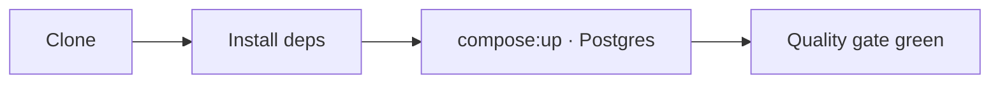

# Quickstart — Developer

Ship to sk with confidence: a green quality gate on every change keeps regressions out of production. From clone to a passing test suite and a live engine in about 10 minutes.



## Prerequisites

- [Bun](https://bun.sh) (`curl -fsSL https://bun.sh/install | bash`).
- Docker Desktop (or compatible) — required for Postgres.

## 1. Clone and install

```bash
git clone https://github.com/mikebild/subkit && cd subkit
bun install
```

## 2. Bring infra up

```bash
bun run compose:up          # Postgres only (engine runs on the host via `bun run dev`)
```

Local dev uses docker compose for postgres only (and optional MinIO under `--profile storage`); the engine runs on the host via `bun run dev` (step 4). For production, run the all-in-one Docker image — see [docs/developers/self-host.md](./self-host.md).

## 3. Run the quality gate

```bash
bun run lint                # biome
bun run typecheck           # tsc --noEmit
bun run test:unit           # fast inner loop (needs Postgres — see note below)
bun run test:integration    # db/queue/http/webhooks/credentials-oauth2
bun run test:e2e            # compiles sk and runs journeys
```

> **Note.** `test:unit` includes `execution/tests`, which uses a throwaway Postgres database. It's fast (seconds) because each file gets its own database, but you do need `compose:up` running.

> **Note.** `bun run test:e2e` is the only supported way to run the e2e layer, and the one CI uses: it gives every e2e file its own process. `bun test tests/e2e/` is not supported — it loads all of them into one process, where suites contend for process-global state and fail on interference unrelated to your change. Running one file by name is fine.

`bun run verify` is the local release gate. It runs determinism lint,
unit tests, eval fixtures, integration tests, `build:sk`, and e2e coverage on top of lint and
typecheck. `bun run verify:ai` is the focused contract suite for prompt/context/authoring changes.

## 4. Develop

```bash
bun run dev                 # engine in watch mode
```

In another shell:

```bash
curl -s http://localhost:3000/v1/health | jq
```

## 5. Where things live

- `apps/engine/src/` — the server. Subsystem-per-directory (45 in total). Start with [AGENTS.md](../../AGENTS.md) for the map.
- `apps/sk/` — `sk` unified CLI. REPL for end-users; full admin surface for operators and admins.
- `packages/shared/` — cross-process types.
- `docs/` — eight concept docs. See [docs/README.md](../README.md) for the index.

## 6. Before you PR

- [AGENTS.md](../../AGENTS.md) — non-negotiables: tenant isolation, audit coverage, Zod at boundaries, QuickJS sandbox, no auto-promote. Read this first.
- [docs/concepts/glossary.md](../concepts/glossary.md) — the domain model. Every term used in the codebase is defined here.
