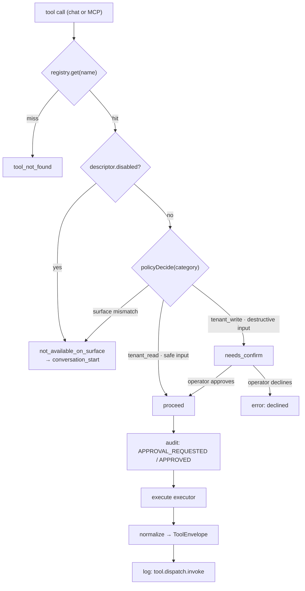

# Tool palette and dispatch

**Outcome:** every LLM action against sk is a *named, governed* tool — one
registry, one policy gate, one audit trail. No ad-hoc calls, no surface that
quietly skips a permission check. A write to prod gates the same whether it
arrives over chat or MCP.

> **Status:** authoritative. See
> [`apps/engine/src/tools/`](../../apps/engine/src/tools/) for the
> implementation and `AGENTS.md` lines 142–185 for the subsystem map.

## Why this exists

The engine speaks "LLM tool-calling" across two surfaces:

| Surface | Transport | Entry point |
|---|---|---|
| **Chat** | Anthropic-SDK tool calls in a conversation turn | `conversations/tools/sdk-wrap.ts` |
| **MCP** | `tools/list` + `tools/call` over Model Context Protocol | `apps/engine/src/mcp/` |

Before the unified palette, those two paths each owned their own dispatch,
schema, RBAC, audit, and policy. Two failure modes followed:

- **Literal duplication.** `test_connector` existed twice — as a
  `ConversationTool` (`conversations/tools/test-connector.ts`) *and* as an
  MCP-only file (`mcp/tools/test-connector.ts`) — both calling the same
  `probeConnector()` driver and `recordConnectorInvoked()` recorder.
- **Divergent gates.** Chat used `tool-policies.resolveToolMode()`; MCP used
  `mcp/capabilities/policy-gate.gateTenantToolCall()`. They disagreed on
  `tenant_read` escalation: a `probe_connector` POST against prod gated
  correctly on chat and **silently bypassed** on MCP.

One registry, one dispatcher, one policy gate, and one envelope shape close
both gaps. Per-surface adapters render that single envelope into MCP transport
or chat SDK shape — the only place surface differences live.

## Concepts

### ToolDescriptor

```ts
interface ToolDescriptor {
  name: string;
  description: string;
  category: "draft_write" | "tenant_read" | "tenant_write";
  inputSchema: unknown; // Zod for conversation tools; JSON Schema for static
  disabled?: { reason: string };
  requires_skill?: string;
}
```

| Field | Role |
|---|---|
| `category` | Drives the policy decision — see *Policy gate (unified)*. |
| `disabled` | Marks a tool `tools/call` rejects with a `not_available_on_surface` envelope pointing at `conversation_start`. |
| `requires_skill` | Gates the tool behind a granted skill. |

**Draft-write tools are HIDDEN from MCP `tools/list`, not badged.** Earlier
they were listed-with-`disabled` as an "honest signal" that the tool exists but
isn't headlessly callable. In practice external clients (e.g. claude.ai) ignore
the `_meta.subkit.disabled` badge, call the tool anyway, get rejected, and churn
instead of authoring — so the catalog `list()` now omits draft-write on MCP
entirely, steering the model to `conversation_start` (the only working authoring
entry point). `resolve()` deliberately still returns the disabled descriptor so
the call-time `not_available_on_surface` backstop stays intact for any client
that guesses the bare name. List and resolve intentionally disagree here, which
is safe because such a call can never execute on this surface.

### Surface

`"chat" | "mcp"` — drives visibility filtering and envelope rendering. No
surface-specific logic in the dispatcher itself; per-surface concerns live in
adapters.

### ToolEnvelope (status-discriminated)

```ts
type ToolEnvelope =
  | { status: "ok"; data: unknown; pause?; committed_workflow_id? }
  | { status: "error"; error_code; message; details?; next_best_actions? }
  | { status: "needs_confirm"; confirm: ConfirmEnvelope }
  | { status: "paused"; pause: ToolResultPause }
  | { status: "not_available_on_surface"; reason: string };
```

Replaces the legacy `ok: true | false` discriminated union from
`conversations/tools/index.ts:178`. The status discriminator makes the surface
adapters trivially total — each adapter has exactly one case per status.

### Provider, Registry, Dispatcher

Providers contribute descriptors + executors:

| Provider | Contributes |
|---|---|
| `StaticToolProvider` | MCP-unique handlers: `authenticate`, `list_recipes`, `self_healing.scan`. |
| `ConversationToolProvider` | everything in `conversations/tools/index.ts:listTools()`, filtered per `(surface, mcpMode, readOnly)`. |

`buildRegistry(providers)` enforces cross-provider name uniqueness at boot.
`registry.get(name, filter)` resolves an executor; `registry.list(filter)` gives
the visible catalog.

`dispatchTool(deps, invocation)` runs one pipeline for both surfaces:



The seven stages in order: **resolve** → `tool_not_found` on miss · **visibility**
→ `not_available_on_surface` on `disabled` · **policy** → `proceed | needs_confirm
| not_available` · **audit** → `APPROVAL_*` rows · **execute** the resolved
executor · **normalize** into a `ToolEnvelope` · **log** one `tool.dispatch.invoke`
event per call.

### Policy gate (unified)

`policyDecide()` is a **pure synchronous function** that subsumes both
`resolveToolMode()` (chat) and `gateTenantToolCall()` (MCP). Audit is emitted by
the dispatcher, not the gate.

```ts
type PolicyDecision =
  | { kind: "proceed" }
  | { kind: "needs_confirm"; envelope: ConfirmEnvelope }
  | { kind: "not_available_on_surface"; reason: string };
```

| Category | Read / write | Default decision |
|---|---|---|
| `tenant_read` | reads tenant state | `proceed` (unless input predicates escalate it) |
| `tenant_write` | mutates tenant state | `needs_confirm` for destructive input |
| `draft_write` | authors a draft | MCP: `not_available_on_surface`; chat: in-loop |

**Key behavioral change vs. the legacy paths: no `tenant_read` shortcut.** The
legacy MCP gate (`policy-gate.ts:84`) returned `proceed` for every `tenant_read`
tool, ignoring `computeModeFromInput` predicates. The unified gate consults
`resolveToolMode` for every category, so `probe_connector` POST against prod
gates correctly on both surfaces.

## Adapters

The dispatcher is surface-agnostic; adapters translate the single `ToolEnvelope`
into each surface's wire shape.

### MCP adapter (`mcp/adapter.ts`)

| Function | Purpose |
|---|---|
| `listToolsViaRegistry(opts)` | `Tool[]` for `tools/list`. |
| `callToolViaDispatcher(opts)` | `{isError, content[], _meta}` for `tools/call`. |
| `buildMcpStubCtx(opts)` | minimal `ToolContext` so conversation tools run against an MCP caller without a real conversation session. |

Envelope rendering:

| ToolEnvelope.status        | MCP response                                                                                  |
|----------------------------|-----------------------------------------------------------------------------------------------|
| `ok`                       | `{isError:false, content:[text(JSON.stringify(data))]}`                                       |
| `error`                    | `{isError:true,  content:[text({error_code, message, details, next_best_actions})]}`          |
| `needs_confirm`            | `{isError:false, content:[text(confirm)], _meta:{subkit:{confirm}}}`                          |
| `paused`                   | `{isError:false, content:[text(pause)],   _meta:{subkit:{paused}}}`                           |
| `not_available_on_surface` | `{isError:true,  content:[text({error_code:"not_available_on_surface", reason})], _meta:...}` |

### Chat adapter (`conversations/tools/dispatch-adapter.ts`)

- `invokeForSdk(opts)` — single entry point for the chat loop. **Not wired into
  `sdk-wrap.ts` yet** — the chat path stays on its existing inline wrapping
  (which owns rate-limiting, signal handling, event emission, and draft-state
  diff emission). The adapter exists so a future cutover lands in one focused
  change.
- `envelopeToToolResult(envelope)` — back-converts to the legacy `ToolResult`
  shape the conversation loop expects today. The `needs_confirm` case becomes an
  `ask_user_confirm` pause so the elicitation loop picks it up unchanged.

## Decisions and trade-offs

### Probe + test stay separate (no merge)

| Tool | Operation |
|---|---|
| `test_connector` | driver health check |
| `probe_connector` | caller-specified HTTP on a saved connector |
| `probe_connector_draft` | caller HTTP on a pre-creation envelope |

These are **three semantically distinct operations**. The early plan considered
merging probe+test under one tool with a `mode` arg; the audit found two RBAC
permissions, two audit shapes, and two rate-limit semantics — merging them hides
operational distinctions under one schema. We keep all three names; the MCP-side
duplicate of `test_connector` is the only thing deleted.

### `save_workflow_draft` and `dry_run_workflow` are MCP-hidden

Both are draft-write tools: OMITTED from MCP `tools/list`, and a direct
`tools/call` short-circuits to `not_available_on_surface` with a reason pointing
to `conversation_start`. They are driven by the engine's internal authoring loop
inside a conversation, never by the external client.

| Tool | Why it can't run standalone on MCP |
|---|---|
| `save_workflow_draft` | needs an MCP-side confirm protocol that doesn't exist standalone — the `ask_user_confirm` elicitation is conversation-shaped. |
| `dry_run_workflow` | needs a `def`/`draft_id` input extension — it only reads `ctx.getDraft()`. |

Listing them as callable — even badged disabled — only traps clients that ignore
the badge into calling and churning, so they are hidden outright.

### Status-discriminated envelope vs. flat `ok` boolean

The legacy `ToolResult` carried `pause` on both `ok:true` and `ok:false`
branches — an awkward shape because "paused but failed" is not a real state.
Status discrimination makes the four valid states explicit and totally
narrowable.

### No HTTP `/v1/tools/:name` surface (yet)

The dispatcher is surface-agnostic, but adding a third per-surface adapter
without a caller violates YAGNI. When an HTTP caller appears, the adapter is a
40-line file.

### Audit lives in the dispatcher

`policyDecide()` is pure. Audit emission (`APPROVAL_REQUESTED`,
`APPROVAL_APPROVED`) happens in the dispatcher around the policy decision. This
keeps the gate testable without DB and centralizes the audit semantics. Per-tool
audits (e.g. `recordConnectorInvoked` inside `test_connector`) continue to fire
from inside the tool's executor.

### Elicitation audit is a tri-state — transport ≠ approval

An elicitation resolve audit row carries up to three independent facts, and they
must not be conflated:

| Fact | Values | Records |
|---|---|---|
| `action` | `APPROVAL_APPROVED` · `APPROVAL_REJECTED` | the *governance decision* |
| `decision_reason` | `user_declined`, `oauth_timeout`, `elicitation_transport_failed`, … | machine code behind a cancel |
| `elicitation_transport` | `succeeded` · `failed` | whether a `protocol_native` bridge round-trip *delivered* — not whether it was approved |

Crucially, `elicitation_transport: "succeeded"` can coexist with a `cancelled`
resolution: a clean bridge round-trip whose operator declined, or did not
acknowledge an OAuth authorization, succeeded *as transport* but rejected *as a
decision*. An audit query for "successful elicitations" must therefore filter on
`action` / `decision_reason`, not on `elicitation_transport` — equating transport
success with approval double-counts every declined-but-delivered prompt.

## Layout

```
apps/engine/src/tools/
├── types.ts                    ToolDescriptor, ToolEnvelope, ToolInvocation, etc.
├── registry.ts                 ToolRegistry interface + buildRegistry()
├── policy.ts                   policyDecide() — pure unified policy gate
├── dispatcher.ts               dispatchTool() — the orchestrator
├── index.ts                    barrel
├── providers/
│   ├── static.ts               StaticToolProvider — MCP-unique handlers
│   └── conversation.ts         ConversationToolProvider — listTools() wrapper
└── tests/
    ├── registry.test.ts
    ├── dispatcher.test.ts
    ├── policy-decide.test.ts
    ├── result-shape-invariants.test.ts
    └── cross-surface-parity.test.ts

apps/engine/src/mcp/
├── adapter.ts                  listToolsViaRegistry / callToolViaDispatcher
└── tests/
    ├── tools-call-parity.test.ts
    ├── policy-gate-snapshot.test.ts
    ├── tools-list-disabled.test.ts
    ├── preview-attachment-flat-name.test.ts
    └── test-connector-dedupe.test.ts

apps/engine/src/conversations/tools/
├── dispatch-adapter.ts         invokeForSdk / envelopeToToolResult
└── tests/
    └── dispatcher-parity.test.ts
```

## Cross-refs

- [`docs/concepts/glossary.md`](../concepts/glossary.md) — vocabulary (workflow, connector, skill).
- [`docs/developers/input-surfaces.md`](./input-surfaces.md) — how chat/MCP/HTTP surfaces map to the conversation loop.
- [`docs/admins/rbac-and-roles.md`](../admins/rbac-and-roles.md) — RBAC, audit, policy.
- `AGENTS.md` lines 142–185 — subsystem map (the row for `tools` lives here).

## Cutover plan

Tests-first: characterization tests in `mcp/tests/policy-gate-snapshot.test.ts`
and `mcp/tests/tools-call-parity.test.ts` pin current behavior. The new-behavior
tests in `apps/engine/src/tools/tests/` and the new MCP tests are `test.todo`
until their implementation commit lands.

The cutover in `mcp/capabilities/tools.ts` inserts a single early-return that
delegates to `mcp/adapter.callToolViaDispatcher()` for any tool the unified
registry recognizes; everything else falls through to the legacy prefix proxies
(`conversation.*`, `wf.<slug>`). The named-tool branches (authenticate,
list_recipes, test_connector, etc.) have all been deleted — the registry claims
those names exclusively.

The `tenant_*` prefix aliases have been **removed**. Every conversation tool
already surfaces under its bare name via the unified registry, so the aliases
were a pure duplicate that doubled the catalog and degraded tool-selection
accuracy on large clients. Bare names dispatch through the unified dispatcher,
which applies the same RBAC + policy gate the aliases did. Only `conversation.*`
session-management tools (`conversation_start`, `conversation_append`,
`conversation_commit`, `conversation_respond_elicitation`, `conversation_get`)
remain on the legacy path because they are MCP-specific session orchestration,
not LLM tool palette items.

The chat side keeps its existing `sdk-wrap.ts` inline path; the
`dispatch-adapter.invokeForSdk` entry exists for a future focused cutover but is
not invoked at runtime yet.
