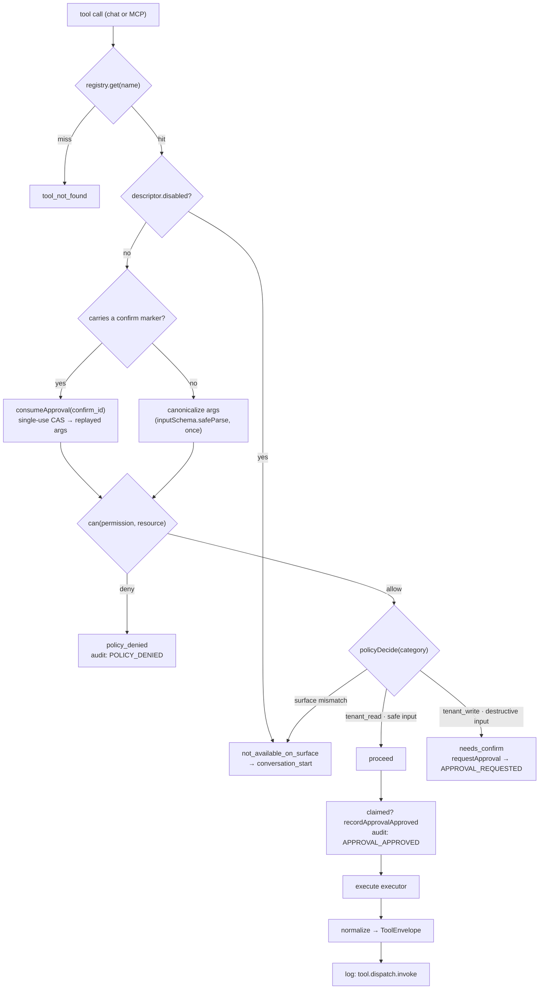

# Tool palette and dispatch

Every action an LLM can take against sk is a named tool that goes through one registry, one
policy gate, and one audit trail. There are no ad-hoc calls and no surface that quietly
skips a permission check: a write is gated identically whether it arrives over chat or over
MCP.

> **Status:** authoritative. See
> [`apps/engine/src/tools/`](../../apps/engine/src/tools/) for the
> implementation and the subsystem map in `AGENTS.md` ("Architecture And Domain Safety").

## Why this exists

The engine speaks "LLM tool-calling" across two surfaces:

| Surface | Transport | Entry point |
|---|---|---|
| **Chat** | Anthropic-SDK tool calls in a conversation turn | `conversations/tools/sdk-wrap.ts` |
| **MCP** | `tools/list` + `tools/call` over Model Context Protocol | `apps/engine/src/mcp/` |

Before the unified palette, those two paths each owned their own dispatch,
schema, RBAC, audit, and policy. Two failure modes followed:

- **Literal duplication.** `test_connector` existed twice — as a
  `ConversationTool` (`conversations/tools/test-connector.ts`) *and* as an
  MCP-only file (`mcp/tools/test-connector.ts`) — both calling the same
  `probeConnector()` driver and `recordConnectorInvoked()` recorder.
- **Divergent gates.** Chat and MCP each carried their own confirm gate, and
  they disagreed on `tenant_read` escalation: a `probe_connector` POST against
  prod gated correctly on chat and **silently bypassed** on MCP.

One registry, one dispatcher, one policy gate, and one envelope shape close
both gaps. The MCP-side gate is gone; `tools/policy.ts:policyDecide()` is the
only confirm decision in the engine. Per-surface adapters render that single
envelope into MCP transport or chat SDK shape — the only place surface
differences live.

## Concepts

### ToolDescriptor

```ts
interface ToolDescriptor {
  name: string;
  description: string;
  category: "draft_write" | "tenant_read" | "tenant_write";
  inputSchema: unknown; // Zod for conversation tools; JSON Schema for static
  disabled?: { reason: string };
  requires_skill?: string;
}
```

| Field | Role |
|---|---|
| `category` | Drives the policy decision — see *Policy gate (unified)*. |
| `disabled` | Marks a tool `tools/call` rejects with a `not_available_on_surface` envelope pointing at `conversation_start`. |
| `requires_skill` | Gates the tool behind a granted skill. |

**Draft-write tools are HIDDEN from MCP `tools/list`, not badged.** Earlier
they were listed-with-`disabled` as an "honest signal" that the tool exists but
isn't headlessly callable. In practice external clients (e.g. claude.ai) ignore
the `_meta.subkit.disabled` badge, call the tool anyway, get rejected, and churn
instead of authoring — so the catalog `list()` now omits draft-write on MCP
entirely, steering the model to `conversation_start` (the only working authoring
entry point). `resolve()` deliberately still returns the disabled descriptor so
the call-time `not_available_on_surface` backstop stays intact for any client
that guesses the bare name. List and resolve intentionally disagree here, which
is safe because such a call can never execute on this surface.

### Surface

`"chat" | "mcp"` — drives visibility filtering and envelope rendering. No
surface-specific logic in the dispatcher itself; per-surface concerns live in
adapters.

### Chat read-only palette

The `"chat"` surface never sees the full catalog. After the normal
`(surface, mcpMode)` visibility filter, the visible set is intersected with a
fixed name allow-list — `CHAT_READONLY_TOOLS` in
`conversations/tools/authoring-palette.ts`, applied by
`filterByChatReadOnlyPalette()` and resolved per turn in `sdk-wrap.ts`.

The palette is **fail-closed**: an allow-list, not a deny-list. A tool absent
from the set is never dispatched on chat — not if it exists in the registry,
not if the linked user's RBAC would permit it, and not if a granted skill
would surface it in an authoring turn. New tools stay invisible to chat until
explicitly added to the set (guarded by
`conversations/tools/tests/sdk-wrap-chat-surface.test.ts`, which asserts
nothing leaks past it). The set is independent of skill state and tool
category — channel-scoped, not role-scoped.

| Group | Tools |
|---|---|
| Conversational meta | `ask_user_confirm` · `ask_user_choice` · `ask_user_multi` · `ask_user_text` · `ask_user_form` · `cannot_help` · `list_skills` · `load_skill` · `list_attachments` · `preview_attachment` · `get_raw_result` |
| Knowledge + docs (read) | `search_knowledge` · `read_knowledge` · `search_docs` · `list_knowledge_sources` · `get_knowledge_source` |
| Workflows (read) | `list_workflows` · `get_workflow` · `find_workflow` |
| Executions (read) | `list_executions` · `get_execution` · `inspect_execution` · `inspect_execution_step` |
| Connector metadata (read) | `list_connectors` · `get_connector` · `find_connector` |
| Skills (read) | `get_skill` · `find_skill` |
| Schedules (read) | `list_schedules` |
| Run | `run_workflow` |

Deliberately absent: `call_connector`, `probe_connector`, `test_connector`,
the `discover_*` probes, every `draft_write` authoring tool, every
`tenant_write` mutation, and external-MCP tools. Connector access on chat is
metadata-only.

### Catalog grouping on the read tools

`list_workflows` and `find_workflow` return a derived `category` (the catalog
block) and `connectors` (the connector slugs the current version uses) on every
item, and accept both as filters:

| Param | Tools | Effect |
|---|---|---|
| `category` | `list_workflows` · `find_workflow` · `list_connectors` · `find_connector` | Restrict to one catalog block |
| `connector` | `list_workflows` · `find_workflow` | Restrict to workflows using that connector (id or slug) |

Workflow categories are derived from the slug corpus — a leading slug segment
shared by at least three workflows forms a block, everything else collects under
`other` — so read a category value off a previous result rather than inventing
one. A connector's category is simply its driver. The `connector` filter counts
both binding forms: a step's `connector_id` **and** a
`${connector.<slug>.base_url}` URL, so a placeholder-only dependant is not
missed. List responses also carry a `categories` array giving the blocks in
render order, which is what `sk` and any dashboard should follow instead of
re-deriving the ordering.

`run_workflow` (with its synthetic `wf_<slug>` peers) is the one action in
the set — running a *saved* workflow. It stays behind
`resolveExecutionToolGate` (default-deny without a bound or explicitly named
saved workflow), per-user RBAC, and the confirm policy, which chat renders as
a native approval card only the requester can confirm. See the *Chat adapter*
section below and the operator page [../operators/chat.md](../operators/chat.md).

### ToolEnvelope (status-discriminated)

```ts
type ToolEnvelope =
  | { status: "ok"; data: unknown; pause?; committed_workflow_id? }
  | { status: "error"; error_code; message; details?; next_best_actions? }
  | { status: "needs_confirm"; confirm: ConfirmEnvelope }
  | { status: "paused"; pause: ToolResultPause }
  | { status: "not_available_on_surface"; reason: string };
```

Replaces the legacy `ok: true | false` discriminated union from
`conversations/tools/index.ts:178`. The status discriminator makes the surface
adapters trivially total — each adapter has exactly one case per status.

### Provider, Registry, Dispatcher

Providers contribute descriptors + executors:

| Provider | Contributes |
|---|---|
| `StaticToolProvider` | MCP-unique handlers: `authenticate`, `list_recipes`, `self_healing.scan`, plus admin-only `subkit_settings` and `subkit_update_setting`. |
| `ConversationToolProvider` | everything in `conversations/tools/index.ts:listTools()`, filtered per `(surface, mcpMode, readOnly)`. |

`buildRegistry(providers)` enforces cross-provider name uniqueness at boot.
`registry.get(name, filter)` resolves an executor; `registry.list(filter)` gives
the visible catalog.

`dispatchTool(deps, invocation)` runs one pipeline for both surfaces:



The stages in order: **resolve** → `tool_not_found` on miss · **visibility** →
`not_available_on_surface` on `disabled` · **confirm** → a confirm marker claims
the stored approval and replays its args · **canonicalize** → the tool's own Zod
schema parses the args that will execute, exactly once · **rbac** → `can()` on
those args, before the gate, so an unauthorized caller never opens an approval ·
**policy** → `proceed | needs_confirm | not_available` · **approve** → the claim
that survived rbac + policy writes `APPROVAL_APPROVED` · **execute** the resolved
executor · **normalize** into a `ToolEnvelope` · **log** one `tool.dispatch.invoke`
event per call.

`canonicalize` runs on the first call only. The args stored with the approval were
already canonicalized at grant time, so a replay hands them to the executor
untouched — a schema whose transform is not idempotent cannot corrupt its own
approved payload. It follows that a `ConversationTool` executor **never re-parses
its own input**: the dispatcher is the boundary, and it parses exactly once.

### Policy gate (unified)

`policyDecide()` (`tools/policy.ts`) is a **pure synchronous function** and the
engine's only confirm decision — chat, MCP, and the conversation fast-path all
call it and none re-derives the answer. It has no I/O: the durable half of the
gate lives in `tools/approval.ts`, and audit is emitted by the dispatcher.

```ts
type PolicyDecision =
  | { kind: "proceed" }
  | { kind: "needs_confirm"; envelope: ConfirmEnvelope }
  | { kind: "not_available_on_surface"; reason: string };
```

| Category | Read / write | Default decision |
|---|---|---|
| `tenant_read` | reads tenant state | `proceed` (unless input predicates escalate it) |
| `tenant_write` | mutates tenant state | `needs_confirm` for destructive input |
| `draft_write` | authors a draft | MCP: `not_available_on_surface`; chat: in-loop |

**No `tenant_read` shortcut.** The deleted MCP-side gate returned `proceed` for
every `tenant_read` tool, ignoring `computeModeFromInput` predicates. The unified
gate runs `decideToolMode` for every category — a `tenant_read` tool without a
dynamic predicate still resolves to `no_confirm`, so the common case is unchanged
and `probe_connector` POST against prod now gates on both surfaces.

### Approvals (`tools/approval.ts`)

An approval is a **capability handle, not a re-transmission challenge**.

| Function | Role |
|---|---|
| `requestApproval` | Persists the canonical args (AES-256-GCM, AAD-bound to `tenant_id:approval_id`) and the `APPROVAL_REQUESTED` row in one transaction. |
| `consumeApproval` | Claims the handle with one atomic CAS on `(id, tenant_id, principal_id, tool, surface)` and returns the decrypted args to replay. Every CAS outcome but success writes `APPROVAL_REJECTED`. |
| `recordApprovalApproved` | Writes `APPROVAL_APPROVED` after RBAC and policy pass, immediately before the executor runs. |

The confirmation carries an **id and nothing else**. The client never re-sends the
payload, so there is nothing for the model to swap between preview and approval,
and a ~50 KB body is approvable. A claim is not yet an approval: it burns the
single-use handle, then still has to survive RBAC and the policy gate — a grant
revoked between preview and confirm denies, and the `POLICY_DENIED` row anchors on
the approval's `(resource_type, resource_id)` so the contradiction is one JOIN.
Handles expire after `APPROVAL_TTL_MS` (15 min), measured entirely on Postgres'
clock.

## Adapters

The dispatcher is surface-agnostic; adapters translate the single `ToolEnvelope`
into each surface's wire shape.

### MCP adapter (`mcp/adapter.ts`)

| Function | Purpose |
|---|---|
| `listToolsViaRegistry(opts)` | `Tool[]` for `tools/list`. |
| `callToolViaDispatcher(opts)` | `{isError, content[], _meta}` for `tools/call`. |
| `buildMcpStubCtx(opts)` | minimal `ToolContext` so conversation tools run against an MCP caller without a real conversation session. |

Envelope rendering:

| ToolEnvelope.status        | MCP response                                                                                  |
|----------------------------|-----------------------------------------------------------------------------------------------|
| `ok`                       | `{isError:false, content:[text(JSON.stringify(data))]}`                                       |
| `error`                    | `{isError:true,  content:[text({error_code, message, details, next_best_actions})]}`          |
| `needs_confirm`            | `{isError:false, content:[text(confirm)], _meta:{subkit:{confirm}}}`                          |
| `paused`                   | `{isError:false, content:[text(pause)],   _meta:{subkit:{paused}}}`                           |
| `not_available_on_surface` | `{isError:true,  content:[text({error_code:"not_available_on_surface", reason})], _meta:...}` |

### Chat adapter (`conversations/tools/dispatch-adapter.ts`)

The palette this surface exposes is the fixed
[chat read-only palette](#chat-read-only-palette) above.

- `invokeForSdk(opts)` — single entry point for the chat loop. **Not wired into
  `sdk-wrap.ts` yet** — the chat path stays on its existing inline wrapping
  (which owns rate-limiting, signal handling, event emission, and draft-state
  diff emission). The adapter exists so a future cutover lands in one focused
  change.
- `envelopeToToolResult(envelope)` — back-converts to the legacy `ToolResult`
  shape the conversation loop expects today. The `needs_confirm` case becomes an
  `ask_user_confirm` pause so the elicitation loop picks it up unchanged.

## MCP session and confirmation tools

A handful of MCP tools are not LLM palette items at all — they are the session
orchestration an external client uses to drive an authoring conversation and to
satisfy the write gate. They dispatch through the same RBAC and audit chokepoint,
but they manage *the conversation*, not a tenant resource.

### The conversation cluster

| Tool | Role |
|---|---|
| `conversation_start` | Open a new authoring conversation from a described outcome; returns the `conversation_id`. |
| `conversation_append` | Add the next user message and enqueue the next authoring turn. |
| `conversation_get` | Read-only poll of a conversation's state — completion status, pending elicitation, and the live progress heartbeat (below). |
| `conversation_respond_elicitation` | Resolve a pending elicitation (a form answer, an approval, an OAuth acknowledgement) and enqueue the following turn. |
| `conversation_commit` | Report the persisted commit state of the conversation's workflow — version written, steps present, read from the persisted rows. Read-only; a draft with unpersisted edits returns a NOT COMMITTED error. |

These five are the complete session surface. Authoring turns run in a background
worker (a real turn outlasts the MCP client timeout), so a client `conversation_start`s
or `conversation_append`s, then polls `conversation_get` until the turn reports
`completed`, `failed`, or `input_required`. The [Input Surfaces](./input-surfaces.md#mcp-integration)
page documents the Tasks-capable vs. non-Tasks polling contract in full.

### Worker-stamped heartbeat

A backgrounded turn has no open stream to report progress on, so the worker stamps
its progress into the conversation row as it goes. `conversation_get` returns that
heartbeat so a polling client can render live status instead of a bare spinner:

| Field | Meaning |
|---|---|
| `phase` | The stage the turn is in (e.g. grounding, drafting, dry-running, critiquing). |
| `elapsed_ms` | Wall-clock elapsed since the turn started. |
| `last_action` | The most recent tool or pipeline step the worker took. |
| `step` | The workflow step currently being authored or tested, when applicable. |

The heartbeat is advisory telemetry for the operator's benefit; the authoritative
terminal signal is still the completion status. A stalled or slow turn is visible
as a growing `elapsed_ms` against an unchanged `last_action`.

### `confirm_tool_call`

**`confirm_tool_call` is a trigger, not a gate.** It cannot approve anything. An
approval is minted UNGRANTED (`granted_at IS NULL`), and the claim CAS demands
`granted_at IS NOT NULL`, which only `grantApproval` sets, and which only a human
channel reaches. So every client may call `confirm_tool_call`, and it succeeds iff a
person already said yes. There is no capability-based refusal, because there is
nothing left for one to protect.

**A human approves out of band, through the approval portal.** The gated call
returns `needs_confirm` carrying a `tool_call_id` (the trigger handle), an
`approval_url` (the human channel), and an `approval.requested` audit row that
persists the encrypted arguments and the `would_write` preview. A person opens the
link, sees exactly what will be written, and grants or declines — one atomic CAS,
recorded as `approval.granted` / `approval.declined`. Afterwards the model relays
`confirm_tool_call({ tool, confirm_id })`, or — if it can set `_meta` — re-issues
with `_meta.sk_confirm: true` + `_meta.sk_confirm_id: <tool_call_id>`. Both are the
same trigger, and both fail with `approval_not_granted` until the human decides.
There is no second door to bolt, because neither door opens by itself.

**A fulfilled native elicitation is a human grant channel.** Conversation workers
persist their confirmation and end the turn; a later `conversation_get` or
`tasks/get` can only resolve it through the active MCP session's
`elicitation/create(mode: form)` request. That delivery is leased, the answer is
stamped `human/in_band_elicitation`, and only then may the harness grant and claim
the held call. A model relay through `conversation_respond_elicitation` is still
refused for approval-bearing rows. Standalone registry calls retain the
approval-portal flow because they have no persisted conversation task to resume.
MCP `wf_<slug>` calls instead use version-bound Execution Authorities: an
existing matching local authority permits the run; otherwise writes remain held
as preparation. A client confirmation alone never creates that authority.

**No path re-sends the arguments.** `confirm_tool_call` publishes no `arguments`
property at all, and on the `_meta` path the dispatcher discards whatever the client
re-sent. The engine replays the args it already holds under that `confirm_id` (see
*Approvals* above). The approval is the human's; the model only fires the trigger.
Every path is audited identically.

## Self-diagnosis: `includeStepResults`

`dry_run_workflow` and `run_workflow` accept an optional `includeStepResults` flag.
When set, the response carries the raw per-step inputs and outputs for the run
alongside the normal summary. This is the self-diagnosis lever: an authoring client
(or an operator) that gets an unexpected result can read exactly what each step
received and emitted without a second round-trip, then feed that back into a patch
edit. It is off by default because the raw payloads can be large; turn it on only
when you need step-level forensics.

## Decisions and trade-offs

### Probe + test stay separate (no merge)

| Tool | Operation |
|---|---|
| `test_connector` | driver health check |
| `probe_connector` | caller-specified HTTP on a saved connector |
| `probe_connector_draft` | caller HTTP on a pre-creation envelope |

These are **three semantically distinct operations**. The early plan considered
merging probe+test under one tool with a `mode` arg; the audit found two RBAC
permissions, two audit shapes, and two rate-limit semantics — merging them hides
operational distinctions under one schema. We keep all three names; the MCP-side
duplicate of `test_connector` is the only thing deleted.

### `save_workflow_draft` and `dry_run_workflow` are MCP-hidden

Both are draft-write tools: OMITTED from MCP `tools/list`, and a direct
`tools/call` short-circuits to `not_available_on_surface` with a reason pointing
to `conversation_start`. They are driven by the engine's internal authoring loop
inside a conversation, never by the external client.

| Tool | Why it can't run standalone on MCP |
|---|---|
| `save_workflow_draft` | needs an MCP-side confirm protocol that doesn't exist standalone — the `ask_user_confirm` elicitation is conversation-shaped. |
| `dry_run_workflow` | needs a `def`/`draft_id` input extension — it only reads `ctx.getDraft()`. |

Listing them as callable — even badged disabled — only traps clients that ignore
the badge into calling and churning, so they are hidden outright.

### External-reaching tools are in-palette, not a side channel

A few tools reach *outside* the engine's own state to live upstream surfaces —
`call_connector` (invokes a saved connector), `discover_connector_endpoints`
(fetches and parses a spec), and `fetch_connector_self_description` (live-fetches
a connector's *own* published docs). These are open-world by nature, but they are
still ordinary palette entries: same registry, same `policyDecide()` gate, same
`tool.dispatch.invoke` audit. Egress is guarded and size-capped inside the
executor; nothing about reaching the network earns a bypass.

`fetch_connector_self_description` (`{ connector_id?, kind?: "llms" | "openapi" |
"graphql" | "all" }`) is a `tenant_read` MCP tool — it appears in `tools/list`
and live-fetches the link the connector remembers in its `self_description.links[]`
metadata, transiently, persisting nothing. It is **not** an HTTP route, so it does
**not** appear in the engine OpenAPI spec; the connector's own machine docs
(`llms_txt`, `llms_full`, `openapi`, `graphql`) are described in
[Connectors → Connector Self-Description](../concepts/connectors.md#connector-self-description).

### Remote MCP entries: sk as an MCP client

sk is an MCP *server* to its own clients and an MCP *client* to servers a tenant
connects. The second half lands in this same palette. Every enabled connector
whose driver is `mcp` has its remote surface merged in, so a message naming a
remote tool dispatches in one call rather than a lookup-then-invoke pair.

**Where the servers live.** In `connectors`, like every other integration.
There is no separate MCP registry table, no separate CRUD surface, and no
separate credential store — an external MCP server is created, patched,
enabled, disabled, and deleted through `/v1/connectors` and `sk connectors`.

**Naming.** `mcp_<connector_slug>__<entry>`. The slug half cannot contain `__`
(a DB `CHECK` on `connectors.slug` enforces it), which is what makes the double
underscore an unambiguous split point. `buildMcpToolName` owns the grammar and
**refuses** a pair it cannot address rather than truncating it — a truncated
name still routes, just possibly to a different server. The composed name is
bounded at 64 characters and matches `^[a-zA-Z0-9_-]{1,64}$`; no dots.

**Entries are not all remote tools.** Each entry is a `PaletteOperationSpec` —
a name, a schema, and the one remote operation it issues. A remote tool supplies
one each. Where the negotiated capabilities declare resources or prompts, four
engine-minted adapters are added per server: `list_resources`, `read_resource`,
`list_prompts`, `get_prompt`. Adapters appear **only** where the capability was
declared, so the model is never offered an entry whose every call is a protocol
error.

**They are ordinary palette entries.** Same registry, same `policyDecide()`
gate, same durable approval handle, same `tool.dispatch.invoke` audit, same
turn mutex, and an `mcp_external_tool:invoke` RBAC check. The `mcp_` prefix is
what `isDangerousTool` and `getApprovalMode` key on, so every remote entry
confirms before running under `auto` / `ask` / `plan`.

**A server's self-description reaches the model, never the gate.** A remote's
`annotations` (`readOnlyHint`, `destructiveHint`) are carried into the entry
description and the audit metadata, and are consulted by no gate whatsoever. A
`tools/call` is a write no matter what the server claims about itself —
`readOnlyHint` is optional, unverified, and asserted by the party whose side
effects it describes. The engine-minted read adapters are the one exception,
and they are reads by the engine's own construction: each is pinned to one
retrieval method and none can reach `tools/call`. Only a tenant-side author can
reclassify a call, with `side_effects: "read"` on a workflow step.

**An operator may trust one tool at a time.** A person holding
`connector:write` can mark an individual remote tool "Ohne Rückfrage" with
`PUT /v1/connectors/{id}/mcp/tool-confirmation` (`{ tool, confirm }`), which
stores the name at `config.mcp.tools_without_confirmation` and writes one
`connector.updated` audit row naming the actor, the tool, and the old and new
setting. That route is the list's only writer: a connector edit keeps the
stored list and refuses a different one, create refuses any list, and a
promotion copy starts with none. The gate reads the list from the connector row
at call time and lets a listed `tools/call` run without the pause under the rule
`connector_trust`, recorded as `gate_rule` on its `mcp_external_tool.invoked`
row. Permission mode `plan` still pauses it, the inline-credential safeguard
still wins, and a resource or prompt adapter is never covered.

**Results are persisted whole, truncated for the model.** The full remote
payload goes into the tool-call row; the model sees a truncated view, and
`get_raw_result` retrieves the rest.

### Status-discriminated envelope vs. flat `ok` boolean

The legacy `ToolResult` carried `pause` on both `ok:true` and `ok:false`
branches — an awkward shape because "paused but failed" is not a real state.
Status discrimination makes the four valid states explicit and totally
narrowable.

### No HTTP `/v1/tools/:name` surface (yet)

The dispatcher is surface-agnostic, but adding a third per-surface adapter
without a caller violates YAGNI. When an HTTP caller appears, the adapter is a
40-line file.

### Audit lives in the dispatcher

`policyDecide()` is pure. Audit emission (`APPROVAL_REQUESTED`,
`APPROVAL_APPROVED`) happens in the dispatcher around the policy decision. This
keeps the gate testable without DB and centralizes the audit semantics. Per-tool
audits (e.g. `recordConnectorInvoked` inside `test_connector`) continue to fire
from inside the tool's executor.

### Elicitation audit is a tri-state — transport ≠ approval

An elicitation resolve audit row carries up to three independent facts, and they
must not be conflated:

| Fact | Values | Records |
|---|---|---|
| `action` | `APPROVAL_APPROVED` · `APPROVAL_REJECTED` | the *governance decision* |
| `decision_reason` | `user_declined`, `oauth_timeout`, `oauth_elicitation_transport_failed`, … | machine code behind a cancel |
| `elicitation_transport` | `succeeded` · `failed` | whether a `protocol_native` bridge round-trip *delivered* — not whether it was approved |

Crucially, `elicitation_transport: "succeeded"` can coexist with a `cancelled`
resolution: a clean bridge round-trip whose operator declined, or did not
acknowledge an OAuth authorization, succeeded *as transport* but rejected *as a
decision*. An audit query for "successful elicitations" must therefore filter on
`action` / `decision_reason`, not on `elicitation_transport` — equating transport
success with approval double-counts every declined-but-delivered prompt.

A broken transport is *not* a decision at all: when an `ask_user_*` bridge
round-trip fails in transit (or a client auto-cancels the form faster than a
human could render it), the row is **demoted to the portal DB-pause** — it
stays `pending`, the conversation stays `awaiting_input`, and the audit trail
records `ELICITATION_DEMOTED_TO_PORTAL`, never `APPROVAL_REJECTED`. Only the
OAuth OOB flow resolves its approval handle on transport failure
(`oauth_elicitation_transport_failed`), because its state row survives
independently and a retried `authenticate_oauth` resumes the same flow.

### Secret answers never transit the transcript or LLM context

A connector credential the operator supplies never lands in the conversation
transcript, a persisted tool-call row, or the model's replayed context:

- **Over MCP** a secret-shaped form is never sent as `mode: form`. For an unsaved
  bearer, basic, header, query, or AWS SigV4 connector draft, the engine converts
  it to a single-use `mode: url` elicitation. Submission stages the value only for
  the draft probe; a green probe atomically persists the connector and encrypted
  credential. Saved connectors use the corresponding reauthentication URL flow.
  Clients without URL elicitation can still expose the persisted setup action from
  `conversation_get`, but the secret is never accepted through chat text.
- When a secret **is** typed into the sanctioned CLI/web masked form, its answer
  value is projected to `***redacted***` at the single persist chokepoint
  (`resolveElicitation`), and credential subtrees in
  `save_connector_draft` / `update_connector_draft` args are scrubbed before the
  tool-call row is written. The raw value still flows in-memory into the credential
  cache and is stored AES-256-GCM-encrypted; only a by-reference credential lands
  in the draft.

The scrub is field-metadata-driven (it masks exactly the fields the form marked
secret) and targeted (only known credential-bearing tool args) — never a blanket
high-entropy sweep, which would corrupt authored workflow code.

## Layout

```
apps/engine/src/tools/
├── types.ts                    ToolDescriptor, ToolEnvelope, ToolInvocation, etc.
├── registry.ts                 ToolRegistry interface + buildRegistry()
├── policy.ts                   policyDecide() — pure unified policy gate
├── approval.ts                 requestApproval / consumeApproval / recordApprovalApproved
├── dispatcher.ts               dispatchTool() — the orchestrator
├── index.ts                    barrel
├── approval.test.ts            approval unit tests
├── approval.int.test.ts        approval CAS + audit lifecycle against Postgres
├── providers/
│   ├── static.ts               StaticToolProvider — MCP-unique handlers
│   └── conversation.ts         ConversationToolProvider — listTools() wrapper
└── tests/
    ├── registry.test.ts
    ├── dispatcher.test.ts
    ├── policy-decide.test.ts
    ├── result-shape-invariants.test.ts
    └── cross-surface-parity.test.ts

apps/engine/src/mcp/
├── adapter.ts                  listToolsViaRegistry / callToolViaDispatcher
├── capabilities/held-preview.ts  honest wf_<slug> preview envelope + confirm_id
└── tests/
    ├── tools-call-parity.test.ts
    ├── policy-gate-snapshot.test.ts
    ├── probe-connector-elicit-confirm.test.ts
    ├── wf-confirm-loop.test.ts
    ├── tools-list-disabled.test.ts
    ├── preview-attachment-flat-name.test.ts
    └── test-connector-dedupe.test.ts

apps/engine/src/conversations/tools/
├── dispatch-adapter.ts         invokeForSdk / envelopeToToolResult
└── tests/
    └── dispatcher-parity.test.ts
```

## Cross-refs

- [`docs/concepts/glossary.md`](../concepts/glossary.md) — vocabulary (workflow, connector, skill).
- [`docs/developers/input-surfaces.md`](./input-surfaces.md) — how chat/MCP/HTTP surfaces map to the conversation loop.
- [`docs/admins/rbac-and-roles.md`](../admins/rbac-and-roles.md) — RBAC, audit, policy.
- `AGENTS.md`, section "Architecture And Domain Safety" — subsystem map (the row for `tools` lives here).

## Cutover state

The MCP-side gate module is gone. `mcp/tests/policy-gate-snapshot.test.ts` and
`mcp/tests/tools-call-parity.test.ts` remain as characterization tests for the
unified resolver; `apps/engine/src/tools/tests/` owns the dispatcher, registry,
and `policyDecide` contracts.

`mcp/capabilities/tools.ts` early-returns into `mcp/adapter.callToolViaDispatcher()`
for any tool the unified registry recognizes; everything else falls through to the
surface-specific handlers (`confirm_tool_call`, `conversation.*`, `wf_<slug>`). The
named-tool branches (authenticate, list_recipes, test_connector, etc.) have all
been deleted — the registry claims those names exclusively.

The `tenant_*` prefix aliases have been **removed**. Every conversation tool
already surfaces under its bare name via the unified registry, so the aliases
were a pure duplicate that doubled the catalog and degraded tool-selection
accuracy on large clients. Bare names dispatch through the unified dispatcher,
which applies the same RBAC + policy gate the aliases did. Only `conversation.*`
session-management tools (`conversation_start`, `conversation_append`,
`conversation_commit`, `conversation_respond_elicitation`, `conversation_get`)
remain on the legacy path because they are MCP-specific session orchestration,
not LLM tool palette items.

The chat side keeps its existing `sdk-wrap.ts` inline path; the
`dispatch-adapter.invokeForSdk` entry exists for a future focused cutover but is
not invoked at runtime yet.
