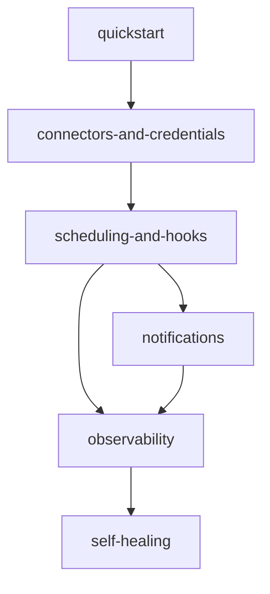

# Operators

Run and govern the sk engine day-to-day — register connectors, wire schedules and webhooks, route notifications, watch the run, and apply repairs when an upstream API drifts.

Start at the quickstart, attach a credential, then put workflows on a schedule or behind a webhook. Notifications and observability tell you when and how a run finished; self-healing turns an upstream break into a ready-to-apply repair.

| Page | What it covers | Link |
|---|---|---|
| Quickstart — Operator | Engine up, admin key minted, first connector registered — three steps to a running engine. | [quickstart.md](quickstart.md) |
| Connectors & Credentials | Register a connector once, attach a credential, and let every workflow reuse it. | [connectors-and-credentials.md](connectors-and-credentials.md) |
| Scheduling & Hooks | Wire scheduled runs that survive restarts and inbound webhooks that trigger workflows. | [scheduling-and-hooks.md](scheduling-and-hooks.md) |
| Notifications | Route run outcomes — succeeded, failed, aborted — to the right people, with per-rule failures logged. | [notifications.md](notifications.md) |
| Chat Channels | Use sk read-only from Google Chat (Slack/Teams to follow): ask, look up, and run workflows from the space your team already lives in. | [chat.md](chat.md) |
| Observability & Resource Limits | Diagnose a run in minutes with metrics, logs, and traces, bounded so no single workflow runs away. | [observability.md](observability.md) |
| Self-Healing in Operations | Detect upstream API breaks during real execution and apply a validated repair instead of a 3am page. | [self-healing.md](self-healing.md) |
| Runtime Dependencies | The one host dependency outside the single binary — Chromium + playwright for SPA-docs discovery — and how it is provisioned. | [runtime-dependencies.md](runtime-dependencies.md) |
