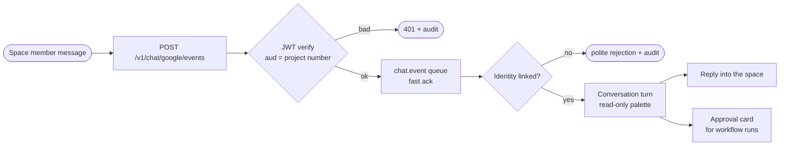

# Chat Channels

**Use sk from the chat your team already lives in.** Link a Google Chat
space (Slack and Microsoft Teams follow the same model) and every
member you approve can ask questions, look up workflows, skills,
knowledge, and executions, and run saved workflows — with the same
RBAC, confirmation gates, and audit trail as every other surface. The
channel is deliberately **read-only**: nobody can build or change
connectors, workflows, skills, or knowledge sources from chat, no
matter which role their linked account holds.



## What the channel can and cannot do

| Can | Cannot |
|---|---|
| Answer questions (LLM chat with tenant context) | Create or edit connectors, workflows, skills, knowledge sources |
| List/inspect workflows, executions, skills, knowledge, connector metadata, schedules | Call connectors directly (no `call_connector`, probe, test, discover) |
| Run saved workflows — behind RBAC + a confirmation card | Change roles, keys, schedules, or any tenant resource |

The restriction is **channel-scoped, not role-scoped**: an admin who
asks the bot to "create a stripe connector" gets a one-sentence
redirect to the sk CLI or web portal. Enforcement is structural — the
chat surface assembles a fixed read-only tool palette, harness-side
write dispatch refuses mutating intents on this surface, and per-user
RBAC still applies underneath as the second layer.

## Conversation memory: one conversation per space

- **A space (channel) keeps one running conversation.** Every top-level
  message continues it, so the bot remembers the topic across days.
- **A reply inside a thread gets its own focused conversation** —
  threads are sub-topics.
- **A DM with the bot is one continuous personal conversation.**
- Send `/new` (or `/reset`) to drop the binding and start fresh.

Privacy note: all linked members of a space share that space's
conversation history — that is the point of topic memory. Do not
discuss things with the bot in a team space you would not post there
yourself. Each turn still runs under the *sender's* permissions, and
only the person who initiated a workflow-run confirmation can approve
its card.

## Set up Google Chat

Prerequisites: a Google Workspace domain (consumer `@gmail.com`
accounts cannot install custom Chat apps), a GCP project, and a public
HTTPS route to the engine.

1. **GCP project** — enable the *Google Chat API*.
2. **Service account** — create one, download a JSON key; you need
   `client_email` and `private_key`.
3. **Configure the Chat app** (Chat API → *Configuration*):
   - Leave **"Build this Chat app as a Google Workspace add-on"
     UNCHECKED** — sk speaks the classic HTTP-app contract; the add-on
     style uses a different verifier and payload and will not work.
   - App name, avatar URL, description; enable *Interactive features*;
     check *Join spaces and group conversations*.
   - Connection settings: **HTTP endpoint URL** =
     `https://<engine-host>/v1/chat/google/events`.
   - **Authentication Audience: "Project Number"** (not "HTTP endpoint
     URL") — sk verifies inbound JWTs against this audience.
   - Visibility: your domain users (up to 25 testers without a
     Marketplace listing).
4. **Engine config** (restart required):

   ```bash
   sk settings set platform.googlechat.client_email "<sa>@<project>.iam.gserviceaccount.com"
   sk settings set platform.googlechat.private_key "$(cat key.pem)"
   sk settings set platform.googlechat.audience "<project number>"
   ```

5. **Install each space** — add the app to the space in Google Chat,
   then register the space with your tenant (one install per space;
   Google events carry no domain id). The space name is in the
   `added_to_space` audit/log entry, or copy it from the space URL:

   ```bash
   curl -X POST https://<engine-host>/v1/chat/workspaces \
     -H "Authorization: Bearer $SK_ADMIN_KEY" -H "content-type: application/json" \
     -d '{"platform":"google_chat","workspace_id":"spaces/AAAA...",
          "installer_platform_user_id":"users/1234567890"}'
   ```

   No `bot_token` — Google outbound auth uses the app-level service
   account from engine config.

6. **Link members** — unknown senders get a polite rejection and a
   `chat.message.denied` audit row. Link each user (their Google id is
   in that audit row's metadata):

   ```bash
   curl -X POST https://<engine-host>/v1/chat/identities \
     -H "Authorization: Bearer $SK_ADMIN_KEY" -H "content-type: application/json" \
     -d '{"platform":"google_chat","workspace_id":"spaces/AAAA...",
          "platform_user_id":"users/1234567890","user_id":"<subkit-user-uuid>"}'
   ```

## Which role should linked chat users have?

The built-in `enduser` role fits the channel: run + read workflows,
read executions, knowledge, and skills, converse — nothing else. Two
reads are deliberately **not** in `enduser`: `connector:read` (the bot
will refuse "which systems are connected?") and `schedule:read`. If
your chat users should see that metadata, create a custom role =
enduser permissions + `connector:read` + `schedule:read` and link
their identities to users holding it. Admin-linked users get admin
*reads and runs* — never authoring; the channel restriction does not
care about roles.

## Slash commands

| Command | Effect |
|---|---|
| `/subkit chat <prompt>` (or just mention the bot) | Continue the space conversation |
| `/subkit run <workflow-slug>` | Run a saved workflow — same RBAC + confirmation card as asking in prose |
| `/new` or `/reset` | Start a fresh conversation for this space/thread |

## Troubleshooting

| Symptom | Look at |
|---|---|
| Bot never answers | Engine log `chat` module; `CHAT_WORKSPACE_HYDRATE_SKIPPED` audit (`google_credentials_unset` = config incomplete) |
| 401 on every event | Authentication Audience must be "Project Number" and match `platform.googlechat.audience`; app must be classic-style, not add-on |
| "Your chat account isn't linked" | `chat.message.denied` audit (`identity_not_linked`) carries the sender's `users/<id>` for the link call |
| Space stopped answering after the app was removed/re-added | Removal drops the space's session bindings by design; re-adding starts a fresh conversation |
| User clicks a confirmation card, nothing happens | Only the requester can confirm (`actor_not_owner` audit); the clicking user gets an in-channel note |

## Slack and Microsoft Teams

The same channel contract (read-only palette, space memory, identity
linking, confirmation cards) applies to Slack and Teams; their
activation is tracked separately. Slack's adapter (signing-secret
verification, Block Kit, modals) already ships — setup docs land with
its rollout.
