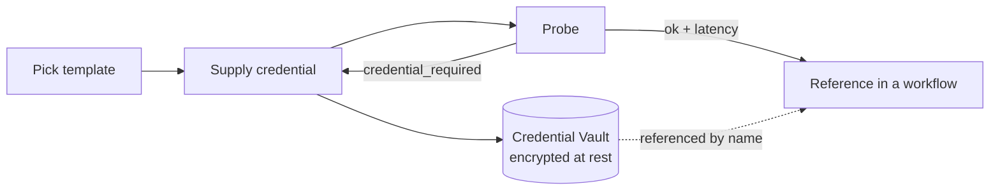
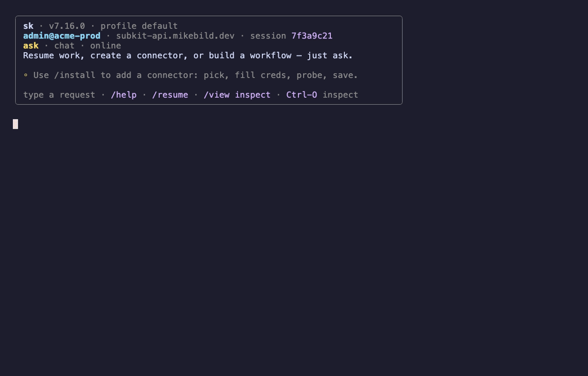

# Connectors & Credentials (operator guide)

**Connect a system once, reuse it everywhere — and the credential is never exposed.**
Operators attach a credential to a connector a single time; every workflow then
references that connector by name. Secrets stay encrypted in the vault, out of
logs, out of LLM context, and out of every response body.

> **Audience:** Operators registering connectors, managing credentials, and
> keeping integrations healthy in production.

This is the operational slice of the connector subsystem: attach and rotate
credentials, test connectivity on demand, invoke an endpoint ad-hoc, and run the
vendor-drift sweep. For the full conceptual model — drivers, templates, the
catalog, schema-version drift — see
[Connectors & Integration](../concepts/connectors.md).

## The onboarding path



| Step | What you do | What the engine does |
|---|---|---|
| Pick template | Match a vendor or URL to a connector template | Pre-fills driver, auth pattern, endpoints |
| Supply credential | `credentials set` once | Encrypts to vault, returns a reference, never the value |
| Probe | `connectors test` | Authenticates, reports status + latency |
| Reference | Name the connector in a workflow step | Applies the saved credential at run time |



---

## Authentication and credential management

sk supports the authentication patterns enterprise systems actually use.

| Pattern | Notes |
|---|---|
| API key | `bearer`, `header`, or `query` placement |
| OAuth2 | Authorisation-code and client-credentials flows |
| Basic auth | Username / password |
| AWS SigV4 | Signed requests |
| Custom header | Arbitrary scheme |

**OAuth2 is fully managed.** Configure the connector once; the engine handles
token refresh, expiry detection, and rotation automatically. No workflow ever
manages token lifecycle.

**Secrets live only in the Credential Vault** — encrypted at rest, never logged,
never exposed outside the engine. Workflows and steps reference credentials by
name, not by value. The full vault model and master-key rotation procedure are in
[Credentials & Keys](../admins/credentials-and-keys.md).

**End-User Credentials** extend this for multi-user scenarios: an individual user
supplies their own credentials, and the platform acts as that user when executing
on their behalf — proper delegation, not credential sharing.

Attach a credential from the CLI:

```bash
sk connectors credentials set <CONNECTOR_ID> --mode bearer --token sk_live_…
#   modes: bearer | header | query | basic | aws_sigv4 | none
sk connectors credentials list <CONNECTOR_ID>
```

## Health and validation

Every connector can be tested independently of any workflow. The engine validates
the connection, authenticates with the configured credentials, and reports the
result plus connection latency. Connector tests and workflow request steps share
the same request-execution path, so a passing test reflects the exact transport a
workflow will use.

```bash
sk connectors test <CONNECTOR_ID>   # re-probe connectivity
```

A draft connector with no saved credential cannot be probed: the probe path
returns a structured `credential_required` envelope rather than silently sending
an unauthenticated request.

## Ad-hoc invocation

Once a connector is persisted, invoke any endpoint against it — for sampling,
pagination validation, or response-shape inspection — without authoring a
workflow. The conversational `call_connector` tool and the matching
`POST /v1/connectors/{id}/call` route apply the saved credential, emit a
`connector.invoked` audit row, and return status, headers, body, latency, and a
truncation flag.

```bash
curl -X POST "$SK_BASE_URL/v1/connectors/$CONNECTOR_ID/call" \
  -H "Authorization: Bearer $SK_API_KEY" \
  -H "Content-Type: application/json" \
  -d '{ "method": "GET", "path": "/v2/droplets", "query": { "per_page": 10 } }'
```

| Driver | `call_connector` |
|---|---|
| HTTP | Supported |
| GraphQL | Supported |
| Postgres / S3 / SQL Server / file-transfer | Returns `driver_not_supported_for_call_connector`, points to workflow authoring |

## Keeping a fleet healthy

Drift is detected from actual execution results, not periodic polling — a
connector that worked last month surfaces drift the moment a real run hits a
changed response shape. That drift feeds the operator-reviewed repair loop in
[Self-healing](./self-healing.md).

To proactively re-verify templates against live vendor APIs, run the vendor-drift
sweep documented in
[Connectors & Integration → Vendor-drift Sweep](../concepts/connectors.md#vendor-drift-sweep).

---

## Further reading

- [Connectors & Integration](../concepts/connectors.md) — the full conceptual model and route surface.
- [Credentials & Keys](../admins/credentials-and-keys.md) — the credential vault and rotation.
- [Self-healing](./self-healing.md) — how connector drift becomes an operator-reviewed Patch Candidate.
