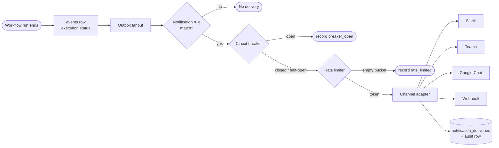

# Notifications

**Operators hear about what matters, not noise.** When a workflow run
ends — succeeded, failed, or aborted — the right people learn about it
in the channel they already watch, with rate limits and circuit
breakers keeping a flapping target from drowning out the signal. Less
log-spelunking, faster incident response, a full audit trail of who
was told what.

sk turns engine outbox events into delivered messages, governed by
tenant-scoped rules, with rate limits, circuit breakers, audit, and
RBAC.



## Surface at a glance

| Concept | Where it lives | What it does |
|---|---|---|
| Notification rule | `notification_rules` row | Selects which events go where, with severity + filter |
| Notification channel | `notification_channels` row | Concrete delivery target — Slack workspace+channel, Teams team+channel, Google Chat space, or webhook URL |
| Notification delivery | `notification_deliveries` row | Per-attempt result: `sent`, `rate_limited`, `breaker_open`, `failed`, `skipped` |
| Adapter | `chat/{slack,teams,google_chat}/adapter.ts` + `notifications/channels/webhook.ts` | Talks to the platform |
| Dispatcher | `apps/engine/src/notifications/service.ts` | Matches rules → applies rate limit + breaker → invokes adapter → records audit + delivery row |
| Outbox fanout | `apps/engine/src/webhooks/outbound/fanout.ts` | Drains `events` table → calls `dispatchEvent()` |

## End-to-end flow

| Step | Component | Action |
|---|---|---|
| 1 | `execution/state.ts` | Workflow finishes → writes an `events` row, channel `execution.status`, type `execution.<status>` (`succeeded`, `failed`, `aborted`, `timed_out`, …). |
| 2 | `webhooks/outbound/fanout.ts` | Outbox listener forwards the row → fanout looks up active subscriptions (outbound webhooks) AND active notification rules (chat / webhook notifications). |
| 3 | `notifications/service.ts#dispatchEvent` | Per matching rule, runs the dispatch pipeline below. |

For each matching rule, `dispatchEvent`:

1. resolves (or auto-creates) the `notification_channels` row,
2. checks the circuit breaker (`closed` → continue, `open` → record
   `breaker_open` and skip, `half-open` → trial-fire),
3. acquires a token from the leaky-bucket rate limiter (records
   `rate_limited` when the bucket is empty),
4. resolves an adapter via the registry,
5. invokes `adapter.send()` with a structured `ChatDelivery`,
6. records a `notification_deliveries` row + an audit row,
7. updates the breaker state from the outcome (`closed → open` after
   `FAILURE_THRESHOLD` consecutive failures; `half-open → closed` on
   first success).

> The dispatcher always resolves. Per-rule failures are logged and
> recorded, never thrown — a misconfigured rule cannot block other
> deliveries.

## Channels

### Chat (Slack, Teams, Google Chat)

The chat adapters under `apps/engine/src/chat/` ship as full peers —
they verify inbound webhooks, normalize platform events, and post
outbound messages. The notification subsystem reuses the same `send()`
surface to deliver completion signals to the operator's chat
workspace.

A rule creates its channel row on its first delivery, as a Slack channel.
To deliver through Teams or Google Chat, or to set a channel's default
severity or rate limit up front, create the channel from the CLI with its
platform and the same workspace + channel pair the rule targets:

```sh
sk notifications channels create --platform slack --workspace-id T0123 --channel-id C0456 \
  --severity error --rate-limit 20
```

`--severity` (default `info`) and `--rate-limit` (deliveries per minute,
default `60`) are optional.

### Webhook (`notifications/channels/webhook.ts`)

For tenants that prefer a generic HTTP endpoint over a chat platform.

| Behaviour | Detail |
|---|---|
| Payload | POSTs JSON `{ tenant_id, workspace_id, channel_id, kind, text }` |
| Headers | `content-type: application/json`, `x-subkit-notification: 1`, `x-subkit-attempt: <n>`, optional `x-subkit-secret` shared secret |
| Retry | At most `WEBHOOK_MAX_ATTEMPTS` tries (default 3), exponential backoff capped at `WEBHOOK_BACKOFF_CAP_MS` (30 s) |
| Backpressure | Honours `Retry-After` on `429` / `503` responses |
| Terminal errors | Non-`429` `4xx` treated as terminal — retrying a mis-configured receiver wastes budget |

## Rules

A `notification_rules` row carries:

| Field | Purpose |
|---|---|
| `event_pattern` | Glob matched against the event type (`execution.*`, `execution.failed`, `*`). |
| `workflow_pattern` | Glob matched against `workflow_id` or `workflow_slug` so a rule can scope to a specific workflow family. |
| `severity` | Drives both the platform-side rendering and the per-rule rate limit. |
| `request_source_filter` | Array of sources the rule should fire for. Default: the dispatcher skips `chat`-sourced runs (the conversation already saw the result) and `mcp` runs (the caller is an LLM, not a human). |
| `target_workspace_id` + `target_channel_id` | Point at the channel row to deliver through. |
| `active` | Soft-disable without deleting. |

`event_pattern` also takes a comma-separated list (`execution.failed,patch.proposed`).
Every tenant starts with one rule, `sk CLI inbox (default)`, targeting the reserved
`_cli` / `_inbox` channel. It routes only events a person may have to act on: failed
runs, connector authentication failures, removed connector endpoints, and proposed
repairs. Step events (`execution.step.*`) and routine successes are not routed, so a
running workflow writes no delivery row per step. A run refused before it started,
because a connector it needs must be reconnected, emits `execution.refused` rather than
`execution.failed`: the caller got the refusal straight away, nothing ran, and the refusal
is kept in the audit log. A rule of your own that routes such
events into the inbox records them as `skipped` with reason `not_actionable`: no inbox
row and no `chat.message.sent` audit entry.

Create a rule from the CLI:

```sh
sk notifications rules create --event 'execution.failed' --workspace-id T0123 --channel-id C0456
```

## Rate limiting

Per-channel leaky bucket in
`apps/engine/src/notifications/rate-limit.ts`. Tokens regenerate at
`rate_limit_per_minute / 60 000` ms. When the bucket is empty the
dispatcher records `rate_limited` with the resume time and skips
delivery — the rule's downstream consumer is not stalled by the
limiter.

## Circuit breaker

Per-channel three-state breaker in
`apps/engine/src/notifications/circuit-breaker.ts`:

| State | Effect |
|---|---|
| `closed` | Deliveries proceed. Failure count resets on success. |
| `open` | Dispatcher records `breaker_open` and skips. Auto-flips to half-open after `OPEN_DURATION_MS`. |
| `half-open` | One trial delivery is allowed. Success → `closed`; failure → `open`. |

`FAILURE_THRESHOLD` consecutive failures (default 5) opens the breaker.
The breaker is per-channel, not per-rule — a rule that targets a
healthy channel keeps firing even when an unrelated rule's target is
down.

## RBAC

| Permission | Routes / actions |
|---|---|
| `notification:read` | List/get channels, rules, deliveries; `GET` on every notifications endpoint. |
| `notification:write` | Create/update/delete channels and rules; `POST /v1/notifications/rules/:id/test` (because triggering a synthetic event causes a real outbound delivery and a real audit row). |

Every write through the HTTP routes flows through `auditAwait` so the
audit log carries the actor, the resource, and the changed fields.

## HTTP routes

| Method | Path | Notes |
|---|---|---|
| `GET` | `/v1/notifications/channels` | |
| `POST` | `/v1/notifications/channels` | |
| `PATCH` | `/v1/notifications/channels/:id` | |
| `DELETE` | `/v1/notifications/channels/:id` | |
| `GET` | `/v1/notifications/rules` | |
| `POST` | `/v1/notifications/rules` | |
| `PATCH` | `/v1/notifications/rules/:id` | |
| `DELETE` | `/v1/notifications/rules/:id` | |
| `POST` | `/v1/notifications/rules/:id/test` | Synthesise a notification event and dispatch it through the rule pipeline. Returns the rule-matching, rate-limit, and channel-dispatch outcome so operators can verify a rule end-to-end without waiting for a real workflow run. Audited as `notification_rule.tested`. |
| `GET` | `/v1/notifications/deliveries?limit=&offset=&status=` | |

All routes are Zod-first (see
`apps/engine/src/http/routes/notifications.ts`) and surface in the
generated OpenAPI document.

## Audit actions

| Action | Trigger |
|---|---|
| `notification_channel.created` / `.updated` / `.deleted` | Channel lifecycle |
| `notification_rule.created` / `.updated` / `.deleted` / `.tested` | Rule lifecycle + test |
| `chat.message.sent` | Delivery `sent` |
| `chat.message.denied` | Delivery `rate_limited` or `breaker_open` |
| `webhook.outbound.failed` | Delivery `failed` |

## Observability

| Signal | Detail |
|---|---|
| Counter `chat_delivery_total{platform,status}` | Partitioned by adapter platform and outcome. |
| Counter `webhook_delivery_total{subscription_id,status}` | For the webhook subscriptions surface (parallel system; see [observability](observability.md)). |
| Structured logs (`notifications/service.ts`) | Carry `tenant_id`, `rule_id`, `channel_id`, `event_type`, `status`. |

## What is intentionally not here

| Not built | Why / where instead |
|---|---|
| Per-user notifications | Recipients are channel-targeted; there is no personal-inbox model. |
| Templating DSL | Message text is built from event metadata. A future template field on rules could land here without changing the dispatch contract. |
| In-app notification surface | No dedicated UI inbox; the deliveries table is the authoritative log. |

## Notification payload pattern — what, why, proposal

Notifications are the first place an operator sees the bounded repair
loop in action. A useful incident message answers four questions in a
single delivery, so the operator can decide without opening logs:

| Question | Carries |
|---|---|
| **What** happened | The failure substance — status, surfaced error, timestamp. |
| **Where** it happened | Workflow slug and version, step id, the external endpoint that drifted. Decisive the moment there is more than one workflow, supplier, or tenant: "the script broke" is not enough. |
| **Why** it happened | The drift the connector or driver actually detected — not just the HTTP status — plus the `patch_candidate` reference when the bounded repair loop has already produced one. |
| **How** to act | The Patch Candidate diff, the deterministic dry-run outcome against recorded fixtures, and the operator actions: **approve**, **reject**, **escalate to human**. |

A concrete delivery body — the same shape across every surface:

```json
{
  "what": {
    "occurred_at": "2026-05-27T14:02:11Z",
    "status": "failed",
    "error": "http_422 — unknown field 'sku_external'"
  },
  "where": {
    "workflow_slug": "sync-suppliers",
    "workflow_version": 4,
    "step_id": "pull-supplier-3",
    "endpoint": "supplier-3/inventory"
  },
  "why": {
    "kind": "schema_drift",
    "diff": { "renamed": [{ "from": "sku_external", "to": "sku" }] },
    "patch_candidate_id": "pc_4711"
  },
  "how": {
    "summary": "Map field 'sku_external' → 'sku' in pull-supplier-3 response shape",
    "dryrun": { "fixtures": 12, "passed": 12, "diverged": 0 },
    "actions": ["approve", "reject", "escalate"]
  }
}
```

One payload contract, every surface:

| Surface | Mode | Renders |
|---|---|---|
| Slack / Teams / Google Chat | Push | Platform-native blocks — four sections as headings, operator actions as buttons. |
| Webhook | Push | The JSON verbatim — the receiving system gets the same four-part answer for its own UI. |
| sk CLI — `sk executions tail` | Pull | Live *what* + *where* + *why* as the run progresses. |
| sk CLI — `sk patch-candidates get <id>` | Pull | The *how*, with `sk patch-candidates approve` / `reject` as the actions. |

The point is not the wire format and not the surface. The point is the
conceptual job: the closed learning loop is only as good as the moment
a human can act on it, and acting requires *what*, *where*, *why*, and
*how* in one place. The alternative — a red workflow plus a "go read
the logs" link — pushes the operator into reconstructing all four
questions from scratch, which is where the compounding loop quietly
stalls into a ticket backlog.
