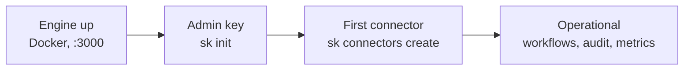
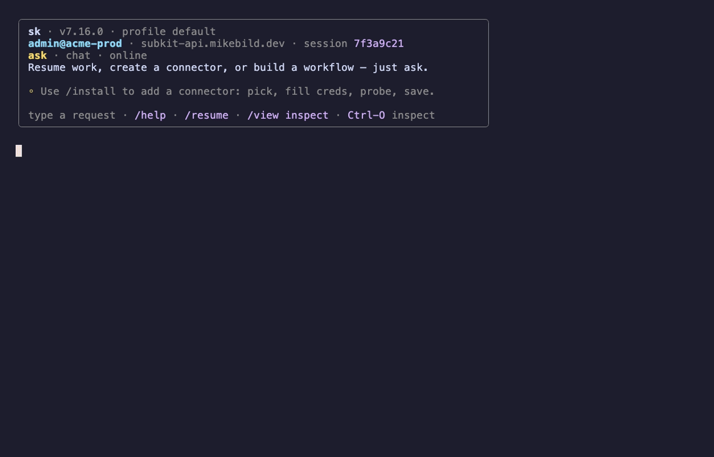

# Quickstart — Operator

In 15 minutes your team has somewhere to put work that should run by itself — live, with a
connected system to point at. Every run that follows is permission-checked, recorded, and
replayable, so you can hand this to people without handing over control.

Three steps get you there: engine up → admin key minted → first connector registered.





> **Brand new to sk?** The [zero-to-running quickstart](../developers/self-host.md) walks a complete beginner from the Docker image through a first connector, workflow, and knowledge article.

> **Just kicking the tires?** The local-dev path (postgres-only compose + `bun run dev`) is in [docs/developers/quickstart.md](../developers/quickstart.md). This page stands up a production engine with the all-in-one Docker image.

## 1. Install the `sk` CLI

The CLI is served by your engine. Once it is running (step 2), install the
version-matched binary straight from it:

```bash
curl -fsSL <your-engine-url>/install | bash   # e.g. http://localhost:3000/install
```

Before your engine exists, the all-in-one image also bundles `sk` on the
container PATH — `docker compose exec engine sk …` — so you can drive the engine
without a local install first.

See [docs/developers/input-surfaces.md](../developers/input-surfaces.md) for Windows and manual platform installs. The install script may place a `subkit` compatibility alias on disk; the canonical command surface is `sk`.

## 2. Run the engine (Docker Compose)

sk ships an application-complete image (`mikebild/subkit`) with the engine,
Cockpit, migrations, `sk`, every supported CLI platform artifact, local blob
storage, and Chromium. PostgreSQL is deliberately a separate, mandatory
service. The repository Compose file starts both with version-pinned images:

```bash
docker compose up -d
```

On first boot the engine persists a `MASTER_KEY`, runs migrations against the
external database, and serves the API on `127.0.0.1:3000`. Application files
and database data use separate named volumes. Verify both liveness and
readiness:

```bash
curl -s http://localhost:3000/health | jq
curl -s http://localhost:3000/ready | jq
```

Full guide (managed-DB mode, TLS-fronting, persistence, resource limits): [docs/developers/self-host.md](../developers/self-host.md).

## 3. Create the first tenant + admin key

A fresh engine has no tenants. It prints a one-time bootstrap token to the logs:

```bash
docker compose logs engine 2>&1 | grep 'sk init --token'
```

Complete setup with `sk init` — creates the tenant, mints the admin key, and wires the LLM provider in one shot (the bundled CLI runs inside the container):

```bash
docker compose exec engine sk init --token <token> \
  --admin-email you@example.com \
  --tenant-name "My Org" \
  --llm-provider anthropic \
  --llm-api-key sk-ant-…
```

To get a full admin key you can paste into a `sk` CLI on your host (tenant slug is the kebab-cased name, e.g. `My Org` → `my-org`):

```bash
docker compose exec engine engine --issue-admin-key --tenant my-org   # printed once
sk login --engine-url http://localhost:3000 --api-key wf_live_…
```

## 4. Register your first connector

```bash
sk connectors create \
  --template stripe \
  --name stripe-prod
```

Pick from 57 connector templates — including Cloudflare and Firebase/Firestore. See
[docs/concepts/connectors.md](../concepts/connectors.md) for how templates, drivers, and
credentials work together.

## 5. You're operational

- `sk workflows list` — see what's defined.
- `sk executions list` — watch executions.
- `sk audit tail` — confirm every state change is recorded.
- `curl -H "Authorization: Bearer <key>" http://localhost:3000/metrics` — Prometheus scrape target.
- `sk settings configure` — interactive form for every runtime config leaf (database, LLM provider, observability, etc.). See [`subkit.config.example.json`](../../subkit.config.example.json) at the repo root for the full schema with defaults.

## How `curl /install | bash` works against your engine

The engine serves install artifacts at `/install/sk-:platform-:arch`, `/install/agent-:platform-:arch`, and `/install/sha256sums`. Anyone who can reach your engine URL can install the CLI:

```bash
curl -fsSL https://my-engine.example.com/install | bash
```

The script probes `${ENGINE_URL}/install/sk-${os}-${arch}` first; on `200` it streams from there with `x-subkit-sha256` verification against `${ENGINE_URL}/install/sha256sums`. The all-in-one Docker image bundles these binaries; for a systemd deploy, stage them into `SUBKIT_BINARIES_DIR` (see [operators/deploy.md](deploy.md)). On `404` the script falls back to a GitHub Release, which only works when the repository is public — while it is private the engine must serve the binaries itself, so bundling/staging is what makes the one-liner work. Either way `~/.subkit/bin/sk` matches the engine's running version exactly — no version drift.

## Next steps

- [docs/concepts/connectors.md](../concepts/connectors.md) — connector management, credentials, and OAuth2.
- [docs/admins/rbac-and-roles.md](../admins/rbac-and-roles.md) — RBAC, identity setup (OIDC/SSO), API key rotation, and Before-Request Hooks.
- [docs/operators/observability.md](./observability.md) — observability, resource limits, self-healing, and backup strategy.
