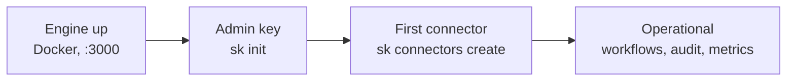

# Quickstart — Operator

**Outcome: a governed, audited automation engine your whole team can use — live in production in 15 minutes.** Every workflow run is permission-checked, recorded, and replayable, so you ship automation without trading away control.

Three steps get you there: engine up → admin key minted → first connector registered.




> **Brand new to sk?** The [zero-to-running quickstart](../developers/self-host.md) walks a complete beginner from the Docker image through a first connector, workflow, and knowledge article.

> **Just kicking the tires?** The local-dev path (postgres-only compose + `bun run dev`) is in [docs/developers/quickstart.md](../developers/quickstart.md). This page stands up a production engine with the all-in-one Docker image.

## 1. Install the `sk` CLI

```bash
curl -fsSL https://raw.githubusercontent.com/mikebild/subkit/main/scripts/install.sh | bash
```

See [docs/developers/input-surfaces.md](../developers/input-surfaces.md) for Windows and manual platform installs. The install script may place a `subkit` compatibility alias on disk; the canonical command surface is `sk`.

## 2. Run the engine (Docker)

sk ships an all-in-one image (`mikebild/subkit`) that bundles the engine + PostgreSQL:

```bash
docker run -d --name subkit -p 3000:3000 -v subkit-data:/data mikebild/subkit:latest
```

On first boot it initializes Postgres, persists a `MASTER_KEY`, runs migrations, and serves the API on `:3000`. The `subkit-data` volume holds all state. Verify:

```bash
curl -s http://localhost:3000/v1/health | jq
```

Full guide (external-DB mode, TLS-fronting, persistence, resource limits): [docs/developers/self-host.md](../developers/self-host.md).

## 3. Create the first tenant + admin key

A fresh engine has no tenants. It prints a one-time bootstrap token to the logs:

```bash
docker logs subkit 2>&1 | grep 'sk init --token'
```

Complete setup with `sk init` — creates the tenant, mints the admin key, and wires the LLM provider in one shot (the bundled CLI runs inside the container):

```bash
docker exec subkit sk init --token <token> \
  --admin-email you@example.com \
  --tenant-name "My Org" \
  --llm-provider anthropic \
  --llm-api-key sk-ant-…
```

To get a full admin key you can paste into a `sk` CLI on your host (tenant slug is the kebab-cased name, e.g. `My Org` → `my-org`):

```bash
docker exec subkit engine --issue-admin-key --tenant my-org   # printed once
sk login --engine-url http://localhost:3000 --api-key wf_live_…
```

## 4. Register your first connector

```bash
sk connectors create \
  --template stripe \
  --name stripe-prod
```

Pick from 55 connector templates — see [docs/concepts/connectors.md](../concepts/connectors.md) for how templates, drivers, and credentials work together.

## 5. You're operational

- `sk workflows list` — see what's defined.
- `sk executions list` — watch executions.
- `sk audit tail` — confirm every state change is recorded.
- `curl -H "Authorization: Bearer <key>" http://localhost:3000/metrics` — Prometheus scrape target.
- `sk settings configure` — interactive form for every runtime config leaf (database, LLM provider, observability, etc.). See [`subkit.config.example.json`](../../subkit.config.example.json) at the repo root for the full schema with defaults.

## How `curl /install | bash` works against your engine

The engine serves install artifacts at `/install/sk-:platform-:arch`, `/install/agent-:platform-:arch`, and `/install/sha256sums`. Anyone who can reach your engine URL can install the CLI:

```bash
curl -fsSL https://my-engine.example.com/install | bash
```

The script probes `${ENGINE_URL}/install/sk-${os}-${arch}` first; on `200` it streams from there with `x-subkit-sha256` verification against `${ENGINE_URL}/install/sha256sums`. On `404` (the case for systemd-deployed engines that don't bundle CLI binaries on the host), the script falls back to the matching GitHub Release. Either way `~/.subkit/bin/sk` matches the engine's running version exactly — no version drift.

## Next steps

- [docs/concepts/connectors.md](../concepts/connectors.md) — connector management, credentials, and OAuth2.
- [docs/admins/rbac-and-roles.md](../admins/rbac-and-roles.md) — RBAC, identity setup (OIDC/SSO), API key rotation, and Before-Request Hooks.
- [docs/operators/observability.md](./observability.md) — observability, resource limits, self-healing, and backup strategy.
