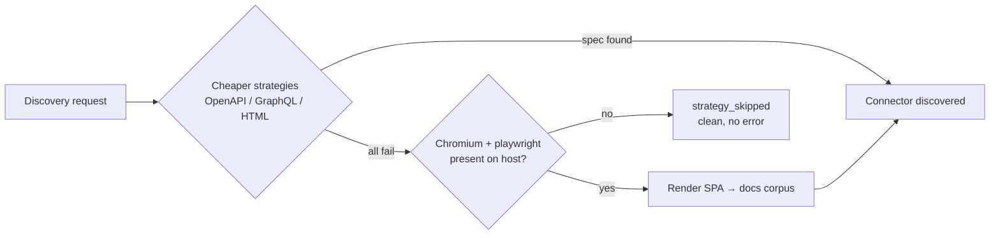

# Runtime Dependencies

> **Audience:** SREs, platform engineers, operators running sk in production

Discovery works against every documentation site, including the ones that render themselves in JavaScript — provided one thing is installed on the host. The engine ships as a single self-contained binary, with exactly one exception: rendering an SPA documentation site needs a real browser. This page covers that dependency, why it exists, and how to provision it so the strategy actually runs in production instead of quietly skipping itself.

## What needs a host dependency

The engine is a `bun build --compile` single binary: no Node, no runtime install, no container spawning. Everything it needs is inside the binary — with **one** exception.

| Dependency | Used by | Required? | If absent |
|---|---|---|---|
| **Chromium + the `playwright` package** | The SPA-docs connector-discovery strategy (`connectors/discovery/playwright-crawl.ts`) | Optional | The strategy self-skips with a clean `strategy_skipped`; the engine boots and serves normally — only documentation sites that need a rendered DOM become undiscoverable |

Nothing else in the engine reaches outside the binary. Postgres and Caddy are separate services, not engine dependencies.

## Why a browser, and why on disk

Connector discovery tries cheap strategies first (OpenAPI specs, GraphQL introspection, static HTML). When a documentation site renders entirely client-side — an SPA that ships no machine-readable spec and no server-rendered HTML — the only way to read it is to render it. The last-resort strategy launches **headless Chromium** via [Playwright](https://playwright.dev), renders the page, and extracts a docs corpus.

Because the engine is compiled, a bare `import("playwright")` resolves against the embedded virtual filesystem (`bunfs`) and fails — playwright is intentionally **not** bundled into the binary. So the runtime loads playwright from an **on-disk** install via an absolute path, and launches a Chromium build that was downloaded to a fixed location.

## How the engine finds it

Two environment variables wire the binary to the on-disk install. The production systemd unit sets both:

| Variable | Points at | Notes |
|---|---|---|
| `SK_PLAYWRIGHT_ENTRY` | The absolute path to the playwright package **entry file** (e.g. `…/node_modules/playwright/index.mjs`) | The runtime dynamic import reads this. Bare `playwright` is kept only as the dev fallback when running via `bun run` — it cannot resolve inside the compiled binary. |
| `PLAYWRIGHT_BROWSERS_PATH` | The directory holding the downloaded Chromium build | Module resolution alone is not enough — `chromium.launch()` still needs the browser binary present. |

If `SK_PLAYWRIGHT_ENTRY` is unset or wrong, discovery falls back to the bare specifier, which cannot resolve in the binary, and the strategy self-skips. There is no crash and no wasted run-and-fail — the availability probe is cached.

## Provisioning in production

Provisioning is host-specific and belongs to your deployment tooling, not this repo. A typical one-time setup:

1. Installs the `playwright` package into a fixed directory (`/opt/subkit/playwright`).
2. Downloads the matching Chromium build with `playwright install --with-deps chromium` into a fixed browsers directory (`/opt/subkit/ms-playwright`), pulling the OS libraries headless Chromium needs.
3. The `subkit-engine.service` systemd unit sets `SK_PLAYWRIGHT_ENTRY` and `PLAYWRIGHT_BROWSERS_PATH` to those paths.

The installed playwright version must stay in lockstep with the `playwright` dependency range in the engine's `package.json` — the package and the Chromium download must come from the same version so the browser revision matches the launcher. Make the provisioning step idempotent so re-running it reinstalls the pinned version in place.

> Operators on a host **without** Chromium (local dev, a minimal box, a container image that omits the browser) need do nothing: discovery simply self-skips the SPA-docs strategy and every cheaper strategy still runs. Install the dependency only when you need to discover SPA-only documentation sites.

## Verifying

After a deploy, a discovery run against an SPA documentation site with no cheaper spec should run `playwright-crawl` and return a corpus — `journalctl -u subkit-engine` shows no `playwright_failed`. On a host without the dependency the same run logs `strategy_skipped` instead of a thrown error. See [observability.md](observability.md) for reading discovery outcomes in the run timeline, and [self-healing.md](self-healing.md) for how discovery feeds repair.
