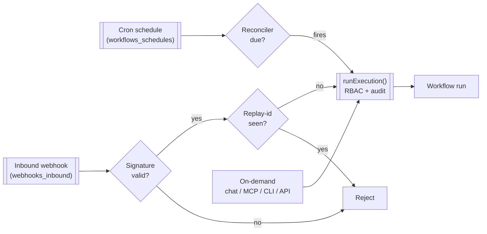
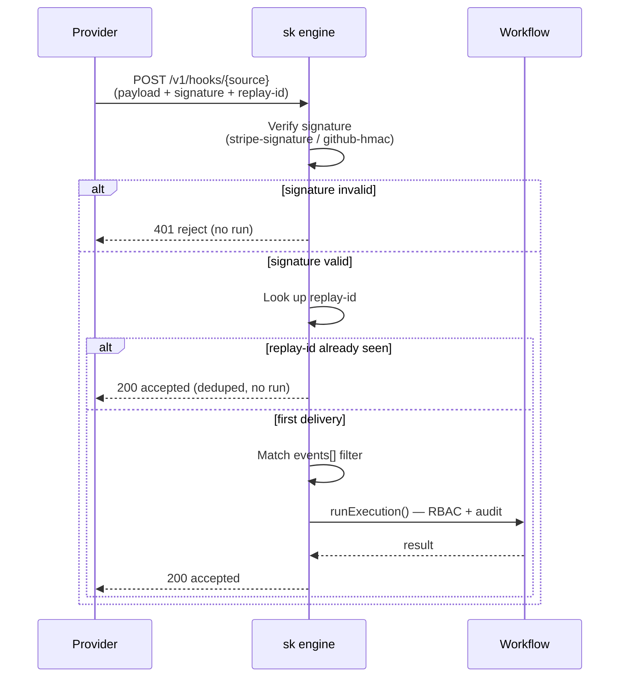
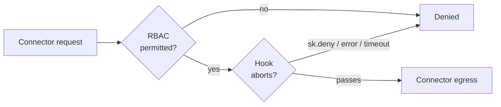

# Scheduling & Hooks (operator guide)

> **Audience:** Operators wiring scheduled runs, webhook triggers, and
> Before-Request Hooks.

**Outcome:** automation that fires on time or on event — verified at the door.
Scheduled runs survive restarts and fire when due; inbound webhooks are
signature-verified and replay-deduplicated before any work happens; and a
Before-Request Hook adds dynamic policy in front of every connector call. One
execution contract, one RBAC check, one audit trail — only the trigger differs.

| Lever | What it buys you |
|---|---|
| **Schedule** | Time-driven runs that are a durable commitment, not a best-effort timer. |
| **Webhook** | Event-driven runs gated by signature verification and replay dedup. |
| **Before-Request Hook** | Per-request policy that static roles cannot express, fail-closed. |

The execution model these sit on top of is in
[Workflows](../concepts/workflows.md); the access-control model the hook
extends is in [RBAC & Roles](../admins/rbac-and-roles.md).

---

## Triggers

`WorkflowDef.trigger` is a discriminated union over `kind`. Omitting the block is
equivalent to `{ kind: "request" }`. All three variants land at the same
`runExecution()` core through the same execution contract, the same RBAC, and the
same audit — only the way the run is initiated differs.

| `kind` | Fields | Behaviour |
|---|---|---|
| `request` | (none) | Default. Run is initiated on demand — chat `run_workflow`, MCP, the CLI, or `POST /v1/executions`. Inline runs complete on the request path; `async: true` is honoured only for `source=saved`. |
| `webhook` | `source` (slug), `events[]` (provider event names; empty = any), `verify` (`stripe-signature` \| `github-hmac` \| `none`) | Reverse-bound to a `webhooks_inbound` row. Inbound posts are signature-verified before any processing; replay-id deduplication suppresses retried deliveries. |
| `schedule` | `cron` (5-field `m h dom mon dow` or `every:N`), `tz` (IANA, default `UTC`); optional `business_days_only`, `skip_dates[]` | Reverse-bound to a `workflows_schedules` row. The reconciler validates the cron at bind time and fires at the operator's local wall-clock time. `business_days_only` skips weekends; `skip_dates` declares holidays/freezes explicitly. A missed firing fires on the next reconciler pass rather than being silently skipped. |

Setting `webhook` or `schedule` reverse-binds the inbound binding or cron schedule
keyed on `(tenant_id, workflow_id)` at save time and removes the binding on delete
or version rotate. The trigger is recorded in every Execution and Audit Log entry
alongside the actor identity envelope.

### Webhook verification & replay dedup

Inbound deliveries are checked **before** any workflow logic runs. Verification
proves the payload came from the declared provider; replay dedup proves it is not
a retried copy of a delivery already accepted.

| Stage | Guarantee |
|---|---|
| Signature verify | Forged or tampered payloads are rejected before processing (`verify: none` opts out — only for trusted-network sources). |
| Replay dedup | Provider retries of an already-accepted delivery are suppressed; the workflow runs at most once per replay-id. |
| Event filter | `events[]` narrows which provider event names trigger a run; empty matches any. |

## Scheduling durability

The scheduler uses a durable job queue so scheduled runs survive engine restarts.
A schedule is a commitment: if the engine was unavailable when a run was due, it
fires when availability is restored. The same queue backs explicitly asynchronous
workflow runs, while synchronous API-initiated runs stay inline on the request
path.

Execution state changes are published through a pub/sub system backed by an outbox
pattern — events are written in the same transaction as the state change that
produced them, so they are never silently lost. Subscribers (CLI live-tail, chat
progress, SSE consumers, outbound webhooks) receive them in real time.

| Property | Behaviour |
|---|---|
| Restart survival | Due-but-unfired runs fire when the engine returns; nothing is silently dropped. |
| Missed firing | Fires on the next reconciler pass, not skipped. |
| Outbox events | Written in the same transaction as the state change — never lost. |

## Before-Request Hooks

A Before-Request Hook is a sandboxed script that runs **before a connector request
executes**. It receives the full request context — caller identity, target
connector, operation type, request parameters — and can enforce policy that static
roles cannot express: block writes during a maintenance window, require approval
for specific production connectors, enforce data-residency constraints, or log
requests matching a pattern.

Hooks run in an isolated QuickJS-WASM sandbox with a strict CPU budget. They
cannot access the network, the file system, or the database. An error or timeout
fails **closed**: the request is denied. Every hook execution is recorded in the
audit log.

**Evaluation order:** RBAC is evaluated first. If the caller has no permission, the
request is denied before the hook is consulted. If RBAC passes, the hook runs; if
it aborts, the request is denied with the hook's reason. Only if both pass does the
request proceed.

A hook is plain sandboxed JavaScript and can use the frozen `sk` standard library
(`sk.deny("reason")`, `sk.http.isMutating(method)`, `sk.get(...)`) — see
[Custom Skills → the sk-Stdlib](../authors/custom-skills.md). The authorization
model the hook layers onto is in [RBAC & Roles](../admins/rbac-and-roles.md).

| Guard | Effect |
|---|---|
| Sandbox | No network, file system, or database access; strict CPU budget. |
| Fail-closed | Error or timeout denies the request. |
| Audit | Every hook execution is recorded. |

---

## Further reading

- [Workflows](../concepts/workflows.md) — the execution model, triggers, versioning, and self-healing.
- [RBAC & Roles](../admins/rbac-and-roles.md) — the access-control model Before-Request Hooks extend.
- [Notifications](./notifications.md) — routing the events these triggers emit.
