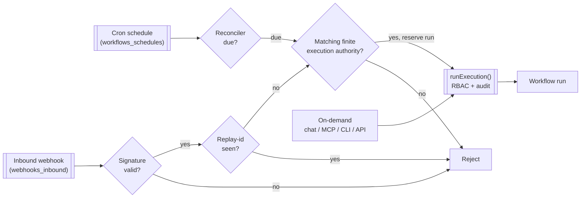
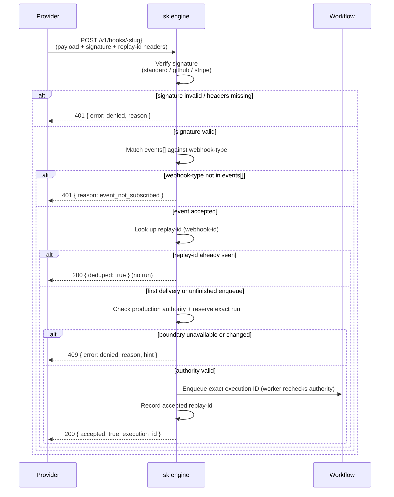
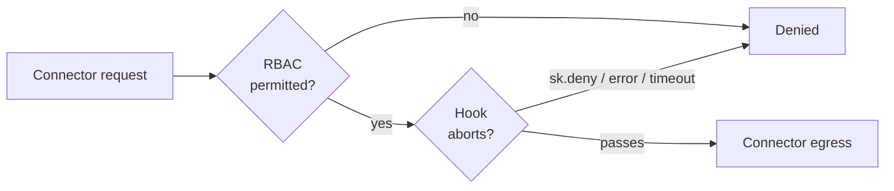

# Scheduling & Hooks (operator guide)

> **Audience:** Operators wiring scheduled runs, webhook triggers, and
> Before-Request Hooks.

Work that runs when it should, whether or not anyone is watching — and nothing gets in
without being checked at the door. Scheduled runs survive a restart and still fire when
due within its approved boundary; an inbound webhook needs both verified ingress and
a matching finite execution authority before work starts; and a Before-Request Hook can apply your own policy in front of every
connector call. The trigger is the only thing that differs: one execution contract, one
permission check, one audit trail.

| Lever | What it buys you |
|---|---|
| **Schedule** | Time-driven runs that are a durable commitment, not a best-effort timer. |
| **Webhook** | Event-driven runs gated by signature verification, replay dedup and production execution authority. |
| **Before-Request Hook** | Per-request policy that static roles cannot express, fail-closed. |

The execution model these sit on top of is in
[Workflows](../concepts/workflows.md); the access-control model the hook
extends is in [RBAC & Roles](../admins/rbac-and-roles.md).



---

## Triggers

`WorkflowDef.trigger` is a discriminated union over `kind`. Omitting the block is
equivalent to `{ kind: "request" }`. All three variants land at the same
`runExecution()` core through the same execution contract, the same RBAC, and the
same audit — only the way the run is initiated differs.

| `kind` | Fields | Behaviour |
|---|---|---|
| `request` | (none) | Default. Run is initiated on demand — chat `run_workflow`, MCP, the CLI, or `POST /v1/executions`. Inline runs complete on the request path; `async: true` is honoured only for `source=saved`. |
| `webhook` | `source` (slug), `events[]` (provider event names; empty = any), `verify` (`stripe-signature` \| `github-hmac` \| `none`) | Reverse-bound to a `webhooks_inbound` row. Inbound posts are signature-verified before any processing; replay-id deduplication suppresses retried deliveries. |
| `schedule` | `cron` (5-field `m h dom mon dow` or `every:N`), `tz` (IANA, default `UTC`); optional `execution_mode` (`dev` \| `prod`, default `prod`), `business_days_only`, `skip_dates[]` | Reverse-bound to a `workflows_schedules` row. The reconciler validates the cron at bind time and fires at the operator's local wall-clock time. Scheduled automation targets production connectors by default; set `execution_mode: dev` explicitly for an authoring loop. `business_days_only` skips weekends; `skip_dates` declares holidays/freezes explicitly. A missed firing fires on the next reconciler pass rather than being silently skipped. |

The execution mode is persisted on the schedule and copied into every queued
execution. It is not inferred from connector availability. This keeps the immutable
execution record, connector resolution, audit trail, and warning semantics aligned:
a production schedule records `execution_mode=prod` and resolves production
connectors without a misleading environment-fallback warning.

Setting `webhook` or `schedule` reverse-binds the inbound binding or cron schedule
keyed on `(tenant_id, workflow_id)` at save time and removes the binding on delete
or version rotate. The trigger is recorded in every Execution and Audit Log entry
alongside the actor identity envelope.

> **The binding is a mirror of the trigger block — dropping the trigger DELETES the
> hook (and its signing secret).** Reverse-bind is not additive. Every workflow save
> reconciles the `webhooks_inbound` row to whatever `trigger` the saved definition
> carries (`applyTriggerBindings` in `apps/engine/src/workflows/trigger-bindings.ts`):
>
> | Save the workflow with… | Effect on the inbound hook |
> |---|---|
> | `trigger: { kind: "webhook", … }` (unchanged) | No-op — the existing row is preserved, secret intact. |
> | `trigger: { kind: "webhook", … }` (verify / source / events changed) | Row rewritten in place; the signing secret is **preserved**. |
> | `trigger` removed, or changed to `{ kind: "request" }` / `{ kind: "schedule" }` | **Row is DELETED.** The encrypted signing secret is destroyed with it. |
> | Workflow deleted or version-rotated | Row is DELETED. |
>
> The practical trap: an operator edits an existing webhook-triggered workflow — say
> to tweak a step — and re-submits a definition that no longer includes the `trigger`
> block (a common mistake when hand-editing or when a tool round-trips the def without
> it). That save silently tears down the public ingress URL and its secret. The upstream
> provider keeps POSTing to a slug that now returns `404 not_found`. Re-adding the
> webhook trigger recreates the row **with a fresh random placeholder secret** — you
> must re-provision the shared secret (see the wiring recipe below). Always carry the
> full `trigger` block through every edit of a webhook- or schedule-triggered workflow.

### Webhook verification & replay dedup

Inbound deliveries are checked **before** any workflow logic runs. Verification
proves the payload came from the declared provider; replay dedup proves it is not
a retried copy of a delivery already accepted.



| Stage | Guarantee |
|---|---|
| Signature verify | Forged or tampered payloads are rejected before processing (`verify: none` opts out — only for trusted-network sources). |
| Event filter | `events[]` narrows which provider event names trigger a run; empty matches any. Checked **after** signature, **before** dedup. |
| Execution authority | An active version, exact effect manifest, production environment, validity window and remaining run allowance are required. A signature or `verify: none` never creates authority. |
| Replay dedup | Accepted deliveries are suppressed. Concurrent retries and interrupted enqueueing reuse the same charged execution and queue job UUID, not an additional allowance. Foreign side effects are not promised exactly once. |

### Finite authority for webhook runs

In the workflow Cockpit, review the active version's production effect manifest,
targets and credentials, then grant an explicit finite validity window and run
limit. Existing active workflows receive no authority automatically. Both direct
CRUD bindings and reverse-bound triggers use this check; a development grant
cannot authorize a production webhook. No new configuration file or service is
needed. Expiry, revocation, exhausted limits or changed version/configuration stop
new runs. The worker repeats the authority check before external dispatch.

The first reusable-authority version accepts only statically bounded requests.
Runtime substitutions in request data, unknown effects and destructive operations
require concrete-run review and are denied at this unattended ingress with
`execution_authority_required`; the ingress does not create that review itself.
This is an explicit remaining workflow, not permission to bypass the denial.

A denial does not mark the event as accepted. After correcting and reviewing the
boundary, explicitly redeliver it if the provider does not retry. A queue failure
also leaves the replay receipt unconsumed, but retains the original reservation.
A retry uses that exact execution and original immutable input. Fresh verified
delivery timestamps/signatures are allowed; a changed event body, type or other
headers cannot replace a pending execution. Completed or already-running
executions are never re-enqueued by delivery replay. Historic replay receipts stay
deduplicated and are not interpreted as new approvals.

The driver is `handleInbound()` in `apps/engine/src/webhooks/inbound/service.ts`; the
individual verifiers live under `apps/engine/src/webhooks/inbound/verifiers/`.

### `verify` → stored verifier mapping (read this before touching the CRUD API)

The `verify` value you write on the **trigger** is NOT the value stored in the
`webhooks_inbound.verifier` column. The reverse-bind step
(`VERIFY_TO_VERIFIER` in `service.ts`) translates it:

| Trigger `verify` | Stored `verifier` | Stored `native_verifier_config` | Verifier that runs at ingress |
|---|---|---|---|
| `stripe-signature` | `stripe` | `{ source, events }` | Stripe (`Stripe-Signature` header) |
| `github-hmac` | `github` | `{ source, events }` | GitHub (`X-Hub-Signature-256` header) |
| `none` | `standard` | `{ source, events, skip: true }` | Standard verifier in **skip** mode — signature check bypassed |

A trigger therefore only ever stores **`standard`, `github` or `stripe`** — never
`none`. The fourth stored verifier, `hmac`, is only created through the CRUD API (see
[Senders with their own HMAC scheme](#senders-with-their-own-hmac-scheme)). `verify: "none"` does not disable the verifier; it selects
the `standard` verifier and sets `native_verifier_config.skip = true`, which makes the
driver synthesize a normalized event (from the `webhook-*` headers, or a body hash)
and skip the signature check. This is the only place `skip` is honored.

> **Do NOT set `verifier: "none"` (or any value outside `standard` / `github` /
> `stripe` / `hmac`) on a `webhooks_inbound` row.** At ingress the driver looks up
> `VERIFIERS[row.verifier]`; an unrecognized value has no verifier, so the request is
> denied with `reason: "unknown_verifier"` and **HTTP 401** before any workflow runs.
> The authenticated CRUD endpoint (`POST /v1/webhooks/inbound`) only accepts
> `verifier ∈ { standard, github, stripe, hmac, custom }` (`custom` is an alias that stores
> `standard`) — a literal `"none"` is rejected by request validation. To reproduce the
> trigger's `verify: "none"` behaviour via CRUD, create the row with
> `verifier: "standard"` and `native_verifier_config: { "skip": true }`.

### Senders with their own HMAC scheme

Some senders sign with a shared-secret HMAC but use neither the Standard Webhooks,
GitHub nor Stripe header layout. Bind them with `verifier: "hmac"` and describe the
sender's scheme in `native_verifier_config.hmac`:

| Field | Required | Meaning |
|---|---|---|
| `signature_header` | yes | Header carrying the signature. |
| `id_header` | yes | Header with a per-delivery id that stays the same across retries — the replay-dedup key. |
| `signature_prefix` | no (`""`) | Literal prefix stripped before decoding, e.g. `v1=`. |
| `encoding` | no (`hex`) | Digest encoding: `hex` or `base64`. |
| `signed_payload` | no (`{body}`) | Template of the signed string. Placeholders: `{timestamp}`, `{id}`, `{body}` (required). |
| `timestamp_header` | when the template uses `{timestamp}` | Unix-seconds header; turns on the replay window. |
| `tolerance_seconds` | no (`300`) | Allowed clock skew for `timestamp_header`. |
| `type_header` / `type_field` | no | Event type from a header, or from a top-level field of the JSON body. Without either the type is `"unknown"`. |

The digest is always HMAC-SHA256 with the stored secret as the key, computed over the
raw body exactly as received. `POST /v1/webhooks/inbound` rejects an invalid `hmac`
object with **400**, so a misconfigured binding is never stored. Example for a sender
that sends `X-Example-Signature: v1=<hex(HMAC(secret, "v1:<timestamp>:<body>"))>`:

```bash
cat > hmac.json <<'JSON'
{
  "hmac": {
    "signature_header": "X-Example-Signature",
    "signature_prefix": "v1=",
    "signed_payload": "v1:{timestamp}:{body}",
    "timestamp_header": "X-Example-Timestamp",
    "id_header": "X-Example-Message-Id",
    "type_field": "eventType"
  }
}
JSON
sk hooks create --slug example-events --workflow-id <workflow-id> \
  --verifier hmac --secret-file ./signing-secret.txt --config-file ./hmac.json
```

The secret is read from a file (`-` for stdin), never from a command-line argument.

### Public ingress: `POST /v1/hooks/{slug}`

The public, unauthenticated ingress is `POST /v1/hooks/{slug}` — the **signature is
the auth**, so it carries no bearer token. Two things about `{slug}` catch people out:

- **The slug is the stored `webhooks_inbound.slug`, not the trigger's `source`
  field.** For a reverse-bound trigger the engine derives the slug as
  `wf-<workflow-slug>` (`slugFromWorkflow` in `service.ts`, truncated to 64 chars). The
  trigger's `source` is only a provider label stored inside
  `native_verifier_config.source`; it is **not** part of the URL. So a workflow with
  slug `payment-sync` is reachable at `POST /v1/hooks/wf-payment-sync`. Confirm the
  exact slug via `GET /v1/webhooks/inbound` (or `list_inbound_hooks`).
- CRUD-created bindings use whatever `slug` the operator passed to
  `POST /v1/webhooks/inbound`.

**The default (`verify` = `stripe-signature`/`github-hmac`, or a CRUD `standard` row)
requires the [Standard Webhooks](https://www.standardwebhooks.com) headers** for the
`standard` verifier: `webhook-id`, `webhook-timestamp`, `webhook-signature`. Missing
any of them is denied with `reason: "missing_standard_webhooks_headers"` / 401.

Event-type resolution and the `events[]` filter:

- The engine resolves the event **type** from the **`webhook-type`** header (the
  `standard` verifier; GitHub uses `X-GitHub-Event`, Stripe reads the body `type`). If
  the header is absent, the type defaults to the literal string `"unknown"`.
- If the trigger's `events[]` is non-empty and the resolved type is not in it, the
  request is denied with `reason: "event_not_subscribed"` / 401 — **even when the
  signature is valid**. An empty `events[]` accepts any type. So the `webhook-type`
  the upstream sends must exactly match one of the workflow's `events[]` entries.
- Replay dedup keys on `webhook-id`: a repeated `webhook-id` returns
  `200 { deduped: true }` with no run.

A correct signed request to a `standard`-verifier binding for a workflow subscribed to
`events: ["invoice.paid"]`:

```http
POST /v1/hooks/wf-payment-sync HTTP/1.1
Host: your-engine.example.com
Content-Type: application/json
webhook-id: msg_2eXaMPle01
webhook-timestamp: 1893456000
webhook-type: invoice.paid
webhook-signature: v1,g0Xm9c1nQ0e3s0mEb64SiGnAtUrE=

{"invoice":"in_123","amount":4200}
```

- `webhook-signature` is `v1,<base64(HMAC-SHA256(secret, "<webhook-id>.<webhook-timestamp>.<raw-body>"))>`.
  The signed base string is the three fields joined by `.` — the exact raw body bytes,
  unmodified.
- `webhook-timestamp` is Unix **seconds** and must be within ±5 minutes of engine time,
  else `reason: "timestamp_outside_window"`.
- `webhook-type` must be one of the workflow's `events[]` (here `invoice.paid`), else
  `event_not_subscribed`.

For `verify: "none"` (skip) bindings no `webhook-signature` is required, but you should
still send `webhook-id` (for dedup) and `webhook-type` (the `events[]` filter still
applies in skip mode). With no `webhook-id`, the engine derives a replay id from a hash
of the body. On the skip path the stored signing secret is never decrypted, so a skip
binding whose secret is still the reverse-bind placeholder (never rotated) accepts
traffic normally — a malformed placeholder can no longer surface as an HTTP 500.

Denial reasons you may see as `401 { error: "denied", reason: … }`:

| `reason` | Meaning |
|---|---|
| `not_found` (404) | No `webhooks_inbound` row for that slug — often the binding was deleted by dropping the trigger. |
| `missing_standard_webhooks_headers` | One of `webhook-id` / `webhook-timestamp` / `webhook-signature` absent. |
| `bad_signature` | HMAC did not match — wrong or unsynced shared secret. |
| `timestamp_outside_window` | `webhook-timestamp` more than 5 min from engine clock. |
| `missing_hmac_headers` | `hmac` verifier: the configured signature or id header is absent. |
| `bad_hmac_signature_format` | `hmac` verifier: wrong prefix, or the digest is not valid `hex`/`base64` of the right length. |
| `bad_hmac_config` | `hmac` verifier: the stored `native_verifier_config.hmac` is invalid. |
| `unknown_verifier` | Stored `verifier` is not `standard`/`github`/`stripe`/`hmac` (e.g. someone set `none`). The 401 body includes a `hint` naming the accepted values and the `verify: "none" → standard + skip` mapping. |
| `event_not_subscribed` | `webhook-type` not in the workflow's non-empty `events[]`. |
| `inactive` | The binding row is disabled (`active = false`). |

Execution-boundary denials use **409**, not a signature-authentication failure:
`execution_authority_unavailable`, `execution_authority_required`,
`execution_authority_changed`, `execution_boundary_mismatch`,
`workflow_version_not_active` or `input_schema_violation`. The response includes
an actionable review hint; no new execution is admitted for an invalid boundary.

### End-to-end wiring recipe (upstream provider → sk ingress)

Wiring an upstream system (e.g. a headless CMS emitting Standard-Webhooks-signed
events) to an sk workflow:

1. **Create the inbound binding with the right verifier.** Pick by how the upstream
   signs, and note this determines which authoring path you use:
   - **Stripe / GitHub:** author the workflow with a `webhook` trigger and
     `verify: "stripe-signature"` or `"github-hmac"`. Saving reverse-binds the
     `webhooks_inbound` row (`verifier` = `stripe` / `github`).
   - **A generic Standard-Webhooks signer (e.g. a headless CMS):** the trigger `verify`
     enum has **no `standard` value**, so you cannot get a signature-checking
     `standard` binding from the trigger alone (a `webhook` trigger only yields
     `stripe`, `github`, or `standard`+`skip`). Instead create the binding directly on
     the authenticated CRUD surface:
     `POST /v1/webhooks/inbound { slug, workflow_id, verifier: "standard", secret }`.
     That row fires the same `workflow_id` at ingress; it just isn't reverse-bound to a
     trigger block, so it is not torn down by workflow edits.
   - **Trusted-network only:** `verify: "none"` (stored `standard`+`skip`) bypasses the
     signature check — do not use it for a public-internet upstream.
2. **Find the ingress URL.** `GET /v1/webhooks/inbound` (or `list_inbound_hooks`) to
   read the row's `slug`. The public URL is
   `https://<your-engine>/v1/hooks/<slug>` (for a reverse-bound trigger, `slug` =
   `wf-<workflow-slug>`; for a CRUD binding, the `slug` you passed).
3. **Generate one shared secret** — a high-entropy random string. This single secret
   must exist on **both** sides.
4. **Set the secret on the sk side.** For a **CRUD** binding you pass `secret` at
   create time (step 1). For a **reverse-bound trigger** binding the trigger block
   deliberately never carries a secret, so the first bind writes only a random
   **placeholder** secret — you must provision the real one out-of-band
   (`rotateInboundSecret`) or every delivery fails `bad_signature`. Re-adding a dropped
   webhook trigger also re-generates a placeholder, so re-provision after any such
   round-trip.
5. **Register the endpoint on the upstream.** In the upstream system's outbound-webhook config,
   add an endpoint pointing at the sk ingress URL and paste the **same** secret as
   its signing key. It will then sign each delivery
   `v1,<base64(HMAC-SHA256(secret, "<webhook-id>.<webhook-timestamp>.<body>"))>` and set
   the `webhook-type` header to the event name — which must match one of the workflow's
   `events[]`.
6. **Review the production execution authority.** Activate the exact workflow
   version and separately approve its manifest, finite validity and run limit in
   the workflow Cockpit. A trigger binding or signing secret grants no live runs.
7. **Verify.** Trigger an upstream event and confirm a `200 { accepted: true }` plus a
   new execution (`webhook.trigger.fired` in the Audit Log). A `bad_signature` means the
   two secrets diverged; `event_not_subscribed` means the upstream's `webhook-type` is
   not in `events[]`.

Because verification is HMAC over a shared secret (symmetric), the secret on the
upstream signer and the secret on the sk row must be byte-identical. Rotate on both
sides together; a mismatch fails closed (`bad_signature` / 401), never open.

## Scheduling durability

The scheduler uses a durable job queue so scheduled runs survive engine restarts.
A schedule is a commitment: if the engine was unavailable when a run was due, it
fires when availability is restored. The same queue backs explicitly asynchronous
workflow runs, while synchronous API-initiated runs stay inline on the request
path.

For asynchronous REST runs that explicitly select an `execution_authority_id`,
an idempotency key is required. Queue retries reuse both the reserved execution
and its queue job ID, without spending another run. Before enqueueing, SubKit
checks that the stored authority is still live and matches the active version
and manifest. A revoked, expired, or changed boundary returns a conflict instead
of enqueueing the retry. Runtime checks still apply before external effects;
this does not promise exactly-once delivery to external systems.

Execution state changes are published through a pub/sub system backed by an outbox
pattern — events are written in the same transaction as the state change that
produced them, so they are never silently lost. Subscribers (CLI live-tail, chat
progress, SSE consumers, outbound webhooks) receive them in real time.

| Property | Behaviour |
|---|---|
| Restart survival | Due-but-unfired runs fire when the engine returns; nothing is silently dropped. |
| Missed firing | Fires on the next reconciler pass, not skipped. |
| Outbox events | Written in the same transaction as the state change — never lost. |

## Before-Request Hooks

A Before-Request Hook is a sandboxed script that runs **before a connector request
executes**. It receives the full request context — caller identity, target
connector, operation type, request parameters — and can enforce policy that static
roles cannot express: block writes during a maintenance window, require approval
for specific production connectors, enforce data-residency constraints, or log
requests matching a pattern.

Hooks run in an isolated QuickJS-WASM sandbox with a strict CPU budget. They
cannot access the network, the file system, or the database. An error or timeout
fails **closed**: the request is denied. Every hook execution is recorded in the
audit log.

**Evaluation order:** RBAC is evaluated first. If the caller has no permission, the
request is denied before the hook is consulted. If RBAC passes, the hook runs; if
it aborts, the request is denied with the hook's reason. Only if both pass does the
request proceed.



A hook is plain sandboxed JavaScript and can use the frozen `sk` standard library
(`sk.deny("reason")`, `sk.http.isMutating(method)`, `sk.get(...)`) — see
[Custom Skills → the sk-Stdlib](../authors/custom-skills.md). The authorization
model the hook layers onto is in [RBAC & Roles](../admins/rbac-and-roles.md).

| Guard | Effect |
|---|---|
| Sandbox | No network, file system, or database access; strict CPU budget. |
| Fail-closed | Error or timeout denies the request. |
| Audit | Every hook execution is recorded. |

---

## Further reading

- [Workflows](../concepts/workflows.md) — the execution model, triggers, versioning, and self-healing.
- [RBAC & Roles](../admins/rbac-and-roles.md) — the access-control model Before-Request Hooks extend.
- [Notifications](./notifications.md) — routing the events these triggers emit.
