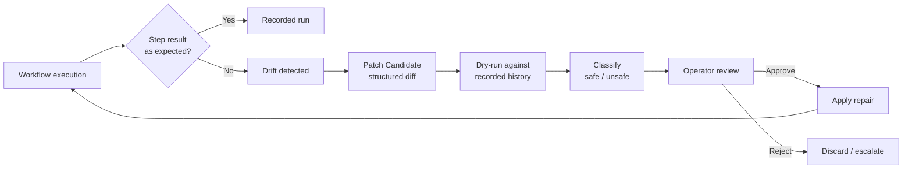

# Drift-assisted repair in operations

> **Audience:** SREs, platform engineers, operators running sk in production

When a vendor renames a field, moves an endpoint, or starts requiring a parameter, you get a repair to review — not a 3am page and a diagnosis from scratch. The engine notices the break during a real run, works out the smallest safe change, tests it against recordings of runs that used to work, and hands you the result to approve.

## Why it matters

External APIs change constantly. Without detection, a workflow that worked yesterday fails today — loudly or silently — and the cleanup is yours. This turns an open-ended incident into one review-and-apply decision.

> **A note on names.** The prose calls this *drift-assisted repair*. The codebase, the CLI (`sk self-healing`), and the log events keep the older technical name *self-healing* — same thing, stable identifiers that are deliberately not renamed.

| Without self-healing | With self-healing |
|---|---|
| Drift surfaces as a mystery failure | Drift surfaces as a structured diff |
| Operator reverse-engineers the change | Engine classifies the change as safe / unsafe |
| Fix is hand-written and untested | Fix is dry-run against recorded history |
| Separate health-check jobs needed | Detected during real work, when it matters |

## The bounded repair loop

Drift is caught during normal execution — no separate health check, no manual test run. The operator stays in control: nothing is applied without a decision.

## Stages

| Stage | What happens |
|---|---|
| **Execution** | A connector step runs as part of a real workflow. |
| **Drift detect** | The engine spots a discrepancy in the response shape, status, or contract. |
| **Patch Candidate** | A proposed repair is generated with a structured diff of exactly what changed. |
| **Dry-run** | The candidate is validated against recorded execution history before it is offered. |
| **Classify** | The repair is marked safe or unsafe based on the scope of the change. |
| **Operator review** | The operator approves or rejects — one action, not a manual rebuild. |
| **Apply** | On approval, the repair updates the connector and the loop closes. |

## Operator guarantees

- **No silent failure.** Drift becomes a visible, structured signal.
- **No auto-apply.** The operator always decides; sk only proposes.
- **Validated before offered.** Every Patch Candidate is dry-run against real history.
- **Caught early.** Leading-indicator risk signals flag a degrading connector boundary before it fails wholesale — see [Observability](./observability.md).

---

## Further reading

- [Observability & resource limits](./observability.md) — the metrics and risk signals that flag drift early.
- [Workflows](../concepts/workflows.md) — the execution model and the self-healing repair loop (Run → Drift → Patch Candidate → Skill Candidate) in full.

## Reviewing proposed repairs

Proposed repairs appear on the Cockpit's start page, **Today** (German: **Heute**),
the one list of what needs a person. A failing workflow and the repairs waiting for
it are one entry; its **Review** action opens a review sheet over the list, and the
sheet's address (`?review=…`) can be shared or bookmarked. The same list is
available as `GET /v1/attention` and the MCP tool `get_attention`.

The cockpit counts a repair only when it can change the current workflow. Missing
step references, unsupported repairs and repairs that no longer change anything
are not offered for approval. Waiting conversation questions are entries of their
own, and only for the person they ask. Knowledge approval uses **Adopt and
activate** and requires permission to activate skills; previously created draft
skills remain drafts.

In the review sheet, open a repair to see its before/after changes. Approval submits the preview's
`review_digest` as `expected_review_digest`; changed proposals or workflow versions
require a fresh preview. The CLI exposes the preview through
`sk patch-candidates preview <id>` and accepts the digest with
`sk patch-candidates approve <id> --review-digest <digest>`.
An unsuccessful application returns a conflict and does not close the decision.

**Apply and authorize** prepares an immutable version for review, then applies
that correction and grants its exact execution boundary in one transaction.
Preparation alone does not activate or run anything. Review the environment,
targets, effects, expiry and run limit. Active schedules suggest their occurrences
for the next 30 days, capped at 10,000 runs; without schedules the suggestion is
one run within 24 hours. Existing authorities never transfer to a changed version.

Repeated observations update the existing finding within its artifact and step
boundary. Evidence from the same execution or repair counts once. The upgrade
consolidates duplicate evidence and records the consolidation in the audit log;
it does not approve historical proposals or activate existing draft skills.
