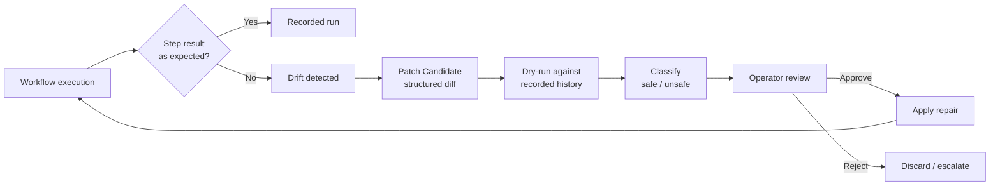

# Drift-assisted repair in operations

> **Audience:** SREs, platform engineers, operators running sk in production

When a vendor renames a field, moves an endpoint, or starts requiring a parameter, you get a repair to review — not a 3am page and a diagnosis from scratch. The engine notices the break during a real run, works out the smallest safe change, tests it against recordings of runs that used to work, and hands you the result to approve.

## Why it matters

External APIs change constantly. Without detection, a workflow that worked yesterday fails today — loudly or silently — and the cleanup is yours. This turns an open-ended incident into one review-and-apply decision.

> **A note on names.** The prose calls this *drift-assisted repair*. The codebase, the CLI (`sk self-healing`), and the log events keep the older technical name *self-healing* — same thing, stable identifiers that are deliberately not renamed.

| Without self-healing | With self-healing |
|---|---|
| Drift surfaces as a mystery failure | Drift surfaces as a structured diff |
| Operator reverse-engineers the change | Engine classifies the change as safe / unsafe |
| Fix is hand-written and untested | Fix is dry-run against recorded history |
| Separate health-check jobs needed | Detected during real work, when it matters |

## The bounded repair loop

Drift is caught during normal execution — no separate health check, no manual test run. The operator stays in control: nothing is applied without a decision.

## Stages

| Stage | What happens |
|---|---|
| **Execution** | A connector step runs as part of a real workflow. |
| **Drift detect** | The engine spots a discrepancy in the response shape, status, or contract. |
| **Patch Candidate** | A proposed repair is generated with a structured diff of exactly what changed. |
| **Dry-run** | The candidate is validated against recorded execution history before it is offered. |
| **Classify** | The repair is marked safe or unsafe based on the scope of the change. |
| **Operator review** | The operator approves or rejects — one action, not a manual rebuild. |
| **Apply** | On approval, the repair updates the connector and the loop closes. |

## Operator guarantees

- **No silent failure.** Drift becomes a visible, structured signal.
- **No auto-apply.** The operator always decides; sk only proposes.
- **Validated before offered.** Every Patch Candidate is dry-run against real history.
- **Caught early.** Leading-indicator risk signals flag a degrading connector boundary before it fails wholesale — see [Observability](./observability.md).

---

## Further reading

- [Observability & resource limits](./observability.md) — the metrics and risk signals that flag drift early.
- [Workflows](../concepts/workflows.md) — the execution model and the self-healing repair loop (Run → Drift → Patch Candidate → Skill Candidate) in full.
