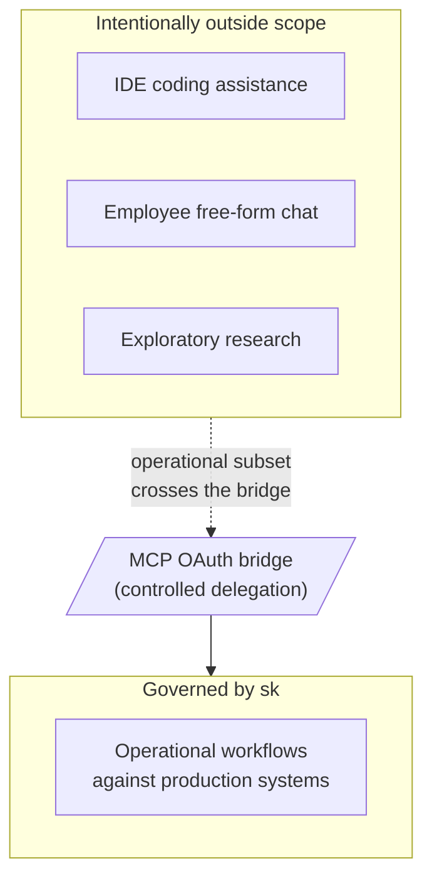
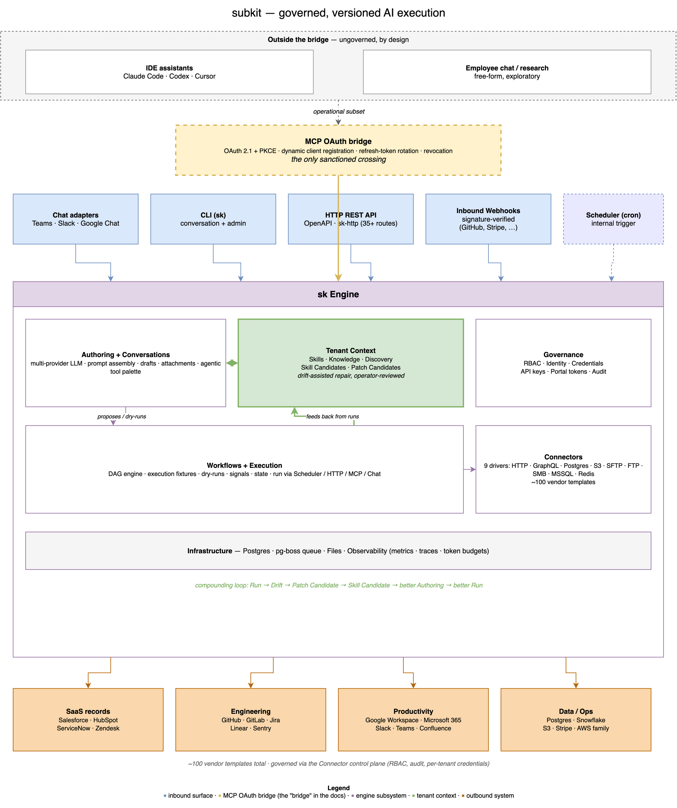
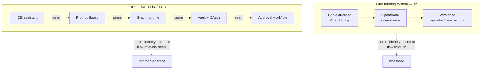
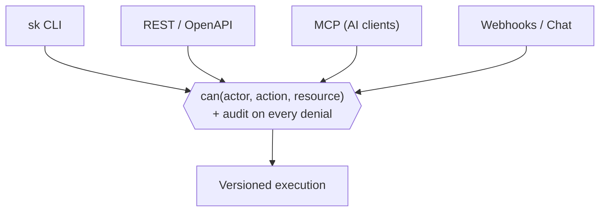
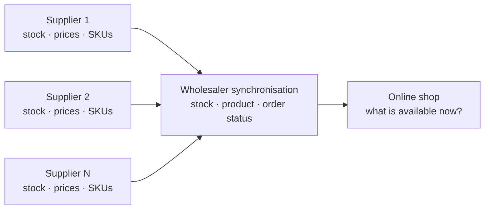

# sk — Operational AI Execution Layer (Positioning)

> **Reading time:** ~20 min
> **Read before:** [the thesis](./thesis.md) and [system requirements](./system-requirements.md)
> **Audience:** CTO, Platform Owner, Buyer-side Architect

---

## 1. Summary

**sk is the operational AI execution layer** — a shared system that turns individual agentic productivity into organisational agentic operationalisation (see the [thesis](./thesis.md) for the platform theory behind that sentence). It is not a chat product, not a replacement for general AI assistants, not a universal AI-governance layer for an entire enterprise. This document positions sk against the [system requirements](./system-requirements.md); any candidate system can be evaluated against the same standard.

The iconic short form, for conversations that need one sentence:

> ***Your operating model used to live in PowerPoint. Now it runs.***

The strategic-management term *operating model* — until now a static description, a deck, a diagram — becomes executable software. The vocabulary triad is intentional: *organisational agentic operationalisation* (theory term), *operational AI execution layer* (market term), **The Operating Model** (iconic short term). See the [glossary](./02-concepts.md#group-0-strategy-vocabulary).

**Scope decision (deliberate, GTM-critical).** sk addresses one sharp slice: the *governed execution of operationalised workflows* against production systems. Free exploration, IDE coding assistance, and employee chat stay outside — they are probabilistic by design and do not need execution governance. sk does *not* eliminate shadow AI; it draws the *operational* subset of AI usage into a governed lane.

*What sk governs (governed operational workflows) vs. what stays outside (free exploration, IDE coding assistance, employee chat). The bridge between them is controlled operational delegation via the MCP OAuth endpoint.*

In one sentence: sk integrates three layers that organisations otherwise have to assemble themselves — **contextualised AI authoring**, **operational governance**, and **versioned, reproducible execution** — into one running system whose effect compounds per tenant over time. Context accumulation and the learning loop are the actual moat.

Two sentences that recur across the [thesis](./thesis.md) and ground this positioning:

- *Enterprise AI does not fail at the models; it fails at the absence of controlled execution.*
- *Once AI touches operational systems, conversation governance is no longer enough.*

The three core ideas — Idea 1 is the master claim, Ideas 2 and 3 are derivations from it (carried from the [thesis](./thesis.md#2-the-three-core-ideas--a-hierarchy-not-three-parallel-claims)):

- **Idea 1 — The Problem (master claim).** Agentic productivity does not automatically scale organisationally.
- **Idea 2 — The Category (follows from Idea 1).** The bottleneck is not intelligence (supplied externally by model vendors) and not workflow execution (supplied by mature platforms) — it is the **mediation of organisation-specific context** to those mature components; operationalisation is the form this mediation takes.
- **Idea 3 — The Moat (follows from Ideas 1 and 2).** The only durable advantage is what compounds locally — organisational context accumulation, not any single feature.

The bold formulation, also carried from the thesis: *the next relevant software layer after SaaS is organisational agentic operationalisation.*

*The full sk architecture. The mermaids in this document zoom into specific aspects — the bridge above, the three-layer integration in §2, the worked examples in §6. Source: [`overview.drawio`](overview.drawio).*

---

## 2. The Core: Contextualised Operational AI Authoring + Governed Execution

*Three integrated layers as a single product, contrasted with a chain of five separate tools whose seams leak audit, identity, and context.*

**What sk does in authoring.** It runs a *contextualised* AI assistant in the authoring phase — technically a domain-specialised "agent harness" in the sense of recent agent literature (the interleaved reasoning + acting pattern of ReAct — Reasoning + Acting — Yao et al. 2023; a means, not the headline). The difference from a generic coding assistant is the **grounding on the tenant**: the assistant decides not from training knowledge alone but from this organisation's own context — conceptually retrieval-augmented generation (RAG, Lewis et al. 2020).

Five context sources ground the assistant — Skills, Knowledge, Connectors, Workflows, Operational feedback. The full specification of why each is required lives in [context as authoring input](./system-requirements.md#r2--context-as-a-first-class-input-to-authoring) (R2):

- **Skills** — operator-approved best practices and failure modes ([definition](./02-concepts.md#group-2-authoring)).
- **Docs and knowledge** — ingested interface specifications, runbooks, policies ([Knowledge Source](./02-concepts.md#group-2-authoring)).
- **Connectors** — governed integrations, not generic HTTP calls ([Connector](./02-concepts.md#group-3-integration)).
- **Workflows** — existing, versioned workflows used as reference cases ([Workflow](./02-concepts.md#group-4-execution)).
- **Operational feedback** — drift-assisted repair suggestions from real runs flowing back into authoring (see [closed learning loop / R5](./system-requirements.md#r5--closed-learning-loop-with-operator-reviewed-remediation)).

The same assistant behaves differently per organisation and per team, because its context is different.

**Why AI-assisted authoring at all? (the honest objection).** A CTO asks, rightly: classical workflow systems are explicit, formal, reviewable — why have an LLM produce operational processes, with implicit decisions and harder-to-validate semantics? The answer is economic, not philosophical:

> ***The bottleneck is not workflow execution. It is the cost, speed, and context depth of workflow creation.***

- **Classical builders, BPMN (Business Process Model and Notation), low-code** push the intent → spec translation onto a human who understands both the builder *and* the target systems. That combination is scarce; it becomes the bottleneck. Maintenance under schema changes binds the same scarce resource.
- **Engineering implementation** is the most rigorous but the slowest and most expensive — every operational request from the business lands in a backlog.
- **Generic copilots** accelerate typing but do not know the org context; they suggest plausible, unverified code.

AI-assisted authoring grounded on tenant context hits the actual bottleneck. But: AI-assisted authoring is *creation help, not the output*. The result is the same explicit, formal, reviewable, versioned workflow artefact a classical workflow system would produce. The probabilistic part is confined to authoring and ends with human approval; AI-assisted authoring does not replace review — it gets faster to the thing that gets reviewed.

**Why "AI-native" — and not just "a copilot for workflows"?** When the runtime is deliberately not intelligent, the fair question is: why does the architecture need to be AI-native at all? Because AI-native here does not mean "a generator bolted on the front". It means a **closed loop**: author → govern → execute → observe drift → propose repair → refine. Three things separate this fundamentally from a copilot sidecar:

- The assistant is contextualised on tenant-specific skills, knowledge, connectors, workflows — a generic copilot is not.
- Drift detection and repair loops feed signals from *production* back into authoring — a one-shot generator does not.
- Tenant context and operational feedback are *continuous, first-class inputs* to authoring — not a code-completion sidecar.

The runtime being non-intelligent is *the point*: it makes execution auditable. The intelligence is concentrated and continuously improving in the authoring/repair loop.

**The irreducible moat.** Not "integration", but the *contextual learning loop*. The [build-it-yourself answer](#3-the-build-it-yourself-question-tool-by-tool) below makes this concrete.

---

## 3. The Build-It-Yourself Question, Tool by Tool

The strongest sceptical attack: *"You are a workflow system with an LLM in front — I can build this from standard parts (a graph runtime + a secret vault + OAuth + an approval workflow)."* The mechanic of sk really is buildable from standard parts. What is not buildable — and not trivially added on — is the actual moat:

- **Organisational context accumulation.** Per tenant, a curated context grows over time: Skills, Knowledge, versioned Workflows as reference cases. The next authoring run is visibly better grounded than the previous one. A self-assembled stack does not have this accumulation as a first-class concept.
- **Drift-assisted remediation as a closed loop.** Schema and behaviour drift detected in production flows back as operator-reviewed Patch and Skill Candidates into authoring. The system learns from *real* production runs rather than generic training knowledge.
- **Reusable patterns and skills**, not ad-hoc knowledge in private chat histories. What worked once becomes visible, curated organisational knowledge inherited by other teams.
- **Compounding.** The model improves because vendors ship better models; the *operating model* improves because the organisation learns. The second part is what the organisation actually controls.

Capability by capability, what the build-it-yourself stack leaves open:

- **Durable-execution engines** solve resilience, not contextualised authoring and not connector/credential governance. Workflows are written there as code by engineers.
- **Agent-graph runtimes** keep the model in the runtime loop; sk takes it out — the execution is a frozen, versioned artefact, which is what the loop is meant to improve over time.
- **A model API plus internal RBAC (Role-Based Access Control)** produces no versioned execution artefact, no audit at the workflow-version level, no connector control plane.
- **A low-code builder bolted to a generic coding assistant** separates authoring (an assistant, without org context) from execution (the builder); grounding and continuous governance across the seam are missing.

The irreducible core is not a single feature; it is the **integration**: contextualised operational AI authoring with end-to-end governed, versioned execution — as one product, not a self-assembled chain of five tools whose seams leak audit, identity, and context.

*Other systems orchestrate tasks; sk accumulates operational context competence that grows with each run.*

---

## 4. Part 1 — The Problem (how sk maps the symptoms)

This is the compressed version; for the deeper framing of *why* ungoverned AI use becomes operational action, see the [Why Now? section](./thesis.md#4-why-now--the-urgency) and the [real-problem-domain section](./thesis.md#3-the-real-problem-domain--solo-leverage-vs-organisational-operationalisation) in the thesis.

The problem is not just account sprawl. Account sprawl is the *visible* symptom of a deeper transition: AI is moving from advice to action (Why Now?), and individual solo productivity does not automatically become organisational operationalisation (the category). Every ungoverned AI usage that touches a production system becomes *operational action* — without approval, without version, without audit. The three symptom axes below are consequences of that one transition, not an independent risk list.

**4.1 Security symptoms.** Uncontrolled data egress into external chat UIs; no who-did-what-when audit trail; credential sprawl across personal configurations; shadow integrations against production systems; identity blurring between what the human did and what AI did in their name; no controlled, versioned execution for operational steps.

**4.2 Cost symptoms.** Licence sprawl (n employees × m tools); no attribution per team / project / workflow; no budgets or quotas; no caching leverage (each account rebuilds context); hidden costs from rework on non-reproducible outputs.

**4.3 Organisational symptoms.** Knowledge trapped in private chat histories; no shared organisational memory; inconsistency at scale; no enforceable governance, approval, or four-eyes review; no central point for on-/offboarding; no tenant model for departments or subsidiaries.

**4.4 Mediation symptoms (the bottleneck the [thesis](./thesis.md#1-summary) names).** Even when the technical layers around an organisation are mature, the organisation-specific context — structure, culture, knowledge, priorities, working procedures — rarely reaches those layers in a form that compounds. The visible consequences:

- Knowledge is distributed across people, servers, and scripts → no organisational memory the next workflow can draw on.
- Integration is island execution that requires deep domain expertise → no onboarding path; the next team starts at zero.
- Documentation drifts; after a while no one understands *why* the script does what it does → no learnable organisational artefact.
- Understanding a third-party API or file format correctly costs developers weeks per integration → no shared context pool that pays this cost only once.
- "Glue-code" is built once and then maintained by whoever happens to be available → no versioned ownership of operational logic.

The structural answer is not to rebuild what mature integration platforms already do well. It is to make organisation-specific context a **first-class authoring input** — the five sources defined by [R2](./system-requirements.md#r2--context-as-a-first-class-input-to-authoring) (Skills, Knowledge, Connectors, Workflows, Operational feedback) feeding every authoring run, every drift repair, every Skill Candidate. The mediation bottleneck dissolves the way every other bottleneck in software dissolved: when the input becomes versioned, inheritable, and reusable rather than re-derived from scratch each time.

**4.5 What enterprise AI accounts already solve — and what stays open.** Honest differentiation: enterprise AI accounts are far beyond "just an account". They provide SSO (Single Sign-On) / SAML (Security Assertion Markup Language), central retention, partial DLP (Data Loss Prevention), audit logs of conversations, admin APIs, data residency, light RBAC, and connector governance.

- **What they solve:** identity and billing — central login, seat management, cost bundling, coarse access control, conversation-grade compliance basics.
- **What they structurally do not solve:** their audit log records what was said to the model, not which workflow version ran with which inputs against which production system, approved by whom. Execution stays agentic. RBAC stays coarse (seat / feature). Connector governance controls access, not the governed, versioned execution against the connected system.

The defensible thesis is therefore not "enterprise AI accounts solve nothing":

> ***Enterprise AI accounts solve identity and billing — but not controlled, versioned execution of operationalised workflows. That is where sk sits.***

---

## 5. Part 2 — Principles and Flows (no feature inventory)

Deliberately not a feature list. Feature lists kill momentum. Three short orientation flows first, then per axis the carrying principles — each with its mechanism in one sentence, cross-referenced to the requirement number from the [system requirements](./system-requirements.md).

**Three orientation flows.**

- **Flow A — From idea to approved workflow.** A user describes the goal in their preferred conversational surface — the sk CLI's conversational REPL with `/`-slashes and `@`-mentions, a chat workspace (Slack / Teams / Google Chat), or an MCP-connected AI client ("on every Stripe `charge.failed`, notify Slack"). The same contextualised authoring loop runs behind all three: it draws on the Stripe skill, the existing Slack connector, and a similar versioned workflow, and proposes a draft. The reviewer sees a structured diff and approves a version — via `/approve` in the CLI REPL, an approve button in chat, or `POST /v1/...` from a script. The probabilistic part ends here.
- **Flow B — External AI client triggering an operational action.** An external MCP-compatible AI client wants to trigger the approved workflow on behalf of a user. It registers dynamically (standard OAuth 2.1, PKCE), receives a tightly scoped, expiring token, and can only trigger this one operational action. Each call is audited; access can be revoked at any moment — instead of a long-lived ungoverned API key in a client config.
- **Flow C — Drift in production, learning back into authoring.** Three weeks later Stripe changes the shape of `charge.failed` responses. Execution detects the drift, does *not* auto-repair, and instead presents the operator with a Patch Candidate including a diff and a dry-run against recorded fixtures. The operator can act on it from any surface they already work in: `sk patch-candidates get <id>` followed by `sk patch-candidates approve` in the terminal, the approve button in a chat notification, or a webhook receiver's own UI. After approval, the new version runs; the insight enters the tenant context as a Skill Candidate inherited by the next workflow that touches the same interface.

*Four entry surfaces, one gate. Same approval logic and same audit trail behind every one. A second entry that bypasses the gate would be a hole in the layer.*

**5.1 Security and governance — principles.**

- **Action-level identity.** Permissions enforced at every entry surface; every denial audited. ([R7](./system-requirements.md#r7--fine-grained-action-level-identity-and-authorisation))
- **Secrets isolation.** AEAD-encrypted (Authenticated Encryption with Associated Data) at rest, cryptographically bound to tenant and record, redacted before persistence, audited on every access. ([R8](./system-requirements.md#r8--secrets-isolation-from-the-ai-context))
- **Delegated AI action.** Scoped, time-bound, revocable, audited (Flow B; the mechanic is standard OAuth 2.1 with dynamic client registration, PKCE, refresh-token rotation, revocation). ([R6](./system-requirements.md#r6--delegated-ai-action-with-scoped-time-bound-revocable-audited-authority))
- **Authoring-vs-execution split.** The approved workflow runs as approved; the control flow is fixed at authoring time and is not re-decided by inference at runtime. Step outputs may vary; the path does not. Every run is recorded as an immutable execution record; rollback by version change. ([R3](./system-requirements.md#r3--separation-of-authoring-probabilistic-from-execution-controlled), [R4](./system-requirements.md#r4--workflow-as-a-versioned-organisational-artefact))
- **Policy before every external call.** Possible via a sandboxed, fail-closed hook for maintenance windows, approval gates, and data-residency rules. State-changing steps run only after explicit approval; Patch Candidates are never auto-applied.
- **Tenant isolation.** Tenant boundary enforced at storage, query, and response layers; covered by regression tests. Structurally enforced, not absolutely guaranteed. ([R9](./system-requirements.md#r9--multi-tenant-isolation-as-a-structural-property))
- **Audit-grade evidence, not compliance.** The append-only action log provides evidence and building blocks for a SOC2 / ISO27001 / GDPR programme; sk is not a compliance solution — compliance requires processes, operations, incident handling, vendor management. ([R11](./system-requirements.md#r11--audit-grade-evidence-not-compliance))

**5.2 Cost — principles.**

- **Cost attribution.** One LLM provider identity per tenant, not n personal keys — costs attributable and cappable. ([R10](./system-requirements.md#r10--cost-attribution-and-per-tenant-budget))
- **Hard per-tenant monthly ceiling.** When the limit is reached, further LLM calls are refused — no end-of-month cost shock. A per-run budget additionally protects against prompt-bloat in a single execution.
- **Invoice-matching ledger.** Every LLM call is booked in an append-only usage ledger (tenant, flow, model, tokens, latency, result). The monthly aggregation is the authoritative billing input, attributable by flow and model — and matches the provider invoice because cache effect is weighted into the bookkeeping.

**5.3 Organisation — principles.**

- **Organisational memory.** Skills (curated best practices, failure modes) and knowledge (runbooks, policies, interface specifications) are visible, searchable, tenant-specific — instead of private chat histories. ([R2](./system-requirements.md#r2--context-as-a-first-class-input-to-authoring))
- **Closed learning loop.** Operational feedback flows back into authoring (Flow C). Drift-assisted repair suggestions are operator-reviewed; no autonomous intervention. Skill Candidates emerge from recurring patterns and are never auto-promoted. ([R5](./system-requirements.md#r5--closed-learning-loop-with-operator-reviewed-remediation))
- **Connectors as a governed integration layer.** Credentials isolated in the vault, versioned integration behaviour with per-endpoint drift detection, one curated, audited integration point instead of scattered shadow integrations. (Honest open enterprise question: depth and SLA for large suites such as SAP / ServiceNow / Workday / Snowflake — see [what sk still lacks](#8-part-3--what-sk-still-lacks-honestly).)
- **One governance gate.** CLI, API, MCP, chat — same approval gate, same audit trail; on-/offboarding in one place. ([R12](./system-requirements.md#r12--multiple-entry-surfaces-one-governance-point))
- **Observability.** Metrics in a standard scrape format, structured JSON logs, per-step execution logs, live-tail of running workflows.

---

## 6. Worked Examples — Two Lifecycles in Detail

Concrete on purpose, so the principles do not stay abstract. Both examples show the full lifecycle: authoring → approval → scoped execution → audit trail → drift detection → reusable learning.

### Example 1 — "Deploy Service X to production"

*Starting point.* A platform team wants to roll the `customer-portal-svc` service automatically to production once QA has signed off. Today: manual runbooks plus a wiki page; the actual rollout is a heroic act.

1. **Authoring (contextualised).** Wherever the platform engineer prefers to think — the sk CLI's conversational REPL, a Slack thread, or an MCP-connected AI client: *"When QA signs off `customer-portal-svc`, roll the image to production — canary 10 %, then 100 %, Slack notify on failure."* In the REPL the engineer can `@workflow:canary-rollout-template` to pin the reference workflow and `@skill:k8s-canary` to pin the relevant skill; in chat the same grounding happens implicitly via the contextualised assistant. The assistant is grounded on the tenant: it uses the team's Kubernetes skill, the existing canary-rollout workflow of the platform team, and the in-house release-policies knowledge (maintenance windows, health-check thresholds). It proposes a workflow draft — not a generic kubectl call, but a sequence that fits the architecture of this house.
2. **Review and approval.** The reviewer sees a structured diff of the control flow: `validate-manifest → preflight → deploy-canary(10 %) → wait_for_event(metrics-ok, 15 min) → ramp(100 %) → notify(slack#deploys)` — plus the referenced skill and knowledge snippets that justify each choice. Approval produces Version 1; the probabilistic part ends here.
3. **Scoped execution.** QA triggers via a signature-verified webhook. The engine assumes the workflow identity, fetches the Kubernetes credential from the vault (time- and scope-bound: only the `customer-portal` namespace, only deployment verbs); the secret never enters the AI context, never enters a log. A before-request hook checks the maintenance window — were it Friday evening, the hook would fail closed.
4. **Audit trail.** Every step writes an immutable line: actor (workflow identity, on behalf of which user), workflow version, inputs, outputs, latency, result. Trace correlation links the QA sign-off webhook, the workflow run, and every Kubernetes call. Result: in a post-mortem one can answer exactly *which version, with which inputs, approved by whom, ran against which cluster*.
5. **Drift detection (weeks later).** Kubernetes deprecates a field used in the manifest; the next rollout fails at `validate-manifest`. The engine detects a schema drift relative to the recorded response shape and runs the bounded repair loop: a repair proposal is classified, a fixture dry-run validates it against recorded responses. Rather than deploying the patch, it is presented as a **Patch Candidate** — no autonomous intervention in production.
6. **Operator approval and learning.** The platform operator sees: the manifest diff, "safe" classification, dry-run green. They approve; Version 1.1 is live. Simultaneously a **Skill Candidate** emerges from the repair ("replace K8s manifest field X by Y"); after operator approval it becomes part of the tenant context. The next deploy workflow that needs the same field semantics — `analytics-svc`, `billing-svc` — inherits the learning automatically at authoring time. Compounding becomes concretely measurable: each drift in one workflow makes the next workflow better.

### Example 2 — "Onboard a new B2B customer" (compact)

Sales closes an enterprise deal in Salesforce. A workflow should automatically create a Stripe customer entity, provision a workspace in the internal tenant system, send a welcome email via SendGrid, and register the customer in the analytics system. *Authoring:* the assistant uses the Salesforce skill, the Stripe skill, the internal tenant-system connector, the SendGrid connector, and the analytics skill — five systems, five authentications, all known from the tenant context. The draft is a declarative sequence with fan-out (parallel calls to independent systems) where possible. *Review:* control-flow visible, versioned, approved. *Execution:* the Salesforce webhook (signature-verified) triggers; each system speaks with its own vault-isolated credentials; partial successes are modelled explicitly (e.g. "Stripe ok, SendGrid down" → compensating retry logic per approved pattern, not ad hoc). *Audit:* who closed which deal, which workflow version was activated, which external calls succeeded or failed — visible in a single trace span. *Drift later:* SendGrid renames a webhook field; drift detected, Patch Candidate, operator approval, Version 2 runs. The repair produces a "SendGrid webhook schema 2026" skill that applies to *all* workflows that talk to SendGrid — not just the onboarding workflow.

**What exists organisationally afterwards** — that would not have existed under solo work: a versioned, reviewable onboarding workflow; isolated, rotatable credentials for five systems; an audit trail giving every onboarding run a reviewable history; a growing catalogue of skills and patterns that lets the next B2B variant (partner onboarding, trial onboarding) cost a fraction of the original.

### Example 3 — Wholesaler data synchronisation (compact)

*Starting point.* A mid-sized wholesaler aggregates stock, product, and order data from N suppliers — each with its own API or file format, each shifting on its own timetable — and exposes a single "what can the customer buy and order today?" view to the online shop. Today: one batch script per supplier, on one server, maintained by one person, breaking whenever a supplier changes a field.

*Authoring:* the operations lead opens the sk CLI's conversational REPL — or the same conversation surface inside Slack; the authoring loop is identical — and pins the relevant context explicitly via `@skill:supplier-pull`, `@connector:supplier-3-sftp`, and `@workflow:supplier-1-sync` as a reference case. The assistant draws on those plus the merge skill that normalises stock/price/SKU records into the canonical shop schema. The draft is a per-supplier parallel fan-out with a deterministic merge, plus a normalisation step per supplier. *Review:* control flow visible, versioned, approved per supplier. *Execution:* each supplier-pull runs against vault-isolated credentials; the merge step is deterministic, so two consecutive runs on identical inputs produce identical outputs. *Audit:* each pulled record is traceable to its supplier, its connector version, and its run. *Drift later:* Supplier 3 renames `sku_external` to `sku`; per-endpoint schema drift fires, the bounded repair loop proposes a Patch Candidate with the field mapping, a fixture dry-run against the last twelve recorded pulls is green, the operator approves; Version 1.1 runs. The "supplier-3 SKU schema 2026" Skill Candidate enters the tenant context — so the *next* supplier the wholesaler adds inherits the lesson at authoring time.

*What this example proves about the thesis.* The mediation bottleneck appears multiple times in this scenario: every supplier ships its own dialect, every supplier moves on its own timetable. Without organisation-specific context shared across all suppliers, each supplier change is a fresh island project. With it, the organisational memory grows with each integration — the next supplier costs less than the previous one. That is the compounding loop made concrete for a mid-market reality, with no hyperscaler assumption.

### Example 4 — Legacy script migration (compact)

*Starting point.* An 800-line Python cron job runs nightly on a VPS owned by one person. Nobody else fully understands the business rules; the README is out of date; the only people who can describe *why* it works are the original author and a contractor who left two years ago. The script is correct often enough that nobody has prioritised replacing it — until the author leaves.

*Authoring:* the source code, the accompanying e-mail thread, the README, and a sample of historical output files are ingested as a Knowledge Source. The controller and a platform engineer open the migration in the sk CLI's conversational REPL — `@knowledge:legacy-reconciler-script`, `@knowledge:legacy-reconciler-emails`, `@knowledge:legacy-reconciler-readme` pin the relevant ingested artefacts directly into the prompt; the same conversation could equally happen in chat. The contextualised assistant extracts intent ("nightly reconcile invoice rows against booking ledger, flag mismatches over EUR 250, e-mail the controller"), proposes a draft workflow expressing the same business rules as declarative steps with named connectors, and surfaces the assumptions it could not resolve from the source as explicit operator questions answered in-place via slash commands. *Review:* the controller and the platform owner see a structured workflow next to the original Python — they review the diff in *semantics*, not in syntax, and approve Version 1. *Execution:* the new workflow runs alongside the old script for a week of shadow runs against the same inputs, with a deterministic diff job comparing the outputs. Once the diff is green, the script is decommissioned and archived as a Knowledge Source for the tenant. *Audit:* every shadow run, every diff result, every approval is recorded — the migration itself becomes a reviewable artefact. *Drift later:* the booking system changes its CSV layout; the connector reports schema drift; a Patch Candidate proposes the mapping; the operator approves it the same hour. The original Python would have produced silently wrong reconciliations until somebody noticed.

*What this example proves about the thesis.* This is the cleanest inversion of the default. Before: a lone script, tribal knowledge, no learning loop, no successor. After: a versioned artefact, a shared context pool, a compounding loop in operation — and a measurable reduction in the kind of integration work that the [thesis numbers](./thesis.md#the-mediation-bottleneck-is-operationally-measurable) describe. If the thesis holds, exactly this kind of migration must be feasible without heroics; this example demonstrates the path.

---

## 7. Part 2b — Structural Changes (sk-specific, not generic outcomes)

This section deliberately avoids the interchangeable enterprise outcomes ("less risk / better scaling / predictable cost") that any vault + RBAC stack could claim. Instead: six structural changes that follow from sk being in place — and that are hard to claim for a self-assembled stack without the integration of authoring + execution + learning loop.

- **The operational workflow becomes, for the first time, a versioned organisational artefact.** Something the organisation *owns* — rollbackable, inheritable, reviewable — not a script in someone's repo, not a Confluence sketch, not "the AI is on it right now". The shift from heroic act to artefact is structural, not gradual.
- **Operational action decouples from individual vigilance.** The same action runs the same defined way on every repetition — at night, on vacation, after the original author's offboarding. Knowledge leaves private chat histories and becomes visible, searchable tenant property.
- **Drift becomes context accumulation, not isolated repair.** Each survived drift sharpens the tenant context (Patch → Skill Candidate) that the next workflow inherits. Maintenance compounds instead of degrading — the compounding loop becomes operational reality.
- **External AI clients become connectable without creating a second governance island.** A coding assistant, a chat connector, an external agent can trigger operational actions through the MCP OAuth endpoint — scoped and audited — no new shadow-integration sprawl, no parallel identity / audit world.
- **Operational AI cost gets a vendor-decoupled structure.** One org identity per provider, one ledger per tenant, one monthly budget — tools can change, prices can shift; the operating model stays, and the cost stays attributable.
- **Onboarding a new team reduces to identity + roles + inherited context.** The team immediately inherits the tenant's skills, workflows, knowledge; it does not build its leverage from an empty repository.

---

## 8. Part 3 — What sk Still Lacks (Honestly)

The most important structural residual first, because it is GTM-critical: **sk does not eliminate shadow AI.** It governs only what flows through its surfaces. What a developer does in an editor-side coding assistant directly in the editor stays outside sk's audit boundary. A reader who expects an all-covering AI governance layer reads the wrong category into this document — the scope decision (operational execution layer, not universal governance layer) is deliberate. The honest answer is a clear category (sk is valuable for the *operational* part) plus the MCP OAuth endpoint that draws the operational portion of external AI clients into the governed lane. A story for raw coding assistance still needs to exist elsewhere in the organisation.

**P0 — critical for the enterprise story (blocks buyers):**

- **Cost / chargeback dashboard.** Budgets, usage ledger, and metrics exist; an operator-facing UI that visualises spend by tenant / workflow / model / team does not — only via external metric stacks today. Without a built-in dashboard, the cost-transparency claim stays weak.
- **Per-user / per-role quotas.** The budget is per-tenant only. No "members at most X runs/day", no "service account 1M tokens/month". Cost control stays coarse.
- **DLP / PII detection.** No built-in policy layer that recognises PII (Personally Identifiable Information) or sensitive fields and blocks them — only via hand-written before-request hooks. A hard blocker in regulated industries.
- **SCIM / automated pro-/deprovisioning.** OIDC (OpenID Connect) login exists; SCIM (System for Cross-domain Identity Management), bidirectional role sync, and automatic offboarding do not.

**P1 — important (trust / compliance gaps):**

- Multi-step approval chains / four-eyes principle: a single human gate today.
- Compliance export templates: audit log is comprehensive; no ready-made SOC2 / HIPAA / PCI export formats.
- Tenant-wide usage reports: no "who runs what, which workflows consume tokens / time" out of the box.
- DR / RTO / RPO (Recovery Time / Point Objective): only database backups documented; no SLA, no geo-redundancy.
- Operational hardening: unexplained memory spikes in production (mitigated, not root-caused) — root cause and capacity model still open.

**P2 — optimisation / differentiation:**

- Cost-based provider routing.
- Custom-driver plugin model.
- Email notifications.
- Tenant-scoped recipe overrides (already on the roadmap).

---

## 9. Verification

A reader can validate this document against the plan and the codebase:

- Every claim in [§4 (problem mapping)](#4-part-1--the-problem-how-sk-maps-the-symptoms) and [§5 (principles and flows)](#5-part-2--principles-and-flows-no-feature-inventory) maps to an R-number from the [system requirements](./system-requirements.md); every R-number traces to a thesis section in the [thesis](./thesis.md).
- The compounding formula appears verbatim, exactly once: **Run → Drift → Patch Candidate → Skill Candidate → Better Authoring → Better Run** (visualised in [the closed learning loop](./system-requirements.md#r5--closed-learning-loop-with-operator-reviewed-remediation)).
- The [central axiom](./02-concepts.md#group-0-strategy-vocabulary) appears verbatim wherever it is cited.
- No implementation details (library names, file paths, branch names, table names, hosting details) appear outside the dual-vocabulary note in the [glossary](./02-concepts.md#group-0-strategy-vocabulary).
- Markdown renders cleanly; all relative-path cross-references resolve.

---

## Further reading

- [thesis](./thesis.md) — why this category exists.
- [system requirements](./system-requirements.md) — what such a system must do.
- [glossary](./02-concepts.md) — every term used here, defined once.
- [platform architecture](./01-platform.md) — developer-side architecture of sk.
- [agents contract](../AGENTS.md) — repository-wide developer contract.

Bibliography is shared with [the thesis sources](./thesis.md#sources).
