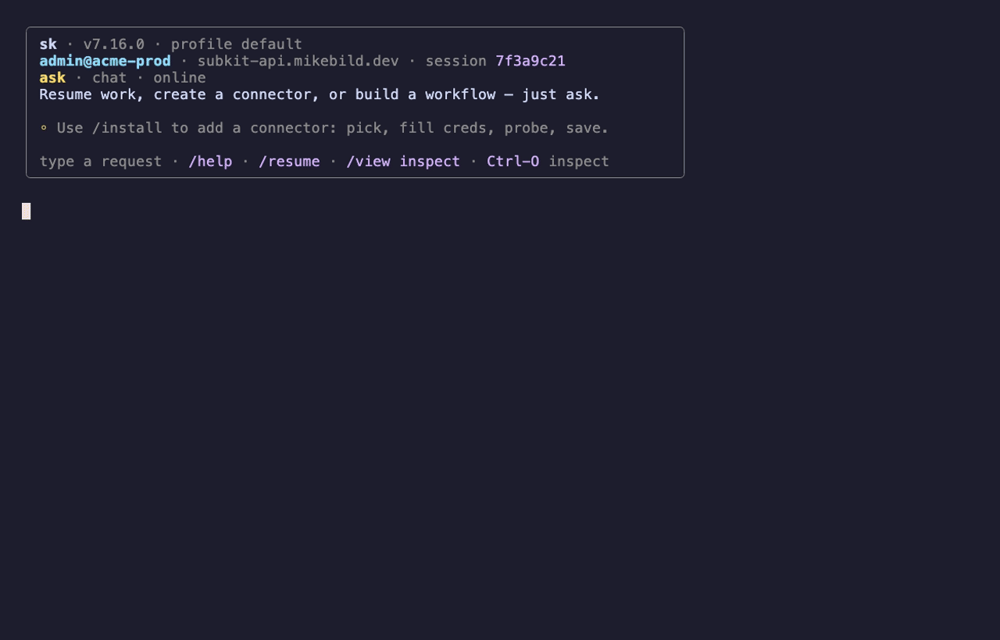

# Start here

sk takes the work your team does the same way every week and runs it for you — reviewed
before it goes live, permission-checked every time, and recorded so you can always show
what happened. This page assumes you know nothing about sk. There is no code on it.

---

## The problem

Every organisation has work that runs the same way every time.

Here is one, told to the end. A new customer pays. Someone notices the payment, copies
the customer into the CRM, and tells the team in chat. Three systems, the same steps,
every time — and when that someone is in a meeting, on holiday, or simply tired, the CRM
is out of date and nobody heard about the sale.

## What sk does

You describe what should happen, in ordinary sentences:

> *"When a new customer pays in Stripe, create the contact in HubSpot and post it to our
> sales channel in Slack."*

sk works out how to do it, shows you what it built, and waits. You look at it. If it is
right, you approve it. From then on, it happens by itself.

That exact process ships in the box as a blueprint (`stripe/new-customer-enrich-notify`),
alongside hundreds of others — and the same shape covers everything from a daily
infrastructure digest to a company knowledge base that answers questions with sources. Real cases, each
traceable to something that ships or something we run ourselves:
[Use cases](use-cases.md).

## Why this is not just automation

A tool that writes an email for you is harmless. A tool that reaches into your real
systems — pays invoices, changes customer records, sends mail in your company's name — is
not.

The useful comparison is a new colleague. They can take a lot of work off your hands. But
you want three questions answered before you hand them the keys:

| The question you'd ask about a new colleague | How sk answers it |
|---|---|
| **What are they even allowed to touch?** | Each process gets exactly the access it needs, and nothing beyond it |
| **Do they check with someone before doing something expensive?** | Before anything is sent, paid, or deleted, the request goes to a person |
| **Can I see afterwards what they did?** | Every run is written down: when, what, with what result, and who approved it |

That last one is the real point. Plenty of tools can automate something. sk automates in a
way you can **account for afterwards** — to your manager, your customer, your auditor.

## The AI builds it. It does not decide while it runs.

This is the part people most often get backwards, so slowly:

**While it is being built**, an assistant helps. It understands your sentence, looks at the
system you are pointing it at, and writes the process down. That is what saves the weeks a
developer used to spend.

**While it runs**, the assistant is out of the loop. A person looked at the finished process
and approved it. From then on, what happens is settled — every Monday, the same thing. The
AI does not reconsider each week what it feels like doing this time.

Why that matters: something that decides freely every time will eventually do something
surprising. For holiday photos, charming. For bank transfers, not.

## Where you do what

sk meets you in several places, and they are not interchangeable. Pick by the job:

| What you want to do | Where |
|---|---|
| Run something and read the result | Your team chat, or a browser AI client |
| Ask how your team normally does something | A coding agent, or a browser AI client |
| Describe a brand-new process for the first time | A conversation — in the terminal or in chat |
| Change one line of a process that already exists | The `sk` command line |
| Go back to an earlier version | The `sk` command line |
| Approve something | The link you were sent, or the command line |
| Connect a new system and enter its credentials | The setup wizard, or the credential page |
| Have something run on a timetable, or when an event fires | A schedule, or a webhook — a URL another system calls when something happens. Nobody has to be present |

The rule underneath all of it: **a chat window runs things; it does not rewrite them.** That
is deliberate. Changing what a process does should pass through something a person can
read. The long version, with worked examples, is
[Choosing your surface](authors/choosing-your-surface.md).

## What you end up with

Three results, not a toolkit:

1. **Your most expensive manual routines run by themselves.** Two to four weeks, and you
   sign off by watching one real run and checking the result.
2. **Your AI experiments become reviewable.** What three people wired together by hand
   becomes one operation your IT leadership will put their name to.
3. **A system stays connected.** When a vendor changes their interface, sk notices and
   suggests the repair, instead of quietly breaking.

## What sk does not do

**It does not move your old data into a new system.** Bulk record migration with
field-by-field reconciliation is a different job and needs different tooling.

**It does not invent work.** If nobody described it and nobody approved it, nothing runs.

## Where to go next

- **You want to try it** → [Self-host quickstart](developers/self-host.md) — from nothing to
  a running engine (the piece of software that does the work) and a first process of your own.
- **Someone already runs sk for you** → [Author quickstart](authors/quickstart.md).
- **You use a coding agent** (Claude Code, Codex, Cursor, …) →
  [Use sk from a coding agent](authors/coding-agents.md).
- **You want the whole map** → [Documentation index](README.md).
- **A word did not make sense** → [Glossary](concepts/glossary.md).
