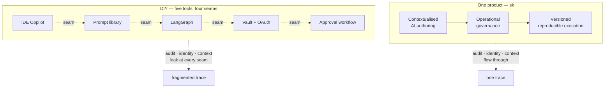
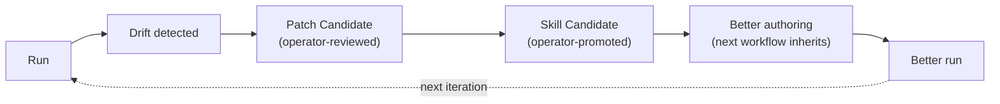

# System Requirements for Organisational Agentic Operationalisation

> **Reading time:** ~18 min
> **Read before:** [the thesis](./thesis.md)
> **Audience:** CTO, Platform Owner, Buyer-side Architect

Use this document to evaluate any candidate system against the same twelve-requirement standard — including a custom build assembled from existing components. Every requirement traces back to a specific section of the [thesis](./thesis.md), and forward to the section of the [positioning](./positioning.md) document that describes how sk realises it.

The market term used throughout for this category is **operational AI execution layer**; the theory term is *organisational agentic operationalisation*. Both are kept; neither is mixed inside a single sentence.

---

## Reading guide

This document has two layers. Strategic compression below for quick reads; full specification further down for implementation work. The two layers say the same thing — the second one shows the work.

*Three integrated layers as one product, contrasted with five separate tools whose seams leak audit, identity, and context. The requirements below describe what each band must provide and where the seams must disappear.*

---

## Strategic compression — the requirements in four clusters

Each cluster is one structural property a candidate system must have. The R-numbers point to the full specification below; the [glossary](./02-concepts.md#requirement-aliases-r1r12) carries one-line aliases for each.

### Cluster A — Shared substrate

> **A candidate system must be one shared layer, not a federation of per-team installs.**

Without a shared execution and review surface, operational experience does not aggregate into organisational memory — only into n parallel personal memories. *Covers [R1](#r1--a-shared-operational-execution-layer). Derives from the [shared-system argument](./thesis.md#7-why-a-shared-system--the-centralisation-argument) in the thesis.*

### Cluster B — Contextual learning core (the moat cluster)

> **A candidate system must ground authoring in accumulated organisational context, produce a versioned operational artefact, and close the loop from production back into authoring.**

This is the moat cluster. Org-curated context is a first-class input to authoring; probabilistic authoring is separated from policy- and version-bound execution; the workflow itself is a versioned organisational artefact; operator-reviewed remediation closes the *Run → Drift → Patch → Skill → Better Authoring → Better Run* loop. Together they make Idea 3 (the moat — context accumulation) operational. *Covers [R2](#r2--context-as-a-first-class-input-to-authoring), [R3](#r3--separation-of-authoring-probabilistic-from-execution-controlled), [R4](#r4--workflow-as-a-versioned-organisational-artefact), [R5](#r5--closed-learning-loop-with-operator-reviewed-remediation).*

### Cluster C — Delegation, identity, secrets, tenant isolation

> **A candidate system must let external AI clients act, but only inside scoped, revocable, audited authority — and must hold secrets and tenants apart from the model.**

External AI clients (coding assistants, chat connectors) trigger operational actions without becoming a parallel governance island. Identity is at the action level, not the seat level. Credentials are AEAD-encrypted at rest, bound to tenant and record, and never enter the model context. Multi-tenant isolation is structural — enforced at storage, query, and response layers, with regression tests. *Covers [R6](#r6--delegated-ai-action-with-scoped-time-bound-revocable-audited-authority), [R7](#r7--fine-grained-action-level-identity-and-authorisation), [R8](#r8--secrets-isolation-from-the-ai-context), [R9](#r9--multi-tenant-isolation-as-a-structural-property).*

### Cluster D — Cost, audit, surfaces

> **A candidate system must make cost attributable per tenant, evidence audit-grade (not compliance itself), and the same governance gate visible from every entry surface.**

Cost is attributable per tenant and per operational flow, with a hard ceiling and provider-invoice-matching ledger. Evidence is sufficient for a compliance programme — without claiming to *be* compliance. The same approval gate and audit trail sit behind every entry surface (CLI, API, MCP, chat). *Covers [R10](#r10--cost-attribution-and-per-tenant-budget), [R11](#r11--audit-grade-evidence-not-compliance), [R12](#r12--multiple-entry-surfaces-one-governance-point).*

### Anti-cluster — what the system is *not* required to do

Explicit non-goals: replace IDE coding assistants; govern all employee AI usage; eliminate shadow AI; be the only AI provider for an organisation. A candidate that *does* claim any of these is making a different strategic bet — see [Anti-requirements](#anti-requirements-what-the-system-is-not-required-to-do) below.

---

## Recap — the three core ideas (verbatim from the thesis)

The three core ideas are a hierarchy, not three parallel claims; the [thesis](./thesis.md#2-the-three-core-ideas--a-hierarchy-not-three-parallel-claims) carries the full derivation.

- **Idea 1 — The Problem (master claim).** Agentic productivity does not automatically scale organisationally.
- **Idea 2 — The Category (follows from Idea 1).** The bottleneck is not intelligence — supplied externally by model vendors — but operationalisation.
- **Idea 3 — The Moat (follows from Ideas 1 and 2).** The only durable advantage is what compounds locally — organisational context accumulation, not any single feature.

The [central axiom](./02-concepts.md#group-0-strategy-vocabulary) compresses Ideas 2 and 3:

> ***The operating model improves because the organisation learns — and that is the part the organisation can actually control.***

---

## Full specification

The twelve requirements in detail, in the order they would naturally be evaluated. Each links back to a thesis section and forward to the positioning section that explains sk's realisation.

### R1 — A shared operational execution layer

*Alias: **shared substrate**.* One organisation, one governance, audit, and version space — not a federation of per-team installs.

Local per-team substrates do not aggregate. Operational learning, audit, and context accumulation only emerge when operational experience becomes visible inside one shared execution and review system. A candidate system must therefore provide *one* governance, audit, and version space — not a federation of per-team installations. Four properties enforce this: visibility across teams, inheritability of skills, reuse of workflows, and audit at the organisation level.

*Derives from* the [shared-system argument](./thesis.md#7-why-a-shared-system--the-centralisation-argument) in the thesis.
*Realised in sk:* see [positioning §1 (scope decision)](./positioning.md#1-summary) and [§2 (the core)](./positioning.md#2-the-core-contextualised-operational-ai-authoring--governed-execution).

---

### R2 — Context as a first-class input to authoring

*Alias: **context as authoring input**.* Five tenant-curated context sources ground every authoring action.

When a model takes over the translation intent → spec, tenant-specific knowledge becomes infrastructure rather than documentation. The system must therefore accept and *accumulate* organisation-curated context as a first-class input to every authoring action.

Five context sources are required:

- **Skills** — operator-approved best practices, integration patterns, and failure modes.
- **Knowledge sources** — runbooks, policies, architecture documents; chunked and searchable per tenant.
- **Integration recipes** — pre-authored, governed integrations against external systems.
- **Prior workflows** — existing, versioned workflows as reference cases the next authoring run can clone or extend.
- **Operational feedback** — drift and repair signals from real production runs flowing back into authoring (see also [R5](#r5--closed-learning-loop-with-operator-reviewed-remediation)).

*Derives from* the [operational-context-as-infrastructure section](./thesis.md#52-operational-context-becomes-a-first-class-infrastructure-resource) in the thesis.
*Realised in sk:* see [positioning §2 (five context sources)](./positioning.md#2-the-core-contextualised-operational-ai-authoring--governed-execution).

---

### R3 — Separation of authoring (probabilistic) from execution (controlled)

*Alias: **authoring-vs-execution split**.* No runtime inference may decide control flow.

The authoring phase may be probabilistic; the execution phase must be policy-bound, version-bound, and reproducibly orchestrated. Step outputs may legitimately vary (external systems return different data; humans pause for decisions); the *path itself* is fixed once approved.

This is the structural answer to the "deterministic" claim that is often overstated: the system as a whole is not deterministic, but the control flow is — and that is what audit and reproducibility require.

*Derives from* the [new-middleware-layer section](./thesis.md#54-a-new-middleware-layer-emerges-historically--not-by-accident) in the thesis.
*Realised in sk:* see [positioning §5 (policy- and version-bound execution)](./positioning.md#5-part-2--principles-and-flows-no-feature-inventory).

---

### R4 — Workflow as a versioned organisational artefact

*Alias: **workflow as artefact**.* Formal, reviewable, diffable, rollbackable.

The authoring output must be a *formal, reviewable, diffable, rollbackable artefact* — an artefact the organisation can own, inherit, audit, and roll back. Not a script in a person's repository, not a wiki page, not a "the AI is handling it right now" answer.

This is the strongest structural change the system enables: operational logic enters the balance sheet of organisational software assets, for the first time at first-class.

*Derives from* [Git for operational organisational logic](./thesis.md#53-operational-knowledge-becomes-accumulable-versionable-inheritable--git-for-operational-organisational-logic) in the thesis.
*Realised in sk:* see [positioning §7 (structural changes)](./positioning.md#7-part-2b--structural-changes-sk-specific-not-generic-outcomes).

---

### R5 — Closed learning loop with operator-reviewed remediation

*Alias: **closed learning loop**.* Drift produces operator-reviewed Patch and Skill Candidates; no autonomous production changes.

Operational drift must produce *operator-reviewed* repair proposals, not autonomous production changes. Repair candidates are bounded, classified, and validated against recorded production fixtures before they are offered for review. The same loop produces reusable skill proposals.

*The compounding loop. Every run makes the next one better — systematically, not dependent on individual vigilance. The formula is the same across all three documents:* **Run → Drift → Patch Candidate → Skill Candidate → Better Authoring → Better Run.**

No autonomous repair in production. The loop runs through a human gate. The *compounding* effect — each run improving the next — is the actual moat.

*Derives from* [Git for operational organisational logic](./thesis.md#53-operational-knowledge-becomes-accumulable-versionable-inheritable--git-for-operational-organisational-logic) and the [four platform effects](./thesis.md#8-four-platform-effects--over-context-not-over-users) in the thesis.
*Realised in sk:* see [positioning §6 (worked example 1, drift stage)](./positioning.md#6-worked-examples--two-lifecycles-in-detail) and [§7 (drift becomes context accumulation)](./positioning.md#7-part-2b--structural-changes-sk-specific-not-generic-outcomes).

---

### R6 — Delegated AI action with scoped, time-bound, revocable, audited authority

*Alias: **delegated AI action**.* External AI clients act through scoped, time-bound, revocable, audited authority.

External AI clients — coding assistants, chat connectors, third-party agents — must be reachable without forming a second governance island. A delegated action is permitted only if it is *scoped* (this user can only trigger these specific operational actions), *time-bound* (the grant expires), *revocable* (it can be withdrawn immediately), and *audited* (every use is recorded).

The market mechanic for this is OAuth 2.1 (Proof Key for Code Exchange — PKCE — by default) with dynamic client registration (DCR, RFC 7591), refresh-token rotation, and revocation; the business meaning is **controlled operational delegation**.

*Derives from* the [Why Now? section](./thesis.md#4-why-now--the-urgency) and the [shared-system argument](./thesis.md#7-why-a-shared-system--the-centralisation-argument) in the thesis.
*Realised in sk:* see [positioning §6 (worked example 2, external trigger)](./positioning.md#6-worked-examples--two-lifecycles-in-detail) and [§5 (controlled operational delegation)](./positioning.md#5-part-2--principles-and-flows-no-feature-inventory).

---

### R7 — Fine-grained, action-level identity and authorisation

*Alias: **action-level identity**.* Authorisation per resource and per action, uniformly across every entry surface.

Authorisation must be expressible per *operational resource* and per *action* (e.g. "can run this workflow", "can rotate that credential"), not just per seat or feature group. The same authorisation model must apply at every entry surface (HTTP, MCP, webhook, CLI), and every denial must produce an audit record.

This is the structural answer to "RBAC light" in conversation-grade enterprise tariffs.

*Derives from* the [Why Now? section](./thesis.md#4-why-now--the-urgency) and the [shared-system argument](./thesis.md#7-why-a-shared-system--the-centralisation-argument) in the thesis.
*Realised in sk:* see [positioning §5 (fine-grained action-level identity)](./positioning.md#5-part-2--principles-and-flows-no-feature-inventory).

---

### R8 — Secrets isolation from the AI context

*Alias: **secrets isolation**.* AEAD-encrypted, tenant-bound, never in the model context, audited on access.

Credentials for external systems must be *authenticated-encrypted at rest* (AEAD) and cryptographically bound to the tenant and the record they belong to, so that a ciphertext lifted from one record cannot be replayed against another. Secrets must never enter the model context, must be redacted before persistence in any log or transcript, must be rotatable, and every access must be audited.

This is non-negotiable: the moment a credential enters a model context, governance is already lost.

*Derives from* the [Why Now? section](./thesis.md#4-why-now--the-urgency) — once AI acts against production systems, secrets must be isolated from the model.
*Realised in sk:* see [positioning §5 (secrets outside the AI context)](./positioning.md#5-part-2--principles-and-flows-no-feature-inventory).

---

### R9 — Multi-tenant isolation as a structural property

*Alias: **tenant isolation**.* Storage, query, response — enforced and regression-tested.

Multi-tenancy must be a structural property, not a configuration mode. Every record carries a tenant boundary; the boundary is enforced at storage, query, and response layers and is covered by regression tests. This is not an absolute guarantee — no isolation claim ever is — but it is structurally enforced, not conventional.

*Derives from* the entire thesis: organisational accumulation only makes sense if each organisation's context stays its own.
*Realised in sk:* see [positioning §5 (layered tenant isolation)](./positioning.md#5-part-2--principles-and-flows-no-feature-inventory).

---

### R10 — Cost attribution and per-tenant budget

*Alias: **cost attribution**.* Per-tenant ceiling, per-flow attribution, invoice-matching usage ledger.

Cost for AI usage must be attributable per tenant and per operational flow, and the system must enforce a hard per-tenant ceiling. Concretely: one provider identity per tenant (not n personal keys), an append-only usage ledger recording each model call (tenant, flow, model, tokens, latency, result), and an effective-cost weighting that matches the actual provider invoice (prompt-cache reads cheaper, cache builds more expensive).

The point is not "cheaper AI"; it is *cost as a tenant-level, vendor-decoupled property*. Tools can change; pricing can change; the operating model stays, and the cost stays attributable.

*Derives from* the [shared-system argument](./thesis.md#7-why-a-shared-system--the-centralisation-argument) in the thesis.
*Realised in sk:* see [positioning §5 (cost principles)](./positioning.md#5-part-2--principles-and-flows-no-feature-inventory).

---

### R11 — Audit-grade evidence (not compliance)

*Alias: **audit-grade evidence**.* Append-only action log sufficient to feed a SOC2 / ISO27001 / GDPR programme — never the compliance programme itself.

The system must produce an *append-only, immutable action log* with enough detail to feed a SOC2 / ISO27001 / GDPR programme: actor, action, timestamp, reason, source address, trace correlation, before/after diff for state changes. Action types must cover operational actions, not only model conversations.

**Explicitly: this is not a compliance solution.** Compliance is achieved by processes, documentation, operations, incident handling, and vendor management — never by architecture alone. A candidate system can provide the *evidence and building blocks* that make a compliance programme tractable; it cannot promise compliance.

*Derives from* the [Why Now? section](./thesis.md#4-why-now--the-urgency) — governance shifts from conversation logs to action artefacts.
*Realised in sk:* see [positioning §5 (traceability, not compliance)](./positioning.md#5-part-2--principles-and-flows-no-feature-inventory).

---

### R12 — Multiple entry surfaces, one governance point

*Alias: **one governance gate**.* Same approval gate and audit trail behind every surface — CLI, API, MCP, chat.

Operators must reach the system from multiple entry surfaces (CLI, REST/MCP, chat) and find the *same* governance gate and the *same* audit trail behind every one of them. A second entry that bypasses the gate is a hole in the layer.

*Derives from* the [shared-system argument](./thesis.md#7-why-a-shared-system--the-centralisation-argument) in the thesis.
*Realised in sk:* see [positioning §5 (multiple surfaces, one governance point)](./positioning.md#5-part-2--principles-and-flows-no-feature-inventory).

---

## Anti-requirements (what the system is *not* required to do)

The category is sharper if its boundaries are explicit:

- **It is not required to replace IDE coding assistants.** Tools such as Claude Code, Codex, and Cursor address a different axis (code authoring in the editor); a useful system on this axis complements them but does not subsume them.
- **It is not required to govern all employee AI usage.** Generic chat, exploratory use, free-form research are intentionally outside scope. They are probabilistic by design.
- **It is not required to eliminate shadow AI.** It is required to provide a *governed lane* for the operational subset that touches production systems; the rest stays free and that is correct.
- **It is not required to be the only AI provider for an organisation.** Foundation models, IDE assistants, chat products, and this layer coexist; the layer adds the operational governance the others cannot provide (see [Why Not Just OpenAI?](./thesis.md#6-why-not-just-openai) in the thesis).

A candidate system that *does* try to subsume any of these is making a different strategic bet and should be evaluated as such — not as a realisation of this category.

---

## Further reading

- [thesis](./thesis.md) — why this category exists.
- [positioning](./positioning.md) — how sk realises it.
- [glossary](./02-concepts.md) — every term used here, defined once.

## Sources

Same bibliography as the [thesis sources](./thesis.md#sources) — research literature (ReAct, RAG, agent surveys) and industry context (MindStudio, GitHub Enterprise AI Controls, VentureBeat, Temporal/LangGraph, Grant Thornton, Lumenova).
